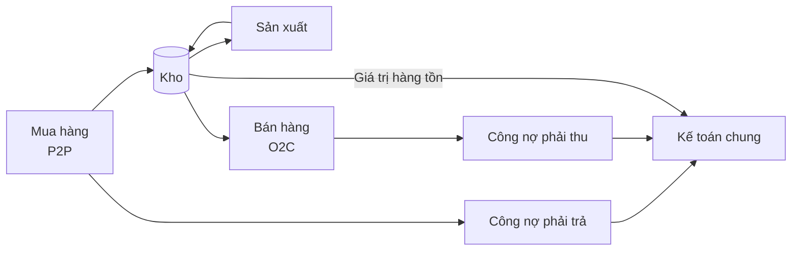

# Cách đọc tài liệu ERP Nghiệp vụ

Tài liệu này viết cho người **làm nghiệp vụ ERP** — dùng SAP, Oracle EBS, Epicor, Odoo hay hệ thống do doanh nghiệp tự xây. Nội dung được tổ chức theo **quy trình vận hành thật**, không theo module phần mềm, vì ngoài đời người ta không "vận hành module" mà vận hành một quy trình đi xuyên nhiều phân hệ.

## Bảy khối tài liệu

| Khối | Nội dung | Khi nào đọc |
|---|---|---|
| **Nền tảng** | Tổ chức, pháp nhân, thuật ngữ, chứng từ, kiểm soát nội bộ, đơn vị tính | Đọc trước tiên, một lần |
| **Kho** | Cấu trúc kho, giao dịch nhập xuất, giữ hàng, kiểm kê, định giá | Khi cần hiểu hàng hóa được ghi nhận thế nào |
| **Mua hàng** | Nhu cầu, chọn nhà cung cấp, đơn mua, nhận hàng, đối soát hóa đơn | Khi làm nghiệp vụ mua |
| **Sản xuất** | Kỹ thuật sản xuất, lệnh sản xuất, dở dang, giá thành | Khi làm nghiệp vụ sản xuất |
| **Bán hàng** | Đơn bán, giao hàng, đổi trả, mô hình bán đặc thù | Khi làm nghiệp vụ bán |
| **Công nợ** | Phải trả, phải thu, đối trừ, tuổi nợ, dòng tiền | Khi làm công nợ |
| **Kế toán chung** | Tài khoản trung gian, giá vốn, thuế, tài sản cố định, sổ cái, đóng kỳ | Khi làm tổng hợp và khóa sổ |

## Mọi thứ nối với nhau theo một dòng

Hàng đi qua kho, tiền đi ngược chiều qua công nợ, và kế toán chung là nơi ghi nhận giá trị của cả hai. Đây là lý do tài liệu không tách rời từng module: hiểu một bước mà không thấy nó nối sang đâu thì không dùng được trong công việc thật.

## Tra cứu theo tình huống

Nếu có câu hỏi cụ thể, đi thẳng tới đây:

| Tình huống | Xem bài |
|---|---|
| Hàng về kho rồi mà hóa đơn chưa về thì ghi thế nào? | Kế toán chung → Hạch toán & tài khoản trung gian |
| Hóa đơn lệch giá hoặc lệch số lượng so với đơn mua | Mua hàng → Đối soát hóa đơn & 3-Way Match |
| Báo cáo tồn kho lệch so với thực tế | Kho → Kiểm kê & điều chỉnh |
| Tồn kho đúng số lượng nhưng lệch tiền so với sổ cái | Kho → Định giá & báo cáo kho |
| Báo cáo số liệu sai dù hệ thống lưu đúng | Nền tảng → Nguyên lý quy đổi đơn vị tính |
| Bán hàng cho khách nhưng hàng giao thẳng từ nhà cung cấp | Bán hàng → Mô hình bán đặc thù |
| Chi phí sản xuất không khớp giá thành | Sản xuất → Giá thành sản xuất |
| Cùng một người vừa tạo đơn vừa duyệt chi tiền | Nền tảng → Kiểm soát nội bộ & phân tách nhiệm vụ |

## Mỗi bài được viết theo cùng một cấu trúc

1. **Nguyên lý** — phần dùng chung cho mọi hệ thống ERP, không phụ thuộc hãng nào.
2. **Luồng vận hành** — sơ đồ để nắm nhanh toàn cảnh.
3. **Ai làm gì ở module nào** — bảng phân vai giữa các bộ phận, đây là phần hay bị bỏ sót khi triển khai.
4. **Hạch toán** — chỉ dẫn tới bài gốc về tài khoản, không định nghĩa trùng.
5. **Điểm chạm & rủi ro** — bài này nối sang bài nào, và sai ở đây thì hỏng cái gì.
6. **Triển khai tham chiếu** — cấu hình và câu truy vấn cụ thể trên Oracle EBS, Epicor, SAP, Odoo. Phần này có thể bỏ qua nếu chỉ cần nghiệp vụ thuần.
7. **Bẫy thực chiến & Checklist** — lỗi đã gặp ngoài thực tế và cách phòng tránh.

## Một nguyên tắc khi đọc

Mỗi khái niệm có **một bài gốc** duy nhất. Gặp lại ở bài khác, bài đó dẫn link tới bài gốc thay vì giải thích lại — giữ được một nguồn sự thật cho mỗi khái niệm.

  <strong>Chúc các bạn thành công và vui vẻ!</strong>

