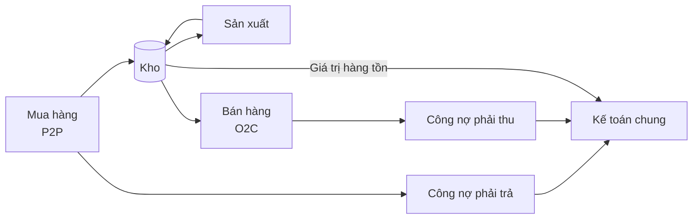

# Cách đọc tài liệu ERP Nghiệp vụ

Tài liệu này dành cho những người cùng làm việc quanh một hệ thống ERP: người dùng nghiệp vụ, phân tích nghiệp vụ (BA), kế toán và lập trình viên. Bạn dùng SAP, Oracle EBS, Epicor, Odoo hay hệ thống doanh nghiệp tự xây đều đọc được. Nội dung đi theo **quy trình vận hành thật**, không theo module phần mềm, vì ngoài đời không ai "vận hành module"; người ta vận hành một quy trình đi xuyên nhiều phân hệ.

## Sáu khối tài liệu

| Khối | Trả lời câu hỏi | Bắt đầu từ |
|---|---|---|
| Nền tảng | Pháp nhân, dữ liệu gốc, chứng từ, kiểm soát nội bộ, thuật ngữ và quy đổi đơn vị | Phần bên dưới |
| Kho | Hàng nằm ở đâu, tồn thay đổi vì sự kiện gì, bán được bao nhiêu, đáng giá bao nhiêu | [Tổng quan Kho](../1-kho/0000-tong-quan-kho.md) |
| Mua hàng | Từ đơn mua tới nhận hàng, kiểm chất lượng và đối soát hóa đơn | [Nhận hàng & kiểm tra chất lượng](../2-mua-hang/2010-nhan-hang-va-kiem-qc.md) |
| Sản xuất | Cấp liệu, lệnh sản xuất, WIP và giá thành | [Lệnh sản xuất & WIP](../3-san-xuat/2000-lenh-san-xuat-va-wip.md) |
| Bán hàng | Từ tiếp nhận đơn, ATP tới giao hàng và các mô hình bán đặc thù | [Tiếp nhận đơn & ATP](../4-ban-hang/2000-tiep-nhan-don-va-atp.md) |
| Kế toán | Hạch toán, giá vốn, đóng kỳ và đối soát sổ phụ | [Hạch toán & tài khoản trung gian](../5-ke-toan/ke-toan-tong-hop/1000-hach-toan-va-tai-khoan-trung-gian.md) |

## Đọc theo vai trò

| Bạn là | Nên đọc trước | Phần đáng chú ý nhất |
|---|---|---|
| Người dùng nghiệp vụ | Nguyên lý, Ai làm gì ở module nào | Bảng phân vai và các bẫy thực chiến |
| BA | Toàn bộ trừ phần triển khai tham chiếu | Luồng vận hành, Hạch toán, Điểm chạm |
| Kế toán | Hạch toán, Điểm chạm & rủi ro | Phần đối chiếu sổ phụ với sổ cái |
| Lập trình viên | Triển khai tham chiếu, Bẫy thực chiến | Mô hình dữ liệu, ràng buộc và truy vấn kiểm soát |

## Khối Nền tảng gồm ba nhóm

### 🟢 I. Tổ chức & Dữ liệu gốc (Organization & Master Data)

*Mục đích: Xác lập nền móng pháp lý và dữ liệu không bao giờ được sửa sai — trước khi nhập bất kỳ giao dịch nào.*

- **[1000 Tổ chức & Pháp nhân (Legal Entity / Ledger)](./1000-to-chuc-va-phap-nhan.md)** — Pháp nhân, sổ kế toán, đơn vị hạch toán và ranh giới báo cáo.
- **[1010 Master Data & tính bất biến](./1010-master-data-va-tinh-bat-bien.md)** — Vì sao mã hàng, mã đối tác, đơn vị tính đã dùng thì không được sửa.

### 🟡 II. Chứng từ & Kiểm soát nội bộ (Documents & Internal Control)

*Mục đích: Cách ghi nhận việc đã xảy ra, và cách tách quyền để không ai tự làm tự duyệt.*

- **[2000 Chứng từ & nguyên lý đối soát](./2000-chung-tu-va-nguyen-ly-doi-soat.md)** — Chứng từ gốc, đối tượng đối soát, và vì sao sổ phải khớp chứng từ.
- **[2010 Kiểm soát nội bộ & phân tách nhiệm vụ](./2010-kiem-soat-noi-bo-va-phan-tach-nhiem-vu.md)** — Tạo – duyệt – ghi sổ phải do ba người khác nhau.

### 🔴 III. Thuật ngữ & Quy đổi (Glossary & UOM)

*Mục đích: Thống nhất ngôn ngữ giữa các hệ thống và xử lý đơn vị tính — nguồn gốc của nhiều sai số báo cáo.*

- **[3000 Glossary & ánh xạ thuật ngữ](./3000-glossary-va-anh-xa-he-thong.md)** — Cùng một khái niệm, mỗi hãng ERP gọi một kiểu.
- **[3010 Thuật ngữ kỹ thuật & dữ liệu chuẩn](./3010-thuat-ngu-ky-thuat-va-du-lieu.md)** — Từ điển thuật ngữ dùng xuyên suốt tài liệu.
- **[3020 Nguyên lý quy đổi đơn vị tính (UOM)](./3020-nguyen-ly-quy-doi-uom.md)** — Vì sao báo cáo sai dù hệ thống lưu đúng.

## Mọi thứ nối với nhau theo một dòng

Hàng đi qua kho, tiền đi ngược chiều qua công nợ, và khối kế toán là nơi ghi nhận giá trị của cả hai. Vì vậy một bước nghiệp vụ chỉ có ý nghĩa khi bạn biết nó nối sang đâu; các bài đều có mục "Điểm chạm" để chỉ rõ điều đó.

## Tra cứu theo tình huống

Nếu bạn đang gặp một vấn đề cụ thể, đi thẳng tới bài tương ứng:

| Tình huống | Xem bài |
|---|---|
| Hàng về kho rồi mà hóa đơn chưa về thì ghi thế nào? | [Kế toán: Hạch toán & tài khoản trung gian](../5-ke-toan/ke-toan-tong-hop/1000-hach-toan-va-tai-khoan-trung-gian.md) |
| Hóa đơn lệch giá hoặc lệch số lượng so với đơn mua | [Mua hàng: Đối soát hóa đơn & 3-Way Match](../2-mua-hang/2020-doi-soat-hoa-don-va-3-way-match.md) |
| Hàng đã về cổng nhưng chưa dùng được, đang chờ kiểm chất lượng | [Mua hàng: Nhận hàng & kiểm tra chất lượng](../2-mua-hang/2010-nhan-hang-va-kiem-qc.md) |
| Báo cáo tồn kho lệch so với thực tế | [Kho: Kiểm kê & điều chỉnh](../1-kho/3000-kiem-ke-va-dieu-chinh.md) |
| Tồn kho bị âm | [Kho: Kiểm kê & điều chỉnh](../1-kho/3000-kiem-ke-va-dieu-chinh.md), mục Chính sách âm kho |
| Còn hàng trong kho nhưng hệ thống báo hết, hoặc bán quá số hàng đang có | [Kho: Giữ hàng, phân bổ & ATP](../1-kho/2010-giu-hang-phan-bo-va-atp.md) |
| Muốn sửa số tồn kho cho đúng | [Kho: Giao dịch nhập, xuất & chuyển](../1-kho/2000-giao-dich-nhap-xuat-chuyen.md) |
| Tồn kho đúng số lượng nhưng lệch tiền so với sổ cái | [Kho: Định giá & báo cáo kho](../1-kho/3010-dinh-gia-va-bao-cao-kho.md) |
| Báo cáo số liệu sai dù hệ thống lưu đúng | [Nền tảng: Nguyên lý quy đổi đơn vị tính (UOM)](./3020-nguyen-ly-quy-doi-uom.md) |
| Bán hàng cho khách nhưng hàng giao thẳng từ nhà cung cấp | [Bán hàng: Mô hình bán đặc thù](../4-ban-hang/2030-mo-hinh-ban-dac-thu.md) |
| Chi phí sản xuất không khớp giá thành | [Sản xuất: Giá thành sản xuất](../3-san-xuat/2020-gia-thanh-san-xuat.md) |
| Cùng một người vừa tạo đơn vừa duyệt chi tiền | [Nền tảng: Kiểm soát nội bộ & phân tách nhiệm vụ](./2010-kiem-soat-noi-bo-va-phan-tach-nhiem-vu.md) |

## Mỗi bài đọc theo cùng một thứ tự

1. **Nguyên lý** — những điều đúng với mọi hệ thống ERP, không phụ thuộc hãng nào.
2. **Luồng vận hành** — sơ đồ để nắm nhanh toàn cảnh.
3. **Ai làm gì ở module nào** — bảng phân vai giữa các bộ phận; đây là phần dễ bị bỏ sót nhất khi triển khai.
4. **Hạch toán** — bút toán phát sinh nhìn từ phía nghiệp vụ, kèm đường dẫn tới bài kế toán có bản đồ tài khoản đầy đủ.
5. **Điểm chạm & rủi ro** — bài này nối sang bài nào, và sai ở đây thì hỏng cái gì.
6. **Triển khai tham chiếu** — cấu hình và câu truy vấn cụ thể trên Oracle EBS, Epicor, SAP, Odoo.
7. **Bẫy thực chiến & Checklist** — những lỗi hay gặp ngoài thực tế và cách phòng tránh.
8. **Xem thêm** — các bài liên quan để đọc tiếp.

## Cách đọc phần triển khai tham chiếu

- **Ô đánh dấu `*`** là chỗ chưa được xác minh trên hệ thống thật. Tên bảng, tên cột và tên màn hình thay đổi theo phiên bản và cấu hình của từng doanh nghiệp, nên hãy đối chiếu trước khi đưa vào thiết kế.
- **Phần Epicor** tham chiếu bản Epicor ERP 10.2 (E10.2). Các bản Kinetic mới hơn có thể khác.
- **Bảng và truy vấn "hệ thống tự xây"** dùng lược đồ giả định để minh họa logic. Với Oracle, SAP, Epicor, hãy ưu tiên báo cáo chuẩn của hệ thống, hoặc áp cùng logic lên bảng của chính hệ thống đó.
- **Nếu bạn chỉ cần nắm nghiệp vụ**, có thể bỏ qua phần này.

## Khi gặp một khái niệm quen

Mỗi khái niệm được giải thích đầy đủ ở một bài; khi nó xuất hiện ở bài khác, bạn sẽ thấy một đường dẫn về bài đó. Muốn hiểu sâu, hãy theo đường dẫn thay vì đoán. Ví dụ: cơ chế ghi giao dịch kho nằm ở [Giao dịch nhập, xuất & chuyển](../1-kho/2000-giao-dich-nhap-xuat-chuyen.md); các bài Mua hàng, Bán hàng, Sản xuất chỉ mô tả sự kiện dẫn tới giao dịch đó.

  <strong>Chúc các bạn thành công và vui vẻ!</strong>

