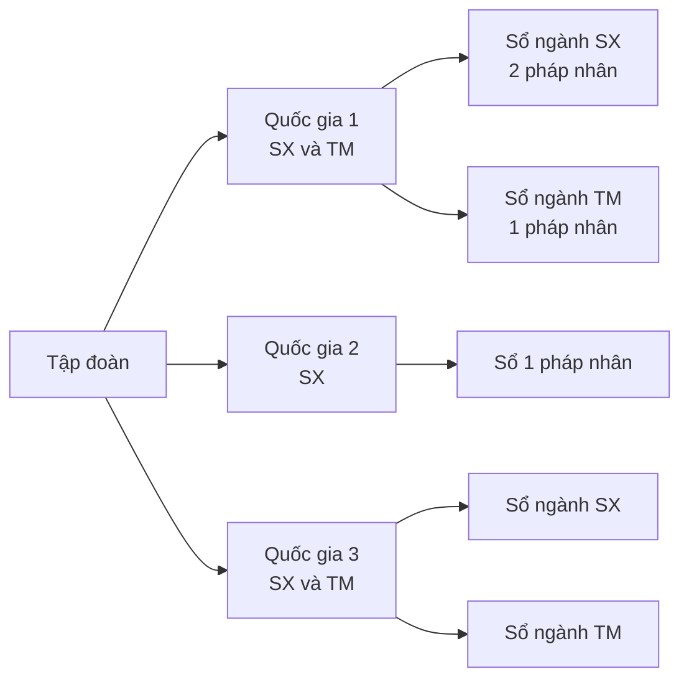
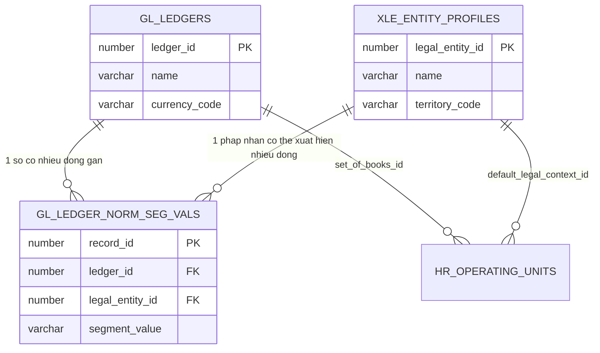

# 2000 Tổ chức & Pháp nhân (Legal Entity / Ledger)

Quyết định **đầu tiên và quan trọng nhất** khi triển khai phân hệ tài chính cho một tập đoàn nhiều pháp nhân: mỗi công ty con có **sổ sách kế toán riêng biệt**, hay nhiều công ty **dùng chung một sổ**, phân biệt bằng một mã số?

Đổi kiến trúc sau khi đã có giao dịch thực tế là việc cực kỳ tốn kém — đòi hỏi migrate toàn bộ dữ liệu lịch sử. Vì vậy phải chốt **trước khi thiết kế Hệ thống tài khoản**.

## 0. Nguyên lý (áp dụng mọi ERP)

1. **Đây không phải một câu hỏi duy nhất cho cả tập đoàn, mà là câu hỏi lặp lại ở từng nhóm.** Tổ chức đa quốc gia có nhiều lớp phân cấp hơn người mới triển khai thường hình dung.
2. **Ba cấp cơ bản:** Tập đoàn (chỉ tồn tại trên báo cáo hợp nhất, không phát sinh giao dịch) → Quốc gia (currency, calendar, chuẩn mực kế toán) → Pháp nhân (nơi giao dịch thực sự phát sinh).
3. **Giữa các quốc gia: luôn tách riêng.** Câu hỏi "tách hay gộp" chỉ có ý nghĩa giữa các pháp nhân **trong cùng một quốc gia**.
4. **Gộp được chỉ khi thoả cả bốn điều kiện:** cùng đồng tiền, cùng lịch kế toán, cùng cấu trúc Hệ thống tài khoản, và cùng ngành nghề kinh doanh.
5. **Ranh giới ngành thể hiện qua việc gán pháp nhân vào sổ nào**, không cần cột dữ liệu đánh dấu ngành.
6. **Tầng kế toán và tầng vận hành độc lập nhau.** Gộp sổ ở tầng kế toán không làm mất khả năng tách dữ liệu giao dịch hằng ngày ở tầng vận hành.

## 1. Luồng vận hành



## 2. Ai làm gì ở module nào

| Việc | Ban điều hành | Kế toán trưởng | IT / Triển khai | Kiểm toán |
|---|---|---|---|---|
| Chốt cấu trúc pháp nhân | ✅ duyệt | ✅ đề xuất | Cung cấp năng lực hệ thống | Tư vấn |
| Quyết định tách/gộp sổ | ✅ duyệt | ✅ sở hữu | Đánh giá hệ quả kỹ thuật | ✅ rà soát |
| Thiết kế Hệ thống tài khoản | — | ✅ sở hữu | Cấu hình | ✅ rà soát |
| Phân quyền theo pháp nhân | — | ✅ duyệt | ✅ thực hiện | Kiểm tra |
| Chốt nhu cầu báo cáo hợp nhất | ✅ quyết định | ✅ cung cấp | Đánh giá công cụ | ✅ rà soát |

## 3. Hạch toán

Cấu trúc pháp nhân quyết định **sổ nào ghi bút toán nào**, nhưng không đổi bản chất bút toán.

**Công thức số sổ cái cần thiết** — với một nhóm gồm N pháp nhân đã thoả cả bốn điều kiện:

| Lựa chọn | Số sổ cần thiết | Cách phân biệt dữ liệu |
|---|---|---|
| **A — Tách riêng** | **N sổ** (1 sổ / 1 pháp nhân) | Mỗi sổ độc lập hoàn toàn |
| **B — Gộp chung** | **1 sổ** | N mã pháp nhân khác nhau trong cùng một sổ |

Nếu tập đoàn có nhiều nhóm đồng nhất, tổng số sổ = tổng từng nhóm — mỗi nhóm chọn A hoặc B độc lập.

## 4. Điểm chạm & rủi ro

- **Hệ thống tài khoản dùng chung**: [Hạch toán & tài khoản trung gian](../6-ke-toan-chung/1000-hach-toan-va-tai-khoan-trung-gian.md)
- **Sổ cái và hợp nhất báo cáo**: [Sổ cái & báo cáo tài chính](../6-ke-toan-chung/4000-so-cai-va-bao-cao-tai-chinh.md)
- **Giao dịch nội bộ giữa pháp nhân**: [Đối trừ công nợ, netting & đa tiền tệ](../5-cong-no/8000-cong-no-doi-tru-netting-va-tien-te.md)
- **Mua/bán nội bộ**: [Mô hình mua đặc thù](../2-mua-hang/6000-mo-hinh-mua-dac-thu.md), [Mô hình bán đặc thù](../4-ban-hang/5000-mo-hinh-ban-dac-thu.md)
- **Phân quyền theo pháp nhân**: [Kiểm soát nội bộ & phân tách nhiệm vụ](./5000-kiem-soat-noi-bo-va-phan-tach-nhiem-vu.md)

**Rủi ro chính:**

- **Gộp sổ khi hai pháp nhân khác ngành** — báo cáo quản trị không đọc được, phải tách lại sau khi đã có giao dịch.
- **Chọn nhầm mã pháp nhân khi hạch toán** — đặc biệt nguy hiểm với hệ thống nhúng pháp nhân vào chuỗi tài khoản.
- **Gộp sổ cho hai pháp nhân khác đồng tiền** — không thể, vì mỗi sổ chỉ có một đồng tiền chức năng.
- **Gộp sổ cho hai pháp nhân khác lịch kế toán** — đóng/mở kỳ phải đồng thời, không thể tách.

## 5. Triển khai tham chiếu ERP

### A. Ánh xạ khái niệm

| Khái niệm | SAP S/4HANA | Oracle EBS | Epicor | Odoo |
|---|---|---|---|---|
| Đơn vị pháp lý | Company Code | Legal Entity | Company | `res.company` |
| Nơi chứa giao dịch | Ledger (bảng `ACDOCA`) | Ledger | Book | Dữ liệu chung một database |
| Mã phân biệt công ty trong 1 sổ | Company Code (field riêng) | Balancing Segment Value | Không có tương đương trực tiếp | `company_id` (field riêng) |

**Ba khác biệt kiến trúc quan trọng:**

- **SAP vốn đã "gộp" theo mặc định.** Leading Ledger (`0L`) được gán cho **tất cả** Company Code ngay từ đầu. Tạo thêm Non-Leading Ledger để **báo cáo song song theo nhiều chuẩn mực** (Local GAAP / IFRS), không phải để tách/gộp pháp nhân.
- **Odoo** gắn `company_id` trên hầu hết bảng giao dịch — tách dữ liệu ở tầng field, tương tự Company Code của SAP, nhưng đơn giản hơn vì không có khái niệm Ledger tách biệt.
- **Oracle EBS** nhúng pháp nhân vào **chuỗi tài khoản** qua Balancing Segment. Vừa linh hoạt hơn (chủ động chọn gộp/tách) vừa rủi ro hơn khi gộp, vì mã công ty chỉ là một đoạn trong dãy số chứ không phải field tách biệt.

### B. Ví dụ tính số sổ cái cần thiết

Tập đoàn hoạt động 2 ngành — Sản xuất (SX) và Thương mại (TM) — tại 3 quốc gia, 6 pháp nhân:

| Quốc gia | Pháp nhân ngành SX | Pháp nhân ngành TM |
|---|---|---|
| Quốc gia 1 | SX-1, SX-2 | TM-1 |
| Quốc gia 2 | SX-1 | — |
| Quốc gia 3 | SX-1 | TM-1 |

| Nhóm đồng nhất | Số pháp nhân | Lựa chọn | Số sổ |
|---|---|---|---|
| Quốc gia 1 — ngành SX | 2 | B (gộp) | 1 |
| Quốc gia 1 — ngành TM | 1 | (chỉ có 1) | 1 |
| Quốc gia 2 — ngành SX | 1 | (chỉ có 1) | 1 |
| Quốc gia 3 — ngành SX | 1 | (chỉ có 1) | 1 |
| Quốc gia 3 — ngành TM | 1 | (chỉ có 1) | 1 |
| **Tổng** | **6 pháp nhân** | | **5 sổ** |

Nhờ gộp 2 pháp nhân cùng ngành SX ở Quốc gia 1, giảm từ 6 xuống **5 sổ**.

**Hệ quả theo từng hệ thống:**

- **Oracle EBS:** tạo đúng 5 sổ. Sổ "SX — Quốc gia 1" thực hiện **Add Legal Entity hai lần**, mỗi lần gán một Balancing Segment Value khác nhau. Bốn sổ còn lại mỗi sổ Add đúng một Legal Entity.
- **Epicor:** không có cơ chế tương đương Lựa chọn B, nên **bắt buộc tạo đủ 6 Company** — muốn xem báo cáo gộp phải qua **Consolidated Company** ở tầng báo cáo. Đây là khác biệt kiến trúc lớn nhất giữa hai hệ thống.

### C. Oracle EBS — cấu trúc bảng và kiểm tra hiện trạng

| Bảng | Vai trò |
|---|---|
| `gl_ledgers` | Thông tin bản thân sổ cái |
| `xle_entity_profiles` | Thông tin pháp nhân, cột `territory_code` xác định quốc gia |
| `gl_ledger_norm_seg_vals` | Bảng trung gian — mỗi dòng là một cặp gán Sổ + Pháp nhân + Giá trị Balancing Segment |
| `hr_operating_units` | Đơn vị vận hành (AP/AR/PO), gắn cố định một sổ và một pháp nhân mặc định |



```sql
-- Kiểm tra hiện trạng: mỗi quốc gia đang có bao nhiêu pháp nhân trong từng sổ
SELECT le.territory_code                      AS quoc_gia,
       gbsv.ledger_id,
       COUNT(DISTINCT gbsv.segment_value)     AS so_phap_nhan_trong_so
FROM   gl_ledger_norm_seg_vals gbsv
JOIN   xle_entity_profiles le ON le.legal_entity_id = gbsv.legal_entity_id
GROUP  BY le.territory_code, gbsv.ledger_id
ORDER  BY quoc_gia, gbsv.ledger_id;
```

**Operating Unit độc lập với quyết định A/B ở tầng sổ.** Dù chọn gộp hay tách, mỗi pháp nhân **vẫn có Operating Unit riêng** — hóa đơn AP/AR của pháp nhân này vẫn tách bạch hoàn toàn qua `ORG_ID`. Gộp sổ chỉ giảm số "cuốn sổ cái" cần quản lý ở tầng kế toán tổng hợp, còn tầng vận hành hằng ngày (nhập hóa đơn, đơn hàng) vẫn tách theo OU.

### D. Epicor — Company đảm nhiệm cả hai vai trò

Trong Epicor, **Company** là ranh giới phân tách cao nhất và đảm nhiệm **vừa là sổ cái (tầng kế toán) vừa là đơn vị vận hành (tầng nghiệp vụ)** cùng lúc. Đây là lý do Epicor không thể "gộp sổ nhưng vẫn tách OU" như Oracle: mọi thay đổi ảnh hưởng cả hai tầng ngay lập tức.

**Multiple Books** là trục khác — cho **một Company** ghi đồng thời vào nhiều sổ song song (Corporate Book / Statutory Book), dùng để báo cáo theo nhiều chuẩn mực, **không phải** cơ chế gộp nhiều pháp nhân.

## 6. Bẫy thực chiến & Checklist

| # | Bẫy | Triệu chứng | Cách phòng tránh |
|---|---|---|---|
| 1 | Gộp sổ cho hai pháp nhân khác ngành | Báo cáo quản trị không đọc được, phải tách lại | Kiểm tra tiêu chí ngành trước khi gộp |
| 2 | Gộp sổ cho hai pháp nhân khác đồng tiền | Không thực hiện được, hoặc phải quy đổi sai | Mỗi sổ chỉ một đồng tiền chức năng |
| 3 | Gộp sổ cho hai pháp nhân khác lịch kế toán | Không thể đóng/mở kỳ độc lập | Cùng calendar là điều kiện bắt buộc |
| 4 | Chọn nhầm mã pháp nhân khi hạch toán | Bút toán sang sổ khác, sửa rất khó | Phân quyền theo vai trò + giá trị mặc định theo user |
| 5 | Không có Cross-Validation Rule | Tổ hợp pháp nhân + tài khoản không hợp lý vẫn lưu được | Cấu hình validation ở tầng dữ liệu |
| 6 | Tưởng gộp sổ làm mất tách dữ liệu vận hành | Do dự không dám gộp dù đủ điều kiện | Operating Unit vẫn tách riêng, độc lập với sổ |
| 7 | Dùng Non-Leading Ledger để tách pháp nhân | Hiểu sai mục đích, cấu hình sai | Sổ song song là để báo cáo đa chuẩn mực |
| 8 | Không chốt trước khi thiết kế tài khoản | Đổi kiến trúc sau khi có giao dịch, phải migrate | Chốt cấu trúc pháp nhân trước Hệ thống tài khoản |
| 9 | Không xác nhận nhu cầu hợp nhất | Cấu trúc phục vụ báo cáo đơn lẻ, không hợp nhất được | Hỏi rõ đội kế toán và kiểm toán từng ngành/quốc gia |

**Checklist trước khi setup:**

- [ ] Đã vẽ sơ đồ phân cấp: Tập đoàn → Quốc gia → Ngành → Pháp nhân.
- [ ] Đã xác nhận: giữa các quốc gia luôn tách riêng.
- [ ] Với mỗi nhóm cùng quốc gia: đã kiểm tra thêm tiêu chí cùng ngành.
- [ ] Chỉ pháp nhân thoả **cả bốn điều kiện** mới vào diện gộp.
- [ ] Đã tính số sổ cần thiết theo công thức ở §3.
- [ ] Nếu gộp: đã thiết kế Cross-Validation Rule + phân quyền riêng từng pháp nhân.
- [ ] Đã xác nhận mỗi pháp nhân vẫn có đơn vị vận hành riêng.
- [ ] Đã xác nhận nhu cầu báo cáo hợp nhất với kế toán/kiểm toán từng quốc gia.

## Xem thêm

- [Cách đọc tài liệu](./0000-cach-doc-tai-lieu.md)
- [Kiểm soát nội bộ & phân tách nhiệm vụ](./5000-kiem-soat-noi-bo-va-phan-tach-nhiem-vu.md)
- [Sổ cái & báo cáo tài chính](../6-ke-toan-chung/4000-so-cai-va-bao-cao-tai-chinh.md)
- [Đối trừ công nợ, netting & đa tiền tệ](../5-cong-no/8000-cong-no-doi-tru-netting-va-tien-te.md)

<div align="center" style={{color: 'var(--ifm-color-primary)'}}>
  <strong>Chúc các bạn thành công và vui vẻ!</strong>
</div>