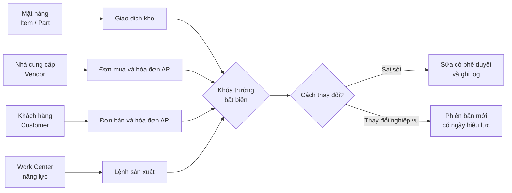

# Master Data & tính bất biến

Trước khi có bất kỳ giao dịch nào, hệ thống phải biết **những thứ gì tồn tại**. Đó là dữ liệu nền. Và điểm quan trọng nhất của dữ liệu nền: **một khi đã phát sinh giao dịch, nhiều trường không được phép đổi nữa**.

Sửa dữ liệu nền sau khi đã có giao dịch không phải là "cập nhật danh mục" — nó làm cho toàn bộ lịch sử mang nghĩa khác, và không có báo cáo nào sửa được điều đó.

## Nguyên lý (áp dụng mọi ERP)

1. **Dữ liệu nền là hợp đồng với quá khứ.** Một mã hàng đã có 100 giao dịch, đổi đơn vị tính gốc sẽ khiến 100 giao dịch đó bị hiểu sai — không phải sai số, mà sai bản chất.
2. **Có bốn danh mục nền bắt buộc:** mặt hàng, nhà cung cấp, khách hàng, và đơn vị năng lực (work center). Thiếu một cái thì quy trình tương ứng không chạy được.
3. **Chống trùng quan trọng hơn đầy đủ.** Một danh mục thiếu vài trường dùng được; một danh mục có hai mã cho cùng một thực thể thì mọi báo cáo tổng hợp đều sai.
4. **Trường bất biến phải khóa ở cả tầng ứng dụng lẫn tầng dữ liệu.** Chỉ ẩn trên giao diện thì vẫn sửa được bằng import, API hoặc script.
5. **Thay đổi hợp lệ phải tạo phiên bản mới có ngày hiệu lực**, không sửa đè giá trị cũ.
6. **Dữ liệu nền cần một chủ sở hữu.** Không ai sở hữu thì mỗi bộ phận tự tạo mã riêng, và danh mục phình gấp nhiều lần thực tế.

## 1. Luồng vận hành



## 2. Ai làm gì ở module nào

| Danh mục | Chủ sở hữu | Đồng duyệt | Được dùng bởi |
|---|---|---|---|
| Mặt hàng | Kho (thuộc tính kho) | Kỹ thuật (thuộc tính kỹ thuật), Kế toán (nhóm tài khoản) | Mua, bán, sản xuất, kế toán |
| Nhà cung cấp | Mua hàng | Kế toán (mã số thuế, tài khoản ngân hàng) | Mua hàng, AP |
| Khách hàng | Bán hàng | Kế toán (hạn mức, mã số thuế) | Bán hàng, AR |
| Work center | Sản xuất | Kế toán (trung tâm chi phí) | Sản xuất, giá thành |

**Ranh giới cốt lõi:** người **tạo** danh mục không được là người **duyệt** các trường tài chính của danh mục đó. Đây là khe hở gian lận phổ biến nhất ở dữ liệu nền.

## 3. Hạch toán

Dữ liệu nền không sinh bút toán, nhưng quyết định bút toán:

- **Nhóm hàng** quyết định tài khoản tồn kho.
- **Đơn vị tính gốc** quyết định đơn giá lưu trên sổ kho.
- **Hồ sơ nhà cung cấp / khách hàng** quyết định tài khoản công nợ và điều khoản thanh toán.
- **Work center** quyết định đơn giá giờ máy, giờ công.

Bản đồ tài khoản ở [Hạch toán & tài khoản trung gian](../5-ke-toan/ke-toan-tong-hop/1000-hach-toan-va-tai-khoan-trung-gian.md).

## 4. Điểm chạm & rủi ro

- **Thuộc tính kho chi tiết của mặt hàng**: [Item Master & thuộc tính kho](../1-kho/1010-item-master-va-thuoc-tinh-kho.md)
- **Đơn vị tính và quy đổi**: [Nguyên lý quy đổi UOM](./3020-nguyen-ly-quy-doi-uom.md)
- **Hồ sơ nhà cung cấp**: [Danh mục & hợp đồng mua](../2-mua-hang/1010-danh-muc-va-hop-dong-mua.md)
- **Hồ sơ khách hàng**: [Danh mục & chính sách bán](../4-ban-hang/1000-danh-muc-va-chinh-sach-ban.md)
- **Work center**: [Work Center & năng lực](../3-san-xuat/1000-work-center-va-nang-luc.md)
- **Phân quyền và SoD**: [Kiểm soát nội bộ & phân tách nhiệm vụ](./2010-kiem-soat-noi-bo-va-phan-tach-nhiem-vu.md)

**Rủi ro chính:**

- **Đổi đơn vị tính gốc sau khi có giao dịch** — toàn bộ lịch sử sai nghĩa, phải dựng lại sổ kho.
- **Trùng mã nhà cung cấp / khách hàng** — công nợ bị xé đôi, không có cái nhìn tổng thể về dư nợ nên khó đối chiếu và đàm phán, có nguy cơ thanh toán trùng hoặc đòi nợ trùng.
- **Đổi nhóm hàng làm đổi tài khoản** — tồn kho nhảy sang tài khoản khác giữa kỳ.
- **Không có chủ sở hữu danh mục** — mỗi bộ phận tạo mã riêng, danh mục phình không kiểm soát.
- **Sửa trường bất biến bằng import** — vẫn sửa được dù giao diện đã khóa.

## 5. Triển khai tham chiếu ERP

### A. Danh mục nền và trường bất biến

| Danh mục | SAP | Oracle EBS | Epicor | Odoo |
|---|---|---|---|---|
| Mặt hàng | `MARA` + `MARC` (theo plant) | `MTL_SYSTEM_ITEMS_B` (theo org) | `Erp.Part` + `PartPlant` | `product.template` + `product.product` |
| Nhà cung cấp | BP + role Supplier (`LFA1`) | TCA `HZ_PARTIES` + `AP_SUPPLIERS` | `Erp.Vendor` | `res.partner` |
| Khách hàng | BP + role Customer (`KNA1`) | TCA `HZ_PARTIES` + `HZ_CUST_ACCOUNTS` | `Erp.Customer` | `res.partner` |
| Work center | `CRHD` | `BOM_DEPARTMENTS` | `Erp.ResourceGroup` | `mrp.workcenter` |

**Bốn trường bất biến quan trọng nhất:**

1. **Đơn vị tính gốc** của mặt hàng — khóa ngay khi có giao dịch kho đầu tiên.
2. **Nhóm hàng quyết định tài khoản** — khóa khi có giao dịch kho.
3. **Mã số thuế** của đối tác — khóa khi đã có hóa đơn, muốn đổi phải tạo mã mới.
4. **Phương pháp tính giá** của mặt hàng — khóa khi có tồn kho khác 0.

### B. Hệ thống tự xây — kiểm soát chống trùng (quan trọng nhất)

> **Lưu ý:** các truy vấn trong mục B và C (phần hệ thống tự xây) là **gợi ý thiết kế**. Tên bảng và tên cột (`Vendor`, `Customer`, `Item_Inventory_Attribute`, `Inventory_Transaction`, `Base_UOM_At_Lock`...) mang tính minh họa, cần ánh xạ sang cấu trúc dữ liệu thực tế của hệ thống đang xây.

```sql
-- Trùng mã số thuế nhà cung cấp
SELECT Tax_Code, COUNT(*) AS So_Ma, STRING_AGG(Vendor_ID, ', ') AS Cac_Ma
FROM Vendor WHERE Status = 'ACTIVE'
GROUP BY Tax_Code HAVING COUNT(*) > 1;

-- Trùng mã số thuế khách hàng
SELECT Tax_Code, COUNT(*) AS So_Ma, STRING_AGG(Customer_ID, ', ') AS Cac_Ma
FROM Customer WHERE Status = 'ACTIVE'
GROUP BY Tax_Code HAVING COUNT(*) > 1;
```

:::note[Phương ngữ SQL]
`STRING_AGG` dùng được trên SQL Server 2017+ và PostgreSQL. Trên Oracle, thay bằng `LISTAGG(Vendor_ID, ', ') WITHIN GROUP (ORDER BY Vendor_ID)`.
:::

**Ràng buộc bắt buộc:** `Tax_Code` phải UNIQUE ở tầng dữ liệu. Không có ràng buộc này, việc chống trùng phụ thuộc vào trí nhớ người nhập — và sẽ luôn thất bại.

```sql
-- SQL Server: UNIQUE nhưng cho phép nhiều dòng không có mã số thuế (khách cá nhân)
CREATE UNIQUE INDEX UX_Vendor_TaxCode
    ON Vendor (Tax_Code) WHERE Tax_Code IS NOT NULL;

CREATE UNIQUE INDEX UX_Customer_TaxCode
    ON Customer (Tax_Code) WHERE Tax_Code IS NOT NULL;
```

Ba lưu ý khi áp dụng ràng buộc:

- **Mô hình bảng:** nếu nhà cung cấp và khách hàng dùng chung một bảng đối tác (như BP của SAP, TCA của Oracle, `res.partner` của Odoo), đặt ràng buộc ở cấp đối tác thay vì hai bảng riêng.
- **Khách cá nhân không có mã số thuế:** cho phép `NULL` và dùng định danh khác (ví dụ số căn cước) để chống trùng. Lưu ý một số hệ quản trị chỉ cho một giá trị `NULL` trong cột UNIQUE thông thường, nên dùng chỉ mục có điều kiện như ví dụ trên.
- **Chi nhánh và địa điểm giao hàng:** có thể dùng chung mã số thuế của trụ sở. Ràng buộc UNIQUE áp dụng ở cấp pháp nhân đối tác, không áp dụng ở cấp địa điểm.

### C. Truy vấn kiểm soát trường bất biến

**Hệ thống tự xây — mặt hàng đã khóa nhưng đơn vị tính gốc vẫn bị đổi:**

```sql
SELECT i.Item_ID, i.Base_UOM, i.Base_UOM_At_Lock, i.Modified_At
FROM Item_Inventory_Attribute i
WHERE i.Is_Locked = 1
  AND i.Base_UOM <> i.Base_UOM_At_Lock;
```

**Hệ thống tự xây — nhóm hàng bị đổi sau khi đã có giao dịch kho:**

```sql
SELECT i.Item_ID, i.Item_Class, COUNT(t.Trx_ID) AS So_Giao_Dich
FROM Item_Inventory_Attribute i
JOIN Inventory_Transaction t ON t.Item_ID = i.Item_ID
WHERE i.Item_Class <> i.Item_Class_At_Lock
GROUP BY i.Item_ID, i.Item_Class;
```

**Epicor — part có giao dịch ghi bằng đơn vị tính khác đơn vị tính gốc (nghi vấn đổi IUM):**

```sql
SELECT p.PartNum, p.IUM, pt.UM, COUNT(*) AS So_Giao_Dich
FROM   Erp.Part p
JOIN   Erp.PartTran pt ON pt.Company = p.Company AND pt.PartNum = p.PartNum
WHERE  p.Company = 'YOUR_COMPANY_CODE'
  AND  pt.UM <> p.IUM
GROUP  BY p.PartNum, p.IUM, pt.UM;
```

:::note[Lưu ý khi chạy trên Epicor]
Đây là truy vấn **sàng lọc nghi vấn**, không phải kết luận. Một số loại giao dịch có thể ghi đơn vị tính khác `IUM` một cách hợp lệ, nên cần đối chiếu thêm với Change Log của Epicor. Tên cột có thể khác tùy phiên bản, dùng `DESC` (hoặc xem metadata trong BAQ) để kiểm tra trước khi chạy.
:::

## 6. Bẫy thực chiến & Checklist

| # | Bẫy | Triệu chứng | Cách phòng tránh |
|---|---|---|---|
| 1 | Cho đổi đơn vị tính gốc khi đã có giao dịch | Nhập 10 chai lịch sử bị hiểu thành 10 thùng | Khóa `Base_UOM` vĩnh viễn, cả app lẫn DB |
| 2 | Đổi nhóm hàng làm đổi tài khoản | Tồn kho nhảy tài khoản giữa kỳ | Khóa nhóm hàng khi có giao dịch kho |
| 3 | Cho sửa mã số thuế đối tác | Hóa đơn cũ trỏ tới MST không còn tồn tại | Tạo mã mới, không sửa mã cũ |
| 4 | Trùng mã nhà cung cấp | Công nợ xé đôi, có nguy cơ thanh toán trùng | `Tax_Code` UNIQUE + tìm mờ trước khi tạo |
| 5 | Trùng mã khách hàng | Hạn mức chia đôi, không thấy tổng dư nợ | `Tax_Code` UNIQUE + tìm mờ trước khi tạo |
| 6 | Không có chủ sở hữu danh mục | Mỗi bộ phận tạo mã riêng | Quy trình tạo mới có người duyệt |
| 7 | Chỉ khóa trên giao diện | Vẫn sửa được bằng import/API | Khóa ở tầng dữ liệu (trigger hoặc constraint) |
| 8 | Không có ngày hiệu lực khi đổi giá trị | Lịch sử không truy được giá trị tại một thời điểm | Phiên bản mới có `Effective_From` |
| 9 | Phương pháp tính giá đổi giữa kỳ | Giá vốn tính lại toàn bộ lịch sử | Khóa khi có tồn kho khác 0 |
| 10 | Test chỉ với mã hàng hệ số quy đổi = 1 | Báo cáo "đúng" khi test, sai khi lên production | Test riêng với mã có hệ số khác 1 |

**Checklist trước go-live:**

- [ ] `Tax_Code` UNIQUE trên nhà cung cấp và khách hàng (đã test tạo trùng bị chặn).
- [ ] Có quy trình tìm trước khi tạo mới (ít nhất 3 tiêu chí: tên, MST, tên viết tắt).
- [ ] Đơn vị tính gốc khóa vĩnh viễn sau giao dịch kho đầu tiên (đã test cả import).
- [ ] Nhóm hàng khóa khi có giao dịch kho.
- [ ] Phương pháp tính giá khóa khi có tồn kho khác 0.
- [ ] Mã số thuế đối tác không sửa được sau khi có hóa đơn.
- [ ] Mỗi danh mục nền có một chủ sở hữu được ghi trong quy trình.
- [ ] Mọi thay đổi giá trị có ngày hiệu lực, không sửa đè.
- [ ] Đã test: import file sửa `Base_UOM` → hệ thống từ chối.

## Xem thêm

- [Cách đọc tài liệu](./0000-cach-doc-tai-lieu.md)
- [Nguyên lý quy đổi UOM](./3020-nguyen-ly-quy-doi-uom.md)
- [Kiểm soát nội bộ & phân tách nhiệm vụ](./2010-kiem-soat-noi-bo-va-phan-tach-nhiem-vu.md)
- [Item Master & thuộc tính kho](../1-kho/1010-item-master-va-thuoc-tinh-kho.md)
- [Hạch toán & tài khoản trung gian](../5-ke-toan/ke-toan-tong-hop/1000-hach-toan-va-tai-khoan-trung-gian.md)

<div align="center" style={{color: 'var(--ifm-color-primary)'}}>
  <strong>Chúc các bạn thành công và vui vẻ!</strong>
</div>