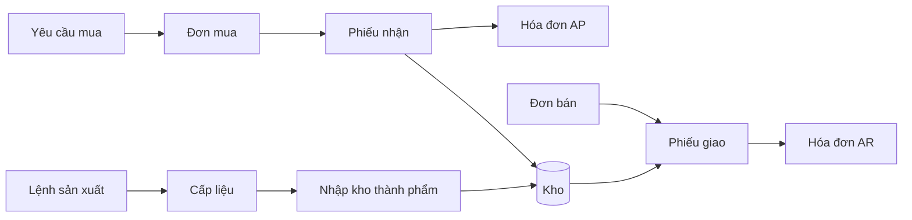

# Chứng từ & nguyên lý đối soát

Mọi giao dịch trong ERP đều bắt nguồn từ một chứng từ, và chứng từ đó lại bắt nguồn từ một chứng từ khác. Chuỗi này là thứ cho phép kế toán trả lời câu hỏi cơ bản nhất: **khoản tiền này đã trả cho cái gì**.

## Nguyên lý (áp dụng mọi ERP)

1. **Mọi bút toán phải có căn cứ.** Bút toán do hệ thống sinh ra phải trỏ về chứng từ gốc. Bút toán thủ công (điều chỉnh, trích trước, kết chuyển) phải khai báo loại, có tài liệu đính kèm và được phê duyệt. Bút toán không có căn cứ là bút toán không giải trình được khi kiểm toán.
2. **Chứng từ phải truy ngược được.** Từ hóa đơn về đơn mua, từ đơn mua về yêu cầu, từ phiếu nhận về đơn mua — mất một mắt xích là đứt toàn bộ chuỗi.
3. **Có ba cặp đối soát chuẩn, mỗi cặp giải quyết một câu hỏi khác nhau:** Mua hàng (đặt – nhận – trả tiền), Bán hàng (bán – giao – thu tiền), Sản xuất (lệnh – cấp liệu – nhập kho).
4. **Đối soát ở cấp dòng quan trọng hơn cấp chứng từ.** Khóa ở cấp dòng cho phép chặn đúng dòng sai lệch mà không chặn toàn bộ chứng từ.
5. **Mỗi dòng chứng từ chỉ có một dòng nguồn xác định.** Một chứng từ có thể gom nhiều chứng từ nguồn (nhiều yêu cầu mua gộp thành một đơn mua), và một dòng nguồn có thể có nhiều dòng con (một dòng đặt hàng nhận làm nhiều đợt). Nhưng từng dòng con phải chỉ rõ nó sinh từ dòng nguồn nào. Một sự kiện thực tế ghi bằng hai chứng từ là dấu hiệu chồng chéo quy trình.
6. **Số liệu trên chứng từ phải là số thực tế, không phải số kế hoạch.** Phiếu nhận ghi số thực giao, không ghi số đặt trên PO.

## 1. Luồng vận hành



## 2. Ai làm gì ở module nào

| Cặp đối soát | Người tạo chứng từ nguồn | Người ghi nhận | Người đối soát |
|---|---|---|---|
| Đặt – Nhận – Trả tiền | Mua hàng (PO) | Kho (phiếu nhận) | Kế toán AP (đối soát 3 chiều) |
| Bán – Giao – Thu tiền | Bán hàng (SO) | Kho (phiếu giao) | Kế toán AR (xuất hóa đơn) |
| Lệnh – Cấp liệu – Nhập kho | Sản xuất (lệnh SX) | Kho (giao dịch kho) | Kế toán giá thành |

**Ranh giới cốt lõi:** người **tạo** chứng từ nguồn không được là người **đối soát** chứng từ đó.

## 3. Hạch toán

Chứng từ là căn cứ của bút toán: khi một chứng từ được ghi nhận (post), hệ thống sinh bút toán theo cấu hình đã khai báo.

- Chứng từ gốc là căn cứ để sinh bút toán.
- Bút toán không có chứng từ gốc và không thuộc loại thủ công được phê duyệt là lỗi kiểm soát.
- Bút toán sinh từ chứng từ sai phải được đảo bằng chứng từ điều chỉnh, không sửa tay.

Bản đồ tài khoản ở [Hạch toán & tài khoản trung gian](../5-ke-toan/ke-toan-tong-hop/1000-hach-toan-va-tai-khoan-trung-gian.md).

## 4. Điểm chạm & rủi ro

- **Đối soát 3 chiều trong mua hàng**: [Đối soát hóa đơn & 3-Way Match](../2-mua-hang/2020-doi-soat-hoa-don-va-3-way-match.md)
- **Hạch toán tài khoản trung gian**: [Hạch toán & tài khoản trung gian](../5-ke-toan/ke-toan-tong-hop/1000-hach-toan-va-tai-khoan-trung-gian.md)
- **Giao dịch kho do chứng từ sinh ra**: [Giao dịch nhập, xuất & chuyển](../1-kho/2000-giao-dich-nhap-xuat-chuyen.md)
- **Đóng kỳ và đối soát sổ phụ**: [Đóng kỳ & đối soát sổ phụ](../5-ke-toan/ke-toan-tong-hop/2010-dong-ky-va-doi-soat-so-phu.md)
- **Phân tách nhiệm vụ**: [Kiểm soát nội bộ & phân tách nhiệm vụ](./2010-kiem-soat-noi-bo-va-phan-tach-nhiem-vu.md)

**Rủi ro chính:**

- **Bút toán không có căn cứ** — không giải trình được khi kiểm toán.
- **Đứt chuỗi truy ngược** — không biết hóa đơn này trả cho lần nhận hàng nào.
- **Một sự kiện ghi bằng nhiều chứng từ** — dòng chứng từ bị nhân đôi, số liệu sai.
- **Ghi số kế hoạch thay số thực tế** — đối soát về sau không khớp được.
- **Đối soát ở cấp chứng từ** — khóa cả hóa đơn vì một dòng lệch.

## 5. Triển khai tham chiếu ERP

### A. Ánh xạ chuỗi chứng từ

> **Lưu ý:** tên bảng thay đổi theo phiên bản và cấu hình, cần xác nhận trên hệ thống thật trước khi dùng trong thiết kế hoặc truy vấn.

| Chứng từ | SAP | Oracle EBS | Epicor | Odoo |
|---|---|---|---|---|
| Yêu cầu mua | `EBAN` | `PO_REQUISITION_HEADERS_ALL` | `Erp.ReqHead` | Không có chứng từ riêng mặc định: dùng `purchase.order` ở trạng thái nháp, hoặc module Purchase Request bổ sung |
| Đơn mua | `EKKO`/`EKPO` | `PO_HEADERS_ALL`/`PO_LINES_ALL` | `Erp.POHeader`/`PODetail` | `purchase.order` |
| Phiếu nhận | `MATDOC` (S/4HANA; `MKPF`/`MSEG` là view tương thích), movement type 101 | `RCV_TRANSACTIONS` | `Erp.RcvHead`/`RcvDtl` | `stock.picking` (loại nhập) |
| Hóa đơn AP | `RBKP`/`RSEG` | `AP_INVOICES_ALL` | `Erp.APInvHed`/`APInvDtl` | `account.move` (`in_invoice`) |
| Đơn bán | `VBAK`/`VBAP` | `OE_ORDER_HEADERS_ALL` | `Erp.OrderHed`/`OrderDtl` | `sale.order` |
| Phiếu giao | `LIKP`/`LIPS` | `WSH_NEW_DELIVERIES` | `Erp.ShipHead`/`ShipDtl` | `stock.picking` (loại xuất) |
| Hóa đơn AR | `VBRK`/`VBRP` | `RA_CUSTOMER_TRX_ALL` | `Erp.InvcHead`/`InvcDtl` | `account.move` (`out_invoice`) |
| Lệnh SX | `AUFK`/`AFKO` | `WIP_DISCRETE_JOBS` | `Erp.JobHead` | `mrp.production` |

### B. Hệ thống tự xây — nguyên tắc thiết kế

> **Lưu ý:** đoạn mã dưới đây và các truy vấn ở mục C (phần hệ thống tự xây) là **gợi ý thiết kế**. Tên bảng và tên cột mang tính minh họa, cần ánh xạ sang cấu trúc dữ liệu thực tế của hệ thống đang xây.

Mọi chứng từ con phải có **hai cột tham chiếu** về dòng nguồn: số chứng từ và số dòng.

```sql
-- Ví dụ trên bảng phiếu nhận
CREATE TABLE Receipt_Line (
    Receipt_No       VARCHAR(30) NOT NULL,
    Line_No          INT NOT NULL,
    PO_No            VARCHAR(30) NOT NULL,   -- tham chiếu chứng từ nguồn
    PO_Line_No       INT NOT NULL,           -- tham chiếu dòng nguồn
    Item_ID          VARCHAR(50) NOT NULL,
    Qty_Received     DECIMAL(18,4) NOT NULL,
    PRIMARY KEY (Receipt_No, Line_No),
    FOREIGN KEY (PO_No, PO_Line_No) REFERENCES PO_Line (PO_No, Line_No)
);
```

Bốn ràng buộc bắt buộc:

1. **Khóa ngoại thật** từ dòng chứng từ con về dòng chứng từ cha, không chỉ lưu số chứng từ dạng text.
2. **Mỗi dòng con chỉ có một dòng nguồn xác định** — không cho phép một dòng con mơ hồ giữa nhiều nguồn.
3. **Chặn xóa chứng từ cha khi còn chứng từ con** tham chiếu.
4. **Mọi bút toán có `Source_Doc`** trỏ về chứng từ gốc; bút toán thủ công có thêm loại bút toán và người phê duyệt.

### C. Truy vấn kiểm soát

**Hệ thống tự xây — truy vấn gợi ý:**

**Bút toán do hệ thống sinh nhưng mất chứng từ gốc:**

```sql
SELECT Journal_ID, Account_ID, Amount, Entry_Type, Posting_Date
FROM GL_Journal
WHERE Source_Doc IS NULL
  AND Entry_Type <> 'MANUAL'
ORDER BY Posting_Date DESC;
```

**Bút toán thủ công thiếu phê duyệt:**

```sql
SELECT Journal_ID, Account_ID, Amount, Posted_By, Posting_Date
FROM GL_Journal
WHERE Entry_Type = 'MANUAL'
  AND Approved_By IS NULL
ORDER BY Posting_Date DESC;
```

**Dòng hóa đơn AP có tham chiếu PO nhưng không tham chiếu dòng phiếu nhận — không đối soát 3 chiều được:**

```sql
SELECT il.Invoice_ID, il.Line_No, il.PO_No, il.PO_Line_No, il.Amount
FROM AP_Invoice_Line il
WHERE il.PO_No IS NOT NULL
  AND il.Receipt_Line_ID IS NULL;
```

Dòng hóa đơn dịch vụ không có phiếu nhận hàng có thể hợp lệ nếu doanh nghiệp áp dụng đối soát 2 chiều cho nhóm này. Cần loại các dòng đó khỏi kết quả theo loại dòng hoặc nhóm hàng.

**Đơn mua đã hủy nhưng vẫn còn phiếu nhận:**

```sql
SELECT po.PO_No, po.Status, COUNT(DISTINCT r.Receipt_No) AS So_Phieu_Nhan
FROM PO_Header po
JOIN Receipt_Line r ON r.PO_No = po.PO_No
WHERE po.Status = 'CANCELLED'
GROUP BY po.PO_No, po.Status;
```

**Epicor — phiếu nhận không gắn PO (receipt nhập khác - miscellaneous):**

```sql
-- RcvDtl.ReceiptType: 'P' = receipt theo PO, 'M' = receipt không có PO (miscellaneous)
-- RcvDtl.PONum là int nên kiểm tra NULL hoặc 0 đều đúng, nhưng điều kiện gốc là ReceiptType
SELECT rd.Company, rd.PackSlip, rd.PackLine, rd.ReceiptType,
       rd.PONum, rd.POLine, rd.PartNum, rd.OurQty, rd.ReceiptDate
FROM Erp.RcvDtl rd
WHERE rd.Company = 'YOUR_COMPANY_CODE'
  AND rd.ReceiptType = 'M'
  AND (rd.PONum IS NULL OR rd.PONum = 0)
ORDER BY rd.ReceiptDate DESC;
```

Kiểm tra chéo trên `RcvHead` (phiếu nhận chưa hoàn tất nhận):

```sql
SELECT rh.Company, rh.PackSlip, rh.ReceiptDate, rh.Received, rh.Invoiced
FROM Erp.RcvHead rh
WHERE rh.Company = 'YOUR_COMPANY_CODE'
  AND rh.Received = 0
ORDER BY rh.ReceiptDate DESC;
```

## 6. Bẫy thực chiến & Checklist

| # | Bẫy | Triệu chứng | Cách phòng tránh |
|---|---|---|---|
| 1 | Bút toán thủ công không chứng từ, không phê duyệt | Không giải trình được khi kiểm toán | Bắt buộc `Source_Doc` hoặc tài liệu đính kèm + phê duyệt |
| 2 | Lưu số chứng từ dạng text không có khóa ngoại | Chuỗi truy ngược đứt khi dữ liệu lệch | Khóa ngoại thật giữa chứng từ con và cha |
| 3 | Một sự kiện ghi bằng hai chứng từ | Dòng chứng từ nhân đôi, số liệu sai | Mỗi sự kiện một chứng từ, mỗi dòng con một dòng nguồn |
| 4 | Ghi số kế hoạch thay số thực tế | Đối soát về sau không khớp | Phiếu nhận ghi số thực giao |
| 5 | Đối soát cấp chứng từ | Khóa cả hóa đơn vì một dòng lệch | Đối soát cấp dòng |
| 6 | Cho xóa chứng từ cha khi có chứng từ con | Chứng từ con mồ côi | Chặn xóa, chỉ đóng/hủy |
| 7 | Không có cột tham chiếu dòng nguồn | Không biết dòng nào khớp dòng nào | Cột số dòng nguồn (như `PO_Line_No`) bắt buộc |
| 8 | Chứng từ nguồn và chứng từ con lệch ngày | Không xác định được kỳ hạch toán | Ngày chứng từ con ≥ ngày chứng từ cha |
| 9 | Kiểm tra đứt chuỗi chỉ khi kiểm toán | Phát hiện muộn, sửa rất tốn kém | Báo cáo kiểm tra chuỗi chạy định kỳ |
| 10 | Không phân biệt chứng từ hủy và chứng từ gốc | Báo cáo tính cả chứng từ đã hủy | Dùng trạng thái, không xóa bản ghi |

**Checklist trước go-live:**

- [ ] Mọi chứng từ con có khóa ngoại về chứng từ cha (đã test).
- [ ] Mọi bút toán hệ thống sinh ra có `Source_Doc`; bút toán thủ công có loại, tài liệu đính kèm và phê duyệt.
- [ ] Chặn xóa chứng từ cha khi còn chứng từ con (đã test).
- [ ] Mỗi sự kiện chỉ ghi bằng một chứng từ, mỗi dòng con chỉ có một dòng nguồn.
- [ ] Phiếu nhận ghi số thực giao, không ghi số PO.
- [ ] Có báo cáo kiểm tra đứt chuỗi chứng từ.
- [ ] Chứng từ hủy giữ trạng thái, không xóa bản ghi.
- [ ] Ngày chứng từ con không nhỏ hơn ngày chứng từ cha.
- [ ] Đối soát thực hiện ở cấp dòng (đã test một hóa đơn nhiều dòng).

## Xem thêm

- [Cách đọc tài liệu](./0000-cach-doc-tai-lieu.md)
- [Đối soát hóa đơn & 3-Way Match](../2-mua-hang/2020-doi-soat-hoa-don-va-3-way-match.md)
- [Giao dịch nhập, xuất & chuyển](../1-kho/2000-giao-dich-nhap-xuat-chuyen.md)
- [Đóng kỳ & đối soát sổ phụ](../5-ke-toan/ke-toan-tong-hop/2010-dong-ky-va-doi-soat-so-phu.md)
- [Kiểm soát nội bộ & phân tách nhiệm vụ](./2010-kiem-soat-noi-bo-va-phan-tach-nhiem-vu.md)

<div align="center" style={{color: 'var(--ifm-color-primary)'}}>
  <strong>Chúc các bạn thành công và vui vẻ!</strong>
</div>