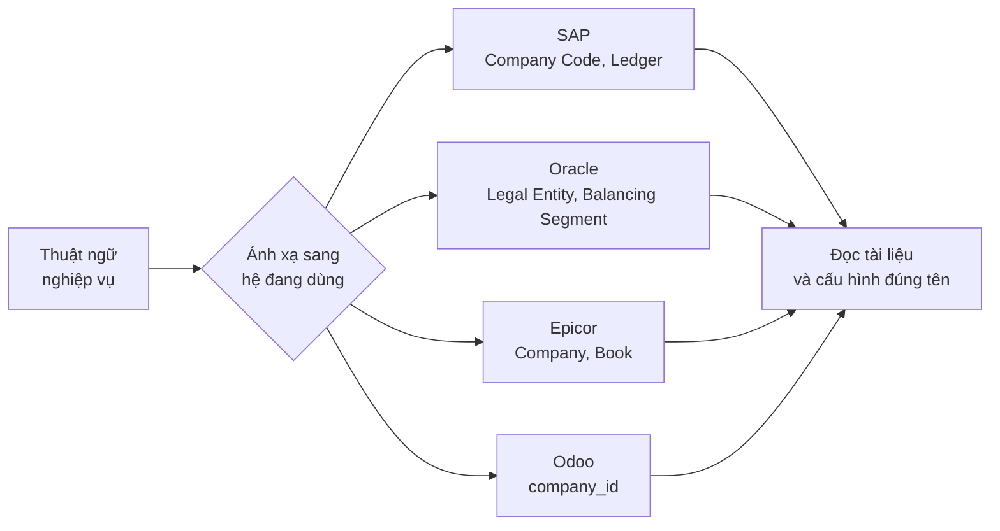

# Glossary & ánh xạ thuật ngữ

Cùng một nghiệp vụ, bốn hệ thống gọi bốn tên. Đọc tài liệu của SAP xong chuyển sang Oracle sẽ tưởng là hai thế giới khác nhau — thực chất chỉ là khác cách đặt tên và khác điểm nhúng pháp nhân.

Bài này gom thuật ngữ về một chỗ và chỉ ra **bốn khác biệt triết lý** chi phối mọi phần còn lại.

## Nguyên lý (áp dụng mọi ERP)

1. **Thuật ngữ khác nhau, nghiệp vụ giống nhau.** Bảng đối chiếu bên dưới là công cụ để đọc tài liệu của hệ khác mà vẫn hiểu.
2. **Khác biệt lớn nhất không nằm ở tên gọi mà ở chỗ pháp nhân được nhúng vào đâu:** field riêng (SAP, Odoo) hay segment trong chuỗi tài khoản (Oracle).
3. **Mỗi hệ có một trục "sổ song song" riêng** để báo cáo đa chuẩn mực, và trục đó không dùng để tách pháp nhân.
4. **Không bao giờ dịch máy thuật ngữ khi làm việc với đội triển khai.** Dùng đúng tên hệ thống đang chạy để tránh hiểu nhầm.

## 1. Luồng vận hành



## 2. Ai làm gì ở module nào

| Việc | Triển khai / BA | Kế toán | IT | Người dùng cuối |
|---|---|---|---|---|
| Chốt bảng thuật ngữ dự án | ✅ sở hữu | ✅ duyệt | Tham gia | — |
| Dịch tài liệu nghiệp vụ | ✅ thực hiện | Rà soát | — | — |
| Đặt tên trường trên hệ thống | — | — | ✅ sở hữu | — |
| Đào tạo thuật ngữ | ✅ sở hữu | Tham gia | — | ✅ nhận |

## 3. Hạch toán

Thuật ngữ quyết định **tài khoản nào được gọi là gì** trong báo cáo. Sai thuật ngữ dẫn tới trình bày sai bản chất:

- "Accrual" không phải "chi phí" — nó là khoản nợ tạm tính.
- "PPV" và "IPV" đều là chênh lệch giá nhưng phát sinh ở hai thời điểm khác nhau.
- "Realized" và "Unrealized" FX là hai loại chênh lệch có thời điểm ghi nhận khác nhau.

Bản đồ tài khoản ở [Hạch toán & tài khoản trung gian](../5-ke-toan/ke-toan-tong-hop/1000-hach-toan-va-tai-khoan-trung-gian.md).

## 4. Điểm chạm & rủi ro

- **Tổ chức và pháp nhân**: [Tổ chức & Pháp nhân](./1000-to-chuc-va-phap-nhan.md)
- **Master data**: [Master Data & tính bất biến](./1010-master-data-va-tinh-bat-bien.md)
- **Chứng từ**: [Chứng từ & nguyên lý đối soát](./2000-chung-tu-va-nguyen-ly-doi-soat.md)
- **UOM**: [Nguyên lý quy đổi UOM](./3020-nguyen-ly-quy-doi-uom.md)

**Rủi ro chính:**

- **Dịch máy thuật ngữ** — "Ledger" dịch thành "sổ cái" trong khi hệ đang dùng có cả "Book" và "Ledger" là hai thứ khác nhau.
- **Nhầm "sổ song song" với "gộp pháp nhân"** — Non-Leading Ledger và Multiple Books không phải cơ chế gộp.
- **Nhầm Accrual với chi phí** — dẫn tới hạch toán sai kỳ.

## 5. Triển khai tham chiếu ERP

### A. Thuật ngữ tổ chức và sổ sách

| Nghiệp vụ | SAP S/4HANA | Oracle EBS | Epicor | Odoo |
|---|---|---|---|---|
| Đơn vị pháp lý | Company Code | Legal Entity | Company | `res.company` |
| Nơi chứa giao dịch kế toán | Ledger (`ACDOCA`) | Ledger | Book | Dữ liệu chung một database |
| Đơn vị vận hành nghiệp vụ | Company Code | Operating Unit | Company | `company_id` |
| Sổ song song đa chuẩn mực | Non-Leading Ledger | Secondary Ledger | Multiple Books | Không native |
| Trung tâm chi phí | Cost Center | Cost Center (đoạn CoA) | `JCDept` | Analytic Account |

### B. Thuật ngữ mua hàng và công nợ

| Nghiệp vụ | SAP | Oracle EBS | Epicor | Odoo |
|---|---|---|---|---|
| Yêu cầu mua | Purchase Requisition (`EBAN`) | Requisition | `Erp.ReqHead` | `purchase.order` nháp |
| Đơn mua | Purchase Order | Standard PO | `POHeader` | `purchase.order` |
| Hợp đồng khung | Contract / Scheduling Agreement | Blanket PO | Blanket PO / Contract | `purchase.requisition` |
| Phiếu nhận | Goods Receipt | Receiving / GRN | `RcvHead` | `stock.picking` |
| Tài khoản trung gian nhận hàng | GR/IR Clearing (`WRX`) | AP Accrual | GL Control Account | Stock Interim |
| Hóa đơn AP | Vendor Invoice (`RBKP`) | AP Invoice | `APInvHed` | `account.move` |
| Đối soát 3 chiều | Invoice Verification (MIRO) | Match to Receipt | AP Invoice từ `PackSlip` | 3-way matching |
| Chênh lệch giá khi nhận | Price Difference (PRD) | PPV Account | PPV Account | Price Difference Account |
| Chênh lệch giá khi có hóa đơn | Price Difference (PRD) | IPV Account | IPV Account | Price Difference Account |

### C. Thuật ngữ bán hàng và sản xuất

| Nghiệp vụ | SAP | Oracle EBS | Epicor | Odoo |
|---|---|---|---|---|
| Báo giá | Quotation | Quote | `QuoteHed` | `sale.order` nháp |
| Đơn bán | Sales Order (`VBAK`) | Sales Order | `OrderHed` | `sale.order` |
| Giữ hàng | Reservation | Reservation (`MTL_RESERVATIONS`) | Allocation | `stock.move` assigned |
| Giao hàng | Outbound Delivery (`LIKP`) | Delivery (`WSH_NEW_DELIVERIES`) | `ShipHead` | `stock.picking` |
| Trả hàng | Returns (`RE`) | Return Order | `RMAHead` | `sale.order` return |
| BOM | BOM (`STKO`/`STPO`) | Bill of Materials | `PartMtl` | `mrp.bom` |
| Quy trình công nghệ | Routing (`PLKO`/`PLPO`) | Routing | `PartOpr` | `mrp.routing` |
| Phiên bản sản xuất | Production Version (`MKAL`) | Recipe / Alternate | `PartRev` | `mrp.bom` version |
| Lệnh sản xuất | Production Order (`AUFK`) | Discrete Job (`WIP_DISCRETE_JOBS`) | `JobHead` | `mrp.production` |
| Kiểm tra chất lượng | Quality Usage Decision | Inspections | Inspection Processing | Quality Control Point |

### D. Bốn khác biệt triết lý cần nhớ

| Khác biệt | Hệ thể hiện | Hệ quả khi đọc tài liệu |
|---|---|---|
| Pháp nhân là field hay là segment | Field: SAP, Odoo. Segment: Oracle | Gộp pháp nhân ở Oracle rủi ro hơn, vì mã công ty là một đoạn trong dãy số |
| Sổ cái tách rời hay gắn liền | Tách: Oracle. Gắn: Epicor, Odoo | Epicor không thể "gộp sổ nhưng vẫn tách vận hành" |
| BOM và Routing tách hay gộp | Tách: Oracle, SAP, Odoo. Gộp (`MoM`): Epicor | Epicor dùng `PartRev` làm phiên bản sản xuất, không có bảng ghép riêng |
| Sổ phụ tách hay gộp | Tách: SAP, Oracle, Epicor. Gộp: Odoo | Odoo không có reconciliation sổ phụ - sổ cái vì chỉ có một bảng bút toán |

### E. Truy vấn kiểm soát

**Kiểm tra đúng hệ đang chạy — tránh đọc nhầm tài liệu hệ khác:**

```sql
-- Oracle: xác nhận đang ở Ledger nào, có bao nhiêu pháp nhân trong đó
SELECT l.name AS ledger_name, l.currency_code,
       COUNT(DISTINCT gnorm.segment_value) AS so_phap_nhan
FROM gl_ledgers l
LEFT JOIN gl_ledger_norm_seg_vals gnorm ON gnorm.ledger_id = l.ledger_id
GROUP BY l.name, l.currency_code;
```

**Epicor — xác nhận Company và Book đang dùng:**

```sql
SELECT c.Company, c.Name, b.BookID, b.Description
FROM Erp.Company c
LEFT JOIN Erp.Book b ON b.Company = c.Company
WHERE c.Company = 'YOUR_COMPANY_CODE';
```

## 6. Bẫy thực chiến & Checklist

| # | Bẫy | Triệu chứng | Cách phòng tránh |
|---|---|---|---|
| 1 | Dịch máy thuật ngữ | "Ledger" dịch thành "sổ cái" khi hệ có cả Book và Ledger | Dùng đúng tên hệ đang chạy |
| 2 | Nhầm sổ song song với gộp pháp nhân | Cấu hình sai mục đích | Sổ song song là để đa chuẩn mực |
| 3 | Nhầm Accrual với chi phí | Hạch toán sai kỳ | Accrual là khoản nợ tạm tính |
| 4 | Gộp PPV và IPV | Không phân tích được nguyên nhân chênh lệch | Hai thời điểm, hai tài khoản |
| 5 | Gộp chênh lệch tỷ giá realized và unrealized | Lãi lỗ sai, không hoàn nhập được | Hai tài khoản riêng |
| 6 | Đọc tài liệu SAP áp cho Oracle | Cấu hình sai cơ chế pháp nhân | Dùng bảng ánh xạ trước khi áp dụng |
| 7 | Dùng tên bảng Odoo cho Oracle | SQL lỗi | Xác nhận hệ trước khi viết truy vấn |
| 8 | Không có bảng thuật ngữ dự án | Mỗi người dịch một kiểu | Chốt bảng thuật ngữ, đính kèm tài liệu dự án |
| 9 | Nhầm Operating Unit với Legal Entity | Phân quyền sai, báo cáo gộp nhầm | OU là tầng vận hành, LE là tầng pháp lý |

**Checklist:**

- [ ] Đã xác định đúng hệ đang triển khai trước khi áp dụng thuật ngữ.
- [ ] Đã lập bảng thuật ngữ riêng cho dự án và được kế toán duyệt.
- [ ] Phân biệt rõ Accrual / chi phí / công nợ.
- [ ] Phân biệt rõ PPV / IPV / chênh lệch tỷ giá.
- [ ] Phân biệt rõ Legal Entity / Operating Unit / Company.
- [ ] Phân biệt rõ Ledger / Book / Non-Leading Ledger.
- [ ] Mọi tài liệu dịch đã được người hiểu hệ thống rà soát.

<div align="center" style={{color: 'var(--ifm-color-primary)'}}>
  <strong>Chúc các bạn thành công và vui vẻ!</strong>
</div>
