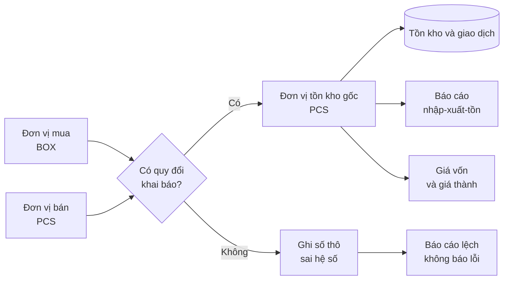

# Nguyên lý quy đổi đơn vị tính (UOM)

Đây là lỗi **không bao giờ báo lỗi**: hệ thống lưu đúng dữ liệu, báo cáo chạy được, số liệu trông hợp lệ — nhưng sai. Và nó sai âm thầm suốt nhiều tháng vì phần lớn mã hàng có hệ số quy đổi bằng 1 nên báo cáo vẫn đúng cho tới khi gặp mã hàng có hệ số khác.

## Nguyên lý (áp dụng mọi ERP)

1. **Mọi số lượng phải quy về một đơn vị gốc duy nhất.** Mua theo thùng, bán theo hộp, sản xuất theo cái — nhưng tồn kho chỉ có một con số ở đơn vị nhỏ nhất không chia được.
2. **Có hai cấp quy đổi:** quy đổi chuẩn dùng chung cho cả nhóm đơn vị (1 tấn = 1.000 kg), và quy đổi đặc thù khai riêng cho từng mã (1 cây thép φ10 dài 12 m, φ16 chỉ dài 11,7 m).
3. **Quy đổi chéo nhóm là nơi dễ sai nhất.** Mua theo lít, tồn theo kg — tỷ lệ phụ thuộc tỷ trọng riêng của từng chất, không thể dùng hệ số chung.
4. **Luôn lưu hệ số dưới dạng phép nhân**, không phải phép chia. Lưu `1/24 = 0.041667` sẽ tích lũy sai số làm tròn qua nhiều giao dịch.
5. **Số dư rác siêu nhỏ là dấu hiệu lỗi làm tròn.** Tồn `0.00000001` không thể xóa, không thể khóa sổ — phải phát hiện và dọn định kỳ.
6. **Nguyên tắc vàng: luôn quy đổi và so sánh theo đơn vị tồn kho.** Đơn vị mua và đơn vị bán chỉ dùng ở cửa ngõ, không dùng để so sánh nội bộ.

## 1. Luồng vận hành



## 2. Ai làm gì ở module nào

| Việc | Kho | Mua hàng | Sản xuất | Kế toán | IT |
|---|---|---|---|---|---|
| Khai đơn vị tính gốc | ✅ sở hữu | Đề xuất đơn vị mua | Đề xuất đơn vị tiêu hao | — | — |
| Khai bảng quy đổi chuẩn | ✅ sở hữu | — | — | — | Cấu hình |
| Khai quy đổi đặc thù theo mã hàng | ✅ sở hữu | Cung cấp tỷ lệ NCC | — | — | — |
| Khoá đơn vị gốc sau giao dịch | ✅ thực thi | — | — | — | Khóa ở DB |
| Viết báo cáo dùng đơn vị gốc | — | — | — | ✅ đọc | ✅ thực hiện |
| Test với mã hệ số khác 1 | ✅ phối hợp | — | — | Tham gia | ✅ sở hữu |

## 3. Hạch toán

Đơn vị tính sai gây sai giá trị trực tiếp:

$$\text{Giá trị tồn kho} = \text{Số lượng (UOM gốc)} \times \text{Đơn giá theo UOM gốc}$$

Nếu đơn giá lưu theo đơn vị mua (100 USD/BOX) nhưng số lượng theo đơn vị gốc (1.000 PCS), kết quả sẽ **phồng 100 lần** — đúng bằng hệ số quy đổi.

Bản đồ tài khoản ở [Hạch toán & tài khoản trung gian](../5-ke-toan/ke-toan-tong-hop/1000-hach-toan-va-tai-khoan-trung-gian.md).

## 4. Điểm chạm & rủi ro

- **Thuộc tính UOM gốc của mã hàng**: [Item Master & thuộc tính kho](../1-kho/1010-item-master-va-thuoc-tinh-kho.md)
- **Giao dịch kho dùng UOM gốc**: [Giao dịch nhập, xuất & chuyển](../1-kho/2000-giao-dich-nhap-xuat-chuyen.md)
- **Lệch UOM khi mua**: [Bẫy thực chiến mua hàng](../2-mua-hang/9000-bay-mua-hang.md)
- **Lệch UOM giữa BOM và Item Master**: [Bẫy thực chiến sản xuất](../3-san-xuat/9000-bay-san-xuat.md)
- **Giá vốn và định giá**: [Giá vốn & định giá tồn kho](../5-ke-toan/ke-toan-tong-hop/1010-gia-von-va-dinh-gia-ton-kho.md)
- **Danh mục nền và tính bất biến**: [Master Data & tính bất biến](./1010-master-data-va-tinh-bat-bien.md)

**Rủi ro chính:**

- **Cho đổi đơn vị gốc sau khi có giao dịch** — toàn bộ lịch sử mang nghĩa khác.
- **Thiếu bảng quy đổi đặc thù** — hệ thống áp hệ số chung, chênh lệch tích lũy.
- **Lưu hệ số dưới dạng chia** — sai số làm tròn tích lũy thành số dư rác.
- **Test chỉ với mã hệ số = 1** — báo cáo "đúng" khi test, sai khi lên production.
- **Báo cáo trộn UOM** — số liệu "trông hợp lý" nhưng không thể dùng để ra quyết định.

## 5. Triển khai tham chiếu ERP

### A. Ánh xạ khái niệm

| Khái niệm | SAP | Oracle EBS | Epicor | Odoo |
|---|---|---|---|---|
| Đơn vị gốc | `MARA.MEINS` | `MTL_SYSTEM_ITEMS_B.primary_uom_code` | `Part.IUM` | `product.template.uom_id` |
| Đơn vị mua | `MARC.BESTME` | Trường trên PO Line | `Part.PUM` | `product.supplierinfo` |
| Đơn vị bán | `MVKE` (sales unit) | Trường trên Order Line | `Part.SalesUM` | `product.uom_id` |
| Bảng quy đổi chuẩn | `MARM` | `MTL_UOM_CONVERSIONS` | `Erp.UOMConv` | `uom.uom` (factor) |
| Quy đổi đặc thù theo mã | `MARM` (theo vật tư) | `MTL_UOM_CONVERSIONS` (theo item) | `Erp.PartUOM` | `uom.uom` theo nhóm |

**Điểm cần nhớ khi chuyển đổi:** Epicor tách hai bảng (`UOMConv` dùng chung, `PartUOM` theo mã) với cột `ConvOperator` (`*` hoặc `/`) — phải đọc kèm operator, không tự suy ra chiều quy đổi.

### B. Hệ thống tự xây — thiết kế tối thiểu

```sql
CREATE TABLE UOM_Conversion (
    Item_ID          VARCHAR(50) NOT NULL,
    From_UOM         VARCHAR(10) NOT NULL,
    To_UOM           VARCHAR(10) NOT NULL,
    Multiply_Factor  DECIMAL(18,8) NOT NULL,  -- Luôn là phép NHÂN
    Valid_From       DATE NOT NULL,
    PRIMARY KEY (Item_ID, From_UOM, To_UOM, Valid_From),
    CONSTRAINT CK_Factor_Pos CHECK (Multiply_Factor > 0)
);
```

Bốn ràng buộc bắt buộc:

1. **Chỉ lưu `Multiply_Factor`**, không lưu hệ số chia. Quy đổi ngược được tính bằng phép chia khi cần.
2. **`Multiply_Factor` kiểu `DECIMAL` với ít nhất 6 chữ số thập phân**, không dùng `FLOAT`.
3. **Chặn lưu dòng BOM / PO / SO có UOM không quy đổi được về UOM gốc.**
4. **Chặn đổi `Base_UOM` của mã hàng đã có giao dịch.** Quy tắc bất biến của master data: [Master Data & tính bất biến](./1010-master-data-va-tinh-bat-bien.md).

### C. Truy vấn kiểm soát

**Số dư tồn kho siêu nhỏ do lỗi làm tròn (hàng "ma" không xóa được):**

```sql
SELECT t.Item_ID, t.To_Location_ID, SUM(t.Qty_Base) AS Ghost_Qty
FROM Inventory_Transaction t
GROUP BY t.Item_ID, t.To_Location_ID
HAVING SUM(t.Qty_Base) > 0 AND SUM(t.Qty_Base) < 0.01;
```

**Mã hàng giao dịch bằng UOM không có quy đổi về UOM gốc:**

```sql
SELECT DISTINCT t.Item_ID, t.UOM AS Trx_UOM, i.Base_UOM
FROM Inventory_Transaction t
JOIN Item_Inventory_Attribute i ON i.Item_ID = t.Item_ID
WHERE t.UOM <> i.Base_UOM
  AND NOT EXISTS (
      SELECT 1 FROM UOM_Conversion u
      WHERE u.Item_ID = t.Item_ID AND u.From_UOM = t.UOM AND u.To_UOM = i.Base_UOM);
```

**Đối chiếu số lượng PO và số lượng nhận — đã quy về đơn vị gốc:**

```sql
SELECT l.PO_No, l.Item_ID, l.UOM AS Order_UOM,
       l.Qty_Ordered, l.Qty_In_Base_UOM,
       ISNULL(SUM(r.Qty_Received), 0) AS Qty_Received_Base,
       l.Qty_In_Base_UOM - ISNULL(SUM(r.Qty_Received), 0) AS Diff
FROM PO_Line l
LEFT JOIN Receipt_Line r ON r.PO_ID = l.PO_ID AND r.Line_No = l.Line_No
GROUP BY l.PO_No, l.Item_ID, l.UOM, l.Qty_Ordered, l.Qty_In_Base_UOM
HAVING l.Qty_In_Base_UOM <> ISNULL(SUM(r.Qty_Received), 0);
```

**Epicor — hệ số quy đổi lưu dạng chia (dấu hiệu sai số tích lũy):**

```sql
SELECT pu.Company, pu.PartNum, pu.UOMCode, pu.ConvOperator, pu.ConvFactor
FROM Erp.PartUOM pu
WHERE pu.Company = 'YOUR_COMPANY_CODE'
  AND pu.ConvOperator = '/'
  AND pu.ConvFactor > 1
ORDER BY pu.PartNum;
```

## 6. Bẫy thực chiến & Checklist

| # | Bẫy | Triệu chứng | Cách phòng tránh |
|---|---|---|---|
| 1 | So sánh số lượng khác UOM | Báo cáo chênh hàng trăm đơn vị, hai phòng tranh cãi | Luôn quy về UOM gốc trước khi so sánh |
| 2 | Test chỉ với mã hệ số = 1 | Báo cáo đúng khi test, sai khi production | Test riêng với mã có hệ số khác 1 |
| 3 | Lưu hệ số dạng chia | Tồn `0.00000001` không xóa được | Luôn lưu hệ số nhân từ đơn vị nhỏ |
| 4 | Dùng `FLOAT` cho hệ số | Sai số tích lũy sau nhiều giao dịch | `DECIMAL(18,8)` |
| 5 | Đổi đơn vị gốc khi đã có giao dịch | Lịch sử sai nghĩa hoàn toàn | Khóa `Base_UOM` ở cả app lẫn DB |
| 6 | Thiếu quy đổi đặc thù | Áp hệ số chung, lệch hàng chục tấn | Bắt buộc khai cho mã khác nhóm |
| 7 | Báo cáo dùng UOM mua/bán | Số liệu không dùng được để ra quyết định | Chỉ dùng `Qty_Base` trong báo cáo |
| 8 | Không dọn số dư rác định kỳ | Không khóa sổ được, không xóa được ô kệ | Báo cáo quét số dư < 0,01, dọn trước khóa sổ |
| 9 | Quy đổi khác nhóm dùng hệ số chung | Lít sang kg sai theo tỷ trọng từng chất | Khai riêng theo từng mã hàng |
| 10 | Không kiểm UOM khi nhập hóa đơn AP | Vỡ động cơ khớp lệnh, kế toán tính tay | UOM hóa đơn phải quy đổi được về UOM gốc |

**Checklist trước go-live:**

- [ ] Mọi mã hàng có đơn vị gốc là đơn vị nhỏ nhất không chia được.
- [ ] Đã rà bảng quy đổi đặc thù cho 100% mã có đơn vị mua/bán khác đơn vị gốc.
- [ ] Hệ số lưu dạng `DECIMAL`, luôn là phép nhân (đã rà).
- [ ] Chặn đổi `Base_UOM` khi đã có giao dịch (đã test cả import).
- [ ] Chặn lưu dòng BOM/PO/SO có UOM không quy đổi được (đã test).
- [ ] Báo cáo quét số dư rác < 0,01, chạy trước mỗi kỳ khóa sổ.
- [ ] Đã test báo cáo với ít nhất 3 mã có hệ số khác 1.
- [ ] Mọi báo cáo số lượng dùng `Qty_Base`, không dùng `Qty` thô.
- [ ] UOM trên hóa đơn AP bị giới hạn trong danh mục quy đổi hợp lệ.
- [ ] Đã đối chiếu: tổng PO quy đổi = tổng nhận quy đổi (0 dòng lệch).

<div align="center" style={{color: 'var(--ifm-color-primary)'}}>
  <strong>Chúc các bạn thành công và vui vẻ!</strong>
</div>
