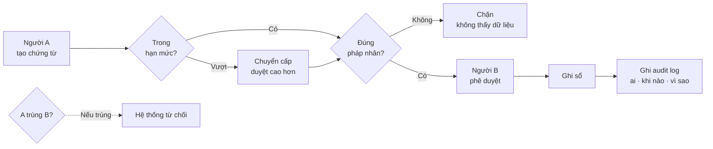

# 5000 Kiểm soát nội bộ & phân tách nhiệm vụ

Kiểm soát nội bộ không phải để bắt lỗi kế toán — nó để **một người không thể tự mình hoàn tất một giao dịch khống**. Đây là nguyên tắc duy nhất đứng sau mọi yêu cầu về phê duyệt, hạn mức và phân quyền.

## 0. Nguyên lý (áp dụng mọi ERP)

1. **Một giao dịch tài chính phải qua ít nhất hai người.** Người khởi tạo và người phê duyệt luôn khác nhau. Không có ngoại lệ ở quy mô doanh nghiệp.
2. **Phân tách theo xung đột lợi ích, không theo chức danh.** Câu hỏi là "người này có lợi gì nếu giao dịch này qua?", không phải "người này giữ chức gì?".
3. **Hạn mức phê duyệt theo giá trị, cấu hình được.** Cấu hình qua bảng tham số, không viết cứng trong mã vì chính sách tài chính thay đổi theo kỳ.
4. **Phê duyệt phải có thời điểm và người duyệt lưu lại.** Phê duyệt không có dấu vết thì không chứng minh được ai đã duyệt.
5. **Phân quyền theo pháp nhân phải áp ở tầng dữ liệu.** Người dùng chi nhánh A không được thấy giao dịch chi nhánh B, kể trên màn hình lẫn báo cáo.
6. **Kiểm soát phòng ngừa rẻ hơn kiểm soát phát hiện.** Một ràng buộc chặn ở tầng dữ liệu thay thế được hàng tuần rà soát thủ công.

## 1. Luồng vận hành



## 2. Ai làm gì ở module nào

| Việc | Kiểm soát nội bộ | Kế toán trưởng | IT / Admin | Ban điều hành |
|---|---|---|---|---|
| Thiết kế ma trận phê duyệt | ✅ sở hữu | ✅ duyệt | Cấu hình | ✅ phê chuẩn |
| Thiết lập hạn mức giá trị | ✅ đề xuất | ✅ sở hữu | Cấu hình | ✅ duyệt |
| Phân quyền theo vai trò | ✅ rà soát | ✅ duyệt | ✅ thực hiện | — |
| Rà soát vi phạm SoD định kỳ | ✅ sở hữu | Tham gia | Cung cấp dữ liệu | Nhận báo cáo |
| Kiểm tra audit trail | ✅ sở hữu | — | Cung cấp log | — |
| Xử lý ngoại lệ | Đề xuất | ✅ duyệt | — | ✅ duyệt ngoại lệ lớn |

**Ranh giới cốt lõi:** người **thiết kế** ma trận phê duyệt không được là người **duy nhất có quyền thay đổi** nó.

## 3. Hạch toán

Kiểm soát nội bộ không sinh bút toán, nhưng nó bảo đảm bút toán có căn cứ:

- **Audit trail** là điều kiện để bút toán được chấp nhận khi kiểm toán.
- **Phê duyệt theo hạn mức** quyết định bút toán lớn có được ghi sổ hay không.
- **Phân quyền theo pháp nhân** bảo đảm bút toán vào đúng sổ.

Bản đồ tài khoản ở [Hạch toán & tài khoản trung gian](../6-ke-toan-chung/1000-hach-toan-va-tai-khoan-trung-gian.md).

## 4. Điểm chạm & rủi ro

- **Tổ chức và pháp nhân** (phân quyền theo đơn vị): [Tổ chức & Pháp nhân](./1000-to-chuc-va-phap-nhan.md)
- **Chứng từ và đối soát**: [Chứng từ & nguyên lý đối soát](./4000-chung-tu-va-nguyen-ly-doi-soat.md)
- **Duyệt PO theo hạn mức**: [Đơn mua hàng](../2-mua-hang/3000-don-mua-hang.md)
- **Mở khóa hóa đơn AP**: [AP: Bẫy & kiểm soát](../5-cong-no/ap/4000-ap-bay-va-kiem-soat.md)
- **Duyệt chi tiền**: [AP: Thanh toán & Cash Out](../5-cong-no/ap/3000-ap-thanh-toan-va-cash-out.md)
- **Duyệt hạn mức tín dụng**: [Danh mục & chính sách bán](../4-ban-hang/1000-danh-muc-va-chinh-sach-ban.md)

**Rủi ro chính:**

- **Một người tự tạo và tự duyệt** — khe hở gian lận lớn nhất.
- **Hạn mức viết cứng trong mã** — đổi chính sách phải sửa code, thường không được cập nhật.
- **Phê duyệt không lưu người và thời điểm** — không chứng minh được ai duyệt.
- **Phân quyền theo pháp nhân chỉ trên giao diện** — báo cáo vẫn gộp dữ liệu mọi chi nhánh.
- **Chia nhỏ giao dịch để né hạn mức** — không có báo cáo phát hiện.
- **Ngoại lệ không có hồ sơ** — mọi thứ đều có thể "duyệt miệng".

## 5. Triển khai tham chiếu ERP

### A. Ánh xạ khái niệm

| Khái niệm | SAP S/4HANA | Oracle EBS | Epicor | Odoo |
|---|---|---|---|---|
| Ma trận phê duyệt | Release Strategy | AME (Approval Management Engine) | Approval Workflow / Task Set | Multi-level Approval Rules |
| Phân quyền theo pháp nhân | Authorization (Company Code) | MOAC + Responsibility | Company Access trên User | Record rules + `company_id` |
| Hạn mức theo giá trị | Release codes + limits | Approval Groups | Approval Limits theo Role | Cần tùy biến |
| Audit trail | Change Documents (`CDHDR`/`CDPOS`) | Audit Trail (schema Audit) | `ChgLog` / Audit Log | Mail thread + audit rules |
| Separation of Duties | GRC (Access Control) | Role-based + AME | Role Security | Cần tùy biến |

### B. Ma trận phân tách nhiệm vụ tối thiểu

| Xung đột | Người 1 | Người 2 | Lý do |
|---|---|---|---|
| Tạo – Duyệt PO | Buyer | Trưởng phòng mua / Giám đốc | Tự đặt hàng cho mình |
| Tạo PO – Nhập hóa đơn | Buyer | AP Clerk | Tự tạo chứng từ khống |
| Nhập hóa đơn – Mở khóa | AP Clerk | Kế toán trưởng AP | Tự duyệt sai lệch của mình |
| Nhập hóa đơn – Duyệt chi | AP Clerk | Kế toán trưởng / CFO | Tự trả tiền cho hóa đơn mình nhập |
| Bán hàng – Cấp hạn mức tín dụng | Sales | Trưởng tín dụng | Tự nới hạn mức cho khách mình |
| Thu tiền – Xóa nợ | AR Clerk | Kế toán trưởng / CFO | Xóa nợ để che tham ô |
| Tạo nhà cung cấp – Duyệt tài khoản ngân hàng | Buyer | Kế toán | Gian lận chuyển tiền sang tài khoản khác |
| Ghi nhận giờ công – Duyệt lương | Tổ trưởng | Nhân sự | Khai khống giờ công |

### C. Truy vấn kiểm soát

**Cùng người tạo và duyệt cùng chứng từ:**

```sql
SELECT 'PO' AS Loai, PO_No AS Doc_No, Created_By, Approved_By
FROM PO_Header
WHERE Created_By = Approved_By
UNION ALL
SELECT 'AP_INVOICE', Invoice_No, Created_By, Approved_By
FROM AP_Invoice
WHERE Created_By = Approved_By
UNION ALL
SELECT 'PAYMENT_RUN', Run_No, Created_By, Approved_By
FROM AP_Payment_Run
WHERE Created_By = Approved_By;
```

**Người nhập hóa đơn đồng thời mở khóa hóa đơn:**

```sql
SELECT h.Invoice_ID, h.Released_By, i.Created_By, h.Release_Code, h.Release_Reason
FROM Invoice_Hold h
JOIN AP_Invoice i ON i.Invoice_ID = h.Invoice_ID
WHERE h.Released_By = i.Created_By;
```

**Chia nhỏ giao dịch để né hạn mức duyệt:**

```sql
SELECT Created_By, DATEADD(DAY, -(DAY(Doc_Date)-1), Doc_Date) AS Thang,
       COUNT(*) AS So_Chung_Tu, SUM(Amount_Total) AS Tong_Gia_Tri
FROM PO_Header
WHERE Doc_Date >= DATEADD(MONTH, -3, GETDATE())
GROUP BY Created_By, DATEADD(DAY, -(DAY(Doc_Date)-1), Doc_Date)
HAVING COUNT(*) >= 5 AND SUM(Amount_Total) > :Approval_Threshold
ORDER BY Tong_Gia_Tri DESC;
```

**Phê duyệt không có dấu vết người duyệt:**

```sql
SELECT Doc_No, Doc_Type, Status
FROM Approval_Document
WHERE Status = 'APPROVED'
  AND (Approved_By IS NULL OR Approved_At IS NULL);
```

**Epicor — hạn mức duyệt chi theo role:**

```sql
SELECT u.UserID, u.Name, r.RoleID, r.Description
FROM Erp.UserFile u
JOIN Erp.UserComp uc ON uc.DcdUserID = u.DcdUserID
JOIN Erp.UserRole r  ON r.UserID = u.UserID
WHERE u.Company = 'YOUR_COMPANY_CODE'
ORDER BY u.UserID, r.RoleID;
```

## 6. Bẫy thực chiến & Checklist

| # | Bẫy | Triệu chứng | Cách phòng tránh |
|---|---|---|---|
| 1 | Một người tạo và duyệt | Gian lận không ai phát hiện | SoD bắt buộc, kiểm tra ở tầng dịch vụ |
| 2 | Hạn mức viết cứng | Đổi chính sách phải sửa code | Bảng tham số hạn mức theo giá trị và vai trò |
| 3 | Phê duyệt không lưu người/thời điểm | Không chứng minh được ai duyệt | `Approved_By` + `Approved_At` NOT NULL khi chuyển APPROVED |
| 4 | Nhiều người dùng chung tài khoản | Không truy được trách nhiệm | Mỗi người một tài khoản, không dùng chung |
| 5 | Phân quyền theo pháp nhân chỉ trên UI | Báo cáo gộp mọi chi nhánh | Chặn ở tầng dữ liệu và báo cáo |
| 6 | Chia nhỏ giao dịch né hạn mức | Ba đơn nhỏ thay một đơn lớn | Báo cáo phát hiện theo người + mã hàng + kỳ |
| 7 | Không có audit log khi sửa chứng từ | Không biết ai đổi gì | Bảng log bất biến cho mọi thay đổi quan trọng |
| 8 | Ngoại lệ không có hồ sơ | Duyệt bằng lời nói, không căn cứ | Mọi ngoại lệ phải có lý do + người duyệt |
| 9 | Rà soát SoD không định kỳ | Vi phạm tích lũy khi đổi nhân sự | Báo cáo vi phạm SoD chạy hằng tháng |
| 10 | Sao lưu không đủ cho audit trail | Không truy được thay đổi cũ | Lưu log tách biệt khỏi dữ liệu nghiệp vụ |

**Checklist trước go-live:**

- [ ] Ma trận phân tách nhiệm vụ đã ký duyệt (ít nhất 8 xung đột ở §5.B).
- [ ] Hệ chặn được người tạo tự duyệt (đã test ở cả PO, hóa đơn AP, chi tiền).
- [ ] `Approved_By` và `Approved_At` bắt buộc khi chuyển APPROVED (đã test).
- [ ] Hạn mức phê duyệt cấu hình qua bảng tham số, không hard-code.
- [ ] Phân quyền theo pháp nhân được chặn ở tầng dữ liệu (đã test báo cáo).
- [ ] Có báo cáo phát hiện chia nhỏ giao dịch.
- [ ] Mọi thay đổi chứng từ quan trọng có audit log bất biến.
- [ ] Mọi ngoại lệ phải nhập lý do + người duyệt (đã test không lưu trống).
- [ ] Có báo cáo vi phạm SoD chạy hằng tháng.
- [ ] Mỗi người dùng một tài khoản riêng, không chia sẻ mật khẩu.

<div align="center" style={{color: 'var(--ifm-color-primary)'}}>
  <strong>Chúc các bạn thành công và vui vẻ!</strong>
</div>
