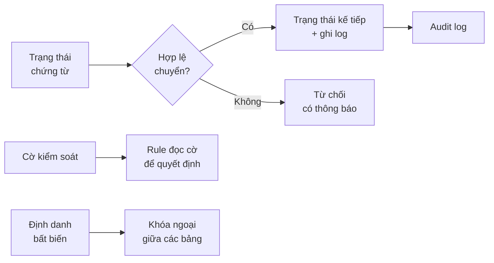

# 7000 Thuật ngữ kỹ thuật & dữ liệu chuẩn

Khi một bài viết nói "chứng từ ở trạng thái `CONFIRMED`" hay "giao dịch có cờ `Is_Logical`", phải có một chỗ định nghĩa các giá trị đó một lần. Đây là chỗ đó.

## 0. Nguyên lý (áp dụng mọi ERP)

1. **Trạng thái chứng từ phải hữu hạn và có ý nghĩa nghiệp vụ.** Một chứng từ không thể có 20 trạng thái mà nửa số đó ai cũng không biết dùng khi nào.
2. **Trạng thái chỉ được đi một chiều, trừ khi có quy trình rõ ràng cho chiều ngược lại.** Cho phép nhảy tự do giữa các trạng thái là bỏ mất kiểm soát quy trình.
3. **Cờ kiểm soát (flag) phải là boolean có tên rõ ràng**, không dùng giá trị số mơ hồ (`0/1/2`) mà không có danh mục.
4. **Mọi bảng giao dịch cần một định danh duy nhất, bất biến, không tái sử dụng.** Dùng số chứng từ làm khóa chính là lỗi thiết kế phổ biến.
5. **Quy ước đặt tên phải thống nhất toàn tài liệu**, để đọc bài này rồi sang bài khác vẫn hiểu.

## 1. Luồng vận hành



## 2. Ai làm gì ở module nào

| Việc | IT / Kiến trúc dữ liệu | BA nghiệp vụ | Người dùng cuối |
|---|---|---|---|
| Định nghĩa danh mục trạng thái | ✅ sở hữu | ✅ duyệt ý nghĩa nghiệp vụ | — |
| Cấu hình chuyển trạng thái hợp lệ | ✅ thực hiện | ✅ cung cấp luật | — |
| Đặt tên bảng và trường | ✅ sở hữu | Rà soát | — |
| Ghi log chuyển trạng thái | ✅ sở hữu | — | — |

## 3. Hạch toán

Trạng thái chứng từ quyết định **khi nào bút toán được ghi**:

- `DRAFT` — không sinh bút toán.
- `APPROVED` / `CONFIRMED` — chưa sinh bút toán nếu chưa có sự kiện kế toán.
- `POSTED` — đã sinh bút toán, không sửa được.
- `CANCELLED` / `VOID` — phải đảo bút toán nếu đã ghi.

Bản đồ tài khoản ở [Hạch toán & tài khoản trung gian](../6-ke-toan-chung/1000-hach-toan-va-tai-khoan-trung-gian.md).

## 4. Điểm chạm & rủi ro

- **Chứng từ và đối soát**: [Chứng từ & nguyên lý đối soát](./4000-chung-tu-va-nguyen-ly-doi-soat.md)
- **Giao dịch kho và loại chuyển động**: [Giao dịch nhập, xuất & chuyển](../1-kho/3000-giao-dich-nhap-xuat-chuyen.md)
- **Kiểm soát nội bộ**: [Kiểm soát nội bộ & phân tách nhiệm vụ](./5000-kiem-soat-noi-bo-va-phan-tach-nhiem-vu.md)

**Rủi ro chính:**

- **Quá nhiều trạng thái không ai dùng hết** — hệ thống có trạng thái mà không ai biết khi nào dùng, dữ liệu rác tích lũy.
- **Cho nhảy trạng thái tự do** — không kiểm soát được quy trình.
- **Dùng số chứng từ làm khóa chính** — trùng số, không sửa được, không liên kết được.
- **Cờ boolean đảo nghĩa không rõ** (`InActive = 1` nghĩa là ngưng) — nguồn gốc của điều kiện viết ngược.

## 5. Triển khai tham chiếu ERP

### A. Trạng thái chứng từ chuẩn dùng trong tài liệu

| Trạng thái | Ý nghĩa | Ghi được bút toán? |
|---|---|---|
| `DRAFT` | Nháp, chưa ai duyệt | Không |
| `PENDING` | Chờ duyệt | Không |
| `APPROVED` | Đã duyệt, chưa phát sinh sự kiện | Không |
| `CONFIRMED` | Đã cam kết với đối tác | Không |
| `PARTIAL` | Đã thực hiện một phần (nhận/giao) | Có (theo phần đã thực hiện) |
| `COMPLETED` / `DELIVERED` | Đã thực hiện đầy đủ | Có |
| `POSTED` | Đã ghi sổ, không sửa được | Đã ghi |
| `CLOSED` | Đã đóng, không thay đổi nữa | Không |
| `CANCELLED` / `VOID` | Đã hủy | Phải đảo nếu đã ghi |

### B. Loại chuyển động kho chuẩn (5 loại gốc)

| Loại | From → To | Sinh bút toán? |
|---|---|---|
| `RECEIPT` | `SUPPLIER` / `WIP` / `CUSTOMER` → bin | Có |
| `ISSUE` | bin → `CUSTOMER` / `WIP` / `SUPPLIER` / `SCRAP` | Có |
| `TRANSFER` | bin A → bin B | Không (trừ khi vượt pháp nhân/tài khoản) |
| `ADJUSTMENT` | `ADJUSTMENT` ↔ bin | Có, sau khi duyệt |
| `REVERSAL` | chiều ngược của giao dịch gốc | Đảo bút toán gốc |

Chi tiết ở [Giao dịch nhập, xuất & chuyển](../1-kho/3000-giao-dich-nhap-xuat-chuyen.md).

### C. Cờ kiểm soát dùng trong tài liệu

| Cờ | Ý nghĩa | Lưu ý |
|---|---|---|
| `Is_Logical` | Giao dịch ảo (drop-ship, ký gửi) | Loại khỏi báo cáo On-hand |
| `Is_Available` | Vị trí tính vào tồn khả dụng | `0` cho kho đệm, kho lỗi |
| `Is_Blocked` | Vị trí đang khóa | Kiểm kê, sự chự cố |
| `Is_Locked` | Mã hàng đã có giao dịch | Chặn sửa `Base_UOM` |
| `Ownership` | `OWN` / `VENDOR` / `CUSTOMER` | `VENDOR` là hàng ký gửi |
| `InActive` | **=1 nghĩa là NGƯNG dùng** | Cờ đảo nghĩa — dễ viết ngược |

### D. Quy ước đặt tên dùng trong tài liệu

| Tiền tố | Ý nghĩa | Ví dụ |
|---|---|---|
| `PO_` | Mua hàng | `PO_Header`, `PO_Line` |
| `WO_` | Lệnh sản xuất | `WO_Operation`, `WO_Material_Txn` |
| `SO_` | Bán hàng | `Sales_Order`, `Sales_Order_Line` |
| `AR_` / `AP_` | Công nợ | `AR_Invoice`, `AP_Open_Item` |
| `Inv_` / `Inventory_` | Kho | `Inventory_Transaction`, `Inv_Location` |
| `BOM_` / `Routing_` | Kỹ thuật sản xuất | `BOM_Header`, `Routing_Operation` |
| `FX_` | Ngoại tệ | `FX_Revaluation_Line` |

### E. Truy vấn kiểm soát

**Chứng từ ở trạng thái không có trong danh mục cho phép:**

```sql
SELECT Doc_Type, Status, COUNT(*) AS So_Dong
FROM (
    SELECT 'PO' AS Doc_Type, Status FROM PO_Header
    UNION ALL SELECT 'AP_INVOICE', Status FROM AP_Invoice
    UNION ALL SELECT 'SALES_ORDER', Status FROM Sales_Order
) t
WHERE t.Status NOT IN ('DRAFT','PENDING','APPROVED','CONFIRMED','PARTIAL',
                       'COMPLETED','DELIVERED','POSTED','CLOSED','CANCELLED','VOID')
GROUP BY Doc_Type, Status;
```

**Giao dịch kho có `From` và `To` trùng nhau:**

```sql
SELECT Trx_ID, Trx_Type, From_Location_ID, To_Location_ID
FROM Inventory_Transaction
WHERE From_Location_ID = To_Location_ID;
```

**Giao dịch kho để trống một đầu vị trí:**

```sql
SELECT Trx_ID, Trx_Type, From_Location_ID, To_Location_ID
FROM Inventory_Transaction
WHERE From_Location_ID IS NULL OR To_Location_ID IS NULL;
```

**Epicor — trạng thái đơn mua nằm ngoài danh mục:**

```sql
SELECT DISTINCT ph.Status
FROM Erp.POHeader ph
WHERE ph.Company = 'YOUR_COMPANY_CODE'
  AND ph.Status NOT IN ('P','A','C','X');  -- Pending, Approved, Closed, Cancelled
```

## 6. Bẫy thực chiến & Checklist

| # | Bẫy | Triệu chứng | Cách phòng tránh |
|---|---|---|---|
| 1 | Quá nhiều trạng thái | Có trạng thái không ai biết dùng khi nào | Danh mục trạng thái tối giản, có tài liệu |
| 2 | Cho nhảy trạng thái tự do | Không kiểm soát được quy trình | Bảng chuyển trạng thái hợp lệ |
| 3 | Không ghi log chuyển trạng thái | Không biết ai đổi, khi nào | Audit log cho mọi chuyển trạng thái |
| 4 | Dùng số chứng từ làm khóa chính | Trùng số, không liên kết được | Khóa kỹ thuật riêng + số chứng từ có unique |
| 5 | Cờ đảo nghĩa không ghi chú | Điều kiện viết ngược, báo cáo sai | Tên cờ rõ nghĩa kèm chú thích |
| 6 | Định danh tái sử dụng | Bản ghi mới trỏ nhầm bản ghi cũ đã xóa | Không tái sử dụng ID |
| 7 | Tên bảng không thống nhất | Cùng khái niệm hai tên khác nhau | Quy ước tiền tố |
| 8 | Trạng thái không phân biệt đã duyệt và đã cam kết | Báo cáo tiến độ sai | Tách `APPROVED` và `CONFIRMED` |
| 9 | Giao dịch kho có From = To | Báo cáo tồn vẫn đúng nhưng vô nghĩa | Ràng buộc `From <> To` |
| 10 | Để trống vị trí thay vì dùng vị trí ảo | Mất khả năng tự kiểm tra tổng bằng 0 | Dùng vị trí ảo có tên |

**Checklist:**

- [ ] Danh mục trạng thái đã chốt và có tài liệu mô tả.
- [ ] Bảng chuyển trạng thái hợp lệ đã cấu hình (đã test chặn nhảy sai).
- [ ] Mọi chuyển trạng thái có audit log.
- [ ] Mọi bảng có khóa kỹ thuật bất biến, không dùng số chứng từ làm khóa chính.
- [ ] Cờ đảo nghĩa (`InActive`) có chú thích rõ trong schema.
- [ ] Quy ước tiền tố bảng đã áp dụng nhất quán.
- [ ] Giao dịch kho có ràng buộc `From <> To` và không NULL (đã test).
- [ ] Trạng thái `APPROVED` và `CONFIRMED` tách biệt.
- [ ] Đã test: cố gắng chuyển từ `POSTED` về `DRAFT` → hệ thống từ chối.

<div align="center" style={{color: 'var(--ifm-color-primary)'}}>
  <strong>Chúc các bạn thành công và vui vẻ!</strong>
</div>
