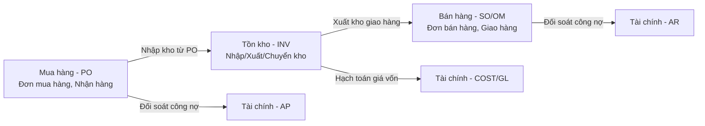

import DocCardList from '@theme/DocCardList';

# Chuỗi cung ứng (SCM)

Chuỗi cung ứng (Supply Chain Management - SCM) là phân hệ trung tâm kết nối dòng chảy vật tư — từ khi phát sinh nhu cầu mua hàng, nhập kho, lưu trữ tồn kho, cho đến khi xuất kho giao hàng cho khách. Đây cũng là phân hệ tạo ra phần lớn dữ liệu giao dịch (transaction) làm đầu vào cho phân hệ Sản xuất (MFG) và Tài chính kế toán (FIN).

## Tương quan phân hệ con với các ERP phổ biến

| Phân hệ con trong tài liệu | SAP | Oracle EBS | Epicor |
|---|---|---|---|
| **Mua hàng (PO)** | MM-PUR (Purchasing) | Purchasing (PO) | Purchase Management |
| **Tồn kho (INV)** | MM-IM (Inventory Management) | Inventory (INV) | Inventory Management |
| **Bán hàng (SO/OM)** | SD (Sales & Distribution) | Order Management (OM) | Sales Order Management |

## Sơ đồ luồng nghiệp vụ

## Danh mục tài liệu

<DocCardList />

  <strong>Chúc các bạn thành công và vui vẻ!</strong>

