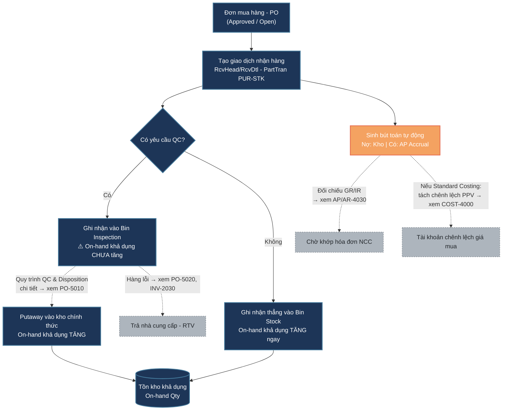

# 1000 Nhập kho từ PO (Receipt from PO) 

> Luồng dữ liệu, Hạch toán và các "Bẫy" thực chiến

Trong chuỗi cung ứng của doanh nghiệp, **Nhập kho từ mua hàng (Receipt from Purchase Order / PO Receipt)** là điểm chạm đầu tiên đưa vật tư bên ngoài vào hệ thống ERP.

Đối với một Developer hoặc Consultant ERP, đây không đơn thuần là nút bấm "Nhập kho" trên màn hình giao diện. Đằng sau nút bấm đó là sự dịch chuyển của các luồng dữ liệu (Data Flow), hạch toán kế toán tự động (SLA) và những ràng buộc chặt chẽ về giá thành.

> **Phạm vi bài viết:** Bài này tập trung vào **giao dịch nhập kho** — dữ liệu ghi nhận ở đâu, tồn kho tăng khi nào, bút toán tự động phát sinh ra sao. Quy trình **nhận hàng & kiểm tra chất lượng đầy đủ** (dung sai nhận thừa, luồng 2 bước qua khu kiểm tra, xử lý hàng lỗi) thuộc phạm vi phân hệ **Mua hàng (PO)**; việc **đối chiếu công nợ tạm tính GR/IR** thuộc phân hệ **Công nợ (AP/AR)**; và **chênh lệch giá mua so với giá thành tiêu chuẩn (PPV)** thuộc phân hệ **Giá thành (COST)**. Link chi tiết ở cuối bài.

---

## Sơ đồ luồng Nhập kho từ PO (góc nhìn Kho)

Sơ đồ dưới đây thể hiện đúng những gì **giao dịch kho** cần xử lý khi nhận hàng từ PO. Các bước thuộc phạm vi phân hệ khác (QC chi tiết, đối soát hóa đơn, tính PPV) được đánh dấu riêng để bạn biết khi nào cần đọc bài chuyên trách thay vì tìm trong bài này.



> Ô màu xám nét đứt là các bước **không thuộc phạm vi bài này** — chỉ ghi nhận để bạn biết luồng đi tiếp theo, chi tiết nghiệp vụ nằm ở bài link kèm theo.

---

## 1. Luồng dữ liệu hệ thống (Under the Hood)

Khi thủ kho thực hiện xác nhận phiếu nhập kho (thường gọi là **GRN - Goods Receipt Note** hoặc **Receiver**), hệ thống ERP sẽ thực hiện ghi nhận dữ liệu vào các bảng Database cốt lõi.

### Bảng đối chiếu cấu trúc dữ liệu giữa các hệ thống:

| Tác vụ dữ liệu | Epicor ERP | Oracle EBS | SAP ERP |
| :--- | :--- | :--- | :--- |
| **Bảng Header Phiếu nhập** | `Erp.RcvHead` | `RCV_SHIPMENT_HEADERS` | `MKPF` (Material Doc Header) |
| **Bảng Detail Phiếu nhập** | `Erp.RcvDtl` | `RCV_SHIPMENT_LINES` | `MSEG` (Material Doc Segment) |
| **Bảng Transaction gốc** | `Erp.PartTran` (TranType: `PUR-STK`) | `MTL_MATERIAL_TRANSACTIONS` | `MSEG` (Movement Type: `101`) |

### Mối quan hệ dữ liệu cốt lõi:
Một lỗi kinh điển khi viết báo cáo đối chiếu của các Developer mới vào nghề là join trực tiếp bảng Nhận hàng (`RcvDtl`) với bảng PO (`PODetail`) mà không qua bảng trung gian hoặc không kiểm tra trạng thái dòng.

Để tính được số lượng **"PO còn lại chưa nhận" (Open PO Qty)**, công thức chuẩn luôn phải là:

$$
\text{Open PO Qty} = \text{PO Ordered Qty} - \text{Total Received Qty} - \text{Total Voided Qty}
$$

---

## 2. Luồng hạch toán kế toán tự động (Subledger Accounting - SLA)

Khi thủ kho nhấn "Save & Post" phiếu nhập kho, hệ thống ERP sẽ tự động sinh bút toán kế toán (Subledger Transaction). Tại thời điểm này, doanh nghiệp **chưa nhận được hóa đơn đỏ (Invoice)** từ nhà cung cấp, nhưng hàng đã vào kho nên bắt buộc phải ghi nhận tăng tài sản và một khoản nợ phải trả tạm tính.

### Tài khoản sử dụng:
* **Tài khoản kho (Inventory Account):** Ghi nhận giá trị hàng tồn kho tăng lên.
* **Tài khoản Trung gian mua hàng (AP Accrual / Nhận hàng chưa hóa đơn):** Tài khoản tạm tính (Liability) để chờ đối chiếu với Invoice sau này.

### Bút toán hạch toán:
* **Nợ (Debit):** `Tài khoản Kho` (152, 156...) — Trị giá hàng nhập kho.
* **Có (Credit):** `Tài khoản AP Accrual` (3387 / 3388 hoặc tài khoản tạm tính tương đương) — Công nợ tạm tính.

> Tài khoản AP Accrual này sẽ được đối chiếu và tất toán khi phòng Kế toán nhận và khớp hóa đơn từ nhà cung cấp. Quy trình đối chiếu định kỳ (Reconciliation) và xử lý các trường hợp lệch số dư giữa "Hàng đã nhận chưa có hóa đơn" thuộc nghiệp vụ **GR/IR Clearing Account Reconciliation** của phân hệ Công nợ — xem chi tiết tại **[AP/AR 4030 - GR/IR Clearing Account Reconciliation]()**.

---

## 3. Các điểm then chốt cần lưu ý khi ghi nhận giao dịch nhập kho

### ⚠️ Điểm 1: Số lượng nhận có thể vượt số lượng đặt trên PO (Over-Receipt)

**Tình huống:** Phòng mua hàng đặt mua **100 con** Bu-lông. Nhà cung cấp giao đến **105 con** (do đóng gói dư hoặc cố tình giao thêm).

Từ góc độ **giao dịch kho**, điều Developer/BA cần nắm là: nếu hệ thống cho phép ghi nhận nhập kho vượt số lượng PO mà không có ràng buộc, tồn kho khả dụng (On-hand Qty) sẽ tăng lên **không có căn cứ chứng từ mua hàng tương ứng**, và về sau khi hóa đơn NCC về đúng 105 con, hệ thống sẽ không khớp được với PO gốc (100 con) khi đối soát.

Việc **cấu hình hạn mức dung sai nhận hàng (Over-Receipt Tolerance)**, ai được duyệt vượt dung sai, và hệ quả lên đối soát hóa đơn 3 chiều là nghiệp vụ của quy trình nhận hàng — xem chi tiết tại **[PO 5010 - PO Receiving, Quality Inspection & Putaway](../po-mua-hang/5010-nghiep-vu-nhan-hang-mua-kiem-tra-chat-luong-va-nhap-kho.md)** và **[PO 7000 - Nguyên lý đối soát khớp lệnh 3 chiều](../po-mua-hang/7000-nguyen-ly-doi-soat-khop-lenh-3-chieu-va-2-chieu.md)**.

---

### ⚠️ Điểm 2: Thời điểm tồn kho khả dụng thực sự tăng lên

Không phải cứ "nhận hàng" là tồn kho khả dụng (On-hand Qty dùng để sản xuất/bán hàng) tăng ngay lập tức. Nhiều doanh nghiệp yêu cầu hàng phải qua khu vực chờ kiểm tra chất lượng (Inspection Bin) trước khi được cất vào kệ kho chính thức (Putaway).

Điều quan trọng với Developer viết báo cáo tồn kho: **giao dịch nhận hàng (Receipt) và giao dịch On-hand Qty tăng lên có thể là hai bước tách biệt về thời điểm.** Nếu báo cáo tồn kho chỉ đếm theo bảng Transaction gốc mà không lọc theo trạng thái Bin (Inspection vs Stock), số liệu tồn kho khả dụng sẽ bị thổi phồng sai so với thực tế hàng có thể xuất dùng.

Toàn bộ quy trình 2 bước (nhận vào khu kiểm tra → QC phân loại đạt/lỗi → cất kho hoặc trả NCC) thuộc nghiệp vụ nhận hàng của phân hệ Mua hàng — xem chi tiết tại **[PO 5010 - PO Receiving, Quality Inspection & Putaway](../po-mua-hang/5010-nghiep-vu-nhan-hang-mua-kiem-tra-chat-luong-va-nhap-kho.md)**. Trường hợp hàng bị từ chối sau kiểm tra dẫn đến xuất trả nhà cung cấp, xem **[INV 2030 - Xuất kho trả nhà cung cấp (RTV)](./2020-xuat-kho-tra-nha-cung-cap-rtv.md)**.

---

### ⚠️ Điểm 3: Đơn giá ghi vào kho không nhất thiết bằng đơn giá trên PO

Nếu doanh nghiệp áp dụng **Tính giá thành tiêu chuẩn (Standard Costing)**, đơn giá ghi tăng vào tài khoản Kho khi nhận hàng là **giá tiêu chuẩn (Standard Cost)** đã được duyệt trước, không phải giá mua thực tế trên PO. Phần chênh lệch (nếu có) giữa hai giá này được tách ra một tài khoản riêng thay vì gộp vào giá trị tồn kho.

**Ví dụ:** Mã hàng `BUL-001` có Standard Cost = 10 USD/con, giá mua trên PO = 12 USD/con. Khi nhận 1 con vào kho, hệ thống không ghi tăng kho 12 USD mà chỉ ghi 10 USD, phần chênh lệch 2 USD được đẩy sang một tài khoản khác.

**Hệ quả cần lưu ý khi viết báo cáo:** nếu lấy `Số lượng nhận × Đơn giá trên PO` để tính giá trị nhập kho trong kỳ đối với các doanh nghiệp chạy Standard Cost, số liệu sẽ lệch ngay so với Sổ cái — vì phần chênh lệch giá mua đã được tách ra khỏi giá trị kho.

Cơ chế tính, hạch toán và phân tích khoản chênh lệch này (Purchase Price Variance - PPV) thuộc phân hệ Giá thành — xem chi tiết tại **[COST 4000 - Phân tích chênh lệch giá thành thực tế so với định mức]()**. Cách phân biệt các phương pháp tính giá tồn kho, xem **[INV 5000 - Các phương pháp Tính giá hàng Tồn kho](./5000-phuong-phap-tinh-gia-fifo-lifo-average-standard.md)**.

---

## 4. Các câu lệnh SQL Audit thực chiến rà soát giao dịch Nhập kho

Định kỳ trước khi khóa sổ kho (Period Close), nên quét 2 câu lệnh dưới đây để phát hiện các bất thường phát sinh ngay tại tầng giao dịch nhận hàng.

---

### ❌ SQL Audit 1: Phát hiện hàng bị "kẹt" ở khu vực kiểm tra chất lượng (Inspection) quá lâu chưa Putaway

Hàng nằm lâu ở Inspection Bin vừa làm sai lệch số liệu tồn kho khả dụng thực tế (On-hand nhìn có vẻ thấp hơn hàng vật lý đang có trong xưởng), vừa là dấu hiệu QC bị tồn đọng cần cảnh báo vận hành. Ví dụ dưới đây quét các dòng nhận hàng đã quá 5 ngày vẫn còn ở trạng thái chờ kiểm.

#### 💻 Code SQL dành cho Epicor ERP (Bảng `RcvDtl` & `PartBin`):
```sql
SELECT 
    rd.PONum AS [Số PO],
    rd.PartNum AS [Mã sản phẩm],
    rd.OurQty AS [SL đã nhận],
    rd.ReceiptDate AS [Ngày nhận],
    DATEDIFF(DAY, rd.ReceiptDate, GETDATE()) AS [Số ngày chờ QC],
    pb.WarehouseCode AS [Kho],
    pb.BinNum AS [Vị trí Bin]
FROM Erp.RcvDtl rd
INNER JOIN Erp.PartBin pb 
    ON rd.Company = pb.Company AND rd.PartNum = pb.PartNum
WHERE rd.InspectionReq = 1                          -- Dòng nhận hàng yêu cầu QC
  AND pb.BinNum LIKE 'INSP%'                         -- Đang nằm trong khu vực Bin kiểm tra
  AND DATEDIFF(DAY, rd.ReceiptDate, GETDATE()) > 5;  -- Quá 5 ngày chưa xử lý
```

#### 💻 Code SQL dành cho Oracle EBS R12 (Bảng `RCV_TRANSACTIONS` & `MTL_MATERIAL_TRANSACTIONS`):
```sql
SELECT 
    pha.segment1                  AS po_number,          -- Số PO
    msi.segment1                  AS item_code,          -- Mã sản phẩm
    rt.quantity                   AS received_qty,       -- Số lượng đã nhận
    rt.transaction_date           AS receipt_date,       -- Ngày nhận
    ROUND(SYSDATE - rt.transaction_date) AS days_waiting_qc, -- Số ngày chờ QC
    rt.subinventory               AS warehouse,          -- Sửa thành cột chuẩn lưu mã kho (Subinventory)
    (SELECT segment1 FROM mtl_item_locations WHERE inventory_location_id = rt.locator_id) AS locator -- Lấy tên vị trí Bin/Locator
FROM 
    rcv_transactions rt
INNER JOIN 
    rcv_shipment_lines rsl ON rt.shipment_line_id = rsl.shipment_line_id
INNER JOIN 
    po_headers_all pha ON rsl.po_header_id = pha.po_header_id
INNER JOIN 
    mtl_system_items_b msi ON rsl.item_id = msi.inventory_item_id AND rsl.to_organization_id = msi.organization_id
WHERE 
    rt.transaction_type = 'RECEIVE'                      -- Trạng thái mới nhận hàng từ nhà cung cấp
    AND rsl.routing_header_id = 2                        -- 2 = Inspection Required (Yêu cầu QC)
    AND NOT EXISTS (                                     -- Kiểm tra xem đã làm bước QC (Accept/Reject) hay chưa
        SELECT 1 
        FROM rcv_transactions rt2 
        WHERE rt2.parent_transaction_id = rt.transaction_id
          AND rt2.transaction_type IN ('ACCEPT', 'REJECT', 'DELIVER')
    )
    AND (SYSDATE - rt.transaction_date) > 5              -- Quá 5 ngày chưa xử lý
ORDER BY 
    rt.transaction_date DESC;
```

---

### ❌ SQL Audit 2: Phát hiện giao dịch nhập kho bị ghi lùi ngày (Backdated) vào kỳ đã khóa sổ

Đây là kiểm soát tương ứng trực tiếp checklist "Ràng buộc kỳ kế toán" — quét các giao dịch có `Ngày giao dịch` (Transaction Date) nhỏ hơn `Ngày tạo giao dịch` (System Created Date) một khoảng bất thường, dấu hiệu người dùng cố tình chỉnh ngày nhận hàng lùi về kỳ trước.

#### 💻 Code SQL dành cho Epicor ERP (Bảng `PartTran`):
```sql
SELECT 
    pt.PartNum AS [Mã sản phẩm],
    pt.TranType AS [Loại giao dịch],
    pt.TranDate AS [Ngày hạch toán],
    pt.SysRowID,
    pt.EntryPerson AS [Người nhập],
    DATEDIFF(DAY, pt.TranDate, pt.CreatedOn) AS [Số ngày lùi]
FROM Erp.PartTran pt
WHERE pt.TranType = 'PUR-STK'                        -- Giao dịch nhập kho từ PO
  AND DATEDIFF(DAY, pt.TranDate, pt.CreatedOn) > 3    -- Ngày hạch toán lùi quá 3 ngày so với ngày tạo thực tế
ORDER BY DATEDIFF(DAY, pt.TranDate, pt.CreatedOn) DESC;
```

#### 💻 Code SQL dành cho Oracle EBS R12 (Bảng `MTL_MATERIAL_TRANSACTIONS`):
```sql
SELECT 
    mmt.transaction_id,
    msi.segment1 AS item_code,
    mmt.transaction_type_id,
    mmt.transaction_date,                            -- Ngày hạch toán do người dùng chọn
    mmt.creation_date,                                -- Ngày hệ thống thực sự tạo dòng
    mmt.created_by,
    (TRUNC(mmt.creation_date) - TRUNC(mmt.transaction_date)) AS days_backdated
FROM mtl_material_transactions mmt
INNER JOIN mtl_system_items_b msi 
    ON mmt.inventory_item_id = msi.inventory_item_id AND mmt.organization_id = msi.organization_id
WHERE mmt.transaction_source_type_id = 1              -- Nguồn gốc từ Purchase Order
  AND (TRUNC(mmt.creation_date) - TRUNC(mmt.transaction_date)) > 3
ORDER BY days_backdated DESC;
```

---

## 5. Checklist cho Developer khi phát triển tính năng/báo cáo Nhập kho từ PO

- [ ] **Kiểm tra trạng thái dòng PO (PO Line Status):** Chỉ cho phép nhận những dòng PO có trạng thái `Approved` và `Open`.
- [ ] **Xử lý Đơn vị tính (UOM):** Luôn kiểm tra trường số lượng đã nhận thực tế theo đơn vị tồn kho gốc (ví dụ: `OurQty` trong Epicor) thay vì lấy số lượng thô của nhà cung cấp (`VendorQty`).
- [ ] **Phân biệt Bin trạng thái khi tính On-hand:** Báo cáo tồn kho khả dụng phải lọc đúng theo Bin/trạng thái (Inspection vs Stock), không gộp chung mọi giao dịch Receipt.
- [ ] **Ràng buộc kỳ kế toán (Period Lock):** Tuyệt đối không cho phép thủ kho nhập lùi ngày nhận hàng (Backdate) về kỳ kế toán đã khóa sổ.
- [ ] **Xử lý tỷ giá (Exchange Rate):** Đối với các PO mua hàng ngoại tệ (USD, EUR), báo cáo đối chiếu tài chính bắt buộc phải lấy đúng tỷ giá tại ngày nhận hàng thực tế (Receipt Date) chứ không phải ngày tạo PO.

---

## Xem thêm

- **[PO 5010 - Nghiệp vụ nhận hàng mua, kiểm tra chất lượng và nhập kho](../po-mua-hang/5010-nghiep-vu-nhan-hang-mua-kiem-tra-chat-luong-va-nhap-kho.md)** — quy trình đầy đủ 2 bước nhận hàng, dung sai nhận thừa, xử lý hàng lỗi.
- **[PO 7000 - Nguyên lý đối soát khớp lệnh 3 chiều và 2 chiều](../po-mua-hang/7000-nguyen-ly-doi-soat-khop-lenh-3-chieu-va-2-chieu.md)** — cơ chế khớp PO - Receipt - Invoice.
- **[AP/AR 4030 - GR/IR Clearing Account Reconciliation]()** — đối chiếu tài khoản trung gian nhận hàng chưa có hóa đơn.
- **[COST 4000 - Phân tích chênh lệch giá thành thực tế so với định mức]()** — chi tiết cơ chế và bút toán Purchase Price Variance (PPV).
- **[INV 2030 - Xuất kho trả nhà cung cấp (RTV)](./2020-xuat-kho-tra-nha-cung-cap-rtv.md)** — giao dịch kho khi hàng bị từ chối sau QC.
- **[INV 5000 - Các phương pháp Tính giá hàng Tồn kho](./5000-phuong-phap-tinh-gia-fifo-lifo-average-standard.md)** — Standard/Average/FIFO/LIFO và cơ chế chọn lô khi xuất kho.

<div align="center" style={{color: 'var(--ifm-color-primary)'}}>
  <strong>Chúc các bạn thành công và vui vẻ!</strong>
</div>