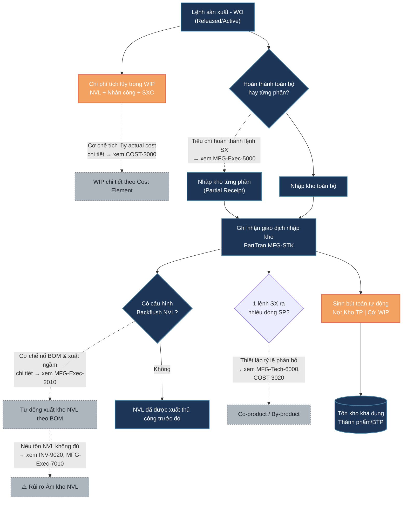

# 1010 Nghiệp vụ Nhập kho từ Sản xuất (Receipt from Work Order)

> Luồng dữ liệu hệ thống, WIP, Kế toán giá thành và các "Bẫy" thực chiến thường gặp khi nhập kho từ sản xuất trên Epicor & Oracle EBS.

Nếu như nhập kho từ PO là việc mang vật tư từ ngoài vào doanh nghiệp, thì **Nhập kho từ sản xuất (Receipt from Work Order / Goods Receipt from Production)** là việc ghi nhận kết quả lao động nội bộ: Chuyển đổi nguyên vật liệu thô thành Bán thành phẩm (SFG) hoặc Thành phẩm (FG) để nhập vào kho.

Đây là nghiệp vụ giao thoa trực tiếp giữa 3 phân hệ lớn: **Kho (INV)**, **Sản xuất (MFG)**, và **Kế toán giá thành (COST)**. Dưới góc độ hệ thống, đây là thời điểm chi phí dở dang (WIP) được kết chuyển thành tài sản tồn kho.

> **Phạm vi bài viết:** Bài này tập trung vào **giao dịch kho nhận thành phẩm/bán thành phẩm từ WIP** — dữ liệu ghi nhận ở đâu, tồn kho tăng khi nào, bút toán tự động phát sinh ra sao. Quy trình sản xuất đầy đủ (khi nào một lệnh SX được coi là hoàn thành từng phần, gán Lot/Serial) thuộc phân hệ **Thực thi Sản xuất (MFG-Exec)**; cơ chế trừ kho tự động theo BOM (Backflushing) thuộc **MFG-Exec**; thiết lập tỷ lệ phân bổ Co-product/By-product thuộc **Kỹ thuật Sản xuất (MFG-Tech)**; và cách tính giá thực tế/phân tích chênh lệch giá thành thuộc **Giá thành (COST)**. Link chi tiết ở cuối bài.

---

## Sơ đồ luồng Nhập kho từ Sản xuất (góc nhìn Kho)



> Ô màu xám nét đứt là các bước **không thuộc phạm vi bài này** — chỉ ghi nhận để bạn biết luồng đi tiếp theo, chi tiết nghiệp vụ nằm ở bài link kèm theo.

---

## 1. Luồng dữ liệu và Giao dịch gốc (Under the Hood)

Khi phân xưởng hoàn thành một lệnh sản xuất (Work Order / Job) và bàn giao thành phẩm cho thủ kho, thủ kho sẽ thực hiện giao dịch nhập kho thành phẩm từ sản xuất.

### Bản đồ dữ liệu giữa các hệ thống ERP:

| Tác vụ dữ liệu | Epicor ERP | Oracle EBS | SAP ERP |
| :--- | :--- | :--- | :--- |
| **Lệnh sản xuất** | `Erp.JobHead` | `WIP_DISCRETE_JOBS` | `AUFK` / `AFKO` (Production Order) |
| **Giao dịch gốc (Transaction)** | `Erp.PartTran` (TranType: `MFG-STK`) | `MTL_MATERIAL_TRANSACTIONS` (Transaction Action: Assembly Completion) | `MSEG` (Movement Type: `101` với reference Order) |
| **Chi phí tích lũy** | `Erp.JobAsmbl` (Lưu WIP chi tiết: Material, Labor, Burden...) | `WIP_PERIOD_BALANCES` | `COSB` (CO Objects: Cost Totals) |

### Bản chất chuyển dịch chi phí:
Khi lệnh sản xuất được chạy, chi phí nguyên vật liệu, nhân công và máy móc được tích lũy vào tài khoản **WIP (Work in Process - Chi phí sản xuất dở dang)**. Khi giao dịch nhập kho thành phẩm diễn ra, chi phí này được rút ra khỏi WIP để nạp vào kho Thành phẩm. Cơ chế tích lũy chi tiết từng yếu tố chi phí (Material/Labor/Overhead) trong WIP trước thời điểm nhập kho thuộc phạm vi phân hệ Giá thành — xem **[COST 3000 - Quy trình tính toán giá trị sản phẩm dở dang cuối kỳ (WIP Calculation)]()**.

---

## 2. Hạch toán kế toán sản xuất tự động (WIP Accounting)

Bút toán nhập kho từ sản xuất phản ánh việc giảm chi phí dở dang trên phân xưởng và tăng giá trị thành phẩm trong kho.

### Tài khoản sử dụng:
* **Tài khoản Thành phẩm (Finished Goods Account):** Ghi nhận giá trị thành phẩm nhập kho (155, 152...).
* **Tài khoản WIP (Work in Process Account):** Tài khoản trung gian tích lũy chi phí sản xuất (154).

### Bút toán hạch toán:
* **Nợ (Debit):** `Tài khoản Kho Thành phẩm` (155) — Tăng tài sản tồn kho.
* **Có (Credit):** `Tài khoản WIP` (154) — Giảm chi phí dở dang tương ứng của lệnh sản xuất.

---

## 3. Các điểm then chốt cần lưu ý khi ghi nhận giao dịch nhập kho từ sản xuất

### ⚠️ Điểm 1: Nhập kho từng phần (Partial Receipt) có thể khiến giá trị nhập kho bị lệch

**Tình huống:** Lệnh sản xuất yêu cầu sản xuất 100 sản phẩm, nhưng phân xưởng hoàn thành và làm thủ tục nhập kho trước 10 sản phẩm (Partial Receipt) khi chi phí nhân công/chi phí chung của cả lệnh **chưa được chấm công đầy đủ** trong hệ thống.

Từ góc độ **giao dịch kho**, điều Developer/BA cần nắm là: nếu hệ thống tính đơn giá nhập kho bằng cách lấy tổng chi phí hiện có trong WIP chia đều cho số lượng vừa nhận, giá trị 10 sản phẩm đầu tiên có thể bị "đội giá" gấp nhiều lần thực tế — vì WIP tại thời điểm đó gánh toàn bộ chi phí NVL nhưng chưa đủ chi phí nhân công tương ứng. Hậu quả trực tiếp lên kho: nếu 10 sản phẩm này được xuất bán ngay trong kỳ, giá vốn ghi nhận sẽ sai lệch nghiêm trọng.

Cơ chế tính giá thực tế theo % hoàn thành, ước tính Labor/Overhead, và xử lý chênh lệch (Variance) cuối kỳ thuộc phân hệ Giá thành — xem **[COST 3010 - Các phương pháp tính giá thành thực tế cuối kỳ]()** và **[COST 4000 - Phân tích chênh lệch giá thành thực tế so với định mức]()**. Tiêu chí xác định khi nào một lệnh sản xuất được coi là hoàn thành từng phần/toàn bộ thuộc **[MFG-Exec 5000 - Nghiệp vụ báo cáo hoàn thành lệnh sản xuất]()**.

---

### ⚠️ Điểm 2: Nhập kho thành phẩm có thể kích hoạt xuất kho ngầm (Backflush) — rủi ro Âm kho NVL

Nhiều doanh nghiệp cấu hình **Backflushing**: khi thủ kho nhập kho thành phẩm, hệ thống tự động tạo giao dịch xuất kho nguyên vật liệu tương ứng dựa trên định mức BOM, thay vì thủ kho phải xuất kho NVL thủ công trước đó.

Từ góc độ **giao dịch kho**, điều cần nắm là: một giao dịch **nhập kho thành phẩm** không chỉ làm tăng tồn kho thành phẩm mà còn **đồng thời kích hoạt giảm tồn kho NVL** ở phía sau. Nếu tồn kho hệ thống của NVL tại thời điểm đó không đủ (dù thực tế ngoài kho vẫn có, chỉ là chưa kịp nhập phiếu), giao dịch có thể khiến tồn kho NVL bị âm, hoặc bị hệ thống chặn đứng khiến không nhập được thành phẩm.

Cơ chế nổ BOM và tạo giao dịch xuất kho ngầm thuộc **[MFG-Exec 2010 - Cơ chế trừ kho vật tư tự động khi hoàn thành nguyên công (Backflushing Mechanics & Issues)]()**. Nguyên lý xử lý âm kho nói chung xem **[INV 9020 - Xử lý âm kho (Negative Inventory)](./9020-xu-ly-am-kho-negative-inventory.md)**; nguyên nhân đặc thù phát sinh từ Backflush xem **[MFG-Exec 7010 - Xử lý lỗi tồn kho âm phát sinh từ cơ chế Backflush]()**.

---

### ⚠️ Điểm 3: Một lệnh sản xuất có thể sinh ra nhiều dòng nhập kho (Co-product / By-product)

Không phải lúc nào một lệnh sản xuất cũng chỉ tạo ra một dòng giao dịch nhập kho duy nhất. Ví dụ: xẻ một khúc gỗ có thể cho ra đồng thời tấm gỗ lớn (Sản phẩm chính), tấm gỗ nhỏ (Co-product) và mùn cưa (By-product).

Từ góc độ **giao dịch kho**, điều cần nắm là: khi đối chiếu WIP đã kết chuyển hết chưa, cần cộng gộp **tất cả các dòng nhập kho** phát sinh từ cùng một lệnh sản xuất, không chỉ dòng sản phẩm chính — nếu chỉ đối chiếu 1 dòng, số liệu sẽ luôn thấy WIP "kết chuyển thiếu".

Việc thiết lập tỷ lệ phân bổ chi phí cho Co-product trong BOM/Routing thuộc **[MFG-Tech 6000 - Quản lý Đồng sản phẩm (Co-product) và Phụ phẩm thu hồi (By-product)](../../2-quan-ly-san-xuat/mfg-ky-thuat/6000-quan-ly-dong-san-pham-va-phu-pham.md)**; cách hạch toán phân bổ giá trị khi nhập kho thuộc **[COST 3020 - Phân bổ chi phí giữa sản phẩm chính, phụ phẩm và xử lý giá trị phế phẩm thu hồi]()**.

---

## 4. Các câu lệnh SQL Audit thực chiến rà soát giao dịch Nhập kho từ Sản xuất

### ❌ SQL Audit 1: Phát hiện giao dịch nhập kho từ SX có đơn giá bất thường so với giá tiêu chuẩn

Dấu hiệu cảnh báo sớm cho tình huống ở Điểm 1 (Partial Receipt bị tính giá sai lệch) — quét các dòng nhập kho có đơn giá thực tế chênh lệch quá lớn (ví dụ > 300%) so với Standard Cost đã khai báo của mặt hàng.

#### 💻 Code SQL dành cho Epicor ERP (Bảng `PartTran` & `PartCost`):
```sql
SELECT 
    pt.JobNum AS [Số lệnh SX],
    pt.PartNum AS [Mã sản phẩm],
    pt.TranQty AS [SL nhập kho],
    pt.MtlUnitCost AS [Đơn giá thực tế ghi nhận],
    pc.StdMaterial + pc.StdLabor + pc.StdBurden AS [Đơn giá tiêu chuẩn],
    pt.TranDate AS [Ngày nhập kho]
FROM Erp.PartTran pt
INNER JOIN Erp.PartCost pc 
    ON pt.Company = pc.Company AND pt.PartNum = pc.PartNum
WHERE pt.TranType = 'MFG-STK'                        -- Giao dịch nhập kho từ sản xuất
  AND (pc.StdMaterial + pc.StdLabor + pc.StdBurden) > 0
  AND pt.MtlUnitCost > (pc.StdMaterial + pc.StdLabor + pc.StdBurden) * 3; -- Lệch quá 300% so với giá tiêu chuẩn
```

#### 💻 Code SQL dành cho Oracle EBS R12 (Bảng `MTL_MATERIAL_TRANSACTIONS` & `CST_ITEM_COSTS`):
```sql
SELECT 
    wdj.wip_entity_id,
    msi.segment1 AS item_code,
    mmt.transaction_quantity AS received_qty,
    mmt.actual_cost AS actual_unit_cost,
    cic.item_cost AS standard_unit_cost,
    mmt.transaction_date
FROM mtl_material_transactions mmt
INNER JOIN mtl_system_items_b msi 
    ON mmt.inventory_item_id = msi.inventory_item_id AND mmt.organization_id = msi.organization_id
INNER JOIN cst_item_costs cic 
    ON cic.inventory_item_id = msi.inventory_item_id AND cic.organization_id = msi.organization_id AND cic.cost_type_id = 1
LEFT JOIN wip_discrete_jobs wdj 
    ON mmt.transaction_source_id = wdj.wip_entity_id
WHERE mmt.transaction_source_type_id = 5             
  AND mmt.transaction_date >= SYSDATE - 30          -- 1. CHỈ QUÉT DỮ LIỆU 30 NGÀY GẦN NHẤT (Giúp tăng tốc 90%)
  AND cic.item_cost > 0
  AND mmt.actual_cost > 0
  -- 2. Thay đổi biểu thức toán học để Oracle sử dụng được Index của cột actual_cost
  AND (mmt.actual_cost / 3) > cic.item_cost;     
```

---

### ❌ SQL Audit 2: Phát hiện giao dịch Backflush khiến tồn kho NVL bị âm sau khi nhập kho thành phẩm

Tương ứng trực tiếp checklist "Ràng buộc kiểm tra tồn kho trước khi Backflush" — quét các mã NVL có số lượng tồn kho hiện tại nhỏ hơn 0 ngay sau các giao dịch nhập kho từ sản xuất trong ngày.

#### 💻 Code SQL dành cho Epicor ERP (Bảng `PartWhse`):
```sql
SELECT 
    pw.PartNum AS [Mã NVL],
    pw.WarehouseCode AS [Kho],
    pw.OnHandQty AS [Tồn kho hiện tại - ÂM],
    (SELECT TOP 1 pt.JobNum 
     FROM Erp.PartTran pt 
     WHERE pt.Company = pw.Company AND pt.PartNum = pw.PartNum AND pt.TranType = 'MTL-WIP' 
     ORDER BY pt.TranDate DESC) AS [Lệnh SX Backflush gần nhất]
FROM Erp.PartWhse pw
WHERE pw.OnHandQty < 0;                               -- Tồn kho đang bị âm
```

#### 💻 Code SQL dành cho Oracle EBS R12 (Bảng `MTL_ONHAND_QUANTITIES_DETAIL`):
```sql
SELECT 
    msi.segment1 AS item_code,
    moqd.organization_id,
    SUM(moqd.transaction_quantity) AS onhand_qty      -- Tổng tồn kho, ÂM là bất thường
FROM mtl_onhand_quantities_detail moqd
INNER JOIN mtl_system_items_b msi 
    ON moqd.inventory_item_id = msi.inventory_item_id AND moqd.organization_id = msi.organization_id
GROUP BY msi.segment1, moqd.organization_id
HAVING SUM(moqd.transaction_quantity) < 0;            -- Tồn kho đang bị âm
```

---

## 5. Checklist dành cho Developer khi viết báo cáo Sản xuất - Nhập kho

- [ ] **Kiểm tra trạng thái Lệnh sản xuất (Job/WO Status):** Chỉ cho phép nhập kho từ các lệnh sản xuất đang hoạt động (`Released`/`Active`), tuyệt đối không cho phép nhập từ lệnh đã đóng (`Closed`) hoặc chưa duyệt (`Unapproved`).
- [ ] **Xử lý số lượng vượt định mức (Over-production):** Cấu hình cảnh báo hoặc chặn nếu số lượng thủ kho nhập kho vượt quá số lượng đặt hàng của lệnh sản xuất (ví dụ Lệnh sản xuất 100 cái nhưng nhập kho tới 120 cái).
- [ ] **Cộng gộp đủ các dòng nhập kho khi đối chiếu WIP:** Khi viết báo cáo đối chiếu WIP đã kết chuyển hết chưa của một lệnh SX, phải gộp tất cả các dòng nhập kho phát sinh (kể cả Co-product/By-product), không chỉ dòng sản phẩm chính.
- [ ] **Ràng buộc kiểm tra tồn kho trước khi Backflush:** Luôn viết truy vấn kiểm tra (Validation Query) số lượng tồn kho của nguyên vật liệu chuẩn bị backflush để cảnh báo cho người dùng trước khi họ nhấn nút nhập kho thành phẩm.

---

## Xem thêm

- **[MFG-Exec 5000 - Nghiệp vụ báo cáo hoàn thành lệnh sản xuất]()** — tiêu chí hoàn thành toàn bộ/từng phần, gán Lot/Serial.
- **[MFG-Exec 2010 - Cơ chế trừ kho vật tư tự động (Backflushing Mechanics & Issues)]()** — chi tiết cơ chế nổ BOM và xuất kho ngầm.
- **[MFG-Exec 7010 - Xử lý lỗi tồn kho âm phát sinh từ Backflush]()** — nguyên nhân đặc thù, xem thêm bài gốc INV-9020.
- **[INV 9020 - Xử lý âm kho (Negative Inventory)](./9020-xu-ly-am-kho-negative-inventory.md)** — nguyên lý chung và mọi nguyên nhân gây âm kho.
- **[MFG-Tech 6000 - Quản lý Đồng sản phẩm (Co-product) và Phụ phẩm thu hồi (By-product)](../../2-quan-ly-san-xuat/mfg-ky-thuat/6000-quan-ly-dong-san-pham-va-phu-pham.md)** — thiết lập tỷ lệ phân bổ chi phí kỹ thuật.
- **[COST 3000 - Quy trình tính toán giá trị sản phẩm dở dang cuối kỳ (WIP Calculation)]()** — cơ chế tích lũy chi phí trong WIP.
- **[COST 3010 - Các phương pháp tính giá thành thực tế cuối kỳ]()** — Job Costing, Process Costing, Material Ledger.
- **[COST 3020 - Phân bổ chi phí Co-product/By-product & Scrap Costing]()** — hạch toán phân bổ giá trị khi nhập kho.
- **[COST 4000 - Phân tích chênh lệch giá thành thực tế so với định mức]()** — xử lý Variance khi Partial Receipt bị tính giá sai.

<div align="center" style={{color: 'var(--ifm-color-primary)'}}>
  <strong>Chúc các bạn thành công và vui vẻ!</strong>
</div>