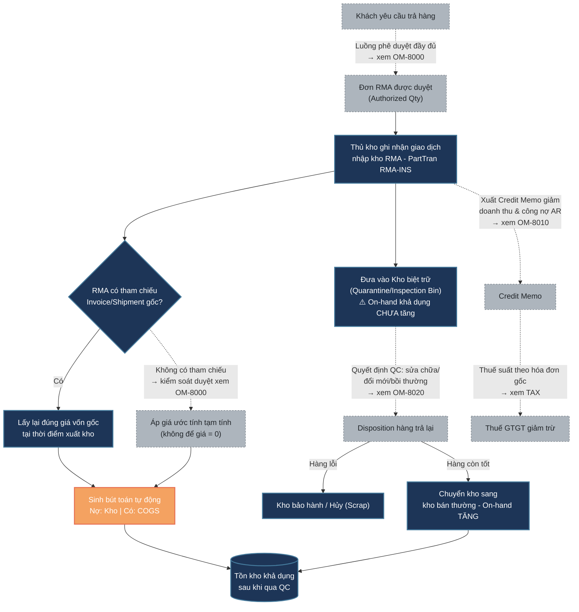

# 1020 Nghiệp vụ Nhập kho Trả hàng từ Khách (Sales Return) 

> Quy trình RMA, Định giá hàng trả lại và các "Cú lừa" kế toán

Trong hoạt động kinh doanh, việc khách hàng trả lại hàng (do lỗi sản xuất, sai quy cách, hoặc không đạt thỏa thuận) là điều không thể tránh khỏi. Trên hệ thống ERP, nghiệp vụ này thường được quản lý thông qua quy trình **RMA (Return Material Authorization - Xác nhận trả lại hàng)**.

Đây là một trong những nghiệp vụ "phiền toái" nhất đối với hệ thống ERP vì nó yêu cầu đảo ngược lại toàn bộ luồng Logistics và Tài chính trước đó: Đưa hàng ngược từ khách vào kho, giảm trừ công nợ phải thu, và điều chỉnh lại Doanh thu - Giá vốn hàng bán (COGS).

> **Phạm vi bài viết:** Bài này tập trung vào **giao dịch kho nhận hàng trả lại** — dữ liệu ghi nhận ở đâu, đơn giá nhập kho được xác định thế nào, tồn kho khả dụng tăng khi nào. Toàn bộ **luồng phê duyệt yêu cầu trả hàng** (ai duyệt, điều kiện chấp nhận) thuộc phân hệ **Bán hàng (OM)**; **xuất Credit Memo giảm công nợ** và **quyết định xử lý hàng lỗi sau kiểm tra** (sửa chữa/đổi mới/bồi thường) cũng thuộc **OM**; **thuế suất áp trên Credit Memo** thuộc phân hệ **Thuế (TAX)**. Link chi tiết ở cuối bài.

---

## Sơ đồ luồng Nhập kho Trả hàng từ Khách (góc nhìn Kho)



> Ô màu xám nét đứt là các bước **không thuộc phạm vi bài này** — chỉ ghi nhận để bạn biết luồng đi tiếp theo, chi tiết nghiệp vụ nằm ở bài link kèm theo.

---

## 1. Luồng nghiệp vụ và Bản đồ dữ liệu (Under the Hood)

Để kiểm soát chặt chẽ, ERP không bao giờ cho phép thủ kho tự ý tạo một phiếu nhập kho trả lại mà không có chứng từ tham chiếu. Luồng đi tổng thể của nghiệp vụ này như sau (phần in đậm là giao dịch thuộc phạm vi Kho):

$$\text{Khách yêu cầu trả} \rightarrow \text{Tạo đơn RMA (OM)} \rightarrow \textbf{Thủ kho nhập kho RMA (INV)} \rightarrow \text{Kế toán xuất Credit Memo (OM/AR)}$$

### Bản đồ dữ liệu giữa các hệ thống ERP:

| Tác vụ dữ liệu | Epicor ERP | Oracle EBS | SAP ERP |
| :--- | :--- | :--- | :--- |
| **Yêu cầu trả hàng (RMA)** | `Erp.RMAHead` / `Erp.RMADtl` | `OE_ORDER_HEADERS_ALL` (Order Category: `RETURN`) | Return Order (`RE`) |
| **Giao dịch nhập kho** | `Erp.PartTran` (TranType: `RMA-INS` hoặc `RMA-STK`) | `MTL_MATERIAL_TRANSACTIONS` (Transaction Source: RMA) | `MSEG` (Movement Type: `651` - Blocked hoặc `653` - Unrestricted) |
| **Hóa đơn giảm trừ nợ** | `Erp.InvcHead` / `InvcDtl` (Credit Memo) | `RA_CUSTOMER_TRX_ALL` (Credit Memo) | Credit Memo (`RE` Invoice) |

Hai bảng đầu và cuối (RMA Header/Detail, Credit Memo) thuộc dữ liệu của OM — chỉ liệt kê ở đây để bạn biết join sang đâu khi viết báo cáo đối chiếu đầu-cuối. Trọng tâm của bài là bảng **Giao dịch nhập kho** ở giữa.

---

## 2. Hạch toán kế toán khi ghi nhận giao dịch kho (RMA Receipt)

Khi hoàn thành việc nhập kho trả hàng, hệ thống tự động sinh bút toán nhập lại kho và giảm giá vốn tương ứng.

### Bút toán phát sinh từ giao dịch kho:
* **Nợ (Debit):** `Tài khoản Kho` (156, 155) — Tăng lại giá trị hàng tồn kho.
* **Có (Credit):** `Tài khoản Giá vốn hàng bán (COGS)` (632) — Giảm giá vốn tương ứng của lô hàng đã bán.

> Song song với bút toán kho này, kế toán còn phải xuất **Credit Memo** để giảm doanh thu và công nợ phải thu (Nợ Doanh thu/Thuế GTGT — Có Phải thu khách hàng) — đây là bút toán độc lập không phát sinh từ giao dịch kho, thuộc nghiệp vụ **[OM 8010 - Nhập kho hàng trả lại và hạch toán giảm trừ công nợ (RMA Receipt & Credit Memo)](/erp-nghiep-vu/1-chuoi-cung-ung/om-ban-hang/8010-rma-receipt-credit-memo.md)**.

---

## 3. Các điểm then chốt cần lưu ý khi ghi nhận giao dịch kho RMA

### ⚠️ Điểm 1: Đơn giá nhập kho phải lấy theo giá vốn gốc, không lấy giá kho hiện tại

Đây là lỗi cực kỳ phổ biến khiến giá trị tồn kho cuối tháng của doanh nghiệp bị sai lệch nghiêm trọng.

**Tình huống:** 3 tháng trước, bạn bán sản phẩm `Part-01` cho khách hàng với **Giá vốn (COGS) xuất kho là 10 USD/con**. Hiện tại, do biến động thị trường, **Giá bình quân (Average Cost) trong kho đã tăng lên 12 USD/con**. Khách hàng trả lại hàng.

* **Lỗi hệ thống (Lấy theo giá hiện tại):** Nếu hệ thống nhập kho tự động lấy giá trị trung bình hiện tại (**12 USD**) để nạp vào kho, doanh nghiệp tự nhiên được "lời ảo" 2 USD trong kho, đồng thời tài khoản COGS bị giảm trừ sai lệch so với lúc bán ra. Báo cáo lỗ lãi (P&L) bị sai lệch.
* **Giải pháp thực chiến:** Giao dịch nhập kho RMA bắt buộc phải **tham chiếu trực tiếp đến số Phiếu xuất kho cũ (Shipment/Invoice)**. Hệ thống tự động tìm lại giá vốn gốc tại thời điểm xuất kho ngày xưa (**10 USD**) để hạch toán nhập kho ngược lại, bất kể giá trị hiện tại của kho là bao nhiêu.

Cơ chế lớp giá (Cost Layers) theo từng phương pháp tính giá tồn kho, xem thêm **[INV 5000 - Các phương pháp Tính giá hàng Tồn kho](./5000-phuong-phap-tinh-gia-fifo-lifo-average-standard.md)**.

---

### ⚠️ Điểm 2: Hàng RMA phải qua Bin biệt trữ, chưa được tính vào tồn kho khả dụng ngay

Khi nhận lại hàng từ khách, tâm lý thủ kho thường muốn quét nhanh để xong việc nên nhận thẳng vào kho chứa hàng bán (Unrestricted Stock).

Từ góc độ **giao dịch kho**, điều Developer/BA cần nắm là: giao dịch nhập kho RMA phải luôn đưa vào **Kho biệt trữ/Kho chờ kiểm (Quarantine/Inspection Bin)** ở trạng thái khóa (Blocked Stock) — On-hand khả dụng dùng để bán tiếp **chưa được tăng** cho đến khi có quyết định xử lý. Nếu báo cáo tồn kho không lọc theo trạng thái Bin này, hàng lỗi/móp méo sẽ hiển thị như hàng sẵn sàng bán, dẫn đến bị bán nhầm cho khách hàng tiếp theo.

Quyết định xử lý sau kiểm tra (chuyển kho bán, chuyển sửa chữa, hay hủy/bồi thường) thuộc nghiệp vụ **[OM 8020 - Xử lý đơn hàng đổi mới hoặc bồi thường hư hỏng (Exchange & Damage Claims)](/erp-nghiep-vu/1-chuoi-cung-ung/om-ban-hang/8020-exchange-damage-claims.md)**.

---

### ⚠️ Điểm 3: RMA không có tham chiếu khiến kho không có căn cứ định giá khi nhập

Trong thực tế, có những trường hợp khách hàng trả lại hàng đã mua từ 2 - 3 năm trước hoặc không thể tìm lại số PO/Hóa đơn gốc để đối chiếu.

Từ góc độ **giao dịch kho**, vấn đề trực tiếp là: không có Invoice/Shipment gốc để tham chiếu (như ở Điểm 1) đồng nghĩa hệ thống **không có căn cứ tự động xác định đơn giá nhập kho**. Giao dịch buộc phải dùng đơn giá ước tính tạm tính (Estimated Return Value) — tuyệt đối không được để đơn giá bằng 0, vì sẽ lặp lại đúng lỗi "Standard Cost = 0" đã nói ở bài INV-5000.

Việc kiểm soát ai được phép tạo RMA không tham chiếu, phân quyền duyệt để tránh rủi ro thông đồng xóa nợ khống, thuộc nghiệp vụ **[OM 8000 - Quy trình phê duyệt yêu cầu khách trả hàng (RMA Approval Flow)](/erp-nghiep-vu/1-chuoi-cung-ung/om-ban-hang/8000-rma-approval-flow.md)**.

---

## 4. Các câu lệnh SQL Audit thực chiến rà soát giao dịch Nhập kho RMA

### ❌ SQL Audit 1: Phát hiện giao dịch RMA bị đưa thẳng vào kho bán mà không qua Bin biệt trữ

Vi phạm nguyên tắc ở Điểm 2 — quét các dòng nhập kho RMA nhưng Bin đích lại là kho hàng bán thông thường thay vì kho chờ kiểm.

#### 💻 Code SQL dành cho Epicor ERP (Bảng `PartTran` & `PartBin`):
```sql
SELECT 
    pt.RMANum AS [Số RMA],
    pt.PartNum AS [Mã sản phẩm],
    pt.TranQty AS [SL nhập kho],
    pt.WarehouseCode AS [Kho nhập],
    pt.BinNum AS [Vị trí Bin],
    pt.TranDate AS [Ngày nhập]
FROM Erp.PartTran pt
WHERE pt.TranType IN ('RMA-INS', 'RMA-STK')
  AND pt.WarehouseCode NOT LIKE 'QUAR%'               -- Không phải Bin biệt trữ/Quarantine
  AND pt.WarehouseCode <> 'INSP';                     -- Không phải Bin chờ kiểm
```

#### 💻 Code SQL dành cho Oracle EBS R12 (Bảng `MTL_MATERIAL_TRANSACTIONS`):
```sql
SELECT 
    mmt.transaction_id,
    msi.segment1 AS item_code,
    mmt.transaction_quantity AS received_qty,
    mmt.subinventory_code,                            -- Kho/Subinventory đích
    mmt.transaction_date
FROM mtl_material_transactions mmt
INNER JOIN mtl_system_items_b msi 
    ON mmt.inventory_item_id = msi.inventory_item_id AND mmt.organization_id = msi.organization_id
WHERE mmt.transaction_source_type_id = 9              -- Nguồn gốc từ RMA
  AND mmt.subinventory_code NOT IN ('QUARANTINE', 'INSPECTION'); -- Không nằm trong kho biệt trữ
```

---

### ❌ SQL Audit 2: Phát hiện giao dịch nhập kho RMA có đơn giá bằng 0 hoặc không khớp với giá vốn gốc

Vi phạm nguyên tắc ở Điểm 1 và Điểm 3 — quét các dòng nhập kho RMA có đơn giá bằng 0, hoặc lệch đáng kể so với giá vốn ghi nhận trên phiếu xuất kho gốc được tham chiếu.

#### 💻 Code SQL dành cho Epicor ERP:
```sql
SELECT 
    pt.RMANum AS [Số RMA],
    pt.PartNum AS [Mã sản phẩm],
    pt.MtlUnitCost AS [Đơn giá nhập kho RMA],
    orig.MtlUnitCost AS [Đơn giá xuất kho gốc]
FROM Erp.PartTran pt
LEFT JOIN Erp.PartTran orig 
    ON orig.Company = pt.Company AND orig.PartNum = pt.PartNum 
    AND orig.InvoiceNum = pt.RMARelatedInvoiceNum AND orig.TranType = 'STK-CUS'
WHERE pt.TranType IN ('RMA-INS', 'RMA-STK')
  AND (pt.MtlUnitCost = 0                             -- Đơn giá bằng 0
       OR (orig.MtlUnitCost IS NOT NULL AND ABS(pt.MtlUnitCost - orig.MtlUnitCost) > 0.01)); -- Lệch giá gốc
```

#### 💻 Code SQL dành cho Oracle EBS R12:
```sql
SELECT 
    mmt.transaction_id,
    msi.segment1 AS item_code,
    mmt.actual_cost AS rma_receipt_cost,
    orig.actual_cost AS original_shipment_cost
FROM mtl_material_transactions mmt
INNER JOIN mtl_system_items_b msi 
    ON mmt.inventory_item_id = msi.inventory_item_id AND mmt.organization_id = msi.organization_id
LEFT JOIN mtl_material_transactions orig 
    ON orig.inventory_item_id = mmt.inventory_item_id 
    AND orig.trx_source_line_id = mmt.trx_source_line_id 
    AND orig.transaction_type_id = 33                  -- Sales Order Issue gốc
WHERE mmt.transaction_source_type_id = 9                -- Nguồn gốc từ RMA
  AND (mmt.actual_cost = 0 
       OR (orig.actual_cost IS NOT NULL AND ABS(mmt.actual_cost - orig.actual_cost) > 0.01));
```

---

## 5. Checklist dành cho Developer khi viết báo cáo và tính năng RMA

- [ ] **Kiểm tra liên kết Invoice/Shipment gốc:** Khi lập trình màn hình tạo giao dịch nhập kho RMA, bắt buộc phải có tính năng tìm kiếm và tải dữ liệu từ Hóa đơn gốc hoặc Phiếu xuất kho gốc để tự động áp đúng giá vốn gốc.
- [ ] **Chặn nhập thẳng vào kho bán:** Ràng buộc giao dịch nhập kho RMA chỉ được phép ghi vào Bin/Warehouse biệt trữ, không cho phép chọn trực tiếp kho hàng bán thông thường.
- [ ] **Đối chiếu Authorized Qty vs Received Qty:** Viết báo cáo đối chiếu giữa số lượng khách hàng được duyệt trả trên đơn RMA và số lượng thủ kho thực nhận, để phát hiện các trường hợp giao thiếu/giao thừa hàng lỗi.
- [ ] **Không để đơn giá nhập kho bằng 0:** Với các RMA không có tham chiếu, bắt buộc phải có bước nhập/áp đơn giá ước tính trước khi cho phép hoàn tất giao dịch nhập kho.

---

## Xem thêm

- **[OM 8000 - Quy trình phê duyệt yêu cầu khách trả hàng (RMA Approval Flow)]()** — luồng phê duyệt, kiểm soát RMA không tham chiếu.
- **[OM 8010 - Nhập kho hàng trả lại và hạch toán giảm trừ công nợ (RMA Receipt & Credit Memo)]()** — bút toán Credit Memo giảm doanh thu/công nợ.
- **[OM 8020 - Xử lý đơn hàng đổi mới hoặc bồi thường hư hỏng (Exchange & Damage Claims)]()** — quyết định xử lý hàng lỗi sau kiểm tra.
- **[INV 5000 - Các phương pháp Tính giá hàng Tồn kho](./5000-phuong-phap-tinh-gia-fifo-lifo-average-standard.md)** — cơ chế lớp giá (Cost Layers), liên quan trực tiếp đến Điểm 1.
- **[INV 1000 - Nhập kho từ mua hàng (Receipt from PO)](./1000-nhap-kho-tu-mua-hang-po.md)** — mô hình 2 bước Inspection → Stock áp dụng tương tự cho hàng RMA.

<div align="center" style={{color: 'var(--ifm-color-primary)'}}>
  <strong>Chúc các bạn thành công và vui vẻ!</strong>
</div>