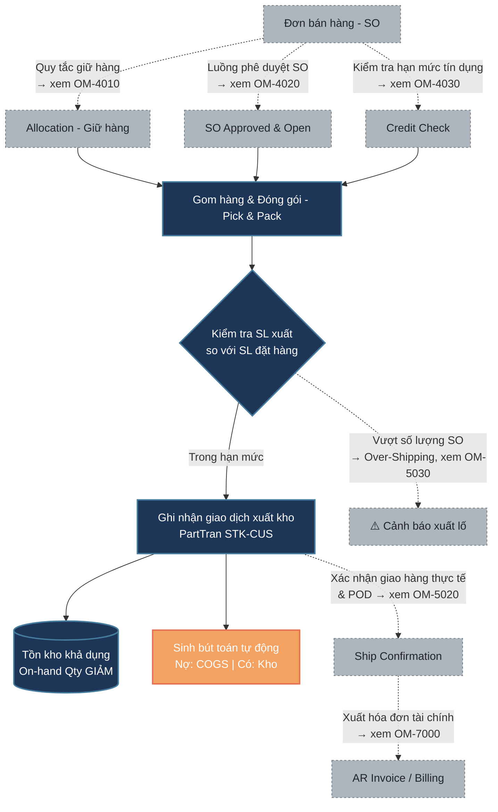

# 2000 Nghiệp vụ Xuất kho Bán hàng (Sales Shipment)

> Luồng hạch toán giá vốn, Cơ chế Giữ hàng (Allocation) và Bộ câu lệnh SQL Audit (Epicor & Oracle EBS)

Xuất kho bán hàng (thường gọi là **Sales Shipment** hoặc **Outbound Delivery**) là nghiệp vụ cốt lõi trong chu trình **Order-to-Cash (Bán hàng thu tiền)** của doanh nghiệp. Đây là thời điểm hàng hóa chính thức rời khỏi ranh giới nhà máy để chuyển quyền sở hữu sang cho khách hàng.

Dưới góc nhìn của hệ thống ERP, giao dịch này ghi nhận sự sụt giảm của tài sản tồn kho vật lý và đồng thời kích hoạt việc ghi nhận **Giá vốn hàng bán (COGS - Cost of Goods Sold)** để đối chiếu với doanh thu bán hàng sau này.

> **Phạm vi bài viết:** Bài này tập trung vào **giao dịch kho xuất hàng bán** — dữ liệu ghi nhận ở đâu, tồn kho giảm khi nào, bút toán giá vốn phát sinh ra sao, và các audit phát hiện bất thường ở tầng giao dịch kho. Quy tắc **kiểm tra hạn mức tín dụng** trước khi cho phép giao hàng thuộc phân hệ **Bán hàng (OM)**; quy tắc **giữ hàng/phân bổ tồn kho (Allocation)** và **luồng phê duyệt đơn hàng** cũng thuộc **OM**; việc **xác nhận giao hàng thành công (POD)** và **xuất hóa đơn tài chính** thuộc **OM**. Link chi tiết ở cuối bài.

---

## Sơ đồ luồng Xuất kho Bán hàng (góc nhìn Kho)



> Ô màu xám nét đứt là các bước **không thuộc phạm vi bài này** — chỉ ghi nhận để bạn biết luồng đi tiếp theo, chi tiết nghiệp vụ nằm ở bài link kèm theo.

---

## 1. Bản chất Giao dịch và Bản đồ dữ liệu (Under the Hood)

Khi thủ kho xác nhận xuất hàng cho xe tải vận chuyển, ERP sẽ thực hiện giảm trừ số lượng tồn kho khả dụng (On-hand Qty) và tạo các bản ghi giao dịch kho để kế toán định khoản giá vốn.

### Bản đồ dữ liệu giữa các hệ thống ERP:

| Tác vụ dữ liệu | Epicor ERP | Oracle EBS | SAP ERP |
| :--- | :--- | :--- | :--- |
| **Đơn bán hàng tham chiếu** | `Erp.OrderHead` / `OrderDtl` | `OE_ORDER_HEADERS_ALL` | Sales Order (`OR`) |
| **Chứng từ xuất hàng** | `Erp.ShipHead` / `ShipDtl` | `WSH_DELIVERY_DETAILS` | `LIKP` / `LIPS` (Outbound Delivery) |
| **Giao dịch kho gốc** | `Erp.PartTran` (TranType: `STK-CUS`) | `MTL_MATERIAL_TRANSACTIONS` (Sales Order Issue) | `MSEG` (Movement Type: `601` - GI for delivery) |

---

## 2. Hạch toán Giá vốn hàng bán (COGS Accounting)

Khi giao dịch xuất kho thành công, hệ thống ERP sẽ tự động trích xuất đơn giá của hàng hóa (theo phương pháp tính giá đã cấu hình như FIFO, Average, hoặc Standard — xem **[INV 5000](./5000-phuong-phap-tinh-gia-fifo-lifo-average-standard.md)**) để thực hiện bút toán hạch toán giá vốn.

### Bút toán hạch toán:
* **Nợ (Debit):** `Tài khoản Giá vốn hàng bán` (632) — Ghi nhận chi phí hoạt động trong kỳ.
* **Có (Credit):** `Tài khoản Kho` (156, 155) — Giảm trừ tài sản tồn kho.

> **Lưu ý nghiệp vụ:** Tại thời điểm xuất kho, doanh nghiệp **chưa hạch toán Doanh thu (Account Receivable - 511/131)**. Doanh thu chỉ được ghi nhận khi phòng kế toán chạy luồng xuất Hóa đơn tài chính tham chiếu trực tiếp đến số Phiếu xuất kho này — xem chi tiết tại **[OM 7000 - Xuất hóa đơn bán hàng và đồng bộ hóa đơn điện tử (AR Invoicing & E-Invoice Integration)]()**.

---

## 3. Ba Kịch bản thực chiến và Bộ câu lệnh SQL Audit rà soát lỗi hệ thống

Dưới đây là 3 kịch bản lỗi phổ biến nhất ở kho xuất hàng và các câu lệnh SQL viết riêng cho **Epicor ERP** và **Oracle EBS** giúp bạn chủ động kiểm soát chất lượng dữ liệu ở tầng **giao dịch kho**. Nguyên nhân gốc và quy trình kiểm soát phía Bán hàng (duyệt SO, hạn mức tín dụng, Allocation) được link riêng ở mỗi kịch bản thay vì diễn giải lại.

---

### ❌ Kịch bản 1: Xuất kho lố số lượng đặt hàng trên Đơn bán hàng (Over-Shipping)

**Tình huống:** Khách hàng đặt mua **100 sản phẩm** trên đơn hàng (SO). Do thủ kho nhập sai hoặc cố tình giao dư, phiếu xuất kho ghi nhận xuất đi **105 sản phẩm**.

* **Hậu quả nhìn từ kho:** Giao dịch xuất kho đã ghi nhận vượt số lượng có căn cứ chứng từ SO, khiến kế toán không thể xuất hóa đơn tài chính khớp đủ cho 5 sản phẩm giao dư, đồng thời tồn kho khả dụng bị trừ nhiều hơn mức có thể giải trình.
* **SQL Audit rà soát:** Tìm tất cả các dòng giao dịch xuất kho có tổng số lượng thực xuất vượt quá số lượng đặt hàng ban đầu trên Đơn bán hàng (SO).

> Việc xử lý thay đổi đơn hàng sau khi đã xác nhận/phân bổ tồn kho (bao gồm các trường hợp cần điều chỉnh SO để hợp thức hóa số lượng giao dư) thuộc **[OM 5030 - Quản lý thay đổi đơn hàng sau khi đã xác nhận/phân bổ tồn kho (Order Change Management)]()**.

#### 💻 Code SQL dành cho Epicor ERP:
```sql
SELECT 
    sd.PackNum AS [Số phiếu xuất],
    sd.OrderNum AS [Số SO],
    sd.PartNum AS [Mã sản phẩm],
    od.OrderQty AS [Số lượng đặt hàng],
    SUM(sd.OurInventoryShipQty) AS [Tổng số thực xuất],
    (SUM(sd.OurInventoryShipQty) - od.OrderQty) AS OverShippedQty
FROM Erp.ShipDtl sd
INNER JOIN Erp.OrderDtl od 
    ON sd.Company = od.Company AND sd.OrderNum = od.OrderNum AND sd.OrderLine = od.OrderLine
GROUP BY sd.PackNum, sd.OrderNum, sd.PartNum, od.OrderQty
HAVING SUM(sd.OurInventoryShipQty) > od.OrderQty;
```

#### 💻 Code SQL dành cho Oracle EBS R12:
```sql
SELECT 
    ooh.order_number AS order_number,               -- Số đơn hàng (SO)
    msi.segment1 AS item_code,                      -- Mã sản phẩm
    ool.ordered_quantity AS qty_ordered,            -- Số đặt hàng trên SO
    ool.shipped_quantity AS qty_shipped,            -- Số thực xuất kho
    (ool.shipped_quantity - ool.ordered_quantity) AS over_shipped_qty
FROM oe_order_lines_all ool
INNER JOIN oe_order_headers_all ooh 
    ON ool.header_id = ooh.header_id
INNER JOIN mtl_system_items_b msi 
    ON ool.inventory_item_id = msi.inventory_item_id AND ool.ship_from_org_id = msi.organization_id
WHERE ool.shipped_quantity > ool.ordered_quantity   -- Điều kiện xuất lố
  AND ool.open_flag = 'Y';
```

---

### ❌ Kịch bản 2: Xuất kho thành công nhưng "quên" xuất hóa đơn tài chính (Unbilled Shipments)

**Tình huống:** Hàng hóa đã thực tế xuất khỏi kho (`Shipped`), hệ thống đã trừ tồn kho và hạch toán Nợ 632 / Có 156. Tuy nhiên, do thiếu sót trong quy trình bàn giao chứng từ, phòng kế toán **quên không chạy luồng xuất hóa đơn** (Billing/Invoice) gửi cho khách hàng.

* **Hậu quả nhìn từ kho:** Đây là điểm đối chiếu quan trọng nhất giữa giao dịch kho và luồng bán hàng — báo cáo tài chính cuối tháng bị lệch nghiêm trọng vì đã ghi nhận Chi phí giá vốn (từ giao dịch kho) nhưng chưa ghi nhận Doanh thu đối ứng (từ luồng OM-7000).
* **SQL Audit rà soát:** Tìm tất cả các phiếu xuất kho đã hoàn thành xuất xưởng nhưng chưa hề được liên kết đến bất kỳ hóa đơn tài chính (Invoice) nào.

#### 💻 Code SQL dành cho Epicor ERP:
```sql
SELECT 
    sh.PackNum AS [Số phiếu xuất],
    sh.ShipDate AS [Ngày xuất],
    sd.OrderNum AS [Số SO],
    sd.PartNum AS [Mã sản phẩm],
    sd.OurInventoryShipQty AS [Số lượng xuất]
FROM Erp.ShipHead sh
INNER JOIN Erp.ShipDtl sd ON sh.Company = sd.Company AND sh.PackNum = sd.PackNum
WHERE sh.ShipStatus = 'SHIPPED'
  -- Điều kiện: Không tồn tại dòng hóa đơn nào liên kết với dòng xuất kho này
  AND NOT EXISTS (
      SELECT 1 
      FROM Erp.InvcDtl id 
      WHERE id.Company = sd.Company 
        AND id.PackNum = sd.PackNum 
        AND id.PackLine = sd.PackLine
  );
```

#### 💻 Code SQL dành cho Oracle EBS R12:
```sql
SELECT 
    ooh.order_number AS order_number,
    msi.segment1 AS item_code,
    wdd.delivery_detail_id AS delivery_line_id,
    wdd.shipped_quantity AS qty_shipped,
    wdd.requested_quantity AS qty_requested,
    wdd.oe_interfaced_flag                          -- Cờ đồng bộ sang AR
FROM wsh_delivery_details wdd
INNER JOIN oe_order_headers_all ooh 
    ON wdd.source_header_id = ooh.header_id
INNER JOIN mtl_system_items_b msi 
    ON wdd.inventory_item_id = msi.inventory_item_id AND wdd.organization_id = msi.organization_id
WHERE wdd.released_status = 'C'                     -- 'C' nghĩa là Ship Confirmed (Đã thực xuất)
  -- Điều kiện: Cờ đồng bộ hóa đơn sang phân hệ AR bằng 'N' hoặc rỗng (Chưa xuất hóa đơn)
  AND (wdd.oe_interfaced_flag = 'N' OR wdd.oe_interfaced_flag IS NULL) 
ORDER BY ooh.order_number DESC;
```

---

### ❌ Kịch bản 3: Xuất kho từ Đơn bán hàng chưa duyệt hoặc đã đóng/hủy

**Tình huống:** Thủ kho sử dụng phiếu giấy xuất kho thủ công bên ngoài, ra kệ lấy hàng xếp lên xe giao cho khách. Khi vào máy nhập dữ liệu, thủ kho "nhập bừa" vào một số SO cũ đã đóng (`Closed`), đã bị hủy (`Cancelled`) hoặc một SO nháp chưa được duyệt (`Entered/Draft`).

* **Hậu quả nhìn từ kho:** Giao dịch xuất kho ghi nhận thành công dù không có căn cứ chứng từ hợp lệ tại thời điểm xuất — đây là điều kho cần tự chặn ở tầng giao dịch, bất kể luồng phê duyệt phía trước đã chạy đúng hay chưa.
* **SQL Audit rà soát:** Tìm tất cả các phiếu xuất kho đã hoàn thành xuất xưởng nhưng được liên kết với một đơn hàng SO đang ở trạng thái chưa được phê duyệt hoặc đã đóng/hủy.

> Cơ chế thiết lập luồng phê duyệt đơn hàng tự động theo điều kiện thuộc **[OM 4020 - Thiết lập luồng phê duyệt đơn hàng tự động theo điều kiện (Auto-approval Workflow)]()**.

#### 💻 Code SQL dành cho Epicor ERP:
```sql
SELECT 
    sh.PackNum AS [Số phiếu xuất],
    sh.ShipDate AS [Ngày xuất],
    sd.OrderNum AS [Số SO],
    sd.PartNum AS [Mã sản phẩm],
    oh.OpenOrder AS [SO Open Status],             -- 0: Đã đóng
    oh.ApprovalStatus AS [SO Approval Status]     -- Approved / Draft
FROM Erp.ShipHead sh
INNER JOIN Erp.ShipDtl sd ON sh.Company = sd.Company AND sh.PackNum = sd.PackNum
INNER JOIN Erp.OrderHed oh ON sd.Company = oh.Company AND sd.OrderNum = oh.OrderNum
WHERE sh.ShipStatus = 'SHIPPED'
  -- Điều kiện: SO đã đóng HOẶC chưa được phê duyệt duyệt chính thức
  AND (oh.OpenOrder = 0 OR oh.ApprovalStatus <> 'Approved');
```

#### 💻 Code SQL dành cho Oracle EBS R12:
```sql
SELECT 
    ooh.order_number AS order_number,
    ooh.flow_status_code AS order_status,           -- Trạng thái đơn SO
    msi.segment1 AS item_code,
    wdd.delivery_detail_id AS delivery_line_id,
    wdd.shipped_quantity AS qty_shipped
FROM wsh_delivery_details wdd
INNER JOIN oe_order_headers_all ooh 
    ON wdd.source_header_id = ooh.header_id
INNER JOIN mtl_system_items_b msi 
    ON wdd.inventory_item_id = msi.inventory_item_id AND wdd.organization_id = msi.organization_id
WHERE wdd.released_status = 'C'                     -- 'C': Đã xuất kho
  -- Điều kiện: Xuất kho từ SO chưa được duyệt (ENTERED) hoặc đã đóng/hủy
  AND ooh.flow_status_code IN ('CANCELLED', 'CLOSED', 'ENTERED') 
ORDER BY ooh.order_number DESC;
```

---

## 4. Checklist dành cho Developer khi phát triển phân hệ Sales Shipment

- [ ] **Chặn giao dịch xuất kho nếu chưa qua kiểm tra tín dụng:** Giao dịch xuất kho cần kiểm tra cờ "đã qua Credit Check" do phân hệ Bán hàng trả về trước khi cho phép ghi nhận — bản thân việc thiết lập hạn mức tín dụng và luồng chặn giao hàng/xuất hóa đơn thuộc **[OM 4030 - Cơ chế kiểm tra tín dụng và chặn giao/xuất hóa đơn (Credit Check, Delivery Block & Billing Block)]()**.
- [ ] **Đồng bộ hóa dữ liệu đóng gói (Pack Line):** Đảm bảo thông tin số lô (`Lot Number`) hoặc số máy (`Serial Number`) được quét chính xác tại bước xuất hàng để phục vụ việc truy xuất nguồn gốc sau này — xem thêm **[MES-TRC 1010 - Thiết lập quy tắc gán sê-ri và lô sản xuất trong phả hệ lắp ráp]()**.
- [ ] **Ràng buộc kiểm tra trạng thái Giữ hàng (Allocation):** Chỉ cho phép xuất những sản phẩm đã được giữ hàng thành công cho chính đơn hàng đó, chặn các hành vi xuất tranh hàng của đơn khác — quy tắc giữ hàng/phân bổ chi tiết xem **[OM 4010 - Quy tắc giữ hàng và phân bổ tồn kho tối ưu (Inventory Allocation & Reservation Rules)]()**.
- [ ] **Xử lý hạch toán đa tiền tệ:** Đảm bảo giá vốn xuất kho luôn được quy đổi chính xác về đồng tiền hạch toán gốc (Base Currency - ví dụ: VND) theo đúng phương pháp tính giá, bất kể đơn bán hàng (SO) đang chạy bằng USD hay EUR.

---

## Xem thêm

- **[OM 4010 - Quy tắc giữ hàng và phân bổ tồn kho tối ưu (Allocation & Reservation Rules)]()** — cơ chế Allocation đầy đủ.
- **[OM 4020 - Thiết lập luồng phê duyệt đơn hàng tự động (Auto-approval Workflow)]()** — luồng duyệt SO trước khi cho phép xuất hàng.
- **[OM 4030 - Cơ chế kiểm tra tín dụng và chặn giao/xuất hóa đơn (Credit Check, Delivery Block & Billing Block)]()** — thiết lập hạn mức tín dụng.
- **[OM 5020 - Xác nhận giao hàng thành công và bàn giao trách nhiệm (Ship Confirmation/POD)]()** — nửa còn lại của giao dịch xuất kho.
- **[OM 5030 - Quản lý thay đổi đơn hàng sau khi đã xác nhận (Order Change Management)]()** — xử lý các trường hợp cần điều chỉnh SO do giao dư/giao thiếu.
- **[OM 7000 - Xuất hóa đơn bán hàng và đồng bộ hóa đơn điện tử (AR Invoicing)]()** — luồng xuất hóa đơn tài chính sau khi xuất kho.
- **[INV 5000 - Các phương pháp Tính giá hàng Tồn kho](./5000-phuong-phap-tinh-gia-fifo-lifo-average-standard.md)** — cơ chế xác định đơn giá khi xuất kho.

<div align="center" style={{color: 'var(--ifm-color-primary)'}}>
  <strong>Chúc các bạn thành công và vui vẻ!</strong>
</div>