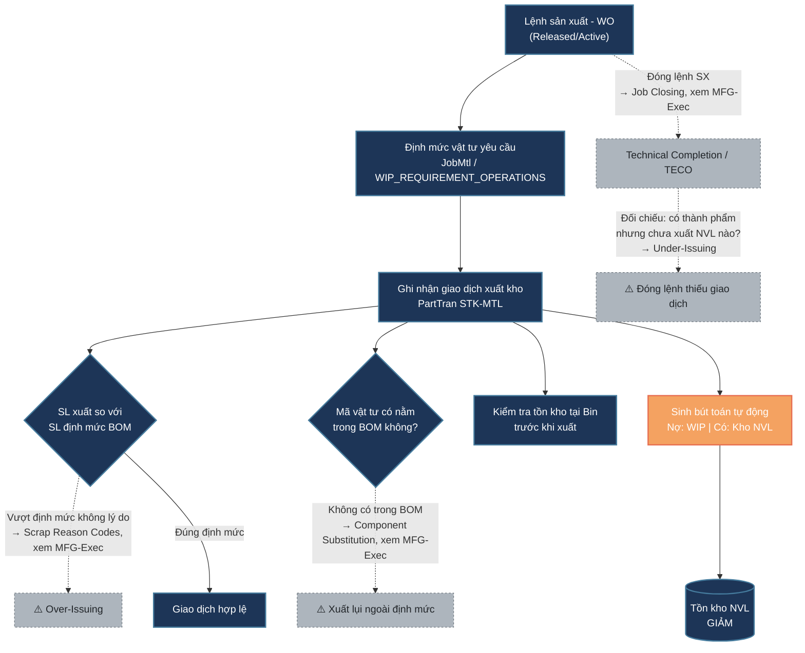

# 2010 Nghiệp vụ Xuất kho cho Sản xuất (Issue for Work Order) 

> Quy trình BOM, Hạch toán WIP và Bộ câu lệnh SQL Audit (Epicor & Oracle EBS)

Trong các nhà máy sản xuất, nghiệp vụ **Xuất kho cho sản xuất (Issue for Work Order / Material Issue)** là cầu nối đưa nguyên vật liệu (Raw Materials - RM) từ kho lưu trữ vào dây chuyền để bắt đầu chế biến. 

Giao dịch này được dẫn dắt trực tiếp bởi định mức nguyên vật liệu **BOM (Bill of Materials)** của Lệnh sản xuất. Dưới góc độ tài chính, đây là thời khắc vật tư chính thức kết thúc vòng đời ở tài khoản Kho để chuyển sang trạng thái **WIP (Work in Process - Chi phí dở dang)**.

> **Phạm vi bài viết:** Bài này tập trung vào **giao dịch kho xuất vật tư cho sản xuất** — dữ liệu ghi nhận ở đâu, tồn kho giảm khi nào, bút toán WIP phát sinh ra sao, và các audit phát hiện bất thường ở tầng giao dịch kho. Quy trình **thay thế vật tư tại thời điểm tiêu thụ**, **ghi nhận lý do hao hụt/phế phẩm**, và **đóng lệnh sản xuất** thuộc phân hệ **Thực thi Sản xuất (MFG-Exec)**. Link chi tiết ở cuối bài (một số bài đối tác chưa xuất bản nên chỉ ghi tên, chưa gắn link).

---

## Sơ đồ luồng Xuất kho cho Sản xuất (góc nhìn Kho)



> Ô màu xám nét đứt là các bước **không thuộc phạm vi bài này** — chỉ ghi nhận để bạn biết luồng đi tiếp theo, chi tiết nghiệp vụ nằm ở bài liên quan (xem mục "Xem thêm" cuối bài).

---

## 1. Bản chất Giao dịch và Bản đồ dữ liệu (Under the Hood)

Khi phân xưởng yêu cầu cấp vật tư, thủ kho sẽ chuẩn bị hàng dựa trên danh sách nguyên vật liệu được chỉ định của Lệnh sản xuất (Job Material List).

### Bản đồ dữ liệu giữa các hệ thống ERP:

| Tác vụ dữ liệu | Epicor ERP | Oracle EBS | SAP ERP |
| :--- | :--- | :--- | :--- |
| **Yêu cầu vật tư định mức** | `Erp.JobMtl` | `WIP_REQUIREMENT_OPERATIONS` | `RESB` (Reservations/BOM Items) |
| **Giao dịch xuất kho gốc** | `Erp.PartTran` (TranType: `STK-MTL`) | `MTL_MATERIAL_TRANSACTIONS` (WIP Issue) | `MSEG` (Movement Type: `261` - GI for order) |

> Bảng "Yêu cầu vật tư định mức" là dữ liệu BOM gốc do phân hệ Kỹ thuật Sản xuất (MFG-Tech) quản lý — chỉ liệt kê ở đây để bạn biết join sang đâu khi đối chiếu số lượng xuất thực tế với định mức.

---

## 2. Luồng Hạch toán Kế toán (WIP Accounting)

Bút toán xuất vật tư cho sản xuất ghi nhận việc giảm tài sản kho nguyên vật liệu và tăng chi phí sản xuất dở dang tại phân xưởng.

* **Nợ (Debit):** `Tài khoản WIP - Nguyên vật liệu dở dang` (154) — Tăng chi phí dở dang của lệnh sản xuất.
* **Có (Credit):** `Tài khoản Kho Nguyên vật liệu` (152) — Giảm trừ giá trị tồn kho nguyên vật liệu thô.

---

## 3. Ba Kịch bản thực chiến và Bộ câu lệnh SQL Audit rà soát lỗi hệ thống

Vì quy trình cấp phát vật tư ở xưởng diễn ra liên tục với số lượng lớn, dữ liệu trên ERP rất dễ bị sai lệch do lỗi thao tác của con người. Dưới đây là 3 kịch bản lỗi phổ biến nhất ở **tầng giao dịch kho** và các câu lệnh SQL viết riêng cho **Epicor ERP** và **Oracle EBS** giúp bạn chủ động quét sạch lỗi dữ liệu trên hệ thống.

---

### ❌ Kịch bản 1: Xuất lố định mức BOM (Over-Issuing) mà không kiểm soát

**Tình huống:** Định mức BOM của một lệnh sản xuất chỉ yêu cầu **10 tấm thép**. Tuy nhiên, trong quá trình dập nguội, công nhân làm hỏng mất 2 tấm và yêu cầu thủ kho cấp thêm. Thủ kho xuất thêm 2 tấm nữa (tổng cộng xuất 12 tấm) nhưng không khai báo lý do hao hụt ngoài định mức (Scrap/Variance).

* **Hậu quả nhìn từ kho:** Giao dịch xuất kho ghi nhận vượt định mức mà không có lý do đính kèm, khiến kế toán không phát hiện được hao hụt bất thường cho đến khi đóng lệnh sản xuất cuối tháng.
* **SQL Audit rà soát:** Tìm tất cả các dòng vật tư có số lượng xuất thực tế (`Issued Qty`) vượt quá số lượng định mức yêu cầu (`Required Qty`) trên các lệnh sản xuất đang mở.

> Việc ghi nhận sản lượng hoàn thành và phế phẩm kèm mã lý do (Reason Codes) trên từng công đoạn thuộc nghiệp vụ **MFG-Exec 3010 - Ghi nhận sản lượng hoàn thành và phế phẩm theo từng công đoạn (Yield & Scrap Reporting with Reason Codes)**.

#### 💻 Code SQL dành cho Epicor ERP:
```sql
SELECT 
    jm.JobNum,
    jm.AssemblySeq,
    jm.PartNum AS MaterialPart,
    jm.RequiredQty AS [Số lượng định mức],
    jm.IssuedQty AS [Số lượng thực xuất],
    (jm.IssuedQty - jm.RequiredQty) AS OverIssuedQty,
    ROUND(((jm.IssuedQty - jm.RequiredQty) / jm.RequiredQty) * 100, 2) AS OverIssuedPercent
FROM Erp.JobMtl jm
INNER JOIN Erp.JobHead jh ON jm.Company = jh.Company AND jm.JobNum = jh.JobNum
WHERE jm.IssuedQty > jm.RequiredQty 
  AND jh.JobClosed = 0; -- Chỉ quét các lệnh sản xuất đang mở
```

#### 💻 Code SQL dành cho Oracle EBS R12:
```sql
SELECT 
    we.wip_entity_name AS job_number,              -- Số lệnh sản xuất (Job)
    msi.segment1 AS material_code,                  -- Mã vật tư thô
    msi.description AS material_desc,               -- Mô tả vật tư
    wro.required_quantity AS qty_required,          -- Số lượng định mức BOM
    wro.quantity_issued AS qty_issued,              -- Số lượng thực xuất vào WIP
    (wro.quantity_issued - wro.required_quantity) AS over_issued_qty,
    ROUND(((wro.quantity_issued - wro.required_quantity) / wro.required_quantity) * 100, 2) AS over_issued_percent
FROM wip_requirement_operations wro
INNER JOIN wip_discrete_jobs wdj 
    ON wro.wip_entity_id = wdj.wip_entity_id AND wro.organization_id = wdj.organization_id
INNER JOIN wip_entities we 
    ON wdj.wip_entity_id = we.wip_entity_id AND wdj.organization_id = we.organization_id
INNER JOIN mtl_system_items_b msi 
    ON wro.inventory_item_id = msi.inventory_item_id AND wro.organization_id = msi.organization_id
WHERE wro.quantity_issued > wro.required_quantity   -- Điều kiện xuất lố
  AND wdj.status_type IN (3, 4)                     -- 3: Released, 4: Complete (Chỉ quét Job chưa đóng)
  AND wro.required_quantity > 0;
```

---

### ❌ Kịch bản 2: Xuất "lụi" mã vật tư nằm ngoài danh mục định mức BOM

**Tình huống:** Lệnh sản xuất yêu cầu xuất Keo dán mã `KEO-A`. Thủ kho hết hàng liền tự ý xuất mã `KEO-B` (gần tương đương) để phân xưởng chạy kịp tiến độ nhưng không làm thủ tục thay đổi thiết kế BOM (ECN/Job Modification) trên hệ thống.

* **Hậu quả nhìn từ kho:** Tồn kho mã `KEO-A` trên máy bị ảo (thực tế đã hết nhưng hệ thống vẫn báo còn), mã `KEO-B` bị thiếu hụt thực tế (trên máy báo còn nhưng thực tế đã mất) — đây là điều kho phải phát hiện được qua đối chiếu giao dịch, dù nguyên nhân gốc là do quy trình thay thế vật tư chưa được làm đúng thủ tục.
* **SQL Audit rà soát:** Tìm tất cả các giao dịch xuất kho cho sản xuất mà mã vật tư được xuất **không hề tồn tại** trong danh sách yêu cầu định mức ban đầu của lệnh sản xuất đó.

> Quy trình đúng để thay thế vật tư tại thời điểm tiêu thụ khi thiếu hàng (kèm phê duyệt ECN/Job Modification) thuộc nghiệp vụ **MFG-Exec 2040 - Thay thế vật tư tại thời điểm tiêu thụ khi thiếu hàng (Component Substitution at Consumption)**.

#### 💻 Code SQL dành cho Epicor ERP:
```sql
SELECT 
    pt.TranDate AS [Ngày giao dịch],
    pt.JobNum,
    pt.PartNum AS [Mã vật tư thực xuất],
    pt.TranQty AS [Số lượng xuất],
    pt.CreatedBy AS [Người thực hiện]
FROM Erp.PartTran pt
WHERE pt.TranType = 'STK-MTL'
  -- Điều kiện: Mã vật tư thực xuất không nằm trong định mức JobMtl của Job đó
  AND NOT EXISTS (
      SELECT 1 
      FROM Erp.JobMtl jm 
      WHERE jm.Company = pt.Company 
        AND jm.JobNum = pt.JobNum 
        AND jm.PartNum = pt.PartNum
  );
```

#### 💻 Code SQL dành cho Oracle EBS R12:
```sql
SELECT 
    mmt.transaction_date AS tx_date,
    we.wip_entity_name AS job_number,
    msi_parent.segment1 AS assembly_product, -- Thành phẩm đang sản xuất
    msi_child.segment1 AS issued_material_code,  -- Mã vật tư đã xuất "lụi"
    msi_child.description AS material_desc,
    (mmt.transaction_quantity * -1) AS issued_qty,-- Giao dịch WIP Issue lưu số âm, nhân -1 để ra số dương
    mmt.transaction_uom AS tx_uom
FROM mtl_material_transactions mmt
INNER JOIN wip_entities we 
    ON mmt.transaction_source_id = we.wip_entity_id 
   AND mmt.organization_id = we.organization_id
INNER JOIN wip_discrete_jobs wdj 
    ON we.wip_entity_id = wdj.wip_entity_id 
   AND we.organization_id = wdj.organization_id
INNER JOIN mtl_system_items_b msi_parent 
    ON wdj.primary_item_id = msi_parent.inventory_item_id 
   AND wdj.organization_id = msi_parent.organization_id
INNER JOIN mtl_system_items_b msi_child 
    ON mmt.inventory_item_id = msi_child.inventory_item_id 
   AND mmt.organization_id = msi_child.organization_id
LEFT JOIN wip_requirement_operations wro
    ON wro.wip_entity_id = mmt.transaction_source_id 
   AND wro.inventory_item_id = mmt.inventory_item_id
   AND wro.organization_id = mmt.organization_id
WHERE mmt.transaction_source_type_id = 5            -- Source Type: WIP (Job or Schedule)  
  AND mmt.transaction_type_id = 35              -- Transaction Type: WIP Issue     
  AND wro.inventory_item_id IS NULL -- Lọc ra những Item KHÔNG có trong BOM  -- Điều kiện: Item thực xuất không tồn tại trong BOM của Job đó
  -- BẮT BUỘC: Thêm điều kiện thời gian để thu hẹp vùng tìm kiếm
  AND mmt.transaction_date >= TRUNC(SYSDATE) - 30 -- Chỉ quét dữ liệu trong 30 ngày qua
```

---

### ❌ Kịch bản 3: Đóng lệnh sản xuất nhưng chưa từng xuất vật tư (Under-Issuing)

**Tình huống:** Phân xưởng báo cáo đã hoàn thành sản xuất **100 sản phẩm** và làm thủ tục nhập kho thành phẩm. Tuy nhiên, kế toán sản xuất đã bấm Đóng lệnh sản xuất (Closed) mà quên chưa làm phiếu xuất kho nguyên vật liệu đầu vào.

* **Hậu quả nhìn từ kho:** Hệ thống ghi nhận doanh nghiệp tự dưng sản xuất được hàng từ "không khí" (không tốn vật tư đầu vào) — đối chiếu giữa giao dịch nhập kho thành phẩm và giao dịch xuất kho NVL của cùng một lệnh SX là điều kho cần tự phát hiện được, độc lập với việc màn hình đóng lệnh có chặn hay không.
* **SQL Audit rà soát:** Tìm các lệnh sản xuất đã đóng, đã nhận thành phẩm về kho, nhưng có ít nhất một dòng nguyên vật liệu bắt buộc chưa từng được xuất kho một chút nào (`Issued Qty = 0`).

> Điều kiện chặn đóng lệnh sản xuất khi còn thiếu giao dịch, cũng như quy trình Đóng kỹ thuật (Technical Completion - TECO), thuộc nghiệp vụ **MFG-Exec 5030 - Quy trình Đóng kỹ thuật và quyết toán tài chính Lệnh sản xuất (Technical Completion - TECO & Closing)** và **MFG-Exec 7000 - Xử lý lệnh sản xuất bị kẹt không đóng được do còn giao dịch treo (Stuck WIP / Open Transactions Preventing Close)**.

#### 💻 Code SQL dành cho Epicor ERP:
```sql
SELECT 
    jh.JobNum,
    jh.PartNum AS FGPart AS [Thành phẩm],
    jh.ProdQty AS [Số lượng kế hoạch],
    -- Tổng số lượng thành phẩm thực tế đã nhận về kho
    (SELECT SUM(pt.TranQty) 
     FROM Erp.PartTran pt 
     WHERE pt.Company = jh.Company AND pt.JobNum = jh.JobNum AND pt.TranType = 'MFG-STK') AS [Thành phẩm đã nhập kho],
    -- Đếm số lượng dòng vật tư bị thiếu (chưa xuất cái nào)
    (SELECT COUNT(*) 
     FROM Erp.JobMtl jm 
     WHERE jm.Company = jh.Company AND jm.JobNum = jh.JobNum AND jm.IssuedQty = 0) AS [Số dòng vật tư chưa xuất]
FROM Erp.JobHead jh
WHERE jh.JobClosed = 1 
  -- Quét các Job có trên 1 dòng vật tư chưa được xuất bất kỳ số lượng nào
  AND (SELECT COUNT(*) FROM Erp.JobMtl jm WHERE jm.Company = jh.Company AND jm.JobNum = jh.JobNum AND jm.IssuedQty = 0) > 0;
```

#### 💻 Code SQL dành cho Oracle EBS R12:
```sql
WITH missing_bom_summary AS (
    -- Bước 1: Gom nhóm và đếm sẵn những vật tư chưa xuất theo từng Job
    SELECT 
        wro.wip_entity_id,
        wro.organization_id,
        COUNT(*) AS missing_materials_count
    FROM wip_requirement_operations wro
    WHERE wro.quantity_issued = 0 -- Chỉ lấy vật tư chưa xuất dòng nào
    GROUP BY wro.wip_entity_id, wro.organization_id
)
SELECT 
    we.wip_entity_name AS job_number,
    msi.segment1 AS assembly_code,
    msi.description AS assembly_desc,
    wdj.start_quantity AS plan_qty,
    wdj.quantity_completed AS completed_qty,
    mbs.missing_materials_count
FROM wip_discrete_jobs wdj
INNER JOIN wip_entities we 
    ON wdj.wip_entity_id = we.wip_entity_id 
   AND wdj.organization_id = we.organization_id
INNER JOIN mtl_system_items_b msi 
    ON wdj.primary_item_id = msi.inventory_item_id 
   AND wdj.organization_id = msi.organization_id
-- Bước 2: Join với bảng tạm đã đếm ở trên, tự động loại bỏ các Job có count = 0
INNER JOIN missing_bom_summary mbs
    ON wdj.wip_entity_id = mbs.wip_entity_id
   AND wdj.organization_id = mbs.organization_id
WHERE wdj.status_type = 12                          -- 12: Closed
  AND wdj.quantity_completed > 0                    -- Đã có thành phẩm nhập kho
  -- LƯU Ý BẮT BUỘC: Nên thêm bộ lọc thời gian đóng Job ở đây nếu dữ liệu quá nhiều lịch sử
   AND wdj.date_closed >= TRUNC(SYSDATE) - 90     -- Ví dụ: Chỉ kiểm tra các Job đóng trong 3 tháng qua
```

---

## 4. Checklist dành cho Developer khi phát triển phân hệ Issue Material

- [ ] **Ràng buộc cảnh báo Over-Issue:** Thiết lập cảnh báo (Warning) hoặc khóa cứng (Block) không cho phép xuất vật tư vượt quá % hao hụt cho phép của BOM nếu không có tài khoản phê duyệt đặc cách. Việc gắn mã lý do hao hụt xem thêm nghiệp vụ **MFG-Exec 3010**.
- [ ] **Ràng buộc kiểm tra tồn kho tại vị trí (Bin Qty Check):** Đảm bảo hệ thống kiểm tra số dư tồn kho tại đúng Vị trí kho (Bin/Location) được chọn trước khi lưu phiếu xuất, tránh trường hợp chọn nhầm Bin gây âm kho cục bộ.
- [ ] **Đồng bộ hóa quy trình quét mã vạch (Barcode Scanning):** Khi phát triển ứng dụng di động cho thủ kho quét mã xuất vật tư cho sản xuất, bắt buộc phải đối chiếu mã vạch quét được với danh sách vật tư được duyệt trong Lệnh sản xuất để chặn đứng lỗi xuất nhầm mã (Kịch bản 2) — quy trình thay thế hợp lệ xem **MFG-Exec 2040**.
- [ ] **Cung cấp dữ liệu đối chiếu cho màn hình Close Job:** Viết sẵn truy vấn kiểm tra (như SQL Audit 3) để màn hình Đóng lệnh sản xuất bên phân hệ MFG-Exec có dữ liệu chặn đóng lệnh khi số lượng thành phẩm hoàn thành lớn hơn 0 nhưng tổng số lượng nguyên vật liệu xuất vào vẫn bằng 0.

---

## Xem thêm

- **MFG-Exec 2040 - Thay thế vật tư tại thời điểm tiêu thụ khi thiếu hàng (Component Substitution at Consumption)** — quy trình đúng cho Kịch bản 2.
- **MFG-Exec 3010 - Ghi nhận sản lượng hoàn thành và phế phẩm theo từng công đoạn (Yield & Scrap Reporting with Reason Codes)** — khai báo lý do hao hụt cho Kịch bản 1.
- **MFG-Exec 5030 - Quy trình Đóng kỹ thuật và quyết toán tài chính Lệnh sản xuất (Technical Completion - TECO & Closing)** — điều kiện chặn đóng lệnh cho Kịch bản 3.
- **MFG-Exec 7000 - Xử lý lệnh sản xuất bị kẹt không đóng được do còn giao dịch treo (Stuck WIP / Open Transactions Preventing Close)**.

Bài liên quan trong series Kho:
- **[INV 1010 - Nhập kho từ sản xuất (Receipt from Work Order)](./1010-nhap-kho-tu-san-xuat-wo.md)** — nửa còn lại của chu trình WIP (nhận thành phẩm sau khi đã xuất NVL).
- **[INV 9020 - Xử lý âm kho (Negative Inventory)](./9020-xu-ly-am-kho-negative-inventory.md)** — nếu Bin Qty Check ở Checklist phát hiện âm kho cục bộ.

<div align="center" style={{color: 'var(--ifm-color-primary)'}}>
  <strong>Chúc các bạn thành công và vui vẻ!</strong>
</div>