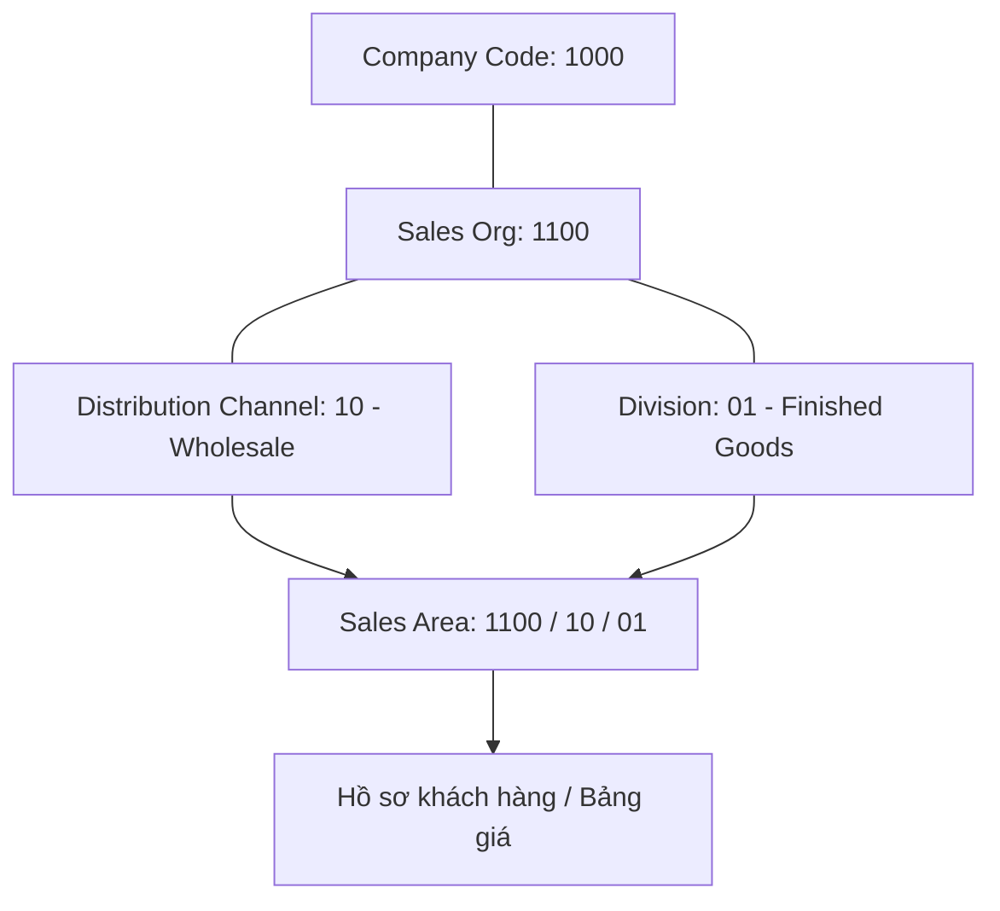

# 1000 Thiết lập cơ cấu tổ chức bán hàng đa công ty, đa kênh

Thiết lập cơ cấu tổ chức bán hàng (Sales Organizational Structure) là bước đặt nền móng đầu tiên khi triển khai phân hệ Quản lý Đơn hàng (Order Management - OM). Cấu trúc này không chỉ phản ánh sơ đồ pháp lý của doanh nghiệp mà còn trực tiếp chi phối luồng dữ liệu giao dịch, chính sách giá, phân quyền bảo mật và các báo cáo tài chính hợp nhất.

---

## 1. Tình huống Nghiệp vụ & "Điểm đau" thực tế

Khi doanh nghiệp mở rộng quy mô kinh doanh sang mô hình tập đoàn đa công ty thành viên, vận hành đồng thời nhiều kênh phân phối (B2B, B2C, Xuất khẩu, Thương mại điện tử), ban dự án thường gặp phải hai rủi ro lớn về mặt thiết kế hệ thống:

*   **Bloated Enterprise Structure (Phình to cấu trúc):** Tạo riêng mỗi phòng ban bán hàng hoặc mỗi cửa hàng vật lý một Tổ chức bán hàng (Sales Org) độc lập. Việc này làm phức tạp hóa quá trình cấu hình (phải khai báo danh mục sản phẩm, khách hàng, bảng giá lặp đi lặp lại cho từng đơn vị) và gây nghẽn luồng xử lý giao dịch.
*   **Thiếu ranh giới pháp lý tài chính:** Gộp chung các đơn vị có mã số thuế khác nhau vào một tổ chức bán hàng duy nhất để "tiết kiệm thao tác nhập liệu". Thiết kế này dẫn đến việc hệ thống không thể tự động bóc tách doanh thu báo cáo thuế, gây lỗi khi thực hiện đối soát liên công ty (Intercompany Reconciliation).

---

## 2. Bản đồ Thiết kế & Ánh xạ Cơ sở dữ liệu trên các ERP lớn

Mỗi hệ thống ERP sử dụng các tên gọi và bảng vật lý khác nhau để biểu diễn mối quan hệ giữa Pháp nhân kế toán và Tổ chức bán hàng. **Lưu ý quan trọng:** SAP và Oracle EBS có mô hình phân tách rõ ràng (Sales Org tách biệt khỏi Pháp nhân, có khái niệm Sales Area riêng). Epicor và Odoo **không có khái niệm tương đương ở cùng độ sâu** — cần đọc phần chú thích bên dưới bảng thay vì hiểu nhầm rằng bốn hệ thống đối xứng nhau.

| Khái niệm nghiệp vụ | SAP S/4HANA (Tables) | Oracle EBS R12 (Tables) | Epicor ERP | Odoo (Models) |
| :--- | :--- | :--- | :--- | :--- |
| **Pháp nhân / Sổ cái**<br/>*(Company Code / Ledger)* | `T001` (Company Codes) | `GL_LEDGERS` (Sổ cái kế toán) | `Erp.Company` (Thông tin công ty) | `res_company` (Bảng công ty gốc) |
| **Tổ chức bán hàng**<br/>*(Sales Org / Operating Unit)* | `TVKO` (Sales Organizations) | `HR_OPERATING_UNITS` *(phân loại là Operating Unit)* | Không có thực thể tương đương riêng — Company đóng luôn vai trò pháp nhân bán hàng, còn `Erp.Plant` chỉ là địa điểm vật lý (kho/nhà máy), **không phải đơn vị bán hàng pháp lý** | `res_company` *(mô hình đa chi nhánh, không tách Sales Org riêng)* |
| **Kênh phân phối**<br/>*(Distribution Channel)* | `TVCO` (Distribution Channels) | Không có bảng Distribution Channel riêng — thường mô phỏng qua `Order Type` hoặc thuộc tính Customer Class | `Erp.SalesTer` là **Sales Territory** (vùng phụ trách của nhân viên KD theo địa lý), khác bản chất với Distribution Channel (chính sách giá/kênh thương mại) — cần dùng field tùy biến nếu muốn mô phỏng đúng | `crm_team` dùng để phân nhóm đội bán hàng, có thể mượn làm kênh logic nhưng không phải khái niệm gốc |
| **Vùng bán hàng**<br/>*(Sales Area)* | `TVKOS` (Sales Org – Distribution Channel – Division Assignment) | Không có khái niệm Sales Area tách biệt; tổ hợp tương đương được kiểm soát qua cặp Operating Unit + Transaction Type | Không có khái niệm tương đương; kiểm soát qua tổ hợp Company + Site + Order Type | Không có khái niệm tương đương; kiểm soát qua tổ hợp Company + Pricelist + Sales Team |

---

## 3. Quy trình cấu hình thực tế trên các ERP lớn

Sơ đồ dưới đây minh họa mô hình khái niệm "Sales Area" — tổ hợp giữa Tổ chức bán hàng, Kênh phân phối và Ngành hàng — vốn được SAP triển khai rõ ràng nhất trong số các ERP lớn. Mô hình này hữu ích để hình dung bản chất vấn đề, dù như đã nêu ở mục 2, Oracle EBS và Epicor không có khái niệm tương đương ở cùng độ sâu và xử lý theo cách khác:



Dưới đây là các bước cấu hình thực tế trên hai hệ thống bạn có thể đối chiếu trực tiếp:

### A. Trên Oracle EBS (Order Management)

Trong Oracle, toàn bộ giao dịch bán hàng được xử lý tại cấp độ **Operating Unit (OU)** — không tồn tại khái niệm Sales Area tách biệt như SAP, mà ranh giới tương đương được kiểm soát qua tổ hợp Operating Unit + Transaction Type:

1.  **Định nghĩa OU:** Truy cập `HRMS > Work Structures > Organization > Description`. Tạo mới một tổ chức và gán phân loại (Classification) là `Operating Unit`.
2.  **Liên kết với Sổ cái (Ledger):** Chạy tính năng cấu hình `Accounting Setup Manager (ASM)` trong General Ledger để liên kết OU này với một Sổ cái chính (Primary Ledger), xác định đồng tiền hạch toán và lịch tài khóa của đơn vị bán hàng.
3.  **Gán tham số OM:** Truy cập `Order Management Super User > Setup > Rules > Security > Org Directory` để kích hoạt quyền nhập đơn hàng cho OU tương ứng.

### B. Trên Epicor ERP

Epicor không có thực thể "Sales Org" độc lập — Company đóng luôn vai trò pháp nhân bán hàng, còn việc phân luồng vật lý dựa trên cấu trúc Site/Plant trực thuộc Company:

1.  **Xác nhận cấu trúc Company:** Truy cập `System Setup > Company/Site Maintenance > Company Configuration` để xác nhận Company đang đóng vai trò pháp nhân bán hàng, gắn với mã số thuế và đơn vị tiền tệ hạch toán tương ứng.
2.  **Thiết lập Site trực thuộc:** Truy cập `System Setup > Company/Site Maintenance > Site Maintenance` để khai báo các Site vật lý (nhà máy/kho) trực thuộc Company, mỗi Site có thể gán kho mặc định riêng phục vụ điều hướng giao hàng.
3.  **Gán quyền truy cập theo Site cho người dùng:** Truy cập `System Setup > Security Maintenance > User Account Security` để giới hạn nhân viên bán hàng chỉ được tạo đơn hàng và xuất kho trong phạm vi Site được phân quyền, mô phỏng ranh giới tương đương "Sales Org" của SAP.

---

## 4. SQL Database Audit Queries (Truy vấn đối soát dữ liệu)

### A. Kiểm tra liên kết giữa Tổ chức bán hàng (OU) và Sổ cái tài chính (Ledger) trên Oracle EBS

Query này giúp phát hiện các Operating Unit chưa được gán chính xác với Sổ cái tài chính hoặc bị sai lệch loại tiền tệ giao dịch mặc định:

```sql
SELECT 
    hou.organization_id AS operating_unit_id,
    hou.name            AS operating_unit_name,
    gl.ledger_id        AS ledger_id,
    gl.name             AS ledger_name,
    gl.currency_code    AS functional_currency,
    hao.creation_date   AS setup_date 
FROM     hr_operating_units hou
INNER JOIN     hr_all_organization_units hao ON hou.organization_id = hao.organization_id 
INNER JOIN     gl_ledgers gl ON hou.set_of_books_id = gl.ledger_id
ORDER BY     hou.name;
```

> **Lưu ý:** `hou.set_of_books_id` là tên cột lịch sử (kế thừa từ trước khi Oracle đổi thuật ngữ "Set of Books" thành "Ledger" ở R12) nhưng vẫn tồn tại trên bảng `hr_operating_units` để join sang `gl_ledgers.ledger_id` — bạn chạy thử trên DB thật và xác nhận cột này còn đúng tên trên bản R12.2.10 công ty bạn.

### B. Kiểm tra danh sách Chi nhánh (Sites) và Kho xuất hàng mặc định trên Epicor ERP

Query dưới đây truy vấn danh sách các Site hoạt động dưới mỗi Company trong Epicor, hiển thị thông tin kho hàng mặc định:

```sql
SELECT 
    c.Company,
    c.Name        AS Company_Name,
    p.Plant       AS Site_ID,
    p.Name        AS Site_Name,
    p.Warehouse   AS Default_Warehouse_ID,
    w.Description AS Default_Warehouse_Name
FROM 
    Erp.Company c
INNER JOIN 
    Erp.Plant p ON c.Company = p.Company
LEFT JOIN 
    Erp.Warehouse w ON p.Company = w.Company AND p.Warehouse = w.WarehouseCode
ORDER BY 
    c.Company, p.Plant;
```

> **Chưa xác minh qua schema thật:** Khác với các bảng `Erp.UOM`/`Erp.UOMClass`/`Erp.UOMConv`/`Erp.PartUOM` mà bạn đã chụp ảnh xác nhận trước đó, câu query này (`Erp.Plant`, `Erp.Warehouse`, cột `p.Warehouse`) dựa trên kiến thức huấn luyện, chưa được đối chiếu ảnh schema thật. Bạn nên tự dò trước bằng: `SELECT TABLE_NAME FROM INFORMATION_SCHEMA.TABLES WHERE TABLE_SCHEMA = 'Erp' AND TABLE_NAME IN ('Plant','Warehouse')` trên schema bạn có, rồi gửi lại để mình chỉnh khớp 100%.

---

## 5. Nguyên tắc Nghiệp vụ cốt lõi khi Tự xây dựng hoặc Tùy biến Hệ thống (OMS/ERP)

Đối với các dự án tự phát triển hệ thống quản lý đơn hàng đa kênh (OMS) hoặc tự xây dựng hệ thống ERP nội bộ, để đảm bảo hệ thống vận hành đúng chuẩn và tránh các lỗi logic nghiêm trọng, đội ngũ thiết kế (BA & Developer) cần đặc biệt tuân thủ hai nguyên tắc nghiệp vụ cốt lõi sau:

### Nguyên tắc 1: Khóa cứng thông tin lịch sử giao dịch (Historical Snapshot Rule)
*   **Vấn đề vận hành:** Một khách hàng B2B ban đầu thuộc chi nhánh Miền Bắc với kênh phân phối "Bán sỉ". Sau một năm, khách hàng này chuyển vùng sang chi nhánh Miền Nam với kênh "Đại lý cấp 2".
*   **Yêu cầu thiết kế logic:** Khi nhân viên kinh doanh hoặc khách hàng tạo đơn hàng (Sales Order), hệ thống **bắt buộc phải ghi đè trực tiếp (snapshot)** thông tin Tổ chức bán hàng, Kênh phân phối, và Văn phòng bán hàng hiện tại vào chính bản ghi của đơn hàng đó.
*   **Mục tiêu:** Đảm bảo khi người dùng thay đổi thông tin mặc định trong hồ sơ khách hàng (Customer Master) hoặc hồ sơ nhân sự (Sales Rep Profile), toàn bộ dữ liệu báo cáo doanh số và phân tích kênh của các đơn hàng cũ trong quá khứ không bị thay đổi theo.

### Nguyên tắc 2: Ràng buộc tính hợp lệ của Kênh bán hàng (Sales Area Validation Rule)
*   **Vấn đề vận hành:** Người dùng vô tình hoặc hệ thống tích hợp tự động đẩy đơn hàng lẻ (B2C) từ Website thương mại điện tử vào một Tổ chức bán hàng chuyên dành cho xuất khẩu (Export Sales Org), dẫn đến việc tính sai thuế suất và sai chính sách giá.
*   **Yêu cầu thiết kế logic:** Hệ thống cần thiết lập một bảng danh mục cấu hình để định nghĩa các "Cặp tổ chức bán hàng và Kênh phân phối hợp lệ" (tương đương khái niệm *Sales Area* của SAP). Khi API tiếp nhận đơn hàng (Order Ingestion API) nhận yêu cầu, hệ thống phải thực hiện kiểm tra tính hợp lệ (Validation) của tổ hợp này trước khi cho phép lưu đơn hàng thành công.

---

## 6. Luồng luân chuyển dữ liệu liên phân hệ (Cross-Module Touchpoints)

Thiết kế cơ cấu tổ chức bán hàng chuẩn xác là tiền đề để tự động hóa dòng chảy thông tin sang các phân hệ khác một cách tự nhiên:

*   **Tích hợp Tài chính kế toán (FIN):** Mối quan hệ giữa Tổ chức bán hàng và Pháp nhân giúp phân hệ Kế toán công nợ (AR) tự động định vị đúng Sổ cái và Mã số thuế phát hành hóa đơn điện tử dựa trên Đơn hàng (Sales Order) được tạo.
*   **Tích hợp Quản lý Kho (WMS/INV):** Khi tạo đơn hàng tại một Vùng bán hàng cụ thể, hệ thống sẽ đối chiếu với cấu hình phân vùng địa lý để tự động giới hạn danh sách kho xuất hàng (Shipping Warehouses) hiển thị trên đơn hàng, tránh tình trạng nhân viên bán hàng chọn nhầm kho xuất ở khu vực địa lý quá xa gây lãng phí chi phí vận chuyển.
*   **Sinh đơn mua hàng nội bộ tự động:** Khi Công ty A bán hàng nhưng Công ty B giữ kho, cơ chế Intercompany dựa trên chính cơ cấu tổ chức này để tự động sinh đơn PO/SO nội bộ, được phân tích chi tiết tại bài [6020 Quản lý đơn mua hàng nội bộ giữa các pháp nhân trong tập đoàn](../po-mua-hang/6020-quan-ly-don-mua-hang-noi-bo-giua-cac-phap-nhan.md) thuộc phân hệ PO.

<div align="center" style={{color: 'var(--ifm-color-primary)'}}>
  <strong>Chúc các bạn thành công và vui vẻ!</strong>
</div>