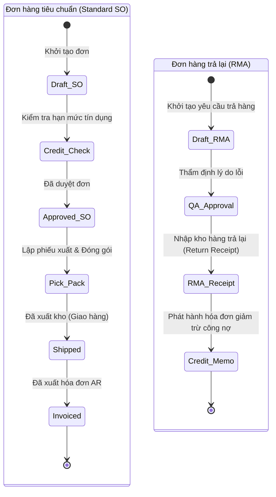

# 1010 Thiết lập loại chứng từ đơn hàng

Trong phân hệ Quản lý Đơn hàng (Order Management - OM), **Loại chứng từ đơn hàng (Sales Document Type / Order Type)** là cấu hình cốt lõi quyết định cách một giao dịch bán hàng được xử lý từ lúc khởi tạo cho đến khi hoàn tất. Cấu hình này định hình toàn bộ luồng công việc (Workflow), kiểm soát dải số chứng từ, quy tắc định giá, các bước phê duyệt tự động và cách thức xuất hóa đơn tài chính.

---

## 1. Tình huống Nghiệp vụ & "Điểm đau" thực tế

Nếu doanh nghiệp xử lý mọi nghiệp vụ bán hàng dưới cùng một "mẫu" đơn hàng tiêu chuẩn duy nhất, hệ thống sẽ gặp các rủi ro vận hành lớn:

*   **Lỗi định giá và hạch toán sai:** Đơn hàng mẫu/quà tặng (Free-of-charge Sample) bị xử lý giống hệt đơn bán sỉ tiêu chuẩn, dẫn đến việc hệ thống tự động ghi nhận công nợ khách hàng (AR) và xuất hóa đơn thương mại sai lệch, mặc dù mục tiêu chỉ là xuất kho giảm tồn kho.
*   **Trì trệ quy trình giao hàng gấp:** Đơn hàng gấp (Rush Order) hoặc đơn bán thu tiền ngay tại quầy (Cash Sale) phải đi qua đầy đủ các bước kiểm tra tín dụng, phê duyệt công nợ và lên lịch chuẩn bị hàng (Wave Planning) kéo dài nhiều ngày, làm mất đi tính kịp thời của dịch vụ khách hàng.
*   **Hỗn loạn quy trình đổi trả (RMA):** Hàng trả lại từ khách hàng được đưa vào hệ thống bằng cách tạo một đơn bán hàng âm. Việc này làm sai lệch báo cáo doanh thu bán ra và không kiểm soát được các bước thẩm định kỹ thuật chất lượng hàng trả về.

---

## 2. Bản đồ Thiết kế & Ánh xạ Cơ sở dữ liệu trên các ERP lớn

Mỗi giải pháp ERP quản lý cấu hình loại chứng từ bán hàng thông qua các bảng vật lý chuyên biệt:

| Khái niệm nghiệp vụ | SAP S/4HANA (Tables) | Oracle EBS R12 (Tables) | Epicor ERP | Odoo (Tables) |
| :--- | :--- | :--- | :--- | :--- |
| **Danh mục Loại đơn hàng**<br/>*(Order Type Master)* | `TVAK` (Sales Document Types)<br/>`TVAKT` (Texts) | `OE_TRANSACTION_TYPES_ALL`<br/>`OE_TRANSACTION_TYPES_TL` | Bảng danh mục Order Type (tên chưa xác minh qua schema thật — xem cảnh báo ở mục 5B) | `sale.order.template` (Mẫu đơn hàng) |
| **Giao dịch Đơn hàng**<br/>*(Sales Order Header)* | `VBAK` (Cột `AUART` - Doc Type) | `OE_ORDER_HEADERS_ALL` (Cột `ORDER_TYPE_ID`) | `Erp.OrderHed` (Cột `OrderType`) | `sale_order` (Cột `sale_order_template_id`) |

---

## 3. Bản đồ luồng xử lý trạng thái theo Loại chứng từ

Sự khác biệt lớn nhất giữa các loại chứng từ là **Luồng chuyển đổi trạng thái (State Machine / Workflow)**. Sơ đồ dưới đây đối chiếu luồng đi của Đơn hàng tiêu chuẩn (Standard SO) và Đơn hàng trả lại (RMA) — đây là mô hình khái niệm chung, áp dụng được cho cả SAP, Oracle lẫn Epicor dù cách cấu hình cụ thể ở mỗi hệ thống khác nhau:



---

## 4. Quy trình cấu hình thực tế trên các ERP lớn

### A. Trên Oracle EBS

1.  **Định nghĩa Transaction Type:** Truy cập `Order Management Super User > Setup > Transaction Types > Define`.
2.  **Thiết lập luồng công việc (Workflow Routing):**
    *   Gán giá trị `Transaction Type Code` = `ORDER` (hoặc `RETURN` cho đơn RMA).
    *   Tại trường `Fulfillment Flow`, chọn luồng xử lý tương ứng (ví dụ: `Order Flow - Generic` cho đơn hàng thường, hoặc `Order Flow - Return with Receipt` cho đơn RMA).
3.  **Gán dải số riêng (nếu cần):** Cấu hình `Document Sequence` tại `System Administrator > Application > Document > Sequence`, sau đó gán vào Transaction Type để tách biệt dải số giữa đơn bán và đơn trả.

### B. Trên Epicor ERP

1.  **Khai báo Order Type:** Truy cập `Sales Management > Order Management > Setup > Order Type` để tạo mã phân loại (ví dụ `STD`, `RMA`, `FOC`).
2.  **Lưu ý về giới hạn cấu hình:** Giống như đã nêu ở bài `1000`, Epicor không có tầng cấu hình Document Type kiểm soát luồng sâu như SAP/Oracle. Order Type ở đây chủ yếu phục vụ phân loại và báo cáo (như câu SQL thống kê ở mục 5B).
3.  **Mô phỏng kiểm soát luồng qua BPM Directive:** Để tái tạo hành vi tương đương "bỏ qua bước kiểm tra tín dụng cho đơn Cash Sale" hoặc "bắt buộc QA Approval cho đơn RMA", cần viết Pre/Post-Processing Directive trên business object `SalesOrder`, kiểm tra điều kiện `OrderHed.OrderType` tại `System Setup > Business Process Management > Method Directives`.

---

## 5. SQL Database Audit Queries (Truy vấn đối soát dữ liệu)

### A. Lọc danh sách Đơn hàng và loại chứng từ tương ứng trên Oracle EBS

Query dưới đây liên kết bảng đơn hàng (`OE_ORDER_HEADERS_ALL`) với bảng danh mục loại giao dịch (`OE_TRANSACTION_TYPES_TL`) để kiểm tra trạng thái vận hành của từng loại đơn hàng:

```sql
SELECT 
    oha.org_id                    AS operating_unit_id,
    oha.order_number              AS order_number,
    otl.name                      AS order_type_name,
    ott.transaction_type_code     AS order_type_code,
    oha.flow_status_code          AS header_flow_status,
    oha.ordered_date              AS ordered_date
FROM 
    oe_order_headers_all oha
INNER JOIN 
    oe_transaction_types_all ott ON oha.order_type_id = ott.transaction_type_id
INNER JOIN 
    oe_transaction_types_tl otl ON ott.transaction_type_id = otl.transaction_type_id 
                                AND otl.language = USERENV('LANG')
WHERE 
    oha.ordered_date >= TO_DATE('2026-01-01', 'YYYY-MM-DD')
ORDER BY 
    oha.ordered_date DESC;
```

### B. Thống kê số lượng đơn hàng theo từng Loại chứng từ trên Epicor ERP

```sql
SELECT 
    oh.Company,
    oh.OrderType                  AS Order_Type_Code,
    ot.Description                AS Order_Type_Description,
    COUNT(oh.OrderNum)            AS Total_Orders,
    MAX(oh.OrderDate)             AS Latest_Order_Date
FROM 
    Erp.OrderHed oh
LEFT JOIN 
    Erp.OrderType ot ON oh.Company = ot.Company AND oh.OrderType = ot.OrderType
WHERE 
    oh.Company = 'YOUR_COMPANY_CODE'
GROUP BY 
    oh.Company, oh.OrderType, ot.Description
ORDER BY 
    Total_Orders DESC;
```

> **Cảnh báo chưa xác minh:** `Erp.OrderHed` và cột `OrderType` gần như chắc chắn đúng (là bảng giao dịch đơn hàng chính, tương tự cách `Erp.PODetail`/`Erp.PORel` đã được xác nhận ở phân hệ PO). Nhưng **bảng danh mục `Erp.OrderType`** ở dòng JOIN thứ hai **chưa được xác minh qua ảnh schema thật** — có thể tên đúng là `Erp.OrderTyp` (số ít) hoặc khác hẳn. Bạn dò trước bằng lệnh sau trên schema Epicor bạn có quyền truy cập, rồi gửi kết quả để mình chỉnh chính xác:
> ```sql
> SELECT TABLE_NAME 
> FROM INFORMATION_SCHEMA.TABLES 
> WHERE TABLE_SCHEMA = 'Erp' 
>   AND TABLE_NAME LIKE '%OrderType%';
> ```

---

## 6. Nguyên tắc Nghiệp vụ cốt lõi khi Tự xây dựng hoặc Tùy biến Hệ thống (OMS/ERP)

### Nguyên tắc 1: Thiết kế Động cơ quy trình (State Machine Engine) thay vì viết code cứng
*   **Vấn đề vận hành:** Nếu lập trình viên sử dụng các câu lệnh điều kiện `if/else` lồng nhau dựa trên mã loại đơn hàng để điều khiển luồng đi (ví dụ: `if (type == 'RMA') { skip_picking() }`), hệ thống sẽ trở nên cực kỳ khó nâng cấp khi doanh nghiệp phát sinh thêm loại đơn hàng mới (như đơn hàng ký gửi - Consignment).
*   **Yêu cầu thiết kế logic:** Hãy xây dựng một bộ máy quản lý trạng thái động (State Machine). Mỗi loại đơn hàng sẽ đăng ký một tập hợp các bước xử lý (Workflow Steps) hợp lệ. Khi một đơn hàng chuyển trạng thái, hệ thống chỉ cần tra cứu cấu hình quy trình của loại chứng từ đó để quyết định bước tiếp theo.

### Nguyên tắc 2: Tách biệt dải mã tiền tố đơn hàng (Pre-defined Prefix Sequence)
*   **Vấn đề vận hành:** Nhân viên kho và bộ phận đối soát kế toán rất dễ nhầm lẫn nếu đơn hàng bán ra và đơn hàng trả lại có định dạng mã số giống hệt nhau.
*   **Yêu cầu thiết kế logic:** Hệ thống tự xây cần hỗ trợ cấu hình tiền tố (Prefix) riêng biệt gắn liền với từng loại đơn hàng tại thời điểm khởi tạo (ví dụ: `SO-2026-0001` cho đơn hàng tiêu chuẩn, `RMA-2026-0001` cho đơn hàng trả lại, và `FOC-2026-0001` cho đơn hàng mẫu).

---

## 7. Luồng luân chuyển dữ liệu liên phân hệ (Cross-Module Touchpoints)

Sự phân loại chứng từ bán hàng đóng vai trò quyết định trong việc định tuyến dữ liệu sang các phân hệ thực thi phía sau:

*   **Tích hợp phân hệ Kho (WMS/INV):** Dựa vào loại chứng từ, phân hệ Kho sẽ nhận diện đơn hàng đó có cần lập kế hoạch gom đơn (Wave Planning), phân vùng lấy hàng (Picking) hay không. Ví dụ: Đơn hàng mẫu khuyến mãi không cần đi qua bước thẩm định mức độ ưu tiên giao nhận của Logistics mà được đẩy thẳng sang phiếu đóng gói.
*   **Tích hợp phân hệ Tài chính (FIN):** Hệ thống kế toán dựa vào loại chứng từ để xác định luồng hóa đơn. Đơn hàng `Standard SO` sẽ kích hoạt luồng xuất hóa đơn bán hàng (`AR Invoice`); đơn hàng quà tặng mẫu `FD` sẽ kích hoạt phiếu xuất kho nội bộ mà không tạo hóa đơn thu tiền; đơn hàng trả lại `RMA` sẽ tạo chứng từ giảm trừ công nợ (`Credit Memo`).

<div align="center" style={{color: 'var(--ifm-color-primary)'}}>
  <strong>Chúc các bạn thành công và vui vẻ!</strong>
</div>