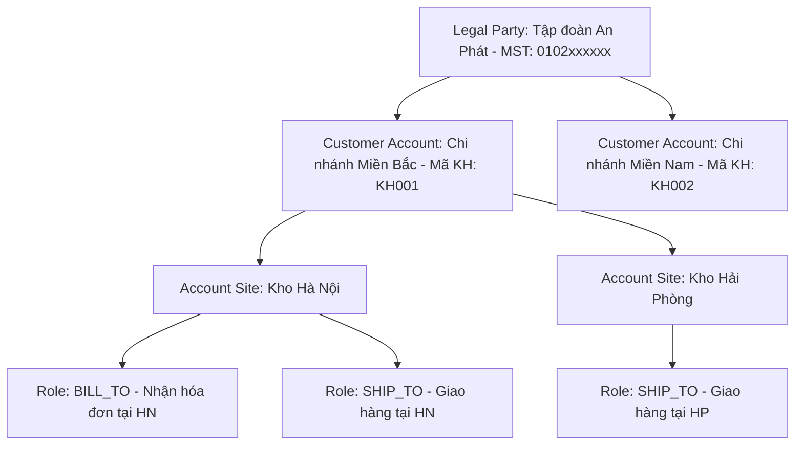

# 2000 Thiết lập hồ sơ khách hàng và phân nhóm

Hồ sơ khách hàng (Customer Master Data) là hạt nhân của toàn bộ phân hệ Quản lý Đơn hàng (OM). Một thiết kế dữ liệu khách hàng chuẩn xác không chỉ giúp tối ưu hóa tốc độ xử lý đơn hàng đa kênh mà còn là điều kiện tiên quyết để hệ thống tự động áp dụng các chính sách chiết khấu, hạn mức công nợ và địa điểm giao hàng một cách chính xác.

---

## 1. Tình huống Nghiệp vụ & "Điểm đau" thực tế

Khi doanh nghiệp phát triển đến quy mô chuỗi hoặc bán hàng phân phối đa kênh, việc quản lý hồ sơ khách hàng thường đối mặt với các bài toán vận hành phức tạp:

*   **Nhầm lẫn địa chỉ hóa đơn và địa chỉ giao hàng:** Một tập đoàn lớn có thể có một văn phòng chính để nhận hóa đơn tài chính (Bill-to) nhưng lại có hàng chục nhà máy, kho vệ tinh ở các tỉnh thành khác nhau để nhận hàng (Ship-to). Nếu hệ thống chỉ thiết kế một trường địa chỉ duy nhất, nhân viên bán hàng sẽ liên tục nhập sai địa điểm giao hàng hoặc xuất sai thông tin hóa đơn đỏ.
*   **Trùng lặp hồ sơ do phân quyền nhập liệu:** Nhân viên chi nhánh Hà Nội tạo một mã khách hàng là "Công ty A", chi nhánh TP.HCM lại tạo thêm một mã khác là "Chi nhánh Công ty A tại miền Nam" dù thực chất họ dùng chung một mã số thuế tập đoàn. Việc này làm phân rã dữ liệu doanh thu và gây khó khăn khi đối soát công nợ tổng của toàn khách hàng.

---

## 2. Bản đồ Thiết kế & Ánh xạ Cơ sở dữ liệu

Dưới đây là bảng đối chiếu cấu trúc lưu trữ thông tin khách hàng trên các hệ thống ERP phổ biến:

| Thực thể nghiệp vụ | Oracle EBS R12 (Tables) | Epicor ERP (Tables) | SAP S/4HANA (Tables) | Odoo (Tables) |
| :--- | :--- | :--- | :--- | :--- |
| **Thực thể pháp lý**<br/>*(Legal Profile / Party)* | `HZ_PARTIES` (Thông tin đối tác chung) | `Erp.Customer` (Master khách hàng — Epicor không tách riêng Party/Account như Oracle) | `BUT000` (Business Partner General) | `res_partner` (Is Company = True) |
| **Tài khoản giao dịch**<br/>*(Customer Account)* | `HZ_CUST_ACCOUNTS` (Tài khoản giao dịch) | `Erp.Customer` (Tích hợp chung) | `KNA1` (Customer General) | `res_partner` (Is Customer = True) |
| **Địa chỉ nhận hàng**<br/>*(Ship-To Site)* | `HZ_CUST_SITE_USES_ALL` (Site Use Code = 'SHIP_TO') | `Erp.ShipTo` (Bảng địa chỉ giao hàng riêng) | `KNVP` (Partner Function = 'WE') | `res_partner` (Type = 'delivery') |
| **Địa chỉ nhận hóa đơn**<br/>*(Bill-To Site)* | `HZ_CUST_SITE_USES_ALL` (Site Use Code = 'BILL_TO') | Không có bảng riêng — địa chỉ gốc lưu ngay trên `Erp.Customer` đóng vai trò Bill-to mặc định | `KNVP` (Partner Function = 'RE') | `res_partner` (Type = 'invoice') |
| **Nhóm phân phối**<br/>*(Customer Group)* | `AR_LOOKUPS` (Loại lookup CUSTOMER_CLASS) | `Erp.CustGrup` (Customer Groups — tên bảng chưa xác minh qua schema thật) | `T151` (Customer Groups) | `res_partner_category` (Tags/Categories) |

---

## 3. Sơ đồ Phân cấp cấu trúc Đối tác (Customer Hierarchy)

Sơ đồ dưới đây mô tả mô hình phân tách địa chỉ và chức năng của một hồ sơ khách hàng tiêu chuẩn, đảm bảo một tài khoản có thể liên kết linh hoạt với nhiều điểm nhận hàng khác nhau:



---

## 4. Quy trình cấu hình thực tế trên các ERP lớn

### A. Trên Oracle EBS R12 (Mô hình TCA - Trading Community Architecture)

1.  **Tạo mới thông tin chung (Party & Account):**
    *   *Đường dẫn:* `Receivables > Customers > Standard`.
    *   *Nghiệp vụ:* Nhập tên đối tác (`Customer Name`), số định danh thuế để hệ thống tự động kiểm tra và tạo bản ghi trong bảng `HZ_PARTIES`, đồng thời sinh ra mã tài khoản giao dịch (`HZ_CUST_ACCOUNTS`).
2.  **Thiết lập Địa chỉ và Chức năng (Sites & Site Uses):**
    *   *Nghiệp vụ:* Tại tab `Addresses`, tạo mới các dòng địa chỉ vật lý. Về bản chất, mỗi địa chỉ này được lưu ở hai lớp: `HZ_PARTY_SITES` (địa chỉ vật lý gắn với Party) và `HZ_CUST_ACCT_SITES_ALL` (site này được "kích hoạt" sử dụng cho tài khoản giao dịch cụ thể).
    *   *Gán chức năng:* Truy cập chi tiết từng địa chỉ, chọn mục `Business Purposes` để gán vai trò tại bảng `HZ_CUST_SITE_USES_ALL`:
        *   Địa chỉ văn phòng chính gán vai trò **Bill To** (Nhận hóa đơn).
        *   Các địa chỉ kho vệ tinh gán vai trò **Ship To** (Nhận hàng).

### B. Trên Epicor ERP (Customer Maintenance)

1.  **Thiết lập Nhóm khách hàng (Customer Group):**
    *   *Đường dẫn:* `Sales Management > Customer Relationship Management > Setup > Customer Group`.
    *   *Nghiệp vụ:* Tạo các nhóm phân phối (ví dụ: `DIST` - Đại lý phân phối, `RET` - Khách mua lẻ) và gán mặc định điều khoản thanh toán (`Terms Code`), bảng giá (`Price List`) cho từng nhóm.
2.  **Tạo mới hồ sơ khách hàng:**
    *   *Đường dẫn:* `Sales Management > Customer Relationship Management > Sheets > Customer Maintenance`.
    *   *Nghiệp vụ:* Nhập mã khách hàng (`CustID`), tên công ty, chọn nhóm khách hàng (`GroupCode`) và gán phân vùng lãnh thổ (`TerritoryID`).
3.  **Cấu hình nhiều điểm giao hàng (Ship To Addresses):**
    *   *Nghiệp vụ:* Chuyển sang tab `Ship To` trong màn hình Customer Maintenance. Tạo mới các bản ghi điểm nhận hàng của khách hàng (`Erp.ShipTo`), cho phép thiết lập mã nhân viên bán hàng (`SalesRep`) và thuế suất riêng biệt cho từng điểm giao hàng.

---
## 5. SQL Database Audit Queries (Truy vấn đối soát dữ liệu)

### A. Đối soát danh sách Địa chỉ giao nhận (Bill-to/Ship-to) trên Oracle EBS

Query dưới đây hỗ trợ kiểm tra tính toàn vẹn dữ liệu, lọc ra các tài khoản khách hàng hoạt động nhưng chưa được cấu hình đầy đủ địa chỉ nhận hóa đơn hoặc địa chỉ giao hàng. Đường liên kết đi qua bảng trung gian `hz_party_sites` để lấy đúng địa chỉ vật lý gốc, vì `hz_cust_acct_sites_all` không liên kết trực tiếp đến `hz_locations`:

```sql
SELECT 
    hca.account_number            AS customer_number,
    hp.party_name                 AS customer_name,
    hcasa.org_id                  AS operating_unit_id,
    hcsua.site_use_code           AS site_use_type, -- Lọc vai trò 'BILL_TO' hoặc 'SHIP_TO'
    hcsua.location                AS site_location_code,
    hcsua.status                  AS site_status,
    hl.address1 || ', ' || hl.city AS detailed_address
FROM 
    hz_cust_accounts hca
INNER JOIN 
    hz_parties hp ON hca.party_id = hp.party_id
INNER JOIN 
    hz_cust_acct_sites_all hcasa ON hca.cust_account_id = hcasa.cust_account_id
INNER JOIN 
    hz_cust_site_uses_all hcsua ON hcasa.cust_acct_site_id = hcsua.cust_acct_site_id
INNER JOIN 
    hz_party_sites hps ON hcasa.party_site_id = hps.party_site_id
INNER JOIN 
    hz_locations hl ON hps.location_id = hl.location_id
WHERE 
    hca.status = 'A' 
    AND hcsua.status = 'A' -- Chỉ lấy địa chỉ đang hoạt động
ORDER BY 
    hp.party_name, hca.account_number;
```

### B. Đối soát phân nhóm Khách hàng và Lãnh thổ bán hàng trên Epicor ERP

Query này hỗ trợ quản trị viên rà soát xem có khách hàng nào đang hoạt động (`Active = 1`) nhưng bị bỏ trống cấu hình Nhóm khách hàng (`GroupCode`) hoặc Vùng bán hàng (`TerritoryID`), điều này có thể dẫn đến việc tính sai giá hoặc sai tuyến giao hàng:

```sql
SELECT 
    c.Company,
    c.CustID                      AS Customer_Code,
    c.Name                        AS Customer_Name,
    c.GroupCode                   AS Customer_Group_Code,
    cg.GroupDesc                  AS Customer_Group_Name,
    c.TerritoryID                 AS Territory_ID,
    st.TerritoryDesc              AS Territory_Name,
    c.TermsCode                   AS Payment_Terms,
    c.CreditHold                  AS Is_Credit_Hold
FROM 
    Erp.Customer c
LEFT JOIN 
    Erp.CustGrup cg ON c.Company = cg.Company AND c.GroupCode = cg.GroupCode
LEFT JOIN 
    Erp.SalesTer st ON c.Company = st.Company AND c.TerritoryID = st.TerritoryID
WHERE 
    c.Company = 'YOUR_COMPANY_CODE'
    AND (c.GroupCode IS NULL OR c.TerritoryID IS NULL) -- Tìm lỗi thiếu phân nhóm
ORDER BY 
    c.Name;
```

---

## 6. Nguyên tắc Nghiệp vụ cốt lõi khi Tự xây dựng hoặc Tùy biến Hệ thống (OMS/ERP)

Để phát triển phân hệ quản lý khách hàng tinh gọn trên một hệ thống tự xây, đội ngũ thiết kế cần áp dụng hai nguyên tắc nghiệp vụ cốt lõi sau:

### Nguyên tắc 1: Tách biệt thực thể "Đối tác pháp lý" và "Tài khoản giao dịch" (Party-Account Split)
*   **Yêu cầu thiết kế logic:** Không nên gộp chung thông tin pháp lý (Mã số thuế, Tên pháp nhân đăng ký) và thông tin tài khoản bán hàng vào cùng một bảng duy nhất. Hãy thiết kế hai thực thể riêng biệt. Một đối tác pháp lý (Party) có thể mở nhiều tài khoản giao dịch (Accounts) khác nhau để mua hàng cho các chi nhánh độc lập của họ.
*   **Mục tiêu:** Giúp tổng hợp công nợ và doanh thu tập đoàn chính xác tại cấp độ Party, trong khi bộ phận vận hành vẫn có thể lên đơn hàng độc lập cho từng Account.

### Nguyên tắc 2: Phân cấp vai trò địa chỉ (Functional Address Roles)
*   **Yêu cầu thiết kế logic:** Một tài khoản khách hàng phải liên kết với một danh sách địa chỉ. Mỗi địa chỉ phải được gán các nhãn chức năng (Roles) rõ ràng: `BILL_TO` (nhận hóa đơn) và `SHIP_TO` (nhận hàng). Khi nhân viên chọn khách hàng trên đơn bán hàng, hệ thống bắt buộc phải hiển thị danh sách lọc tương ứng:
    *   Trường địa chỉ hóa đơn chỉ hiển thị danh sách các địa chỉ có nhãn `BILL_TO`.
    *   Trường địa điểm giao hàng chỉ hiển thị danh sách các địa chỉ có nhãn `SHIP_TO`.

---

## 7. Luồng luân chuyển dữ liệu liên phân hệ (Cross-Module Touchpoints)

*   **Tích hợp phân hệ Kho (WMS/INV):** Địa chỉ nhận hàng (`SHIP_TO`) của khách hàng là dữ liệu đầu vào để hệ thống kho tự động tính toán khoảng cách địa lý, từ đó gán đơn hàng vào tuyến giao nhận (Route) phù hợp nhất.
*   **Tích hợp phân hệ Tài chính (FIN):** Khi kết xuất hóa đơn tài chính (AR Invoice), hệ thống kế toán sẽ truy xuất trực tiếp địa chỉ nhận hóa đơn (`BILL_TO`) và mã số thuế thuộc cấu hình hồ sơ khách hàng để đồng bộ trực tiếp lên hệ thống Hóa đơn điện tử (E-Invoice).

<div align="center" style={{color: 'var(--ifm-color-primary)'}}>
  <strong>Chúc các bạn thành công và vui vẻ!</strong>
</div>