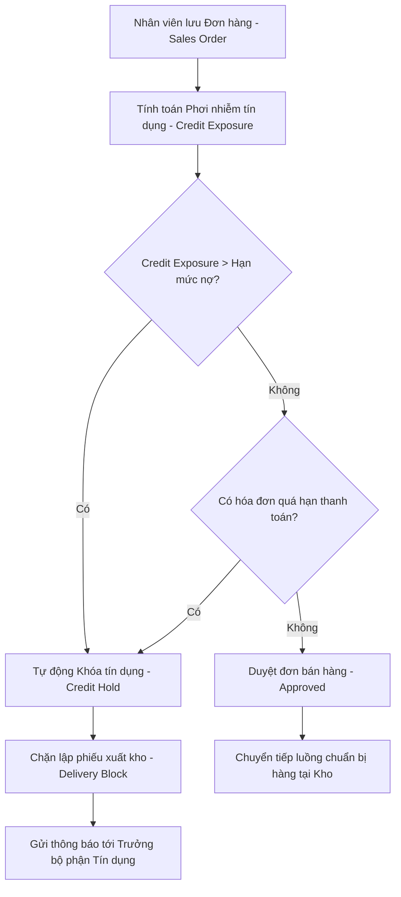

# 2010 Quản lý hạn mức tín dụng và khóa đơn

Trong mô hình kinh doanh B2B và bán hàng phân phối, việc cấp hạn mức công nợ (Credit Limit) cho khách hàng là phương thức phổ biến để thúc đẩy doanh số. Tuy nhiên, nếu thiếu đi công cụ kiểm soát tín dụng tự động, doanh nghiệp sẽ đối mặt với rủi ro nợ xấu và mất khả năng thu hồi vốn khi khách hàng vượt quá khả năng thanh toán [2010].

---

## 1. Tình huống Nghiệp vụ & "Điểm đau" thực tế

Bộ phận tín dụng (Credit Control) và bộ phận kinh doanh (Sales) thường xuyên xảy ra xung đột lợi ích do thiếu một quy trình kiểm soát tự động trên hệ thống:

*   **Rủi ro nợ xấu tăng cao do chậm thông tin:** Nhân viên bán hàng vẫn tiếp tục lên đơn và kho vẫn xuất hàng cho các khách hàng đã quá hạn thanh toán nhiều tháng hoặc đã vượt quá hạn mức nợ cho phép. Lý do là bộ phận kế toán công nợ chỉ đối soát định kỳ cuối tuần/cuối tháng và gửi báo cáo trễ bằng file Excel.
*   **Trì trệ cơ hội bán hàng do duyệt thủ công:** Khi khách hàng thân thiết phát sinh đơn hàng vượt hạn mức tạm thời, đơn hàng phải đi qua luồng ký duyệt giấy phức tạp từ Kế toán trưởng đến Giám đốc tài chính, làm mất nhiều ngày và dẫn đến nguy cơ khách hàng hủy đơn để chuyển sang đối thủ cạnh tranh.

---

## 2. Bản đồ Thiết kế & Ánh xạ Cơ sở dữ liệu

Dưới đây là bảng đối chiếu cấu trúc quản lý hạn mức tín dụng và trạng thái khóa đơn (Credit Hold) trên các hệ thống ERP phổ biến:

| Thực thể nghiệp vụ | Oracle EBS R12 (Tables) | Epicor ERP (Tables) | SAP S/4HANA (Tables) | Odoo (Tables) |
| :--- | :--- | :--- | :--- | :--- |
| **Hồ sơ tín dụng**<br/>*(Credit Profile)* | **`HZ_CUSTOMER_PROFILES`**<br/>(Hạn mức nợ, ngày quá hạn) | **`Erp.Customer`**<br/>(Tích hợp hạn mức trong master) | **`UKMB_BPAR`**<br/>(Business Partner Credit Data) | **`res_partner`**<br/>(Hạn mức công nợ mặc định) |
| **Quy tắc kiểm tra**<br/>*(Credit Rules)* | **`OE_CREDIT_CHECK_RULES`**<br/>(Quy tắc kiểm tra tín dụng) | Được định nghĩa trong **`Erp.Company`** (Grace Period) | **`T024B`**<br/>(Credit Groups) | Quản lý qua Rules/Workflows |
| **Trạng thái khóa đơn**<br/>*(Order Credit Hold)* | **`OE_ORDER_HOLDS_ALL`**<br/>**`OE_HOLD_SOURCES_ALL`** | **`Erp.OrderHed`**<br/>(Cột `CreditHold`) | **`VBAK`**<br/>(Cột `CMGST` - Credit status) | **`sale_order`**<br/>(Trạng thái khóa thanh toán) |

---

## 3. Sơ đồ luồng logic Kiểm tra tín dụng (Credit Check Flow)

Sơ đồ dưới đây mô tả luồng tính toán tín dụng tự động khi một Đơn bán hàng (Sales Order) được lưu trên hệ thống để quyết định việc cho phép giao hàng hay khóa đơn:



---

## 4. Quy trình cấu hình thực tế trên các ERP lớn

### A. Trên Oracle EBS R12 (Credit Management & Order Hold)
1.  **Thiết lập Hạn mức trên Customer Profile:**
    *   *Đường dẫn:* `Receivables > Customers > Standard > Profile` (Chọn Profile Class phù hợp hoặc thiết lập hạn mức trực tiếp tại tab `Profile Limits` của tài khoản khách hàng) [2000].
    *   *Nghiệp vụ:* Nhập giá trị hạn mức tín dụng (`Credit Limit`) và thời gian quá hạn tối đa cho phép.
2.  **Cấu hình Quy tắc kiểm tra tín dụng (Credit Check Rule):**
    *   *Đường dẫn:* `Order Management Super User > Setup > Rules > Credit > Define` [1010].
    *   *Nghiệp vụ:* Tạo mới quy tắc, lựa chọn bao gồm cả giá trị đơn hàng đang chờ duyệt (`Include Tax`, `Include Unbilled Shipping`) vào tổng giá trị phơi nhiễm nợ.
3.  **Gán Quy tắc vào loại chứng từ đơn hàng:**
    *   *Đường dẫn:* `Order Management > Setup > Transaction Types > Define` [1010].
    *   *Nghiệp vụ:* Gán Quy tắc kiểm tra tín dụng vừa tạo vào bước `Booking` của loại đơn hàng tiêu chuẩn [1010]. Khi đơn hàng chuyển sang trạng thái Booked, hệ thống sẽ tự động quét và áp dụng `Credit Hold` nếu vượt hạn mức.

### B. Trên Epicor ERP (Customer Credit & Order Hold)
1.  **Cấu hình Hạn mức và Thời gian gia hạn tại Hồ sơ khách hàng:**
    *   *Đường dẫn:* `Sales Management > Customer Relationship Management > Sheets > Customer Maintenance` [1030, 2000].
    *   *Nghiệp vụ:* Tại tab `Customer > Credit`, nhập giá trị hạn mức tín dụng tối đa (`Credit Limit`). Khai báo số ngày quá hạn được phép (`OverdueGrace`) trước khi hệ thống tự động khóa tín dụng.
2.  **Tự động khóa đơn hàng (Auto-Credit Hold):**
    *   *Nghiệp vụ:* Khi lưu đơn hàng mới (`Order Entry`), Epicor sẽ tự động tính toán tổng công nợ thực tế và giá trị đơn hàng hiện tại. Nếu vượt quá hạn mức, hệ thống sẽ tự động tích chọn ô `Credit Hold` trên màn hình `OrderHed` và khóa không cho phép lập phiếu xuất hàng (`Shipment Entry`).

---

## 5. SQL Database Audit Queries (Truy vấn đối soát dữ liệu)

### A. Đối soát các Đơn hàng đang bị Khóa tín dụng (Active Credit Holds) trên Oracle EBS

Query dưới đây lọc ra toàn bộ các đơn hàng hiện đang bị khóa tín dụng và chưa được giải phóng (Released), hiển thị kèm thông tin hạn mức nợ của khách hàng để phục vụ rà soát.

> **Lưu ý:** `HZ_CUSTOMER_PROFILES` không lưu trực tiếp giá trị hạn mức tín dụng — bảng này chỉ chứa các cờ/quy tắc profile. Giá trị hạn mức thực tế (theo từng loại tiền tệ) nằm ở bảng con `HZ_CUST_PROFILE_AMTS`, nên cần join thêm bảng này để lấy đúng dữ liệu.

```sql
SELECT 
    oha.org_id                    AS operating_unit_id,
    oha.order_number              AS order_number,
    hca.account_number            AS customer_number,
    hp.party_name                 AS customer_name,
    ohd.name                      AS hold_name,
    oh.creation_date              AS hold_applied_date,
    hcpa.overall_credit_limit     AS customer_overall_credit_limit,
    hcpa.trx_credit_limit         AS order_credit_limit,
    hcpa.currency_code            AS credit_limit_currency
FROM 
    oe_order_headers_all oha
INNER JOIN 
    oe_order_holds_all oh ON oha.header_id = oh.header_id
INNER JOIN 
    oe_hold_sources_all ohs ON oh.hold_source_id = ohs.hold_source_id
INNER JOIN 
    oe_hold_definitions ohd ON ohs.hold_id = ohd.hold_id
INNER JOIN 
    hz_cust_accounts hca ON oha.sold_to_org_id = hca.cust_account_id
INNER JOIN 
    hz_parties hp ON hca.party_id = hp.party_id
LEFT JOIN 
    hz_customer_profiles hcp ON hca.cust_account_id = hcp.cust_account_id AND hcp.site_use_id IS NULL
LEFT JOIN 
    hz_cust_profile_amts hcpa ON hcp.cust_account_profile_id = hcpa.cust_account_profile_id
                               AND hcpa.currency_code = oha.transactional_curr_code
WHERE 
    oh.released_flag = 'N' -- Khóa tín dụng đang có hiệu lực
    AND ohd.name LIKE '%Credit%'
ORDER BY 
    oh.creation_date DESC;
```

### B. Tra cứu đơn hàng bị khóa tín dụng trên Epicor ERP

Query dưới đây giúp bộ phận kiểm soát nội bộ rà soát các đơn hàng bị khóa tín dụng (`CreditHold = 1`) hoặc các đơn hàng được bán cho các khách hàng đang bị đánh dấu khóa tín dụng trong hệ thống Epicor:

```sql
SELECT 
    oh.Company,
    oh.OrderNum                   AS Order_Number,
    oh.OrderDate                  AS Order_Date,
    c.CustID                      AS Customer_Code,
    c.Name                        AS Customer_Name,
    c.CreditLimit                 AS Customer_Credit_Limit,
    c.CreditHold                  AS Customer_In_Credit_Hold_State,
    oh.CreditHold                 AS Order_Specifically_Held,
    oh.DocOrderAmt                AS Order_Amount
FROM 
    Erp.OrderHed oh
INNER JOIN 
    Erp.Customer c ON oh.Company = c.Company AND oh.CustNum = c.CustNum
WHERE 
    oh.Company = 'YOUR_COMPANY_CODE'
    AND (oh.CreditHold = 1 OR c.CreditHold = 1)
ORDER BY 
    oh.OrderDate DESC;
```

---

## 6. Nguyên tắc Nghiệp vụ cốt lõi khi Tự xây dựng hoặc Tùy biến Hệ thống (OMS/ERP)

Để phát triển bộ máy kiểm soát tín dụng tự động và an toàn trên các hệ thống tự xây dựng, đội ngũ thiết kế cần tuân thủ hai quy tắc nghiệp vụ cốt lõi sau:

### Nguyên tắc 1: Công thức chuẩn tính Phơi nhiễm tín dụng (Credit Exposure Formula)
*   **Vấn đề vận hành:** Nếu hệ thống chỉ so sánh giá trị đơn hàng mới với công nợ thực tế trên hóa đơn (Unpaid Invoices), khách hàng có thể đặt liên tục 10 đơn hàng giá trị lớn cùng lúc mà không bị chặn, vì lúc này hóa đơn chưa được phát hành.
*   **Yêu cầu thiết kế logic:** Phơi nhiễm tín dụng (Credit Exposure) phải được tính toán theo công thức chuẩn thời gian thực (Real-time) như sau:
    $$\text{Phơi nhiễm} = \text{Công nợ thực tế trên hóa đơn (AR)} + \text{Giá trị các đơn hàng đang xử lý (Open Sales Orders)} + \text{Giá trị đơn hàng hiện tại}$$
    Hệ thống phải tự động từ chối phê duyệt đơn hàng nếu giá trị phơi nhiễm này vượt quá hạn mức tín dụng được cấu hình trên hồ sơ khách hàng [2000, 2010].

### Nguyên tắc 2: Tách biệt trạng thái Chặn giao hàng (Delivery Block)
*   **Yêu cầu thiết kế logic:** Khi một đơn hàng bị rơi vào trạng thái Khóa tín dụng (Credit Hold), hệ thống phải kích hoạt chế độ **Chặn giao hàng (Delivery Block / WMS Hold)** tại tầng cơ sở dữ liệu.
*   **Mục tiêu:** Tuyệt đối không cho phép tạo phiếu chuẩn bị hàng xuất kho (Pick Release/Picking Ticket) tại phân hệ Kho đối với các đơn hàng này cho đến khi có hành động giải phóng khóa (Release Hold) chính thức từ nhân sự kiểm soát tín dụng [1010].

---

## 7. Luồng luân chuyển dữ liệu liên phân hệ (Cross-Module Touchpoints)

*   **Tích hợp phân hệ Tài chính kế toán (FIN - AR):** Công nợ thực tế của khách hàng biến động liên tục sau mỗi giao dịch thanh toán hoặc phát hành hóa đơn đỏ. Mỗi khi kế toán nợ duyệt một phiếu thu tiền gửi ngân hàng, hệ thống FIN phải lập tức cập nhật lại số dư công nợ thực tế để tự động giải phóng hạn mức nợ cho khách hàng tiếp tục mua hàng.
*   **Tích hợp phân hệ Kho (WMS/INV):** Luồng kiểm tra tín dụng tự động đóng vai trò là "người gác cổng" cho các hoạt động tại kho [1010]. Phân hệ Kho chỉ tiếp nhận các yêu cầu soạn hàng xuất kho từ những đơn hàng đã vượt qua bài kiểm tra tín dụng thành công [1010].

---

<div align="center" style={{color: 'var(--ifm-color-primary)'}}>
  <strong>Chúc các bạn thành công và vui vẻ!</strong>
</div>