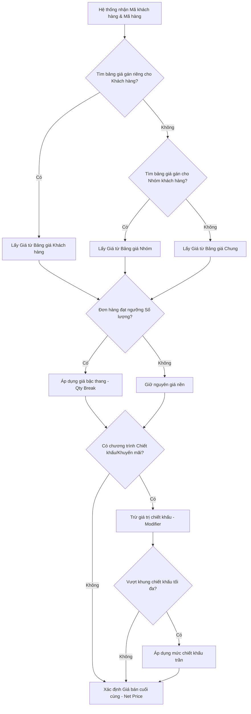

# 2020 Thiết lập bảng giá đa kênh và quy tắc chiết khấu

Trong các doanh nghiệp phân phối đa kênh, quản lý chính sách giá và chiết khấu (Pricing & Discount Management) là nghiệp vụ phức tạp nhất của phân hệ bán hàng. Một thiết kế động cơ tính giá (Pricing Engine) linh hoạt giúp phòng kinh doanh chủ động tung ra các chính sách thương mại cạnh tranh mà không gây hỗn loạn hoặc sai sót khi nhân viên nhập đơn hàng.

---

## 1. Tình huống Nghiệp vụ & "Điểm đau" thực tế

Khi vận hành nhiều kênh phân phối song song (như chuỗi siêu thị MT, cửa hàng bán lẻ GT, sàn TMĐT và xuất khẩu), doanh nghiệp thường gặp các điểm nghẽn lớn sau:

*   **Lỗi áp sai bảng giá:** Nhân viên vô tình chọn nhầm bảng giá bán lẻ cho khách mua sỉ đại lý lớn hoặc ngược lại. Sai sót này dẫn đến việc phải hủy hóa đơn, chỉnh sửa đơn hàng thủ công và ảnh hưởng trực tiếp đến uy tín thương mại của doanh nghiệp.
*   **Trùng lặp cộng dồn chiết khấu (Discount Overlapping):** Doanh nghiệp cùng lúc chạy chương trình chiết khấu theo nhóm khách hàng (ví dụ: giảm 5%) và chương trình chiết khấu số lượng mua lớn (ví dụ: mua trên 100 sản phẩm giảm 10%). Nếu hệ thống không có quy tắc ưu tiên rõ ràng, nhân viên có thể cộng gộp cả hai loại chiết khấu thành 15%, làm biên lợi nhuận của sản phẩm bị giảm dưới giá vốn.

---

## 2. Bản đồ Thiết kế & Ánh xạ Cơ sở dữ liệu

Dưới đây là bảng đối chiếu cấu trúc lưu trữ chính sách giá và chiết khấu giữa các hệ thống ERP:

| Thực thể nghiệp vụ | Oracle EBS R12 (Tables) | Epicor ERP (Tables) | SAP S/4HANA (Tables) | Odoo (Tables) |
| :--- | :--- | :--- | :--- | :--- |
| **Đầu mục bảng giá**<br/>*(Price List Header)* | **`QP_LIST_HEADERS`**<br/>(Lưu tên, tiền tệ, ngày hiệu lực) | **`Erp.PriceLst`**<br/>(Master bảng giá) | **`KONH`**<br/>(Header Conditions) | **`product.pricelist`**<br/>(Bảng giá) |
| **Dòng giá chi tiết**<br/>*(Price List Line)* | **`QP_LIST_LINES`**<br/>**`QP_PRICING_ATTRIBUTES`** | **`Erp.PriceLstParts`**<br/>(Giá chi tiết theo mã hàng) | **`KONP`**<br/>(Condition Item Data) | **`product.pricelist.item`**<br/>(Chi tiết quy tắc tính giá) |
| **Chiết khấu theo số lượng**<br/>*(Quantity Break Price)* | Mapped qua attribute của **`QP_LIST_LINES`** | **`Erp.PriceLstPartsBreak`**<br/>(Bảng giá bậc thang) | **`KONM`**<br/>(Quantity Scales) | Tích hợp trong **`product.pricelist.item`** |
| **Chương trình chiết khấu**<br/>*(Discount Modifiers)* | **`QP_MODIFIERS_PUB`**<br/>(Modifiers & Qualifiers) | **`Erp.Discount`**<br/>(Discount Tables) | **`A000` đến `A999`**<br/>(Access Sequences) | **`coupon.program`** /<br/>**`sale.promo`** |

---

## 3. Sơ đồ luồng logic Tính toán giá (Pricing Engine Flow)

Sơ đồ dưới đây mô tả cách động cơ tính giá của ERP tự động xác định mức giá bán cuối cùng (Net Price) cho một dòng sản phẩm trên đơn hàng:



---

## 4. Quy trình cấu hình thực tế trên các ERP lớn

### A. Trên Oracle EBS R12 (Phân hệ Advanced Pricing)
1.  **Thiết lập Bảng giá gốc (Price List Setup):**
    *   *Đường dẫn:* `Oracle Pricing Manager > Price Lists > Price List Setup`.
    *   *Nghiệp vụ:* Tạo mới bảng giá (`QP_LIST_HEADERS`), chỉ định loại tiền tệ (`VND`), ngày bắt đầu và kết thúc hiệu lực. Tại tab `List Lines`, nhập danh sách mã sản phẩm và giá bán cơ sở (`QP_LIST_LINES`).
2.  **Cấu hình Chương trình giảm giá (Modifiers Setup):**
    *   *Đường dẫn:* `Oracle Pricing Manager > Modifiers > Modifier Setup`.
    *   *Nghiệp vụ:* Tạo mới một Modifier dòng (`Line Adjustment`) để giảm 10% giá trị sản phẩm. Thiết lập điều kiện áp dụng (`Qualifiers`) ví dụ: Chỉ áp dụng khi thuộc nhóm đối tác đại lý lớn (`Customer Class = Wholesale`).

### B. Trên Epicor ERP (Price List Maintenance)
1.  **Thiết lập Bảng giá chi tiết:**
    *   *Đường dẫn:* `Sales Management > Price List > Sheets > Price List Maintenance`.
    *   *Nghiệp vụ:* Tạo mã bảng giá mới (`ListCode`). Tại tab `Parts`, thêm mã sản phẩm và nhập giá bán cơ sở (`BasePrice`).
2.  **Thiết lập chính sách giá bậc thang (Quantity Breaks):**
    *   *Nghiệp vụ:* Tại dòng sản phẩm, chuyển sang tab `Quantity Breaks`. Nhập các ngưỡng số lượng tối thiểu và mức giá tương ứng (ví dụ: mua từ 1-50 cái giá 10,000đ; mua từ 51 cái trở lên giá 9,000đ).
3.  **Gán bảng giá:**
    *   *Nghiệp vụ:* Gán bảng giá này vào hồ sơ Khách hàng (`Customer Maintenance`) hoặc Nhóm khách hàng (`Customer Group`) để hệ thống tự động nhận diện khi lên đơn hàng.

---

## 5. SQL Database Audit Queries (Truy vấn đối soát dữ liệu)

### A. Đối soát Giá bán hiện tại của sản phẩm trong bảng giá trên Oracle EBS

Query dưới đây giúp bộ phận kiểm soát nội bộ rà soát mức giá cơ sở đang có hiệu lực của tất cả sản phẩm trong các bảng giá:

```sql
SELECT 
    qlh.name                      AS pricelist_name,
    qll.list_line_no              AS line_number,
    msib.segment1                 AS item_code,
    qll.operand                   AS base_unit_price,
    qll.start_date_active         AS start_date,
    qll.end_date_active           AS end_date
FROM 
    qp_list_headers_v qlh
INNER JOIN 
    qp_list_lines qll ON qlh.list_header_id = qll.list_header_id
INNER JOIN 
    qp_pricing_attributes qpa ON qll.list_line_id = qpa.list_line_id
INNER JOIN 
    mtl_system_items_b msib ON qpa.product_attr_value = TO_CHAR(msib.inventory_item_id)
WHERE 
    qlh.list_type_code = 'PRL' -- Chỉ lọc Bảng giá (Price List)
    AND qpa.product_attribute = 'PRICING_ATTRIBUTE1' -- Thuộc tính mã sản phẩm
    AND SYSDATE BETWEEN NVL(qll.start_date_active, SYSDATE-1) AND NVL(qll.end_date_active, SYSDATE+1)
ORDER BY 
    qlh.name, msib.segment1;
```

### B. Tra cứu bảng giá bậc thang theo số lượng (Quantity Breaks) trên Epicor ERP

Query dưới đây lọc ra toàn bộ các sản phẩm có cấu hình giá bậc thang theo số lượng trong các bảng giá đang hoạt động trên Epicor:

```sql
SELECT 
    pl.Company,
    pl.ListCode                   AS Price_List_Code,
    pl.Description                AS Price_List_Description,
    plp.PartNum                   AS Part_Number,
    plp.BasePrice                 AS Base_Price,
    plb.Quantity                  AS Break_Qty_Threshold,
    plb.BreakPrice                AS Break_Price,
    pl.StartDate                  AS Start_Date,
    pl.EndDate                    AS End_Date
FROM 
    Erp.PriceLst pl
INNER JOIN 
    Erp.PriceLstParts plp ON pl.Company = plp.Company AND pl.ListCode = plp.ListCode
INNER JOIN 
    Erp.PriceLstPartsBreak plb ON plp.Company = plb.Company AND plp.ListCode = plb.ListCode AND plp.PartNum = plb.PartNum
WHERE 
    pl.Company = 'YOUR_COMPANY_CODE'
    AND (pl.EndDate IS NULL OR pl.EndDate >= GETDATE())
ORDER BY 
    pl.ListCode, plp.PartNum, plb.Quantity;
```

---

## 6. Nguyên tắc Nghiệp vụ cốt lõi khi Tự xây dựng hoặc Tùy biến Hệ thống (OMS/ERP)

Để phát triển bộ máy tính giá tự động chính xác cho hệ thống tự xây dựng, đội ngũ thiết kế cần áp dụng hai nguyên tắc nghiệp vụ cốt lõi sau:

### Nguyên tắc 1: Cấu trúc phân cấp ưu tiên áp dụng giá (Pricing Hierarchy Rules)
*   **Yêu cầu thiết kế logic:** Động cơ tính giá phải duyệt qua các tầng cấu hình giá theo một thứ tự ưu tiên cố định (từ chi tiết nhất đến bao quát nhất). Thứ tự tìm giá tiêu chuẩn thường là:
    $$\text{Giá chỉ định riêng cho Khách hàng} \rightarrow \text{Giá theo Nhóm khách hàng} \rightarrow \text{Giá bán chung của toàn hệ thống}$$
    Ngay khi hệ thống tìm thấy mức giá khớp ở tầng ưu tiên cao hơn, nó phải dừng tìm kiếm để tránh tình trạng áp sai giá nền.

### Nguyên tắc 2: Giới hạn tổng chiết khấu cộng dồn (Cumulative Discount Cap)
*   **Yêu cầu thiết kế logic:** Hệ thống tự xây cần hỗ trợ cấu hình trường "Khung chiết khấu tối đa" (Maximum Discount Cap) tại danh mục sản phẩm (ví dụ: sản phẩm A chỉ cho phép chiết khấu tối đa 20%). Khi tính toán giá cuối cùng, nếu tổng giá trị giảm giá từ các chương trình chiết khấu cộng dồn vượt quá ngưỡng này, hệ thống phải tự động điều chỉnh giảm chiết khấu về mức trần cho phép để bảo vệ biên lợi nhuận của doanh nghiệp.

---

## 7. Luồng luân chuyển dữ liệu liên phân hệ (Cross-Module Touchpoints)

*   **Tích hợp phân hệ Kho (WMS/INV):** Mặc dù bảng giá không trực tiếp thay đổi số lượng tồn kho vật lý, nhưng việc áp giá chính xác tại tầng đơn hàng là căn cứ duy nhất để hệ thống kho tính toán đúng giá trị tồn kho xuất bán trên phiếu đóng gói và bàn giao trách nhiệm hàng hóa.
*   **Tích hợp phân hệ Tài chính (FIN - AR):** Giá bán sau chiết khấu (Net Price) chính là cơ sở pháp lý để hệ thống kế toán tính toán thuế suất giá trị gia tăng (VAT), ghi nhận công nợ phải thu của khách hàng và định khoản doanh thu bán hàng chính xác theo tiêu chuẩn kế toán.

---

<div align="center" style={{color: 'var(--ifm-color-primary)'}}>
  <strong>Chúc các bạn thành công và vui vẻ!</strong>
</div>