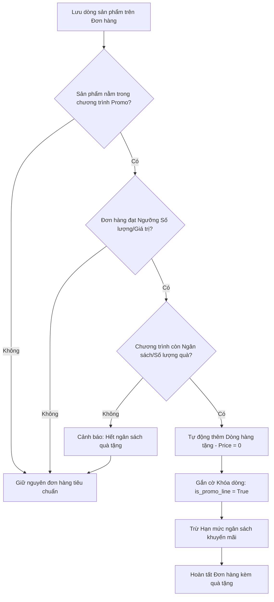

# 2030 Thiết lập chương trình khuyến mãi, quà tặng tự động

Bên cạnh chính sách giá cơ bản, các chương trình khuyến mãi (Promotions) và quà tặng tự động (Free Gifts) là công cụ then chốt để doanh nghiệp kích cầu tiêu dùng. Việc tự động hóa động cơ xử lý khuyến mãi (Promotion Engine) giúp hệ thống tự ghi nhận quà tặng ngay khi đơn hàng đủ điều kiện, giải phóng sức lao động thủ công và đảm bảo tính minh bạch trong quản lý kho vận.

---

## 1. Tình huống Nghiệp vụ & "Điểm đau" thực tế

Hoạt động khuyến mãi thủ công hoặc thiết lập hệ thống thiếu đồng bộ thường đẩy doanh nghiệp vào các tình huống rủi ro:

*   **Thất thoát hàng quà tặng tại kho:** Doanh nghiệp chạy chương trình "Mua 10 tặng 1". Tuy nhiên, do hệ thống không tự động chèn dòng hàng tặng vào đơn hàng, nhân viên bán hàng phải viết ghi chú thủ công bằng tay hoặc gọi điện báo kho xuất thêm hàng. Thủ kho xuất hàng quà tặng dựa trên ghi chú không chính thức, dẫn đến chênh lệch tồn kho vật lý và tồn kho hệ thống.
*   **Lợi dụng kẽ hở khuyến mãi (Promo Abuse):** Khi nhân viên bán hàng tách một đơn hàng lớn đạt ngưỡng nhận quà thành nhiều đơn hàng nhỏ hơn nhằm nhận nhiều suất quà vượt định mức cho phép, hoặc cố tình áp dụng chồng chéo các chương trình đã hết hạn hiệu lực.

---

## 2. Bản đồ Thiết kế & Ánh xạ Cơ sở dữ liệu

Dưới đây là bảng đối chiếu cấu trúc lưu trữ chính sách khuyến mãi và quà tặng trên các hệ thống ERP:

| Thực thể nghiệp vụ | Oracle EBS R12 (Tables) | Epicor ERP (Tables) | SAP S/4HANA (Tables) | Odoo (Tables) |
| :--- | :--- | :--- | :--- | :--- |
| **Đầu mục Khuyến mãi**<br/>*(Promotion Header)* | **`QP_LIST_HEADERS`**<br/>(Lưu chương trình Deal) | **`Erp.Discount`**<br/>(Bảng cấu hình giảm giá) | **`KONH`**<br/>(Header Conditions) | **`loyalty.program`**<br/>(Chương trình ưu đãi) |
| **Điều kiện áp dụng**<br/>*(Promo Qualifiers)* | **`QP_QUALIFIERS`**<br/>(Ràng buộc nhóm đối tác/kênh) | **`Erp.DiscParts`**<br/>(Giới hạn mã hàng áp dụng) | **`KOTD001`**<br/>(Free Goods Access) | **`loyalty.rule`**<br/>(Quy tắc áp dụng) |
| **Hàng tặng/Quà tặng**<br/>*(Gift / Related Modifier)* | **`QP_RLTD_MODIFIERS`**<br/>(Bảng liên kết hàng mua - tặng) | **`Erp.SalesAddtl`** /<br/>BPM Custom Rules | **`KONSD`**<br/>(Free Goods Scale Data) | **`loyalty.reward`**<br/>(Phần thưởng quà tặng) |
| **Hạn mức Ngân sách**<br/>*(Promotion Limits)* | **`QP_LIMITS`**<br/>(Giới hạn ngân sách/số lượng) | BPM Custom Rules | **`T685`**<br/>(Condition Controls) | Tích hợp trong **`loyalty.program`** |

---

## 3. Sơ đồ Luồng xử lý của Động cơ Khuyến mãi (Promotion Engine)

Sơ đồ dưới đây mô tả cách động cơ khuyến mãi quét đơn hàng để tự động xác định điều kiện và đẩy hàng quà tặng vào đơn hàng:



---

## 4. Quy trình cấu hình thực tế trên các ERP lớn

### A. Trên Oracle EBS R12 (Advanced Pricing - Promotional Goods)
1.  **Thiết lập Chương trình Khuyến mãi (Modifier Header):**
    *   *Đường dẫn:* `Oracle Pricing Manager > Modifiers > Modifier Setup`.
    *   *Nghiệp vụ:* Tạo mới một Modifier với `Type = Deal` (`QP_LIST_HEADERS`). Thiết lập ngày hiệu lực bắt đầu và kết thúc phù hợp.
2.  **Cấu hình luồng Mua hàng - Tặng quà (Promotional Goods - PRG):**
    *   *Nghiệp vụ:* Tạo dòng Modifier mới (`QP_LIST_LINES`) với `Modifier Type = Promotion Goods`.
    *   *Xác định điều kiện mua (Buy):* Nhập sản phẩm chính và số lượng tối thiểu yêu cầu (ví dụ: Mua tối thiểu 10 sản phẩm A).
    *   *Xác định quà tặng (Get):* Click nút `Get` để mở cửa sổ liên kết. Nhập mã sản phẩm quà tặng B, số lượng tặng (ví dụ: Tặng 1 sản phẩm B) và thiết lập mức giảm giá `Application Method = Percent` với giá trị `100%` để hàng tặng có giá bằng 0.

### B. Trên Epicor ERP (Discount Table & BPM Automation)
1.  **Thiết lập Bảng quy tắc chiết khấu (Discount Table Setup):**
    *   *Đường dẫn:* `Sales Management > Demand Management > Setup > Discount Table`.
    *   *Nghiệp vụ:* Tạo mới mã quy tắc khuyến mãi (`DiscountCode`). Khai báo các ngưỡng giá trị hoặc số lượng để kích hoạt giảm giá bán lẻ.
2.  **Tự động hóa chèn quà tặng bằng BPM (Business Process Management):**
    *   *Nghiệp vụ:* Do Epicor không có tính năng chèn dòng sản phẩm khác (Free Goods) tự động trên Order Entry theo chuẩn gốc, doanh nghiệp thường thiết lập một Method Directive trên phương thức `SalesOrder.Update`.
    *   *Logic BPM:* Khi người dùng lưu đơn hàng, BPM kiểm tra tổng số lượng dòng sản phẩm chính. Nếu đạt ngưỡng quy định, hệ thống tự động gọi API chèn thêm một dòng đơn hàng mới (`OrderDtl`) chứa mã sản phẩm quà tặng, đồng thời gán mức giá `UnitPrice = 0` và khóa không cho phép sửa đơn giá.

---

## 5. SQL Database Audit Queries (Truy vấn đối soát dữ liệu)

### A. Đối soát các chương trình Mua hàng - Tặng quà đang hoạt động trên Oracle EBS

Query dưới đây giúp bộ phận kiểm soát nội bộ tra cứu toàn bộ các chương trình khuyến mãi "Mua X tặng Y" đang hoạt động trên hệ thống Oracle EBS:

```sql
SELECT 
    qlh.name                      AS promotion_program_name,
    qll_buy.list_line_no          AS buy_line_number,
    msib_buy.segment1             AS buy_item_code,
    qll_get.list_line_no          AS get_line_number,
    msib_get.segment1             AS get_item_code,
    qll_get.benefit_qty           AS award_free_quantity,
    qlh.start_date_active         AS start_date,
    qlh.end_date_active           AS end_date
FROM 
    qp_list_headers_v qlh -- Sử dụng view _v để lấy dữ liệu header chuẩn đầy đủ mã loại
INNER JOIN 
    qp_list_lines qll_buy ON qlh.list_header_id = qll_buy.list_header_id
INNER JOIN 
    qp_rltd_modifiers qrm ON qll_buy.list_line_id = qrm.from_rltd_modifier_id
INNER JOIN 
    qp_list_lines qll_get ON qrm.to_rltd_modifier_id = qll_get.list_line_id
INNER JOIN 
    qp_pricing_attributes qpa_buy ON qll_buy.list_line_id = qpa_buy.list_line_id
INNER JOIN 
    mtl_system_items_b msib_buy ON qpa_buy.product_attr_value = TO_CHAR(msib_buy.inventory_item_id)
INNER JOIN 
    qp_pricing_attributes qpa_get ON qll_get.list_line_id = qpa_get.list_line_id
INNER JOIN 
    mtl_system_items_b msib_get ON qpa_get.product_attr_value = TO_CHAR(msib_get.inventory_item_id)
WHERE 
    qlh.list_type_code = 'DLT' 
    AND qll_buy.list_line_type_code = 'PRG' 
    AND qpa_buy.product_attribute_context = 'ITEM' -- Đảm bảo thuộc tính lọc là hàng hóa/vật tư
    AND qpa_get.product_attribute_context = 'ITEM'
    AND TRUNC(SYSDATE) BETWEEN NVL(qlh.start_date_active, TRUNC(SYSDATE)-1) AND NVL(qlh.end_date_active, TRUNC(SYSDATE)+1)
ORDER BY 
    qlh.name;
```

### B. Đối soát bảng Quy tắc giảm giá đang hoạt động trên Epicor ERP

Query dưới đây lọc ra toàn bộ các cấu hình giảm giá khuyến mãi đang có hiệu lực trên hệ thống Epicor:

```sql
SELECT 
    d.Company,
    d.DiscountCode                AS Discount_Code,
    d.Description                 AS Discount_Description,
    dp.PartNum                    AS Part_Number,
    dp.DiscountPercent            AS Discount_Percent,
    d.StartDate                   AS Start_Date,
    d.EndDate                     AS End_Date
FROM 
    Erp.Discount d
INNER JOIN 
    Erp.DiscParts dp ON d.Company = dp.Company AND d.DiscountCode = dp.DiscountCode
WHERE 
    d.Company = 'YOUR_COMPANY_CODE'
    AND (d.EndDate IS NULL OR d.EndDate >= GETDATE())
ORDER BY 
    d.DiscountCode, dp.PartNum;
```

---

## 6. Nguyên tắc Nghiệp vụ cốt lõi khi Tự xây dựng hoặc Tùy biến Hệ thống (OMS/ERP)

Để phát triển một động cơ khuyến mãi (Promotion Engine) tự động và chính xác trên các hệ thống tự xây, đội ngũ thiết kế cần áp dụng hai nguyên tắc nghiệp vụ cốt lõi sau:

### Nguyên tắc 1: Khóa kiểm soát dòng hàng tặng tự động (Promo Line Locking)
*   **Vấn đề vận hành:** Nếu hệ thống chỉ chèn dòng hàng tặng với đơn giá bằng 0 một cách thông thường, nhân viên bán hàng có thể tự ý sửa số lượng quà tặng tăng lên, hoặc xóa dòng sản phẩm mua chính đi mà vẫn giữ lại dòng quà tặng miễn phí.
*   **Yêu cầu thiết kế logic:** Dòng hàng quà tặng khi được chèn tự động vào đơn hàng phải được gắn cờ đánh dấu `is_promo_line = true` và liên kết trực tiếp với dòng sản phẩm mua chính (`parent_line_id`). Hệ thống phải khóa cứng (Read-only) không cho phép người dùng sửa đổi thủ công số lượng, đơn giá của dòng này. Nếu dòng sản phẩm chính bị xóa hoặc giảm số lượng dưới ngưỡng đạt khuyến mãi, hệ thống phải tự động xóa hoặc cập nhật tương ứng dòng hàng tặng.

### Nguyên tắc 2: Kiểm soát hạn mức ngân sách khuyến mãi thời gian thực (Real-time Budget Limit)
*   **Yêu cầu thiết kế logic:** Chương trình khuyến mãi phải được gán hạn mức số lượng quà tối đa (ví dụ: tối đa tặng 1,000 sản phẩm). Khi đơn bán hàng được duyệt (Booked/Approved), hệ thống phải thực hiện trừ lùi số lượng quà đã phát vào bảng lưu ngân sách khuyến mãi bằng một giao dịch an toàn (atomic transaction). 
*   **Mục tiêu:** Tránh lỗi tranh chấp ghi nhận (Race Condition) khi hàng trăm đơn hàng được đẩy về cùng một lúc từ các sàn thương mại điện tử gây ra tình trạng xuất quà vượt quá ngân sách thực tế cho phép.

---

## 7. Luồng luân chuyển dữ liệu liên phân hệ (Cross-Module Touchpoints)

*   **Tích hợp phân hệ Kho (WMS/INV):** Dòng sản phẩm quà tặng sau khi được phê duyệt tự động trên đơn hàng sẽ đổ trực tiếp về yêu cầu soạn hàng xuất kho (Pick Release). Thủ kho thực hiện đóng gói sản phẩm quà tặng giống như hàng thương mại thông thường, đảm bảo số liệu tồn kho vật lý và số liệu hệ thống luôn khớp nhau.
*   **Tích hợp phân hệ Tài chính (FIN - AR):** Khi xuất hóa đơn đỏ (VAT Invoice), hệ thống kế toán sẽ ghi nhận dòng sản phẩm quà tặng với đơn giá bằng 0 và gán hình thức hóa đơn là "Hàng tiêu dùng nội bộ/Khuyến mãi không thu tiền" để đảm bảo tính hợp lệ về mặt khai báo thuế.

---

<div align="center" style={{color: 'var(--ifm-color-primary)'}}>
  <strong>Chúc các bạn thành công và vui vẻ!</strong>
</div>