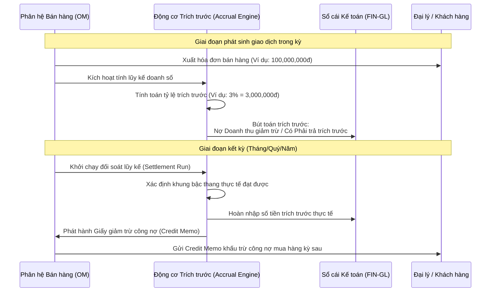

# 2040 Thiết lập chính sách chiết khấu hồi tố (Rebate)

Trong mô hình phân phối (B2B), **Chiết khấu hồi tố (Rebate / Hậu mãi)** là chính sách thương mại cực kỳ quan trọng để khuyến khích nhà phân phối hoặc đại lý cam kết doanh số lớn dài hạn. Khác với chiết khấu thương mại thông thường (trừ trực tiếp trên hóa đơn lúc mua), chiết khấu hồi tố chỉ được tính toán, đối soát và hoàn trả cho khách hàng sau khi kết thúc một thời kỳ (tháng, quý, năm) dựa trên tổng sản lượng hoặc tổng giá trị mua hàng tích lũy.

---

## 1. Tình huống Nghiệp vụ & "Điểm đau" thực tế

Quản lý chiết khấu hồi tố bằng phương pháp thủ công hoặc thiết lập sai nguyên lý tài chính trên ERP thường đẩy doanh nghiệp vào hai rủi ro lớn:

*   **Báo cáo tài chính bị sai lệch (Phơi nhiễm P&L):** Theo chuẩn mực kế toán (IFRS 15 / VAS), nếu doanh nghiệp dự kiến trả 3% chiết khấu hồi tố cuối năm cho một đại lý đạt doanh số, doanh nghiệp **bắt buộc phải trích trước (Accrue)** khoản chi phí này để giảm trừ trực tiếp vào doanh thu của từng hóa đơn phát sinh trong năm. Nếu không trích trước, báo cáo doanh thu giữa năm sẽ bị thổi phồng ảo, và doanh nghiệp sẽ phải gánh chịu một khoản sụt giảm lợi nhuận đột ngột vào kỳ đối soát tháng 12 khi phát hành chiết khấu hoàn trả.
*   **Tranh chấp số liệu cuối kỳ:** Việc tính lũy kế doanh số thủ công trên Excel rất dễ bỏ sót các đơn hàng đổi trả (RMA), đơn hàng bị hủy hoặc tính sai khung bậc thang (Tiers) của hợp đồng. Quá trình đối soát công nợ cuối năm giữa doanh nghiệp và đại lý vì thế thường kéo dài nhiều tuần, gây ức chế và làm chậm luồng quay vòng vốn.

---

## 2. Bản đồ Thiết kế & Ánh xạ Cơ sở dữ liệu

Dưới đây là bảng đối chiếu cấu trúc lưu trữ dữ liệu hợp đồng chiết khấu hồi tố (Rebate Agreement) giữa các hệ thống ERP:

| Thực thể nghiệp vụ | Oracle EBS R12 (Tables) | Epicor ERP (Tables) | SAP S/4HANA (Tables) | Odoo (Tables) |
| :--- | :--- | :--- | :--- | :--- |
| **Hợp đồng Rebate**<br/>*(Rebate Agreement)* | **`OZF_OFFERS`**<br/>(Lưu thông tin chương trình) | **`Erp.Rebate`**<br/>(Rebate Contract) | **`WCOCO`**<br/>(Condition Contract Header) | Quản lý qua Custom Models / Apps |
| **Đối tác áp dụng**<br/>*(Eligible Customers)* | **`OZF_OFFER_QUALIFIERS`**<br/>(Ràng buộc mã khách hàng) | **`Erp.RebateCust`**<br/>(Rebate Customers) | **`WCOCOP`**<br/>(Contract Partners) | Liên kết trực tiếp trên Partner Profile |
| **Mã hàng & Khung bậc thang**<br/>*(Parts & Tier Breaks)* | **`QP_LIST_LINES`**<br/>**`QP_PRICING_ATTRIBUTES`** | **`Erp.RebatePart`**<br/>(Chi tiết mã hàng & tỷ lệ) | **`WCOCOI`**<br/>(Contract Items) | Cấu hình trong Pricelist Rules |
| **Quỹ trích trước**<br/>*(Accrual Funds)* | **`OZF_FUNDS_ALL_B`**<br/>(Quỹ tích lũy chiết khấu) | Tích hợp trong luồng xử lý hạch toán GL | **`WCOCOF`**<br/>(Settlement Data) | Thẻ tài khoản phải trả (Accrued Liabilities) |

---

## 3. Sơ đồ Luồng giao dịch Trích trước & Khấu trừ (Accrual & Settlement Flow)

Sơ đồ dưới đây mô tả chu kỳ vận hành khép kín từ lúc phát sinh hóa đơn bán hàng, trích trước chi phí chiết khấu hồi tố cho đến khi kết kỳ đối soát hoàn tiền cho khách hàng:



---

## 4. Quy trình cấu hình thực tế trên các ERP lớn

### A. Trên Oracle EBS R12 (Phân hệ Channel Revenue Management - ChRM)
1.  **Thiết lập Hợp đồng Rebate (Volume Offer):**
    *   *Đường dẫn:* `Oracle Trade Management > Trade Planning > Offers`.
    *   *Nghiệp vụ:* Tạo mới một Offer với `Type = Volume Offer` (`OZF_OFFERS`). Chỉ định ngày hiệu lực của hợp đồng và đồng tiền giao dịch (`VND`).
2.  **Cấu hình khung bậc thang tích lũy (Tiers Definition):**
    *   *Nghiệp vụ:* Tại tab `Volume`, định nghĩa khung số liệu tích lũy và mức chiết khấu tương ứng (ví dụ: Doanh số đạt từ 1 - 5 tỷ VND chiết khấu 1%; từ 5 - 10 tỷ VND chiết khấu 2%; trên 10 tỷ VND chiết khấu 3%).
3.  **Liên kết nguồn ngân sách trích trước (Accrual Budget):**
    *   *Nghiệp vụ:* Gán hợp đồng với một quỹ ngân sách hoạt động (`OZF_FUNDS_ALL_B`). Khi hóa đơn được ghi nhận, hệ thống tự động trích trước chi phí giảm trừ doanh thu và tích lũy vào quỹ này để chuẩn bị cho kỳ chi trả cuối năm.

### B. Trên Epicor ERP (Advanced Demand Management)
1.  **Tạo mới Hợp đồng Rebate (Rebate Contract Maintenance):**
    *   *Đường dẫn:* `Sales Management > Price List > Sheets > Rebate Contract Maintenance`.
    *   *Nghiệp vụ:* Tạo mới một hợp đồng (`RebateContractID`), nhập mô tả và thiết lập ngày hiệu lực.
2.  **Gán đối tác áp dụng:**
    *   *Nghiệp vụ:* Chuyển sang tab `Customers`, thêm danh sách mã các đại lý (`Erp.RebateCust`) được quyền tham gia chương trình tích lũy này.
3.  **Thiết lập mã hàng và phương thức tính chiết khấu:**
    *   *Nghiệp vụ:* Tại tab `Parts`, thêm danh sách các mã sản phẩm áp dụng (`Erp.RebatePart`). Lựa chọn phương thức tính chiết khấu theo tỷ lệ phần trăm (`RebatePct`) hoặc số tiền cố định trên mỗi sản phẩm, đồng thời cấu hình khung bậc thang doanh số nếu có.

---

## 5. SQL Database Audit Queries (Truy vấn đối soát dữ liệu)

### A. Đối soát các chương trình Trích trước Rebate đang hoạt động trên Oracle EBS

Query dưới đây hỗ trợ bộ phận Kế toán quản trị tra cứu toàn bộ các chương trình Rebate lũy kế đang hoạt động và số tiền thực tế đã được trích trước (Earned Amount) trong quỹ ngân sách:

```sql
SELECT 
    qlh.list_header_id            AS offer_id,
    qlh.name                      AS offer_name,        -- Tên chương trình khuyến mãi
    qlh.description               AS offer_description, -- Mô tả chương trình
    qlh.list_type_code            AS offer_type,        -- Loại chương trình
    qlh.start_date_active         AS start_date,        -- Ngày bắt đầu hiệu lực
    qlh.end_date_active           AS end_date,          -- Ngày kết thúc hiệu lực
    ofb.fund_id                   AS fund_budget_id,    -- ID ngân sách
    ofb.earned_amt                AS total_accrued_amount -- Số tiền đã tiêu thực tế
FROM 
    qp_list_headers_v qlh -- View chuẩn hiển thị tên và mô tả, luôn có sẵn trên mọi hệ thống EBS
LEFT JOIN 
    ozf_funds_all_b ofb ON qlh.list_header_id = ofb.plan_id 
WHERE 
    qlh.list_type_code = 'DLT' -- Loại chương trình Promotion Deal đổ từ OZF sang
    -- Lọc các chương trình đang có hiệu lực ở thời điểm hiện tại
    AND TRUNC(SYSDATE) BETWEEN NVL(qlh.start_date_active, TRUNC(SYSDATE)-1) AND NVL(qlh.end_date_active, TRUNC(SYSDATE)+1)
ORDER BY 
    qlh.name;
```

### B. Tra cứu các Hợp đồng Rebate đang hiệu lực và sản phẩm liên kết trên Epicor ERP

Query này hỗ trợ rà soát danh sách các hợp đồng Rebate đang chạy trên Epicor kèm thông tin đại lý được áp dụng để chuẩn bị cho kỳ đối soát cuối năm:

```sql
SELECT 
    r.Company,
    r.RebateContractID            AS Rebate_Contract_ID,
    r.Description                 AS Rebate_Description,
    rc.CustID                     AS Customer_Code,
    rc.Name                       AS Customer_Name,
    rp.PartNum                    AS Part_Number,
    rp.RebatePct                  AS Rebate_Percent,
    r.StartDate                   AS Start_Date,
    r.EndDate                     AS End_Date
FROM 
    Erp.Rebate r
INNER JOIN 
    Erp.RebateCust rcu ON r.Company = rcu.Company AND r.RebateContractID = rcu.RebateContractID
INNER JOIN 
    Erp.Customer rc ON rcu.Company = rc.Company AND rcu.CustNum = rc.CustNum
LEFT JOIN 
    Erp.RebatePart rp ON r.Company = rp.Company AND r.RebateContractID = rp.RebateContractID
WHERE 
    r.Company = 'YOUR_COMPANY_CODE'
    AND (r.EndDate IS NULL OR r.EndDate >= GETDATE())
ORDER BY 
    r.RebateContractID, rc.Name;
```

---

## 6. Nguyên tắc Nghiệp vụ cốt lõi khi Tự xây dựng hoặc Tùy biến Hệ thống (OMS/ERP)

Để lập trình một tính năng quản lý chiết khấu hồi tố chuẩn mực trên hệ thống tự xây, đội ngũ thiết kế cần áp dụng hai nguyên tắc nghiệp vụ cốt lõi sau:

### Nguyên tắc 1: Động cơ trích trước tự động thời gian thực (Real-time Accrual Logic)
*   **Yêu cầu thiết kế logic:** Hệ thống tự xây không được đợi đến cuối năm mới tính tiền chiết khấu hồi tố. Khi bất kỳ một hóa đơn bán hàng nào được duyệt xuất, động cơ tính toán phải tự động dò tìm các hợp đồng Rebate còn hiệu lực của khách hàng đó, ước tính tỷ lệ đạt được (ví dụ: dự kiến khách hàng đạt mốc 3%) để tự động tính ra số tiền trích trước.
*   **Mục tiêu:** Chuyển tiếp thông tin này sang phân hệ Sổ cái (FIN-GL) để kế toán thực hiện bút toán trích trước chi phí giảm trừ doanh thu, đảm bảo báo cáo P&L hàng tháng phản ánh chính xác biên lợi nhuận ròng thực tế.

### Nguyên tắc 2: Cơ chế loại trừ hàng trả lại khi tính tích lũy (RMA Exclusion Rule)
*   **Yêu cầu thiết kế logic:** Doanh số tích lũy của khách hàng để làm căn cứ tính chiết khấu hồi tố bắt buộc phải bằng:
    $$\text{Doanh số tích lũy thực tế} = \text{Tổng giá trị hóa đơn bán ra (AR Invoices)} - \text{Tổng giá trị hàng bị trả lại (RMA Credit Memos)}$$
    Nếu lập trình viên bỏ qua bước trừ đi giá trị hàng trả lại, đại lý có thể lợi dụng kẽ hở bằng cách mua lượng hàng lớn để nhận chiết khấu bậc thang cao nhất, sau đó làm thủ tục trả lại hàng nhưng vẫn yêu cầu nhận tiền chiết khấu hậu mãi đầy đủ.

---

## 7. Luồng luân chuyển dữ liệu liên phân hệ (Cross-Module Touchpoints)

*   **Tích hợp phân hệ Bán hàng (OM):** Đơn bán hàng (Sales Order) và dữ liệu trả lại hàng (RMA) là nguồn dữ liệu thời gian thực duy nhất để hệ thống liên tục cập nhật số liệu tích lũy của khách hàng.
*   **Tích hợp phân hệ Sổ cái & Công nợ (FIN-GL/APAR):** Khi đến kỳ đối soát hoàn tất chi trả (Settlement), hệ thống sẽ tự động chuyển đổi số dư tích lũy đạt được thành một Giấy giảm trừ công nợ (`AR Credit Memo`) hoặc Phiếu chi tiền mặt (`AP Payment Voucher`) tùy theo điều khoản thỏa thuận trên hợp đồng, đồng thời thực hiện bút toán hoàn nhập tài khoản trích trước chi phí trên Sổ cái kế toán.

---

<div align="center" style={{color: 'var(--ifm-color-primary)'}}>
  <strong>Chúc các bạn thành công và vui vẻ!</strong>
</div>