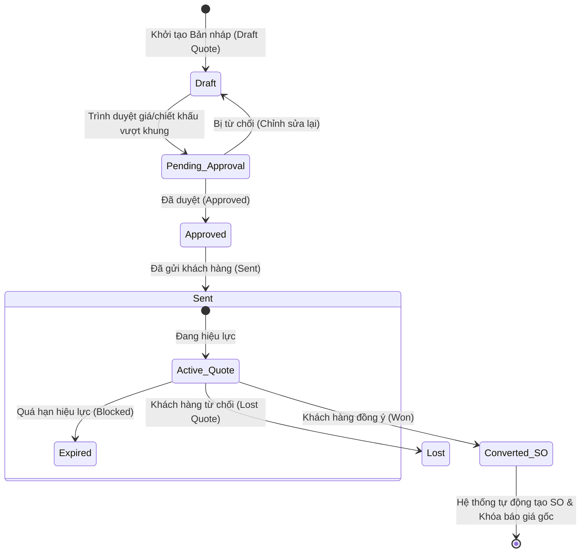

# 3000 Nghiệp vụ Báo giá khách hàng và quy trình chuyển đổi sang SO

Quy trình Báo giá khách hàng (Sales Quotation) là điểm khởi đầu của chu kỳ bán hàng doanh nghiệp (O2C - Order-to-Cash). Đây là cầu nối quan trọng giữa cơ hội bán hàng từ phân hệ CRM và hoạt động thực thi đơn hàng trong hệ thống ERP. Việc chuẩn hóa luồng chuyển đổi từ Báo giá sang Đơn bán hàng (Sales Order - SO) giúp doanh nghiệp kiểm soát chặt chẽ cam kết thương mại về giá cả, thời gian giao hàng và tăng tỷ lệ chốt đơn.

---

## 1. Tình huống Nghiệp vụ & "Điểm đau" thực tế

Trong môi trường kinh doanh B2B, hoạt động báo giá thủ công thường kéo theo nhiều lỗ hổng quản trị:

*   **Báo giá vượt khung thẩm quyền:** Nhân viên kinh doanh tự ý cam kết mức chiết khấu sâu hoặc kéo dài thời hạn công nợ vượt quá quy định để giành lấy hợp đồng, dẫn đến việc doanh nghiệp phải gánh chịu các đơn hàng có biên lợi nhuận âm hoặc rủi ro dòng tiền.
*   **Trùng lặp dữ liệu do nhập liệu thủ công:** Khi khách hàng đồng ý với báo cáo báo giá, nhân viên phải gõ tay lại toàn bộ thông tin mã hàng, số lượng, bảng giá từ file PDF/Excel báo giá vào màn hình tạo đơn hàng SO. Việc này vừa gây lãng phí thời gian, vừa dẫn đến sai sót số liệu (gõ sai mã hàng, sai đơn giá đã thỏa thuận).
*   **Không kiểm soát được thời hạn hiệu lực:** Khách hàng mang một báo giá đã hết hạn từ 6 tháng trước (khi giá nguyên vật liệu đầu vào chưa tăng) yêu cầu doanh nghiệp thực hiện đơn hàng với mức giá cũ. Nếu hệ thống không tự động khóa thời hạn hiệu lực của báo giá, doanh nghiệp sẽ rơi vào thế bị động.

---

## 2. Bản đồ Thiết kế & Ánh xạ Cơ sở dữ liệu

Dưới đây là bảng đối chiếu cấu trúc lưu trữ chứng từ Báo giá và Đơn bán hàng giữa các hệ thống ERP phổ biến:

| Thực thể nghiệp vụ | Oracle EBS R12 (Tables) | Epicor ERP (Tables) | SAP S/4HANA (Tables) | Odoo (Tables) |
| :--- | :--- | :--- | :--- | :--- |
| **Đầu mục Báo giá**<br/>*(Quote Header)* | **`OE_ORDER_HEADERS_ALL`**<br/>*(Giai đoạn NEGOTIATE)* | **`Erp.QuoteHed`**<br/>(Báo giá Header) | **`VBAK`**<br/>(Cột `VBTYP` = 'B') | **`sale_order`**<br/>(Trạng thái 'draft'/'sent') |
| **Dòng Báo giá chi tiết**<br/>*(Quote Line)* | **`OE_ORDER_LINES_ALL`**<br/>*(Giai đoạn NEGOTIATE)* | **`Erp.QuoteDtl`**<br/>(Báo giá Detail) | **`VBAP`**<br/>(Document Items) | **`sale_order_line`**<br/>(Dòng báo giá chi tiết) |
| **Đầu mục Đơn bán hàng**<br/>*(Sales Order Header)* | **`OE_ORDER_HEADERS_ALL`**<br/>*(Giai đoạn FULFILL)* | **`Erp.OrderHed`**<br/>(Đơn hàng Header) | **`VBAK`**<br/>(Cột `VBTYP` = 'C') | **`sale_order`**<br/>(Trạng thái 'sale') |
| **Dòng Đơn hàng chi tiết**<br/>*(Sales Order Line)* | **`OE_ORDER_LINES_ALL`**<br/>*(Giai đoạn FULFILL)* | **`Erp.OrderDtl`**<br/>(Đơn hàng Detail) | **`VBAP`**<br/>(Document Items) | **`sale_order_line`**<br/>(Dòng đơn hàng chi tiết) |
| **Liên kết lịch sử**<br/>*(Document Flow)* | **`OE_ORDER_HEADERS_ALL`**<br/>(Cột `QUOTE_NUMBER`) | **`Erp.OrderDtl`**<br/>(Cột `QuoteNum`, `QuoteLine`) | **`VBFA`**<br/>(Document Flow Table) | Tự tham chiếu trên bảng **`sale_order`** |

---

## 3. Sơ đồ luồng Chuyển đổi trạng thái Báo giá sang SO

Sơ đồ trạng thái dưới đây mô tả chu kỳ sống của một Báo giá và cách thức chuyển đổi dữ liệu sang Đơn bán hàng (SO):



---

## 4. Quy trình cấu hình thực tế trên các ERP lớn

### A. Trên Oracle EBS R12 (Phân hệ Order Management - Negotiation Phase)
Trong Oracle EBS, báo giá và đơn hàng thực chất dùng chung cấu trúc bảng nhưng được phân tách bằng giai đoạn giao dịch (`Transaction Phase`):
1.  **Cấu hình Loại chứng từ Báo giá:**
    *   *Đường dẫn:* `Order Management Super User > Setup > Transaction Types > Define`.
    *   *Nghiệp vụ:* Tạo mới một Transaction Type, thiết lập trường `Transaction Phase = Negotiation`. Gán luồng phê duyệt giá (`Negotiation Flow`) phù hợp cho loại báo giá này.
2.  **Khởi tạo và Chuyển đổi:**
    *   *Nghiệp vụ:* Người dùng tạo báo giá trên màn hình `Sales Order`. Hệ thống lưu thông tin vào bảng `OE_ORDER_HEADERS_ALL` với cột `TRANSACTION_PHASE_CODE = NEGOTIATE`.
    *   *Chuyển đổi:* Sau khi khách hàng chấp nhận, người dùng nhấn nút `Submit Draft` để hệ thống tự động chuyển pha giao dịch sang `FULFILLMENT` (tức chuyển thành một SO chính thức có hiệu lực xuất kho).

### B. Trên Epicor ERP (Opportunity / Quote Entry)
Epicor tách biệt hoàn toàn hai thực thể Báo giá (`Quote`) và Đơn hàng (`Order`):
1.  **Khởi tạo Báo giá (Quote Entry):**
    *   *Đường dẫn:* `Sales Management > Opportunity / Quote Management > Sheets > Quote Entry`.
    *   *Nghiệp vụ:* Nhập thông tin khách hàng, ngày hết hạn (`Expiration Date`). Thêm dòng sản phẩm (`QuoteDtl`) và tính toán giá thành ước tính thông qua tính năng `Worksheet` để đưa ra giá chào bán hợp lý.
2.  **Chuyển đổi tự động sang Đơn bán hàng (Create Sales Order):**
    *   *Nghiệp vụ:* Khi khách hàng đồng ý mua, tại màn hình Quote Entry, chọn `Actions > Create Sales Order`.
    *   *Logic hệ thống:* Epicor sẽ tự động tạo mới một bản ghi trên bảng `Erp.OrderHed` và `Erp.OrderDtl`, sao chép toàn bộ thông tin dòng sản phẩm, đồng thời ghi nhận số báo giá gốc vào cột `OrderDtl.QuoteNum` để lưu lại vết lịch sử chuyển đổi.

---

## 5. SQL Database Audit Queries (Truy vấn đối soát dữ liệu)

### A. Đối soát danh sách Báo giá đang hoạt động trên Oracle EBS

Query dưới đây giúp bộ phận quản lý bán hàng rà soát toàn bộ các báo giá đang trong giai đoạn thương lượng (`NEGOTIATE`) kèm thời hạn hiệu lực của báo giá. Do điều kiện lọc dùng `OR`, kết quả trả về sẽ bao gồm cả các báo giá còn hiệu lực lẫn các báo giá đã chuyển đổi thành công sang SO (nhờ vẫn giữ `quote_number` gốc), giúp người dùng đối chiếu trực tiếp báo giá nào đã "chốt đơn" qua cột `converted_so_number`:

```sql
SELECT 
    oha.org_id                    AS operating_unit_id,
    oha.quote_number              AS quote_number,
    oha.order_number              AS converted_so_number,
    hca.account_number            AS customer_number,
    hp.party_name                 AS customer_name,
    oha.flow_status_code          AS quote_status,
    oha.quote_date                AS quote_date,
    oha.expiration_date           AS expiration_date 
FROM 
    oe_order_headers_all oha
INNER JOIN 
    hz_cust_accounts hca ON oha.sold_to_org_id = hca.cust_account_id
INNER JOIN 
    hz_parties hp ON hca.party_id = hp.party_id
WHERE 
    oha.transaction_phase_code = 'NEGOTIATE' -- Chỉ lấy giai đoạn thương lượng báo giá
    OR oha.quote_number IS NOT NULL
ORDER BY 
    oha.quote_date DESC;
```

### B. Truy vấn đối chiếu đơn hàng SO được tạo từ Báo giá trên Epicor ERP

Query này hỗ trợ rà soát vết lịch sử chuyển đổi, liệt kê các dòng đơn hàng SO thực tế được sinh ra từ các báo giá gốc trên Epicor:

```sql
SELECT 
    od.Company,
    od.OrderNum                   AS Order_Number,
    od.OrderLine                  AS Order_Line_Num,
    oh.OrderDate                  AS Order_Date,
    od.QuoteNum                   AS Originating_Quote_Number,
    od.QuoteLine                  AS Originating_Quote_Line_Num,
    od.PartNum                    AS Part_Number,
    od.OrderQty                   AS Ordered_Quantity,
    c.CustID                      AS Customer_Code,
    c.Name                        AS Customer_Name
FROM 
    Erp.OrderDtl od
INNER JOIN 
    Erp.OrderHed oh ON od.Company = oh.Company AND od.OrderNum = oh.OrderNum
INNER JOIN 
    Erp.Customer c ON oh.Company = c.Company AND oh.CustNum = c.CustNum
WHERE 
    od.Company = 'YOUR_COMPANY_CODE'
    AND od.QuoteNum > 0 -- Chỉ lọc các dòng đơn hàng có nguồn gốc từ báo giá
ORDER BY 
    oh.OrderDate DESC;
```

---

## 6. Nguyên tắc Nghiệp vụ cốt lõi khi Tự xây dựng hoặc Tùy biến Hệ thống (OMS/ERP)

### Nguyên tắc 1: Bảo toàn vết liên kết tài liệu (Document Flow Referential Integrity)
*   **Yêu cầu thiết kế logic:** Hệ thống tự xây không được phép tạo đơn hàng độc lập khi chuyển đổi từ báo giá. Khi người dùng thực hiện hành động "Chuyển đổi thành SO", hệ thống phải tự động sao chép dữ liệu và ghi nhận mã báo giá nguồn (`quote_id`, `quote_line_id`) vào bảng đơn hàng.
*   **Mục tiêu:** Cho phép người dùng dễ dàng truy vết nguồn gốc đơn hàng (Document Flow Traceability), đồng thời ngăn chặn tuyệt đối tình trạng một báo giá bị chuyển đổi thành đơn hàng nhiều lần vượt quá số lượng đã chào bán ban đầu.

### Nguyên tắc 2: Khóa tự động khi hết hạn hiệu lực (Expiration Enforcement)
*   **Yêu cầu thiết kế logic:** Báo giá phải bắt buộc cấu hình trường "Ngày hết hạn hiệu lực" (`expiry_date`). Động cơ kiểm tra đơn hàng (Validation Engine) phải tự động từ chối luồng chuyển đổi sang SO nếu ngày hiện tại đã vượt quá thời hạn hiệu lực của báo giá. Hệ thống yêu cầu nhân viên phải tạo một phiên bản báo giá mới (Revision) và trình duyệt lại giá bán trước khi được phép lên đơn SO.

---

## 7. Luồng luân chuyển dữ liệu liên phân hệ (Cross-Module Touchpoints)

*   **Tích hợp với phân hệ CRM (Quản lý phễu cơ hội):** Kết quả của quy trình báo giá (Won / Lost) chính là dữ liệu đầu vào thời gian thực để cập nhật tỷ lệ chuyển đổi của các cơ hội bán hàng (Opportunities Pipeline) trên phân hệ CRM.
*   **Tích hợp phân hệ Kho (WMS/INV):** Tại bước báo giá, hệ thống có thể kết nối với phân hệ Kho để thực hiện kiểm tra nhanh khả năng cung ứng hàng hóa ước tính (ATP - Available to Promise) nhằm cam kết ngày giao hàng khả thi với khách hàng, nhưng **chưa thực hiện việc khóa giữ hàng (Reservation) thực tế** trong kho cho đến khi báo giá chính thức chuyển đổi thành SO.

---

<div align="center" style={{color: 'var(--ifm-color-primary)'}}>
  <strong>Chúc các bạn thành công và vui vẻ!</strong>
</div>