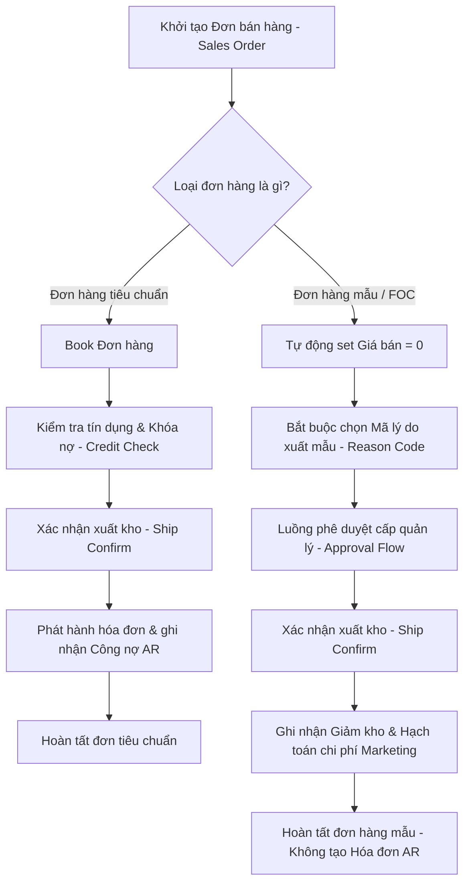

# 3010 Nhập đơn bán hàng thủ công và đơn mẫu

Mặc dù xu hướng tự động hóa đơn hàng qua API, EDI hay sàn TMĐT ngày càng phổ biến, quy trình **Nhập đơn hàng thủ công (Manual Sales Order Entry)** bằng tay vẫn luôn tồn tại trong mọi doanh nghiệp để xử lý các trường hợp đặc biệt. Song song đó, quy trình **Nhập đơn hàng mẫu/Hàng tặng không thu tiền (Sample Order / FOC - Free of Charge)** là nghiệp vụ phát sinh thường xuyên của phòng kinh doanh và marketing cần được thiết lập luồng xử lý riêng biệt.

---

## 1. Tình huống Nghiệp vụ & "Điểm đau" thực tế

Các vấn đề vận hành thường phát sinh khi nhân viên bán hàng trực tiếp nhập tay đơn hàng lên hệ thống:

*   **Sai lệch thông tin do nhập tay (Human Error):** Nhân viên nhập đơn hàng chọn nhầm địa chỉ giao hàng (`Ship-to`) của đối tác, gõ sai số lượng sản phẩm, hoặc áp dụng nhầm bảng giá bán lẻ cho khách mua sỉ.
*   **Gian lận xuất hàng dưới mác "Hàng mẫu" (FOC Abuse):** Nhân viên kinh doanh lợi dụng quyền hạn để tạo các đơn hàng mẫu với đơn giá bằng 0 nhằm xuất hàng ra ngoài cho mục đích tư lợi. Nếu hệ thống cho phép tạo đơn hàng bằng 0 không qua phê duyệt hoặc không kiểm soát hạn mức (Quota) của từng nhân viên, doanh nghiệp sẽ bị thất thoát tài sản lớn.
*   **Hạch toán sai chi phí hàng mẫu:** Khi xuất hàng mẫu hoặc hàng tặng khuyến mãi, kế toán kho thường gặp khó khăn nếu hệ thống tự động sinh ra một hóa đơn phải thu công nợ (AR Invoice) có giá trị bằng 0. Bản chất nghiệp vụ này không tạo ra công nợ khách hàng, mà là một khoản giảm trừ tồn kho và ghi nhận trực tiếp vào chi phí bán hàng/chi phí marketing của doanh nghiệp.

---

## 2. Bản đồ Thiết kế & Ánh xạ Cơ sở dữ liệu

Dưới đây là bảng đối chiếu cấu trúc lưu trữ nguồn gốc đơn hàng (thủ công/tự động) và loại chứng từ hàng mẫu trên các ERP:

| Thực thể nghiệp vụ | Oracle EBS R12 (Tables) | Epicor ERP (Tables) | SAP S/4HANA (Tables) | Odoo (Tables) |
| :--- | :--- | :--- | :--- | :--- |
| **Bảng đơn hàng Header** | **`OE_ORDER_HEADERS_ALL`** | **`Erp.OrderHed`** | **`VBAK`** | **`sale_order`** |
| **Bảng đơn hàng Detail** | **`OE_ORDER_LINES_ALL`** | **`Erp.OrderDtl`** | **`VBAP`** | **`sale_order_line`** |
| **Nguồn đơn hàng**<br/>*(Order Source)* | **`OE_ORDER_HEADERS_ALL`**<br/>(Cột `ORDER_SOURCE_ID`) | **`Erp.OrderHed`**<br/>(Cột `EntryMethod`) | **`VBAK`**<br/>(Cột `ERNAM` - Tên User tạo) | **`sale_order`**<br/>(Cột `origin`) |
| **Mã loại đơn hàng mẫu**<br/>*(Sample Order Type)* | **`OE_TRANSACTION_TYPES_ALL`**<br/>(Mã Transaction Type) | **`Erp.OrderType`**<br/>(Mã Order Type) | **`TVAK`**<br/>(Order Type = 'FD' / 'SD') | **`sale.order.template`**<br/>(Mẫu đơn FOC) |

---

## 3. Sơ đồ Luồng đi của Đơn hàng tiêu chuẩn vs Đơn hàng mẫu (FOC)

Sơ đồ dưới đây đối chiếu luồng thực thi khác biệt giữa một Đơn bán hàng tiêu chuẩn (Standard SO) và một Đơn hàng mẫu/Hàng tặng miễn phí (Sample/FOC Order):



---

## 4. Quy trình cấu hình thực tế trên các ERP lớn

### A. Trên Oracle EBS R12
1.  **Thiết lập Nguồn đơn hàng (Order Source):**
    *   *Đường dẫn:* `Order Management Super User > Setup > Orders > Sources`.
    *   *Nghiệp vụ:* Hệ thống mặc định nguồn `ORDER_SOURCE_ID = 1` cho các đơn hàng nhập thủ công (`Manual`). Khi nhân viên gõ tay đơn hàng trên màn hình `Sales Orders`, trường này sẽ tự động được gán giá trị 1.
2.  **Cấu hình Loại đơn hàng mẫu (Sample Order Type):**
    *   *Đường dẫn:* `Order Management Super User > Setup > Transaction Types > Define`.
    *   *Nghiệp vụ:* Tạo mới loại đơn hàng với tên `Sample Order` hoặc `Free of Charge`.
    *   *Ràng buộc hạch toán:* Gán một luồng công việc (`Workflow`) đặc thù bỏ qua bước xuất hóa đơn tài chính (`Invoice Interface`) và đi thẳng đến bước hoàn tất sau khi xác nhận xuất kho (`Close Order`).

### B. Trên Epicor ERP
1.  **Theo dõi nguồn đơn hàng nhập thủ công:**
    *   *Nghiệp vụ:* Khi nhân viên tạo đơn hàng mới thông qua màn hình `Sales Order Entry`, Epicor sẽ tự động lưu giá trị `EntryMethod = 'MAN'` (viết tắt của Manual) để phân biệt với các đơn hàng đổ về từ hệ thống tích hợp khác (như 'EDI', 'WEB').
2.  **Cấu hình Đơn hàng mẫu qua Product Group:**
    *   *Đường dẫn:* `Material Management > Purchase Management > Setup > Product Group`.
    *   *Nghiệp vụ:* Tạo một Product Group chuyên biệt dành cho hàng mẫu (ví dụ: `SMP` - Sample). Cấu hình tài khoản sổ cái hạch toán mặc định của nhóm này trỏ thẳng về tài khoản chi phí bán hàng (ví dụ: TK 6418 - Chi phí bằng hiện vật) thay vì tài khoản doanh thu thông thường. Khi nhân viên kinh doanh chọn Product Group này trên dòng đơn hàng, hệ thống sẽ tự động chuyển hướng định khoản tài chính tương ứng.

---

## 5. SQL Database Audit Queries (Truy vấn đối soát dữ liệu)

### A. Đối soát danh sách Đơn hàng nhập thủ công trên Oracle EBS

Query dưới đây hỗ trợ bộ phận kiểm soát rà soát toàn bộ các đơn hàng được gõ tay thủ công bởi người dùng trên hệ thống Oracle EBS (loại trừ các đơn hàng đồng bộ tự động), phân loại rõ các đơn hàng mẫu/FOC.

> **Lưu ý:** Cột `TRANSACTION_TYPE_CODE` trên `OE_TRANSACTION_TYPES_ALL` chỉ mang các giá trị lookup hệ thống cố định (`ORDER`, `RETURN`, `MIXED`...), không có giá trị `SAMPLE`. Đơn hàng mẫu thực chất vẫn có `transaction_type_code = 'ORDER'`, chỉ khác nhau ở **tên** Transaction Type do doanh nghiệp tự đặt (ví dụ "Sample Order"). Vì vậy câu lệnh phân loại bên dưới dùng `CASE` đối chiếu theo tên loại đơn hàng (`otl.name`) thay vì đối chiếu theo mã hệ thống — bạn cần điều chỉnh từ khóa `LIKE` cho khớp với tên Transaction Type thực tế trên hệ thống của mình.

```sql
SELECT 
    oha.org_id                    AS operating_unit_id,
    oha.order_number              AS order_number,
    otl.name                      AS order_type_name,
    oha.ordered_date              AS ordered_date,
    fu.user_name                  AS created_by_user,
    oha.flow_status_code          AS order_status,
    CASE 
        WHEN UPPER(otl.name) LIKE '%SAMPLE%' OR UPPER(otl.name) LIKE '%FOC%' THEN 'FOC/Sample'
        ELSE 'Standard'
    END                            AS order_category
FROM 
    oe_order_headers_all oha
INNER JOIN 
    fnd_user fu ON oha.created_by = fu.user_id
INNER JOIN 
    oe_transaction_types_all ott ON oha.order_type_id = ott.transaction_type_id
INNER JOIN 
    oe_transaction_types_tl otl ON ott.transaction_type_id = otl.transaction_type_id 
                                AND otl.language = USERENV('LANG')
WHERE 
    oha.order_source_id = 1 -- Chỉ lọc nguồn nhập thủ công (Manual Entry)
    AND oha.ordered_date >= TO_DATE('2026-01-01', 'YYYY-MM-DD')
ORDER BY 
    oha.ordered_date DESC;
```

### B. Tra cứu các Đơn hàng nhập tay thủ công trên Epicor ERP

Query dưới đây giúp quản trị viên lọc ra toàn bộ các đơn hàng được nhập tay (`EntryMethod = 'MAN'`) và kiểm tra xem có đơn hàng nào có giá trị bằng 0 (nghi ngờ xuất mẫu sai quy trình) hay không:

```sql
SELECT 
    oh.Company,
    oh.OrderNum                   AS Order_Number,
    oh.OrderDate                  AS Order_Date,
    oh.EntryMethod                AS Entry_Method, -- 'MAN' thể hiện nhập thủ công
    oh.OrderType                  AS Order_Type,
    oh.DocOrderAmt                AS Total_Order_Amount,
    c.CustID                      AS Customer_ID,
    c.Name                        AS Customer_Name,
    oh.CreatedBy                  AS Created_By_User
FROM 
    Erp.OrderHed oh
INNER JOIN 
    Erp.Customer c ON oh.Company = c.Company AND oh.CustNum = c.CustNum
WHERE 
    oh.Company = 'YOUR_COMPANY_CODE'
    AND oh.EntryMethod = 'MAN'
    AND oh.OrderDate >= '2026-01-01'
ORDER BY 
    oh.OrderDate DESC;
```

---

## 6. Nguyên tắc Nghiệp vụ cốt lõi khi Tự xây dựng hoặc Tùy biến Hệ thống (OMS/ERP)

Để thiết kế một quy trình nhập đơn hàng thủ công an toàn và kiểm soát tốt đơn hàng mẫu trên hệ thống tự xây, đội ngũ thiết kế cần áp dụng hai nguyên tắc nghiệp vụ cốt lõi sau:

### Nguyên tắc 1: Khóa cứng đơn giá bằng 0 trên Đơn hàng mẫu (Sample Pricing Guard)
*   **Yêu cầu thiết kế logic:** Khi người dùng chọn loại đơn hàng là "Đơn hàng mẫu/FOC", hệ thống phải tự động thiết lập đơn giá bán của toàn bộ dòng sản phẩm về bằng 0. Hệ thống phải khóa cứng trường đơn giá (Read-only), tuyệt đối không cho phép người dùng sửa đổi thủ công thành giá trị khác không.
*   **Ràng buộc bổ sung:** Hệ thống bắt buộc người dùng phải chọn một "Mã lý do xuất mẫu" (Reason Code) cho từng dòng sản phẩm và định tuyến đơn hàng này qua luồng phê duyệt (Approval Workflow) của cấp quản lý trước khi chuyển tiếp sang kho xuất hàng.

### Nguyên tắc 2: Chặn kích hoạt luồng xuất hóa đơn công nợ (Invoice Suppression)
*   **Yêu cầu thiết kế logic:** Đối với loại chứng từ đơn hàng mẫu, máy quản lý trạng thái (State Machine) của đơn hàng phải loại bỏ hoàn toàn bước kích hoạt yêu cầu phát hành hóa đơn đỏ thu tiền (`AR Invoice Interface`).
*   **Hạch toán chi phí:** Thay vì ghi nhận công nợ phải thu của khách hàng, hệ thống chỉ tạo ra một giao dịch giảm kho vật lý tại phân hệ Tồn kho và kết chuyển trực tiếp giá trị vốn của lô hàng xuất mẫu vào tài khoản chi phí bán hàng/chi phí marketing tương ứng trên Sổ cái kế toán (FIN-GL).

---

## 7. Luồng luân chuyển dữ liệu liên phân hệ (Cross-Module Touchpoints)

*   **Tích hợp phân hệ Kho (WMS/INV):** Dù là đơn nhập tay tiêu chuẩn hay đơn hàng mẫu, chứng từ sau khi được phê duyệt thành công sẽ được đẩy trực tiếp sang phân hệ Kho dưới dạng yêu cầu xuất hàng (Pick Release). Thủ kho quét mã vạch và đóng gói xuất kho như bình thường để đảm bảo tính toàn vẹn của số liệu tồn kho vật lý.
*   **Tích hợp phân hệ Tài chính (FIN):** Đơn nhập tay tiêu chuẩn sẽ đi theo luồng hạch toán công nợ thông thường (ghi nhận doanh thu và phải thu khách hàng AR). Trong khi đó, đơn hàng mẫu/FOC chỉ đi theo luồng hạch toán giảm kho và tăng chi phí hoạt động của doanh nghiệp trên Sổ cái kế toán.

---

<div align="center" style={{color: 'var(--ifm-color-primary)'}}>
  <strong>Chúc các bạn thành công và vui vẻ!</strong>
</div>