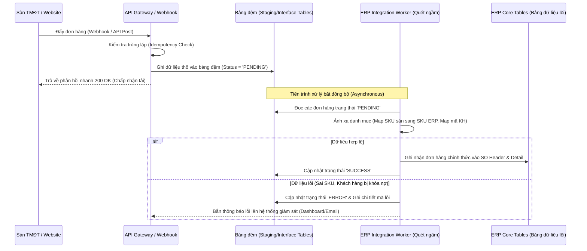

# 3020 Đồng bộ đơn hàng tự động từ Website/POS/Sàn TMĐT

Trong kỷ nguyên số, doanh nghiệp phân phối và bán lẻ không còn phụ thuộc hoàn toàn vào việc nhập đơn bằng tay [3010]. Thay vào đó, đơn hàng liên tục đổ về từ nhiều nguồn khác nhau như Website thương mại điện tử (Shopify, WooCommerce), hệ thống cửa hàng bán lẻ (POS), hoặc các sàn TMĐT (Shopee, Lazada, TikTok Shop). Thiết lập một cơ chế đồng bộ đơn hàng tự động (Omnichannel Order Sync) an toàn và thời gian thực là điều kiện tiên quyết để đảm bảo tốc độ giao hàng và trải nghiệm khách hàng đồng nhất.

---

## 1. Tình huống Nghiệp vụ & "Điểm đau" thực tế

Khi tích hợp các kênh bán hàng bên ngoài vào hệ thống lõi ERP, các kỹ sư phần mềm và chuyên viên nghiệp vụ thường đối mặt với hai rủi ro hệ thống lớn:

*   **Bẫy trùng lặp đơn hàng (Double Booking / Order Duplication):** Do lỗi đường truyền internet hoặc cơ chế retry (thử lại) của webhook phía sàn TMĐT, cùng một đơn hàng gốc có thể bị đẩy về hệ thống ERP hai lần. Nếu hệ thống không có bộ lọc nhận diện, ERP sẽ tự động tạo ra 2 đơn hàng SO trùng lặp, dẫn đến việc kho đóng gói gấp đôi số lượng và kế toán ghi nhận khống doanh thu.
*   **Nghẽn cổ chai dữ liệu giờ cao điểm (Data Bottleneck):** Vào các ngày hội mua sắm lớn (Mega Campaign 11.11, 12.12), lượng đơn hàng từ sàn TMĐT đổ về tăng đột biến gấp hàng trăm lần ngày thường. Nếu API của ERP thực hiện ghi nhận trực tiếp vào các bảng giao dịch lõi (`OrderHed`/`OrderDtl`) theo thời gian thực (Synchronous), toàn bộ hệ thống ERP sẽ bị quá tải, gây nghẽn và treo các hoạt động khác của doanh nghiệp (như sản xuất hay mua hàng).

---

## 2. Bản đồ Thiết kế & Ánh xạ Cơ sở dữ liệu

Dưới đây là bảng đối chiếu cấu trúc tiếp nhận dữ liệu tích hợp (Interface/API Integration) giữa các hệ thống ERP:

| Thực thể nghiệp vụ | Oracle EBS R12 (Tables) | Epicor ERP (Tables) | SAP S/4HANA (Tables) | Odoo (Tables) |
| :--- | :--- | :--- | :--- | :--- |
| **Bảng đệm Đầu đơn**<br/>*(Header Interface)* | **`OE_HEADERS_IFACE_ALL`**<br/>(Lưu tạm thông tin Header) | API gán qua **Business Object** (`SalesOrderSvc`) | **`EDI_ODC`**<br/>(Bảng kiểm soát IDoc) | Sử dụng bảng đệm trung gian tự xây hoặc Odoo Queue |
| **Bảng đệm Dòng đơn**<br/>*(Line Interface)* | **`OE_LINES_IFACE_ALL`**<br/>(Lưu tạm thông tin dòng) | API gán qua **Business Object** (`SalesOrderSvc`) | **`EDI_SDD`**<br/>(Bảng dữ liệu IDoc) | Sử dụng bảng đệm trung gian tự xây hoặc Odoo Queue |
| **Bảng ghi log lỗi**<br/>*(Error Log Table)* | **`OE_PROCESSING_MSGS`**<br/>(Lưu vết lỗi import đơn) | **`Ice.SysActivityLog`** /<br/>BPM Exception Logs | **`BD87`** /<br/>Idoc Status Tables | **`ir.logging`**<br/>(Hệ thống Log chuẩn) |
| **Giao dịch Core**<br/>*(Core Transaction)* | **`OE_ORDER_HEADERS_ALL`**<br/>(Cột `ORDER_SOURCE_ID`) | **`Erp.OrderHed`**<br/>(Cột `EntryMethod`) | **`VBAK`**<br/>(Cột `AUART`) | **`sale_order`**<br/>(Cột `origin`) |

---

## 3. Sơ đồ Kiến trúc luồng Tích hợp bất đồng bộ (Asynchronous Order Sync)

Để bảo vệ hệ thống ERP lõi khỏi sự quá tải dữ liệu, kiến trúc tích hợp tiêu chuẩn luôn sử dụng mô hình **Hàng đợi & Bảng đệm (Message Queue & Staging Tables)**:



---

## 4. Quy trình cấu hình thực tế trên các ERP lớn

### A. Trên Oracle EBS R12 (Order Import Concurrent Program)
1.  **Thiết lập Nguồn đơn hàng tích hợp (Order Source):**
    *   *Đường dẫn:* `Order Management Super User > Setup > Orders > Sources`.
    *   *Nghiệp vụ:* Khởi tạo các mã nguồn tương ứng (ví dụ: `20` - SHOPEE, `21` - LAZADA, `22` - WEBSITE) [3010].
2.  **Đồng bộ qua bảng đệm và chạy tiến trình import:**
    *   *Cơ chế:* Hệ thống trung gian (Middleware) gọi API để đẩy dữ liệu đơn hàng vào hai bảng đệm `OE_HEADERS_IFACE_ALL` và `OE_LINES_IFACE_ALL`.
    *   *Xử lý:* Định kỳ hệ thống chạy chương trình tự động **Order Import (Concurrent Program)** để quét dữ liệu từ bảng đệm, thực hiện các quy tắc xác thực (Validation Rules) và đẩy đơn hàng hợp lệ vào bảng giao dịch chính thức `OE_ORDER_HEADERS_ALL` [3010].

### B. Trên Epicor ERP (REST API & Business Objects Service)
Epicor hỗ trợ mạnh mẽ việc đồng bộ thông qua kiến trúc hướng dịch vụ (SOA):
1.  **Khai báo Tài khoản Tích hợp (API User):**
    *   *Đường dẫn:* `System Setup > Security Maintenance > User Account Maintenance`.
    *   *Nghiệp vụ:* Tạo tài khoản chuyên dụng cho hệ thống tích hợp (ví dụ: `api_shopee`) và cấu hình phân quyền bảo mật riêng biệt.
2.  **Đồng bộ qua REST API v2 (SalesOrderSvc):**
    *   *Cơ chế:* Hệ thống Middleware gọi trực tiếp Service Endpoint `/api/v2/odata/{Company}/Erp.BO.SalesOrderSvc` để tạo đơn hàng. Epicor sẽ tự động kích hoạt các Method Directives (BPM) để kiểm tra hạn mức tín dụng của khách hàng và tính toán thuế suất, giá bán thời gian thực trước khi ghi nhận đơn hàng [2010, 2020].

---

## 5. SQL Database Audit Queries (Truy vấn đối soát dữ liệu)

### A. Tra cứu các đơn hàng bị lỗi trong bảng đệm tích hợp trên Oracle EBS

Query dưới đây hỗ trợ kỹ sư vận hành hệ thống định vị nhanh các đơn hàng bị lỗi khi đồng bộ từ sàn TMĐT/Website về bảng đệm của Oracle EBS, phục vụ cho việc xử lý sự cố kịp thời:

```sql
SELECT 
    ohia.org_id                   AS operating_unit_id,
    ohia.orig_sys_document_ref    AS external_order_id, -- Mã đơn hàng gốc của Shopee/Lazada/Website
    ohia.order_source_id          AS order_source_id,
    ohia.error_flag               AS has_error,
    ohia.creation_date            AS sync_date,
    opm.message_text              AS error_message
FROM 
    oe_headers_iface_all ohia
LEFT JOIN 
    oe_processing_msgs opm 
    ON ohia.orig_sys_document_ref = opm.original_sys_document_ref 
   AND ohia.order_source_id = opm.order_source_id
WHERE 
    ohia.error_flag = 'Y' -- Chỉ lọc các đơn giao dịch bị lỗi interface
ORDER BY 
    ohia.creation_date DESC;
```

### B. Tra cứu đơn hàng được tạo tự động từ kênh API/WEB trên Epicor ERP

Query dưới đây lọc ra toàn bộ đơn hàng được tạo tự động trên Epicor thông qua các nguồn tích hợp, giúp kiểm toán viên và bộ phận kinh doanh đối soát sản lượng đơn hàng đa kênh:

```sql
SELECT 
    oh.Company,
    oh.OrderNum                   AS Order_Number,
    oh.OrderDate                  AS Order_Date,
    oh.EntryMethod                AS Entry_Method, -- Ví dụ: 'WEB', 'API', 'EDI'
    oh.DocOrderAmt                AS Total_Amount,
    oh.PONum                      AS External_Order_Reference, -- Lưu mã đơn hàng gốc của sàn
    oh.CreatedBy                  AS Created_By_User,
    oh.RequestDate                AS Requested_Delivery_Date
FROM 
    Erp.OrderHed oh
WHERE 
    oh.Company = 'YOUR_COMPANY_CODE'
    AND oh.EntryMethod IN ('WEB', 'API', 'EDI') -- Lọc các nguồn tự động
    AND oh.OrderDate >= '2026-01-01'
ORDER BY 
    oh.OrderDate DESC;
```

---

## 6. Nguyên tắc Nghiệp vụ cốt lõi khi Tự xây dựng hoặc Tùy biến Hệ thống (OMS/ERP)

### Nguyên tắc 1: Khóa chống trùng lặp tuyệt đối (Idempotency Key Verification)
*   **Yêu cầu thiết kế logic:** Mỗi đơn hàng từ hệ thống bên ngoài đẩy về bắt buộc phải đi kèm một mã định danh duy nhất (ví dụ: tổ hợp `External Channel Code` + `External Order ID`). 
*   **Mục tiêu:** Trước khi ghi dữ liệu vào bảng đệm hoặc bảng đơn hàng chính thức, hệ thống phải thực hiện kiểm tra tính duy nhất (Unique Constraint Check) của khóa này. Nếu phát hiện khóa đã tồn tại trong cơ sở dữ liệu, API phải lập tức từ chối và trả về mã phản hồi thành công của giao dịch cũ thay vì tạo thêm bản ghi mới [3020].

### Nguyên tắc 2: Ánh xạ danh mục tự động và quản lý SKU lỗi (SKU Mapping & Error Routing)
*   **Yêu cầu thiết kế logic:** Mã sản phẩm trên sàn TMĐT (ví dụ: `AO-THUN-NAM-X-L`) thường không trùng khớp 100% với mã thành phẩm quản lý trong ERP (ví dụ: `FG-TSH-001-XL`). Hệ thống tự xây bắt buộc phải có một bảng ánh xạ danh mục (SKU Mapping Table). 
*   **Mục tiêu:** Khi xảy ra trường hợp đơn hàng chứa SKU chưa được cấu hình ánh xạ, hệ thống không được dừng toàn bộ tiến trình. Hãy đẩy đơn hàng lỗi này vào một danh sách hàng đợi xử lý sự cố (Error Queue), gửi cảnh báo cho nhân sự vận hành cập nhật ánh xạ thủ công, trong khi các đơn hàng hợp lệ khác vẫn tiếp tục được xử lý trơn tru [3020].

---

## 7. Luồng luân chuyển dữ liệu liên phân hệ (Cross-Module Touchpoints)

*   **Tích hợp phân hệ Kho (WMS/INV):** Ngay khi đơn hàng đa kênh được đồng bộ thành công vào ERP dưới dạng SO chính thức, hệ thống phải lập tức kích hoạt luồng kiểm tra khả năng cung ứng hàng hóa (ATP) và thực hiện khóa giữ hàng vật lý (Inventory Reservation) trong kho để giữ hàng cho khách online, tránh tình trạng bị hủy đơn hàng loạt do cháy hàng (Overselling) [1010].
*   **Tích hợp phân hệ Tài chính (FIN):** Đối với các đơn hàng đa kênh đã được thanh toán trước qua cổng thanh toán trực tiếp (Ví điện tử, Thẻ tín dụng), thông tin phương thức thanh toán phải được gán chặt vào đơn hàng. Điều này làm cơ sở để phân hệ hạch toán công nợ (AR) tự động đối soát dòng tiền đổ về tài khoản ngân hàng từ các cổng trung gian thanh toán mà không cần kế toán làm tay [1010].

---

<div align="center" style={{color: 'var(--ifm-color-primary)'}}>
  <strong>Chúc các bạn thành công và vui vẻ!</strong>
</div>