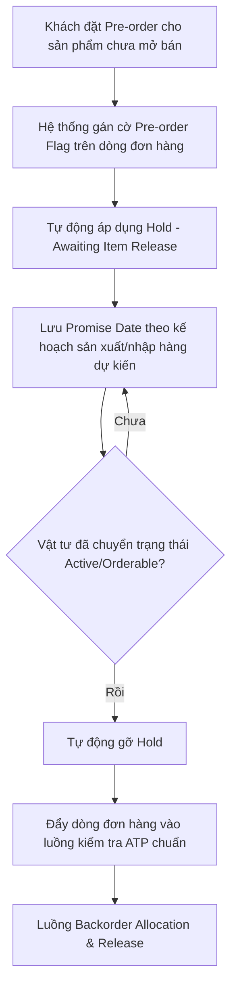
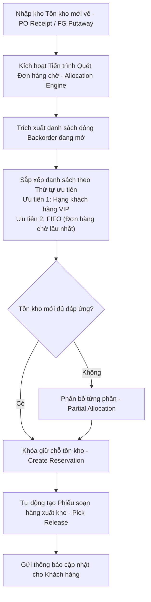

# 3030 Quản lý đơn đặt hàng trước và đơn hàng chờ (Pre-order & Backorder)

Trong quản lý chuỗi cung ứng, mất cân đối giữa cung và cầu là thách thức thường trực. Khi nhu cầu của khách hàng vượt quá lượng tồn kho sẵn có, doanh nghiệp cần các cơ chế xử lý đặc thù để giữ chân khách hàng: **Đặt hàng trước (Pre-order)** đối với sản phẩm chưa ra mắt/chưa sản xuất xong, và **Đơn hàng chờ (Backorder)** đối với sản phẩm hiện đang tạm thời cháy kho [3030].

---

## 1. Tình huống Nghiệp vụ & "Điểm đau" thực tế

Thiếu quy trình kiểm soát tự động đối với các đơn hàng thiếu tồn kho sẽ đẩy doanh nghiệp vào các tình huống rủi ro:

*   **Tranh chấp tồn kho khi hàng mới về:** Khi một lô hàng mới được nhập kho (ví dụ: 100 sản phẩm mới về từ lệnh sản xuất thành phẩm hoặc đơn mua hàng PO), nhân viên kinh doanh nhanh tay tạo đơn hàng mới và lấy sạch số tồn kho này. Trong khi đó, các khách hàng cũ đã đặt tiền chờ đợi từ 1 tháng trước (Backorders) vẫn tiếp tục bị trễ hẹn giao hàng [1000].
*   **Sai lệch kế hoạch logistics do không cho phép giao hàng từng phần (Partial Shipment):** Khách hàng đặt đơn hàng gồm 5 mã sản phẩm, trong đó có 4 mã có sẵn và 1 mã bị thiếu kho. Nếu hệ thống bắt buộc phải gom đủ 100% hàng mới cho xuất kho, doanh nghiệp sẽ bị chậm trễ giao 4 sản phẩm sẵn có, đồng thời làm tăng chi phí lưu kho không đáng có.
*   **Rủi ro hủy đơn hàng loạt do không cập nhật tiến độ:** Khách hàng đặt Pre-order nhưng không nhận được thông tin dự báo ngày có hàng chính xác (Expected Availability Date), dẫn đến việc mất kiên nhẫn và yêu cầu hoàn tiền hàng loạt.
*   **Lẫn lộn giữa hàng chưa ra mắt và hàng đang cháy kho:** Nếu hệ thống không tách biệt rõ hai luồng, nhân viên kinh doanh có thể tạo nhầm đơn Pre-order thành đơn hàng thường, khiến hệ thống cố gắng giữ chỗ tồn kho (Reservation) cho một sản phẩm chưa hề tồn tại trong kho, làm sai lệch toàn bộ số liệu tồn kho khả dụng (ATP) của các đơn hàng khác.

---

## 2. Bản đồ Thiết kế & Ánh xạ Cơ sở dữ liệu

### A. Đơn hàng chờ (Backorder)

Dưới đây là bảng đối chiếu cấu trúc lưu trữ trạng thái đơn hàng chờ giữa các hệ thống ERP:

| Thực thể nghiệp vụ | Oracle EBS R12 (Tables) | Epicor ERP (Tables) | SAP S/4HANA (Tables) | Odoo (Tables) |
| :--- | :--- | :--- | :--- | :--- |
| **Dòng lịch trình giao hàng**<br/>*(Schedule / Release)* | **`OE_ORDER_LINES_ALL`**<br/>(Lưu thông tin lịch trình) | **`Erp.OrderRel`**<br/>(Order Releases) | **`VBEP`**<br/>(Sales Document Schedule Lines) | **`stock.move`**<br/>(Dòng dịch chuyển kho) |
| **Trạng thái Đơn hàng chờ**<br/>*(Backorder Transaction)* | **`WSH_DELIVERY_DETAILS`**<br/>(Cột `RELEASED_STATUS` = 'B') | **`Erp.OrderRel`**<br/>(So sánh Req Qty và Shipped Qty) | **`VBEP`**<br/>(Cột `BMENG` < `WMENG`) | **`stock.picking`**<br/>(Liên kết qua `backorder_id`) |
| **Khóa giữ chỗ tồn kho**<br/>*(Inventory Reservation)* | **`MTL_RESERVATIONS`**<br/>(Bảng giữ chỗ tồn kho cứng) | **`Erp.OrderAlloc`**<br/>(Bảng phân bổ tồn kho) | **`MARD`** / **`MRES`**<br/>(Reservations) | **`stock.quant`**<br/>(Cột `reserved_quantity`) |

### B. Đặt hàng trước (Pre-order)

Pre-order xử lý cho sản phẩm chưa có mặt trong hệ thống dưới dạng tồn kho khả dụng, nên các hệ thống ERP tiêu chuẩn không có sẵn module riêng mà thường tùy biến dựa trên cờ đánh dấu (Custom Flag), ngày hứa giao (Promise Date) và trạng thái vật tư (Item Status):

| Thực thể nghiệp vụ | Oracle EBS R12 (Tables) | Epicor ERP (Tables) | SAP S/4HANA (Tables) | Odoo (Tables) |
| :--- | :--- | :--- | :--- | :--- |
| **Cờ đánh dấu Pre-order**<br/>*(Pre-order Flag)* | Descriptive Flexfield (DFF) tùy biến trên **`OE_ORDER_LINES_ALL`** | User Defined Field (UD Field) tùy biến trên **`Erp.OrderHed`** | Trường tùy biến (Z-Field) trên **`VBAP`** | Trường Boolean tùy biến trên **`sale.order.line`** |
| **Ngày hứa giao / dự kiến có hàng**<br/>*(Promise Date)* | **`OE_ORDER_LINES_ALL.PROMISE_DATE`** | **`Erp.OrderDtl.PromiseDate`** | **`VBEP.EDATU`**<br/>(Ngày giao theo lịch trình) | **`sale.order.line.commitment_date`** |
| **Trạng thái vật tư chưa mở bán**<br/>*(Item Not-Orderable Status)* | **`MTL_SYSTEM_ITEMS_B`**<br/>(Cột `CUSTOMER_ORDER_ENABLED_FLAG` = 'N') | **`Erp.Part`**<br/>(Cột `InActive` = True) | Material Master<br/>(**`MARA.MSTAE`** - Trạng thái sử dụng vật tư) | **`product.template.sale_ok`** = False |

---

## 3. Sơ đồ luồng xử lý

### A. Luồng vòng đời Pre-order (Pre-order Lifecycle)



### B. Luồng Giải phóng Đơn hàng chờ (Backorder Allocation & Release Flow)

Sơ đồ dưới đây mô tả cách hệ thống tự động quét, phân bổ tồn kho mới về cho các đơn hàng đang nằm trong danh sách chờ giao theo thứ tự ưu tiên:



---

## 4. Quy trình cấu hình thực tế trên các ERP lớn

### A. Trên Oracle EBS R12

**A.1. Đơn hàng chờ (Shipping Execution & Backorder)**
1.  **Tự động tạo dòng Backorder tại tầng Giao nhận:**
    *   *Nghiệp vụ:* Khi thực hiện bước soạn hàng (`Pick Release`), nếu số lượng tồn kho thực tế nhỏ hơn số lượng yêu cầu trên đơn hàng, phân hệ Giao nhận (`Shipping Execution`) sẽ tự động tách dòng giao hàng và đánh dấu trạng thái dòng thiếu là **Backordered** (`WSH_DELIVERY_DETAILS.released_status = 'B'`) [1010].
2.  **Chạy chương trình tự động phân bổ lại tồn kho (Backorder Planning):**
    *   *Đường dẫn:* `Order Management > Shipping > Release Sales Orders`.
    *   *Nghiệp vụ:* Cấu hình chạy định kỳ chương trình đối soát tồn kho. Khi có hàng nhập kho mới (`INV 1000`), tiến trình này tự động quét và chuyển trạng thái các dòng Backorder sang `Awaiting Shipping` để kho chuẩn bị xuất hàng.

**A.2. Đặt hàng trước (Pre-order qua Hold Definition & DFF)**
1.  **Thiết lập trạng thái vật tư chưa mở bán:**
    *   *Đường dẫn:* `Inventory > Items > Master Items`.
    *   *Nghiệp vụ:* Gán Item Status riêng (ví dụ `PRE-REL`) cho các vật tư chưa chính thức ra mắt, tắt cờ `Customer Order Enabled Flag`.
2.  **Cấu hình Hold tự động cho đơn Pre-order:**
    *   *Đường dẫn:* `Order Management Super User > Setup > Holds > Hold Definitions`.
    *   *Nghiệp vụ:* Khởi tạo Hold Code (ví dụ `AWAITING ITEM RELEASE`) và gán tự động áp dụng cho dòng đơn hàng có Item Status thuộc nhóm chưa mở bán.
3.  **Lưu ngày hứa giao dự kiến:**
    *   *Nghiệp vụ:* Ngày dự kiến có hàng lấy từ kế hoạch sản xuất (MRP Planned Order) hoặc PO dự kiến, ghi nhận vào cột `OE_ORDER_LINES_ALL.PROMISE_DATE` trên dòng đơn hàng [3030].
4.  **Gỡ Hold khi vật tư chính thức mở bán:**
    *   *Nghiệp vụ:* Khi Item Status chuyển sang trạng thái Active/Orderable, batch tự động gỡ Hold và đẩy dòng đơn hàng vào luồng kiểm tra ATP/Reservation chuẩn như một đơn hàng thông thường.

### B. Trên Epicor ERP

**B.1. Đơn hàng chờ (Fulfillment Queue & Order Releases)**

Epicor quản lý đơn hàng chờ chi tiết đến cấp độ **Release** (đợt giao nhận):
1.  **Cấu hình cho phép giao hàng từng phần (Partial Shipments Allowed):**
    *   *Đường dẫn:* `Customer Maintenance > Shipping` [2000].
    *   *Nghiệp vụ:* Kích hoạt thuộc tính `Ship Complete = False` để cho phép hệ thống tự động tách đợt giao khi thiếu kho.
2.  **Sử dụng hàng đợi phân bổ (Fulfillment Queue):**
    *   *Đường dẫn:* `Material Management > Inventory Management > General Operations > Fulfillment Queue` [1000].
    *   *Nghiệp vụ:* Toàn bộ dòng đơn hàng bị thiếu kho (`Backorder`) sẽ hiển thị tại đây. Khi thủ kho thực hiện giao dịch nhập kho thành phẩm mới từ sản xuất (`MFG 5020`), hệ thống sẽ hiển thị gợi ý phân bổ tồn kho cho các dòng đơn hàng chờ theo thứ tự ngày cần hàng (`NeedByDate`) [1010].

**B.2. Đặt hàng trước (Pre-order qua UD Field & BPM)**
1.  **Đặt trạng thái vật tư chưa mở bán:**
    *   *Đường dẫn:* `Material Management > Inventory Management > Setup > Part Maintenance`.
    *   *Nghiệp vụ:* Đặt cờ `Part.InActive = True` cho các mã hàng chưa chính thức ra mắt.
2.  **Đánh dấu dòng đơn hàng là Pre-order:**
    *   *Nghiệp vụ:* Sử dụng UD Field tùy biến trên `Erp.OrderHed` để đánh dấu đơn hàng thuộc diện Pre-order, đồng thời ghi ngày dự kiến ra mắt vào `Erp.OrderDtl.PromiseDate` theo kế hoạch sản xuất (Job) hoặc kế hoạch nhập hàng.
3.  **Chặn Pick Release/ATP Check bằng BPM:**
    *   *Nghiệp vụ:* Cấu hình Method Directive (BPM) chặn không cho dòng đơn hàng có cờ Pre-order = True đi vào Pick Release hoặc ATP Check, cho đến khi `Part.InActive` chuyển về False.
4.  **Tự động giải phóng khi vật tư kích hoạt:**
    *   *Nghiệp vụ:* Khi `Part.InActive` chuyển về False, BPM tự động gỡ điều kiện chặn và đẩy dòng đơn hàng vào Fulfillment Queue theo luồng Backorder chuẩn.

---

## 5. SQL Database Audit Queries (Truy vấn đối soát dữ liệu)

### A. Đối soát các dòng đơn hàng đang bị nghẽn chờ hàng (Backordered) trên Oracle EBS

Query dưới đây lọc ra toàn bộ các đơn hàng hiện đang ở trạng thái Backorder tại tầng giao nhận kho, hiển thị kèm thông tin mã vật tư và số lượng thiếu để phục vụ kế hoạch mua hàng/sản xuất:

```sql
SELECT 
    oha.org_id                    AS operating_unit_id,
    oha.order_number              AS order_number,
    oel.line_number               AS line_number,
    msib.segment1                 AS item_code,
    wdd.requested_quantity        AS requested_qty,
    wdd.picked_quantity           AS picked_qty,
    (wdd.requested_quantity - NVL(wdd.picked_quantity, 0)) AS backordered_qty,
    wdd.requested_quantity_uom    AS uom,
    wdd.released_status           AS shipping_released_status -- 'B' thể hiện Backordered
FROM 
    oe_order_headers_all oha
INNER JOIN 
    oe_order_lines_all oel ON oha.header_id = oel.header_id
INNER JOIN 
    wsh_delivery_details wdd ON oel.line_id = wdd.source_line_id
INNER JOIN 
    mtl_system_items_b msib ON oel.inventory_item_id = msib.inventory_item_id 
                            AND oel.ship_from_org_id = msib.organization_id
WHERE 
    wdd.released_status = 'B' -- Lọc trạng thái Backordered thực tế
    AND oha.ordered_date >= TO_DATE('2026-01-01', 'YYYY-MM-DD')
ORDER BY 
    oha.order_number, oel.line_number;
```

### B. Tra cứu các đợt giao hàng đang bị trễ hẹn (Open Backorder Releases) trên Epicor ERP

Query dưới đây lọc ra danh sách các đợt giao hàng (`OrderRel`) của đơn hàng Epicor đang mở nhưng chưa được giao đủ số lượng yêu cầu do thiếu hàng:

```sql
SELECT 
    orl.Company,
    orl.OrderNum                   AS Order_Number,
    orl.OrderLine                  AS Line_Number,
    orl.OrderRelNum                AS Release_Number,
    od.PartNum                     AS Part_Number,
    orl.OurReqQty                  AS Requested_Quantity,
    orl.OurJobShippedQty + orl.OurStockShippedQty AS Shipped_Quantity,
    (orl.OurReqQty - (orl.OurJobShippedQty + orl.OurStockShippedQty)) AS Backorder_Quantity,
    orl.NeedByDate                 AS Need_By_Date
FROM 
    Erp.OrderRel orl
INNER JOIN 
    Erp.OrderDtl od ON orl.Company = od.Company AND orl.OrderNum = od.OrderNum AND orl.OrderLine = od.OrderLine
WHERE 
    orl.Company = 'YOUR_COMPANY_CODE'
    AND orl.OpenRelease = 1 -- Đợt giao hàng vẫn đang mở
    AND (orl.OurReqQty > (orl.OurJobShippedQty + orl.OurStockShippedQty)) -- Số lượng yêu cầu lớn hơn thực tế đã xuất
ORDER BY 
    orl.NeedByDate;
```

### C. Tra cứu các dòng đơn hàng Pre-order đang bị giữ Hold trên Oracle EBS

Query dưới đây lọc ra danh sách các dòng đơn hàng Pre-order đang chờ vật tư mở bán, kèm ngày hứa giao dự kiến, phục vụ đội chăm sóc khách hàng chủ động cập nhật tiến độ:

```sql
SELECT 
    oha.order_number              AS order_number,
    oel.line_number                AS line_number,
    msib.segment1                  AS item_code,
    msib.customer_order_enabled_flag AS item_orderable_flag, -- 'N' nghĩa là vật tư chưa mở bán
    oel.promise_date               AS expected_availability_date,
    ohs.hold_id                    AS hold_id, -- Lấy từ bảng oe_hold_sources_all
    ohd.name                       AS hold_reason
FROM 
    oe_order_headers_all oha
INNER JOIN 
    oe_order_lines_all oel ON oha.header_id = oel.header_id
INNER JOIN 
    mtl_system_items_b msib ON oel.inventory_item_id = msib.inventory_item_id 
                            AND oel.ship_from_org_id = msib.organization_id
INNER JOIN 
    oe_order_holds_all ohol ON oha.header_id = ohol.header_id AND oel.line_id = ohol.line_id
-- BỔ SUNG: Join qua bảng trung gian chứa thông tin nguồn Hold
INNER JOIN 
    oe_hold_sources_all ohs ON ohol.hold_source_id = ohs.hold_source_id
INNER JOIN 
    oe_hold_definitions ohd ON ohs.hold_id = ohd.hold_id
WHERE 
    ohd.name = 'AWAITING ITEM RELEASE' -- Hold Code dành riêng cho Pre-order
    AND ohol.released_flag = 'N'       -- Hold vẫn đang còn hiệu lực, chưa gỡ
ORDER BY 
    oel.promise_date;
```

---

## 6. Nguyên tắc Nghiệp vụ cốt lõi khi Tự xây dựng hoặc Tùy biến Hệ thống (OMS/ERP)

### Nguyên tắc 1: Cơ chế tự động tách dòng giao hàng (Auto-Line Splitting)
*   **Yêu cầu thiết kế logic:** Khi đơn hàng đi vào bước xuất kho và xác nhận giao hàng (Ship Confirmation), nếu số lượng thực xuất nhỏ hơn số lượng đặt hàng, hệ thống tự động thực hiện tách đôi dòng đơn hàng (Line Split):
    *   **Dòng 1.1:** Lưu số lượng thực xuất (ví dụ: 40 cái) $\rightarrow$ Chuyển trạng thái thành `Shipped` (Đã giao) và đẩy sang phân hệ hóa đơn [1010].
    *   **Dòng 1.2:** Lưu số lượng còn thiếu (ví dụ: 60 cái) $\rightarrow$ Tự động sinh mã dòng phụ, gán trạng thái `Backordered` (Hàng chờ) và giải phóng lượng giữ kho ảo [1010].

### Nguyên tắc 2: Động cơ tái phân bổ tồn kho theo thứ tự ưu tiên (Dynamic Allocation Engine)
*   **Yêu cầu thiết kế logic:** Khi có giao dịch nhập kho mới về, hệ thống tự xây phải chạy một tiến trình ngầm (Worker) để rà soát danh sách hàng chờ bán. Hệ thống tuyệt đối không cho phép các đơn hàng mới tạo "cướp" mất lượng tồn kho này. Việc phân bổ tồn kho phải tuân thủ nghiêm ngặt bộ quy tắc ưu tiên (Allocation Priority Rules), ví dụ: Ưu tiên hạng khách hàng VIP trước, sau đó áp dụng quy tắc FIFO (đơn hàng chờ lâu nhất được ưu tiên phân bổ trước) [3030].

### Nguyên tắc 3: Tách biệt tuyệt đối luồng Pre-order khỏi luồng giữ tồn kho thật (Pre-order Isolation)
*   **Yêu cầu thiết kế logic:** Đơn hàng Pre-order tuyệt đối không được phép kích hoạt cơ chế giữ chỗ tồn kho vật lý (Hard Reservation) vì sản phẩm chưa tồn tại trong kho. Hệ thống tự xây phải chặn dòng đơn hàng có cờ Pre-order ở tầng kiểm tra ATP, không cho đi vào hàng đợi phân bổ tồn kho chung với các đơn hàng Backorder, tránh làm sai lệch số liệu tồn kho khả dụng của toàn hệ thống [3030].

### Nguyên tắc 4: Bắt buộc thu cọc/thanh toán trước đối với đơn Pre-order (Deposit Enforcement)
*   **Yêu cầu thiết kế logic:** Do thời gian chờ của Pre-order thường kéo dài và rủi ro hủy đơn cao hơn Backorder thông thường, hệ thống tự xây nên ràng buộc điều kiện thu một khoản đặt cọc hoặc thanh toán trước tối thiểu ngay tại bước tạo đơn hàng, đồng thời gắn chặt thông tin thanh toán này vào dòng đơn hàng để phân hệ Tài chính (AR) đối soát khi phát sinh hủy hoặc hoàn tất giao hàng [3030].

---

## 7. Luồng luân chuyển dữ liệu liên phân hệ (Cross-Module Touchpoints)

*   **Tích hợp phân hệ Kho (WMS/INV):** Giao dịch nhập kho thành phẩm từ sản xuất (`MFG 5020`) hoặc nhập kho từ đơn mua hàng (`INV 1000`) là sự kiện kích hoạt (Event Trigger) để động cơ phân bổ tự động quét và giải phóng các đơn hàng chờ đang bị tắc nghẽn [1010].
*   **Tích hợp phân hệ Mua hàng/Sản xuất (PO/MFG):** Tổng số lượng đơn hàng chờ (`Backorder Qty`) chính là nguồn dữ liệu đầu vào quan trọng của tiến trình lập kế hoạch nhu cầu vật tư (MRP), giúp bộ phận mua sắm và sản xuất nhanh chóng lên kế hoạch bổ sung hàng hóa kịp thời để đáp ứng đơn hàng cho khách.
*   **Tích hợp phân hệ Kế hoạch Sản xuất (MPS/MRP) cho Pre-order:** Tổng số lượng đơn Pre-order đã ghi nhận cho một sản phẩm sắp ra mắt là dữ liệu đầu vào để phòng kế hoạch sản xuất xác định số lượng lô sản xuất/nhập hàng đầu tiên (Initial Launch Quantity), tránh tình trạng sản xuất quá tay hoặc thiếu hụt ngay đợt ra mắt đầu tiên.

---

<div align="center" style={{color: 'var(--ifm-color-primary)'}}>
  <strong>Chúc các bạn thành công và vui vẻ!</strong>
</div>