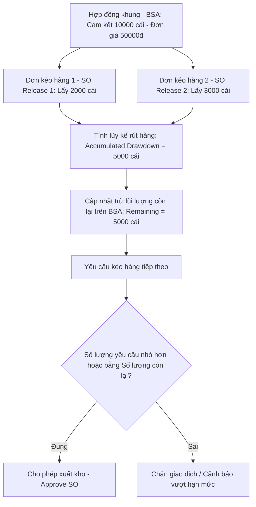
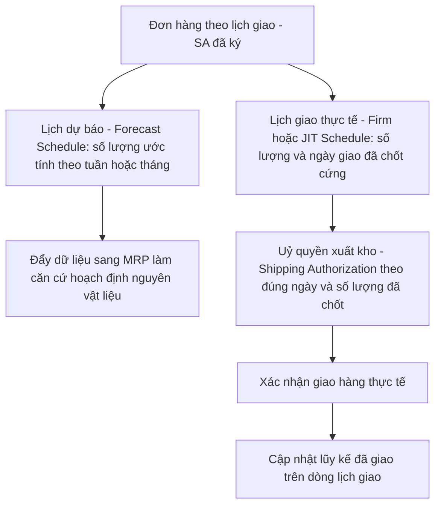

# 3040 Quản lý hợp đồng khung và đơn hàng theo lịch giao (BSA/SA)

Trong các ngành công nghiệp phụ trợ, sản xuất linh kiện, B2B hoặc phân phối bán sỉ, khách hàng thường ký kết các thỏa thuận mua sắm dài hạn (ví dụ: cam kết mua 120,000 sản phẩm trong vòng 1 năm) để khóa mức giá ưu đãi. Nghiệp vụ này được quản lý thông qua **Hợp đồng khung bán hàng (Blanket Sales Agreement - BSA)** — kéo hàng theo yêu cầu phát sinh (Ad-hoc Release/Drawdown), hoặc **Thỏa thuận lịch giao hàng (Scheduling Agreement - SA)** — lịch giao đã được chốt sẵn theo từng đợt cụ thể ngay từ đầu. Định kỳ hàng tuần/tháng, khách hàng sẽ gửi các yêu cầu kéo hàng (Releases / Drawdowns) hoặc hệ thống tự xuất theo lịch đã chốt để kho thực xuất dựa trên thỏa thuận khung đã ký [3040].

---

## 1. Tình huống Nghiệp vụ & "Điểm đau" thực tế

Thiếu đi một công cụ tự động kiểm soát hợp đồng khung sẽ đẩy doanh nghiệp vào các rủi ro vận hành sau:

*   **Rút hàng vượt hạn mức hợp đồng (Contract Over-drawdown):** Khách hàng đã lấy hết 100% sản lượng cam kết trong hợp đồng với đơn giá ưu đãi, nhưng nhân viên bán hàng vẫn tiếp tục tạo đơn hàng mới gán mã hợp đồng cũ. Việc này giúp khách hàng vô tình "mua thêm" hàng với giá rẻ, gây thiệt hại trực tiếp cho biên lợi nhuận của doanh nghiệp [2020, 3040].
*   **Tranh chấp đơn giá khi biến động thị trường:** Hợp đồng khung quy định một mức giá cố định kèm thời hạn hiệu lực. Nếu hệ thống không tự động khóa thời hạn hoặc cho phép nhân viên tự ý chỉnh sửa đơn giá trên các đơn hàng kéo hàng (Release Orders), kế toán sẽ mất nhiều thời gian để đối chiếu chênh lệch hóa đơn cuối kỳ [1010].
*   **Không dự báo được nhu cầu giao hàng:** Khách hàng yêu cầu giao hàng định kỳ nhưng không cung cấp lịch trình cụ thể, dẫn đến việc bộ phận kế hoạch sản xuất (MRP) hoặc bộ phận mua hàng bị động, gây ra tình trạng lúc thì tồn kho quá tải, lúc thì thiếu hàng giao [3030].
*   **Nhầm lẫn giữa lịch dự báo và lịch đã chốt cứng:** Đối với đơn hàng theo lịch giao (SA), khách hàng thường gửi hai loại lịch: một lịch dự báo dài hạn mang tính tham khảo (Forecast) và một lịch giao ngắn hạn đã chốt cứng (Firm/JIT). Nếu hệ thống không tách biệt hai loại này, kho có thể xuất hàng nhầm theo số liệu dự báo chưa được xác nhận, dẫn đến sản xuất/giao hàng sai số lượng thực tế cần.

---

## 2. Bản đồ Thiết kế & Ánh xạ Cơ sở dữ liệu

### A. Hợp đồng khung bán hàng (Blanket Sales Agreement)

Dưới đây là bảng đối chiếu cấu trúc lưu trữ dữ liệu Hợp đồng khung bán hàng và Đơn hàng kéo hàng trên các hệ thống ERP:

| Thực thể nghiệp vụ | Oracle EBS R12 (Tables) | Epicor ERP (Tables) | SAP S/4HANA (Tables) | Odoo (Tables) |
| :--- | :--- | :--- | :--- | :--- |
| **Đầu mục Hợp đồng**<br/>*(Agreement Header)* | **`OE_BLANKET_HEADERS_ALL`**<br/>(BSA Header) | **`Erp.OrderHed`**<br/>(Đơn hàng gốc chứa các Release) | **`VBAK`**<br/>(Cột `VBTYP` = 'G' - Contract) | **`sale.order`** /<br/>Custom Contract App |
| **Dòng Hợp đồng chi tiết**<br/>*(Agreement Line)* | **`OE_BLANKET_LINES_ALL`**<br/>(BSA Line) | **`Erp.OrderDtl`**<br/>(Sản phẩm thuộc Blanket) | **`VBAP`**<br/>(Contract Lines) | **`sale.order.line`** |
| **Đơn hàng kéo hàng**<br/>*(Release / Drawdown Order)* | **`OE_ORDER_HEADERS_ALL`**<br/>(Cột `BLANKET_NUMBER`) | **`Erp.OrderRel`**<br/>(Các đợt kéo hàng chi tiết) | Giao dịch bán hàng tham chiếu **`VBAK/VBAP`** | Đơn hàng SO tham chiếu Contract ID |
| **Lượng lũy kế đã xuất**<br/>*(Cumulative Released)* | **`OE_BLANKET_LINES_ALL`**<br/>(Cột `RELEASED_QUANTITY`) | **`Erp.OrderRel`**<br/>(Tổng `OurJobShippedQty` + `OurStockShippedQty`) | **`VBLB`** / **`VBFA`**<br/>(Lũy kế chứng từ liên kết) | Trường tính toán tự động (Computed field) |

### B. Đơn hàng theo lịch giao (Scheduling Agreement)

Khác với BSA (kéo hàng khi có yêu cầu phát sinh), Scheduling Agreement (SA) yêu cầu toàn bộ lịch giao — bao gồm cả lịch dự báo dài hạn và lịch chốt cứng ngắn hạn — được thiết lập sẵn ngay từ đầu:

| Thực thể nghiệp vụ | Oracle EBS R12 (Tables) | Epicor ERP (Tables) | SAP S/4HANA (Tables) | Odoo (Tables) |
| :--- | :--- | :--- | :--- | :--- |
| **Đối tượng Scheduling Agreement** | Không có đối tượng riêng — dùng chung `OE_BLANKET_HEADERS_ALL`, tạo sẵn toàn bộ dòng lịch giao trước | Không có đối tượng riêng — dùng chung `Erp.OrderHed`, tạo sẵn toàn bộ `Erp.OrderRel` theo lịch | **`VBAK`**<br/>(Loại chứng từ `LZ` - Scheduling Agreement) | Không hỗ trợ sẵn — tùy biến bảng lịch giao riêng |
| **Lịch dự báo**<br/>*(Forecast Schedule)* | Ghi chú tại DFF trên dòng đơn hàng dự kiến | UD Field tùy biến đánh dấu Release là Forecast | **`VBEP`**<br/>(Cột `ETART` = Loại lịch Forecast Delivery Schedule) | Trường tùy biến `is_forecast` trên bảng lịch giao |
| **Lịch chốt cứng**<br/>*(Firm / JIT Schedule)* | `OE_ORDER_LINES_ALL.SCHEDULE_SHIP_DATE` đã xác nhận | `Erp.OrderRel.NeedByDate` đã khóa không cho sửa | **`VBEP`**<br/>(Cột `ETART` = Loại lịch JIT/Firm Delivery Schedule) | Trường tùy biến `is_firm` trên bảng lịch giao |

---

## 3. Sơ đồ Luồng vận hành

### A. Luồng Hợp đồng khung bán hàng (BSA Drawdown)

Sơ đồ dưới đây mô tả cách một Hợp đồng khung (BSA) kiểm soát giá trị và sản lượng của các Đơn hàng kéo hàng (Release Orders) phát sinh trong năm:



### B. Luồng Đơn hàng theo lịch giao (Scheduling Agreement - Forecast & Firm)

Sơ đồ dưới đây mô tả cách hệ thống tách biệt lịch dự báo (chỉ dùng để hoạch định) và lịch chốt cứng (được phép kích hoạt xuất kho thực tế):



---

## 4. Quy trình cấu hình thực tế trên các ERP lớn

### A. Trên Oracle EBS R12 (Blanket Sales Agreement - BSA)
1.  **Tạo mới Hợp đồng khung (BSA Header):**
    *   *Đường dẫn:* `Order Management Super User > Blankets > Blanket Sales Agreement`.
    *   *Nghiệp vụ:* Nhập thông tin đối tác, ngày hiệu lực và hạn mức giá trị hợp đồng tối đa. Hệ thống lưu vào bảng `OE_BLANKET_HEADERS_ALL` [2000].
2.  **Thiết lập dòng sản phẩm cam kết (BSA Lines):**
    *   *Nghiệp vụ:* Tại tab `Lines`, nhập mã sản phẩm, đơn giá ưu đãi đã đàm phán, số lượng tối thiểu (`Min Quantity`) và tối đa (`Max Quantity`) được phép rút [2020].
3.  **Thực hiện kéo hàng (Create Release Order):**
    *   *Nghiệp vụ:* Khi khách hàng gửi yêu cầu giao hàng, nhân viên tạo một Sales Order tiêu chuẩn. Tại ô `Agreement` hoặc `Blanket Number`, gán số hợp đồng khung đã ký. Hệ thống sẽ tự động khóa đơn giá của dòng đơn hàng theo đúng đơn giá đã thỏa thuận trên hợp đồng khung, đồng thời thực hiện cập nhật lũy kế trường `RELEASED_QUANTITY` trên dòng BSA gốc [1010].
4.  **Vận dụng BSA cho lịch giao theo Scheduling Agreement:**
    *   *Nghiệp vụ:* Do Oracle EBS không có đối tượng Scheduling Agreement riêng, các đợt kéo hàng cho toàn bộ lịch giao trong kỳ (ví dụ 12 đợt cho 12 tuần) được tạo sẵn ngay khi ký hợp đồng, thay vì đợi khách hàng gửi yêu cầu từng đợt như BSA thông thường. Các dòng lịch dự báo (chưa chốt) được ghi chú riêng qua Descriptive Flexfield trên dòng đơn hàng để phân biệt với các dòng đã xác nhận `SCHEDULE_SHIP_DATE`.

### B. Trên Epicor ERP (Blanket Sales Order)
Epicor quản lý thỏa thuận dài hạn trực tiếp trên cấu trúc đơn hàng chuẩn thông qua cơ chế phân rã **Releases**:
1.  **Thiết lập đơn hàng Blanket:**
    *   *Đường dẫn:* `Sales Management > Customer Relationship Management > Sheets > Sales Order Entry` [1030].
    *   *Nghiệp vụ:* Tạo mới đơn hàng, tích chọn ô `Blanket` trên màn hình Header để đánh dấu đây là hợp đồng khung.
2.  **Thiết lập lịch trình giao hàng chi tiết (Releases Schedule):**
    *   *Nghiệp vụ:* Chuyển sang tab `Releases` (`Erp.OrderRel`) [3030]. 
    *   *Cấu hình:* Tạo mới các dòng Release đại diện cho từng đợt giao hàng mong muốn của khách hàng trong tương lai. Nhập ngày yêu cầu giao (`NeedByDate`) và số lượng tương ứng cho từng đợt [3030]. Khi kho thực hiện xuất hàng (`Customer Shipment Entry`), hệ thống sẽ trừ trực tiếp vào đợt Release đã cấu hình và cập nhật số lượng thực xuất (`OurStockShippedQty`).
3.  **Vận dụng Releases cho lịch giao theo Scheduling Agreement:**
    *   *Nghiệp vụ:* Cùng cơ chế Releases ở trên, nhưng thay vì tạo từng đợt khi phát sinh yêu cầu, toàn bộ các đợt của cả kỳ hợp đồng được nhập sẵn cùng lúc. Sử dụng UD Field tùy biến trên từng dòng Release để đánh dấu đợt nào thuộc diện Forecast (chỉ tham khảo, chưa xuất kho) và đợt nào đã chuyển sang Firm (khóa `NeedByDate`, được phép Pick Release).

---

## 5. SQL Database Audit Queries (Truy vấn đối soát dữ liệu)

### A. Đối soát sản lượng lũy kế đã kéo (Drawdowns) trên Oracle EBS

Query dưới đây liên kết bảng thông tin tham số hệ thống (`OE_SYSTEM_PARAMETERS_ALL`) để lấy đúng mã kho Master Org, lọc ra toàn bộ các hợp đồng khung đang hoạt động kèm sản lượng cam kết và sản lượng thực tế khách hàng đã lấy:

```sql
SELECT 
    obh.org_id                    AS operating_unit_id,
    obh.order_number              AS bsa_number,
    hca.account_number            AS customer_number,
    hp.party_name                 AS customer_name,
    msib.segment1                 AS item_code,
    obl.blanket_min_quantity      AS contract_min_qty,  -- View _V map chính xác trường kiểm soát số lượng tối thiểu này
    obl.blanket_max_quantity      AS contract_max_qty,  -- View _V map chính xác trường kiểm soát số lượng tối đa này
    obl.released_quantity         AS cumulative_released_qty, -- Trên View dòng được đặt lại chuẩn là released_quantity
    obh.start_date_active         AS start_date,
    obh.end_date_active           AS end_date
FROM 
    oe_blanket_headers_v obh -- View Header chuẩn hóa cho R12.2
INNER JOIN 
    oe_blanket_lines_v obl ON obh.header_id = obl.header_id -- ĐỔI THÀNH: View Line để lấy đầy đủ các cột số lượng
INNER JOIN 
    hz_cust_accounts hca ON obh.sold_to_org_id = hca.cust_account_id
INNER JOIN 
    hz_parties hp ON hca.party_id = hp.party_id
INNER JOIN 
    oe_system_parameters_all osp ON obh.org_id = osp.org_id
INNER JOIN 
    mtl_system_items_b msib ON obl.inventory_item_id = msib.inventory_item_id 
                            AND osp.master_organization_id = msib.organization_id
WHERE 
    obh.flow_status_code = 'ACTIVE'
    -- Bộ lọc ngày hiệu lực của hợp đồng BSA
    AND TRUNC(SYSDATE) BETWEEN NVL(obh.start_date_active, TRUNC(SYSDATE)-1) 
                           AND NVL(obh.end_date_active, TRUNC(SYSDATE)+1)
ORDER BY 
    obh.order_number, obl.line_number;
```

### B. Tra cứu các Đơn hàng khung và các đợt giao hàng chi tiết trên Epicor ERP

Query dưới đây lọc ra danh sách các đơn hàng có cấu hình Blanket trên hệ thống Epicor, hiển thị chi tiết số lượng cam kết trên từng đợt giao hàng để phục vụ kế hoạch sản xuất:

```sql
SELECT 
    oh.Company,
    oh.OrderNum                   AS Blanket_Order_Number,
    od.OrderLine                  AS Line_Number,
    orl.OrderRelNum                AS Release_Number,
    od.PartNum                     AS Part_Number,
    orl.OurReqQty                  AS Scheduled_Quantity,
    (orl.OurJobShippedQty + orl.OurStockShippedQty) AS Shipped_Quantity,
    orl.NeedByDate                 AS Scheduled_Delivery_Date,
    orl.OpenRelease                AS Is_Release_Open
FROM 
    Erp.OrderHed oh
INNER JOIN 
    Erp.OrderDtl od ON oh.Company = od.Company AND oh.OrderNum = od.OrderNum
INNER JOIN 
    Erp.OrderRel orl ON od.Company = orl.Company AND od.OrderNum = orl.OrderNum AND od.OrderLine = orl.OrderLine
WHERE 
    oh.Company = 'YOUR_COMPANY_CODE'
    AND oh.VoidOrder = 0
    AND EXISTS (
        SELECT 1 FROM Erp.OrderRel r 
        WHERE r.Company = oh.Company AND r.OrderNum = oh.OrderNum 
        GROUP BY r.OrderNum HAVING COUNT(r.OrderRelNum) > 1
    )
ORDER BY 
    oh.OrderNum, od.OrderLine, orl.OrderRelNum;
```

### C. Đối soát lịch giao đã chốt sẵn (Pre-committed Schedule Lines) trên Oracle EBS

Query dưới đây lọc ra toàn bộ các dòng đơn hàng đã tham chiếu hợp đồng khung và có ngày giao dự kiến trong tương lai, phục vụ đối chiếu lịch giao dạng Scheduling Agreement đã chốt sẵn từ đầu kỳ:

```sql
SELECT 
    oha.order_number              AS order_number,
    oha.blanket_number             AS bsa_number,
    oel.line_number                AS line_number,
    msib.segment1                  AS item_code,
    oel.ordered_quantity           AS scheduled_qty,
    oel.schedule_ship_date         AS scheduled_ship_date,
    oel.flow_status_code           AS line_status
FROM 
    oe_order_headers_all oha
INNER JOIN 
    oe_order_lines_all oel ON oha.header_id = oel.header_id
INNER JOIN 
    mtl_system_items_b msib ON oel.inventory_item_id = msib.inventory_item_id 
                            AND oel.ship_from_org_id = msib.organization_id
WHERE 
    oha.blanket_number IS NOT NULL
    AND oel.schedule_ship_date >= TRUNC(SYSDATE)
ORDER BY 
    oha.blanket_number, oel.schedule_ship_date;
```

---

## 6. Nguyên tắc Nghiệp vụ cốt lõi khi Tự xây dựng hoặc Tùy biến Hệ thống (OMS/ERP)

### Nguyên tắc 1: Cơ chế tự động trừ lùi và khóa hạn mức (Atomic Drawdown Deductions)
*   **Yêu cầu thiết kế logic:** Khi tạo một đơn hàng kéo hàng (Release SO) tham chiếu đến hợp đồng khung, hệ thống tự xây phải thực hiện kiểm tra tính toàn vẹn dữ liệu:
    $$\text{Số lượng yêu cầu mới} \le \text{Sản lượng tối đa hợp đồng} - \text{Sản lượng lũy kế đã kéo}$$
    Khi đơn hàng SO này chuyển sang trạng thái được duyệt (Booked), hệ thống phải thực hiện một giao dịch ghi nhận an toàn (Atomic Transaction) để trừ lùi sản lượng còn lại của hợp đồng khung, tuyệt đối không cho phép rút quá hạn mức đã thỏa thuận [3040].

### Nguyên tắc 2: Giới hạn dung sai vượt định mức (Over-shipment Tolerance limits)
*   **Yêu cầu thiết kế logic:** Trong thực tế sản xuất công nghiệp, việc giao nhận hàng hóa thường có dung sai cho phép (ví dụ: cho phép giao vượt tối đa 5% sản lượng hợp đồng do đặc thù lô sản xuất). Hệ thống tự xây cần hỗ trợ cấu hình trường "Dung sai vượt định mức" (Over-shipment Tolerance) trên hợp đồng. Nếu đơn hàng kéo hàng vượt quá mức dung sai này, hệ thống phải tự động kích hoạt chế độ khóa đơn (Hold) và yêu cầu phê duyệt đặc biệt từ cấp quản lý [3040].

### Nguyên tắc 3: Tách biệt tuyệt đối lịch dự báo và lịch chốt cứng (Forecast vs Firm Isolation)
*   **Yêu cầu thiết kế logic:** Đối với đơn hàng theo lịch giao (SA), hệ thống tự xây phải phân loại rõ ràng hai trạng thái lịch: Forecast (chỉ mang tính tham khảo, dùng làm đầu vào cho MRP hoạch định nguyên vật liệu) và Firm/JIT (đã chốt cứng, được phép kích hoạt Pick Release/xuất kho thực tế). Hệ thống tuyệt đối không cho phép kho xuất hàng dựa trên số liệu còn ở trạng thái Forecast; chỉ khi khách hàng xác nhận chuyển đợt giao đó sang Firm thì dòng lịch giao mới được phép đi vào luồng xuất kho [3040].

---

## 7. Luồng luân chuyển dữ liệu liên phân hệ (Cross-Module Touchpoints)

*   **Tích hợp phân hệ Kho (WMS/INV):** Các đợt giao hàng chi tiết (Releases / Schedule Lines) của hợp đồng khung là căn cứ để phân hệ Kho chủ động lên kế hoạch soạn hàng, sắp xếp nhân lực đóng gói và điều phối xe vận chuyển theo đúng cam kết thời gian giao hàng [1010].
*   **Tích hợp phân hệ Sản xuất (MFG):** Lịch giao hàng dài hạn từ các hợp đồng khung chính là nguồn dữ liệu đầu vào có độ tin cậy cao nhất để phân hệ Lập kế hoạch sản xuất (MRP/MPS) chạy tính toán nhu cầu nguyên vật liệu và lên lịch sản xuất nhà máy một cách chủ động, tránh tình trạng bị động trước các đơn hàng gấp.
*   **Tích hợp lịch Forecast của Scheduling Agreement vào MRP:** Riêng đối với dữ liệu thuộc trạng thái Forecast của Scheduling Agreement, phân hệ MRP/MPS chỉ sử dụng để tính toán nhu cầu nguyên vật liệu dự kiến (Planned Orders), không tạo bất kỳ cam kết xuất kho hay ràng buộc tài chính nào cho đến khi đợt giao đó được khách hàng xác nhận chuyển sang trạng thái Firm.

---

<div align="center" style={{color: 'var(--ifm-color-primary)'}}>
  <strong>Chúc các bạn thành công và vui vẻ!</strong>
</div>