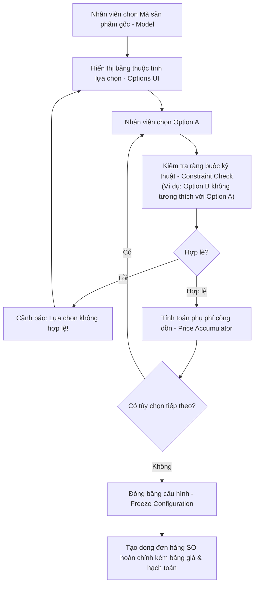

# 3050 Cấu hình sản phẩm theo yêu cầu khách hàng (Configure-to-Order)

Trong các ngành sản xuất và kinh doanh các sản phẩm tùy biến cao (như lắp ráp máy tính, nội thất thiết kế, ô tô, cửa nhôm kính), doanh nghiệp thường áp dụng mô hình **Cấu hình theo yêu cầu (Configure-to-Order - CTO)** hoặc **Lắp ráp theo đơn đặt hàng (Assemble-to-Order - ATO)**. Thay vì tạo hàng ngàn mã sản phẩm (SKU) tĩnh cho mỗi tổ hợp thuộc tính khác nhau, hệ thống ERP cung cấp công cụ **Trình cấu hình sản phẩm (Product Configurator)** giúp nhân viên bán hàng chủ động lựa chọn các tùy chọn (Options) ngay trên màn hình nhập đơn hàng SO theo đúng mong muốn của khách hàng [3050].

---

## 1. Tình huống Nghiệp vụ & "Điểm đau" thực tế

Thiếu đi một trình cấu hình sản phẩm tự động, doanh nghiệp thường gặp phải các bài toán vận hành phức tạp:

*   **Bùng nổ mã SKU tĩnh (SKU Explosion):** Nếu một sản phẩm có 5 thuộc tính (màu sắc, kích thước, chất liệu, phụ kiện, đóng gói) và mỗi thuộc tính có 10 lựa chọn, doanh nghiệp sẽ phải tạo và quản lý thủ công $10^5 = 100,000$ mã thành phẩm tĩnh trong danh mục sản phẩm (Item Master). Việc này gây quá tải dữ liệu và làm rối loạn hệ thống [1000].
*   **Sai lệch kỹ thuật khi lên đơn hàng:** Nhân viên bán hàng chọn các tùy chọn không tương thích với nhau (ví dụ: chọn kích thước khung cửa loại nhỏ nhưng lại chọn loại kính cường lực siêu dày vượt quá khả năng chịu lực của khung). Đơn hàng bị đẩy xuống nhà máy sản xuất nhưng bị trả lại do không thể chế tạo thực tế, gây trễ hẹn giao hàng và lãng phí nguyên vật liệu.
*   **Tính toán sai giá bán (Pricing Error):** Mỗi tùy chọn cấu hình nâng cấp (ví dụ: nâng cấp dung lượng RAM, thay đổi vỏ nhôm sang vỏ carbon) đều đi kèm một mức phụ phí (markup). Nếu nhân viên bán hàng phải tự cộng dồn giá thủ công bằng tay, rủi ro báo sai giá cho khách hàng là rất lớn [2020].

---

## 2. Bản đồ Thiết kế & Ánh xạ Cơ sở dữ liệu

Dưới đây là bảng đối chiếu cấu trúc lưu trữ dữ liệu cấu hình sản phẩm Configure-to-Order giữa các hệ thống ERP:

| Thực thể nghiệp vụ | Oracle EBS R12 (Tables) | Epicor ERP (Tables) | SAP S/4HANA (Tables) | Odoo (Tables) |
| :--- | :--- | :--- | :--- | :--- |
| **Mẫu sản phẩm gốc**<br/>*(Model / Configurator)* | **`OE_ORDER_LINES_ALL`**<br/>(Cột `ITEM_TYPE_CODE` = 'MODEL') | **`Erp.PcCon`**<br/>(Product Configurator) | **`KLAH`** / **`KSML`**<br/>(Class & Characteristics) | **`product.template`**<br/>(Mẫu sản phẩm) |
| **Thuộc tính & Lựa chọn**<br/>*(Attributes & Options)* | **`OE_ORDER_LINES_ALL`**<br/>(Cột `ITEM_TYPE_CODE` = 'OPTION') | **`Erp.PcValue`**<br/>(Dynamic Configured Values) | **`CABN`** / **`CAWN`**<br/>(Char & Values) | **`product.template.attribute.value`**<br/>(Giá trị thuộc tính) |
| **Giá trị khách chọn**<br/>*(Selected Configuration)* | **`OE_ORDER_LINES_ALL`**<br/>(Cột `TOP_MODEL_LINE_ID`) | **`Erp.PcValueGrp`**<br/>(Liên kết SO Line với Value) | **`VBAP`**<br/>(Cột `CUOBJ` - Config Object) | **`sale.order.line`**<br/>(Mã thuộc tính gán trên đơn) |
| **Đơn giá phụ phí theo tùy chọn**<br/>*(Option Surcharge Pricing)* | **`QP_LIST_LINES`**<br/>(Advanced Pricing - Modifier Line gắn Pricing Attribute theo Option) | Quy tắc tính phụ phí khai báo trong Rule của Configurator Designer, ghi nhận trực tiếp vào `OrderDtl.DocUnitPrice` | **`KONV`**<br/>(Sales Document Condition - Condition Type biến thể, liên kết `CABN`/`CAWN`) | **`product.template.attribute.value.price_extra`** |

---

## 3. Sơ đồ luồng quyết định Cấu hình sản phẩm (Configurator Engine Flow)

Sơ đồ dưới đây mô tả cách động cơ cấu hình sản phẩm tự động kiểm tra tính tương thích kỹ thuật và tính toán giá bán cộng dồn dựa trên các tùy chọn của khách hàng:



---

## 4. Quy trình cấu hình thực tế trên các ERP lớn

Cả Oracle EBS và Epicor đều dùng chung một cơ chế nền tảng: sản phẩm cấu hình luôn phát sinh cấu trúc lắp ráp/BOM động theo lựa chọn của khách hàng (tức thuộc phạm vi Assemble-to-Order - ATO), chứ không dừng lại ở việc chỉ chọn ra một biến thể có sẵn. Vì vậy hai thuật ngữ CTO và ATO được dùng thay thế cho nhau trong phần cấu hình dưới đây.

### A. Trên Oracle EBS R12 (Mô hình CTO/ATO - Assemble-to-Order)
1.  **Thiết lập cấu trúc Model / Option Class:**
    *   *Nghiệp vụ:* Trong phân hệ quản lý danh mục (`Inventory`), định nghĩa mã sản phẩm gốc với thuộc tính `Assemble to Order = Yes`. Khai báo cấu trúc phân cấp cây sản phẩm: `Model` $\rightarrow$ `Option Class` $\rightarrow$ `Options`.
2.  **Vận hành trên Sales Order Entry:**
    *   *Nghiệp vụ:* Khi lên đơn hàng bán lẻ, nhân viên nhập mã Model chính. Hệ thống tự động kích hoạt trình chọn cấu hình **Oracle Configurator**. 
    *   *Xử lý:* Nhân viên tích chọn các thuộc tính mong muốn. Sau khi lưu, hệ thống sẽ lưu dòng Model gốc và tự động chèn thêm các dòng phụ (`Option Lines`) vào bảng `OE_ORDER_LINES_ALL`, khóa chặt mối liên kết thông qua cột `TOP_MODEL_LINE_ID` [3010].

### B. Trên Epicor ERP (Product Configurator)
Epicor sở hữu công cụ Product Configurator cực kỳ mạnh mẽ dành riêng cho các đơn vị chế tạo theo yêu cầu:
1.  **Thiết lập Trình cấu hình (Configurator Designer):**
    *   *Đường dẫn:* `Sales Management > Product Configurator > Sheets > Configurator Designer`.
    *   *Nghiệp vụ:* Thiết kế giao diện nhập liệu cho nhân viên bán hàng (ví dụ: các ô nhập kích thước, các nút chọn màu sắc). Thiết lập các quy tắc logic toán học (Rules) để tự động kiểm tra tính tương thích giữa các lựa chọn.
2.  **Vận hành trên Order Entry:**
    *   *Nghiệp vụ:* Khi nhập đơn hàng tại màn hình `Order Entry`, nhập mã sản phẩm cấu hình, nút `Configure` sẽ sáng lên. Nhân viên click vào để giao diện cấu hình hiển thị [1030]. Sau khi hoàn tất, hệ thống gán trạng thái `Configured = 1` trên bảng `OrderDtl` và lưu toàn bộ thông số lựa chọn vào bảng `Erp.PcValue` [3010].

---

## 5. SQL Database Audit Queries (Truy vấn đối soát dữ liệu)

### A. Đối soát các Đơn hàng ATO kèm danh sách tùy chọn chi tiết trên Oracle EBS

Query dưới đây lọc ra toàn bộ đơn hàng lắp ráp theo yêu cầu (ATO) đang hoạt động, hiển thị chi tiết các tùy chọn (Options) đã được nhân viên bán hàng lựa chọn trên từng đơn hàng:

```sql
SELECT 
    oha.org_id                    AS operating_unit_id,
    oha.order_number              AS order_number,
    oel.line_number               AS line_number,
    oel.shipment_number           AS shipment_number,
    msib.segment1                 AS component_item_code,
    oel.item_type_code            AS item_type, -- Sẽ hiển thị 'MODEL', 'CLASS', hoặc 'OPTION'
    oel.ordered_quantity          AS quantity,
    oel.unit_list_price           AS unit_list_price,
    oel.unit_selling_price        AS unit_selling_price
FROM 
    oe_order_headers_all oha
INNER JOIN 
    oe_order_lines_all oel ON oha.header_id = oel.header_id
INNER JOIN 
    mtl_system_items_b msib ON oel.inventory_item_id = msib.inventory_item_id 
                            AND oel.ship_from_org_id = msib.organization_id
WHERE 
    oel.top_model_line_id IS NOT NULL -- Chỉ lấy các dòng nằm trong cấu hình của Model gốc
    AND oha.ordered_date >= TO_DATE('2026-01-01', 'YYYY-MM-DD')
ORDER BY 
    oha.order_number, oel.line_number, oel.shipment_number;
```

### B. Tra cứu các giá trị thuộc tính khách hàng đã chọn trên Epicor ERP

Query dưới đây hỗ trợ rà soát kiểm tra các đơn hàng được gán cấu hình sản phẩm tùy biến trên Epicor, hiển thị chi tiết từng giá trị thuộc tính đầu vào đã được nhân viên bán hàng thiết lập:

```sql
SELECT 
    od.Company,
    od.OrderNum                   AS Order_Number,
    od.OrderLine                  AS Line_Number,
    od.PartNum                    AS Configured_Part_Number,
    od.OrderQty                   AS Ordered_Quantity,
    pv.InputName                  AS Option_Attribute_Name,
    pv.CharacterVal               AS Selected_Option_Value,
    od.Configured                 AS Is_Configured
FROM 
    Erp.OrderDtl od
INNER JOIN 
    Erp.PcValueGrp pvg ON od.Company = pvg.Company AND od.OrderNum = pvg.OrderNum AND od.OrderLine = pvg.OrderLine
INNER JOIN 
    Erp.PcValue pv ON pvg.Company = pv.Company AND pvg.GroupSeq = pv.GroupSeq
WHERE 
    od.Company = 'YOUR_COMPANY_CODE'
    AND od.Configured = 1 -- Chỉ lọc các đơn hàng đã cấu hình thành công
ORDER BY 
    od.OrderNum, od.OrderLine, pv.InputName;
```

---

## 6. Nguyên tắc Nghiệp vụ cốt lõi khi Tự xây dựng hoặc Tùy biến Hệ thống (OMS/ERP)

### Nguyên tắc 1: Cây ràng buộc loại trừ lẫn nhau (Dependency & Exclusion Tree)
*   **Yêu cầu thiết kế logic:** Công cụ cấu hình của hệ thống tự xây phải hỗ trợ khai báo cây phụ thuộc và ma trận loại trừ (Constraint Matrix). Khi người dùng lựa chọn một tùy chọn làm thay đổi tính tương thích của sản phẩm (ví dụ: Chọn động cơ dung tích nhỏ), hệ thống bắt buộc phải tự động vô hiệu hóa (Disable) các tùy chọn không tương thích liên quan (ví dụ: Hộp số thể thao tải trọng cao) [3050].

### Nguyên tắc 2: Công thức tính giá phụ phí cộng dồn thời gian thực (Dynamic Variant Pricing Formula)
*   **Yêu cầu thiết kế logic:** Giá bán cuối cùng của sản phẩm cấu hình không được thiết lập cố định. Hệ thống tự xây phải tính toán giá theo công thức tích lũy thời gian thực:

$$
\text{Giá bán cuối cùng (Net Price)} = \text{Giá cơ bản của Model gốc} + \sum(\text{Phụ phí của từng tùy chọn đã chọn})
$$

Mỗi khi người dùng tích chọn hoặc bỏ chọn một thuộc tính trên giao diện, đơn giá bán của dòng đơn hàng phải tự động cập nhật ngay lập tức...

---

## 7. Luồng luân chuyển dữ liệu liên phân hệ (Cross-Module Touchpoints)

*   **Tích hợp phân hệ Kỹ thuật Sản xuất (MFG-Tech):** Đây là điểm chạm tích hợp quan trọng nhất. Toàn bộ thông số thuộc tính khách hàng đã chọn trên đơn hàng SO (ví dụ: Kích thước dài, rộng, cao thực tế) sẽ được phân hệ sản xuất tiếp nhận để tự động sinh ra **BOM sản xuất động (Custom BOM)** và quy trình công nghệ (Routing) tương ứng cho lệnh sản xuất (Work Order) tại nhà máy mà không cần kỹ sư thiết kế lại từ đầu.
*   **Tích hợp phân hệ Kế toán giá thành (FIN-COST):** Việc tự động cập nhật các tùy chọn cấu hình giúp phân hệ Giá thành ghi nhận chính xác chi phí định mức kế hoạch (Standard Cost) của riêng biến thể sản phẩm đó, làm cơ sở để tính toán chênh lệch giá thành sản xuất thực tế cuối kỳ.

---

<div align="center" style={{color: 'var(--ifm-color-primary)'}}>
  <strong>Chúc các bạn thành công và vui vẻ!</strong>
</div>