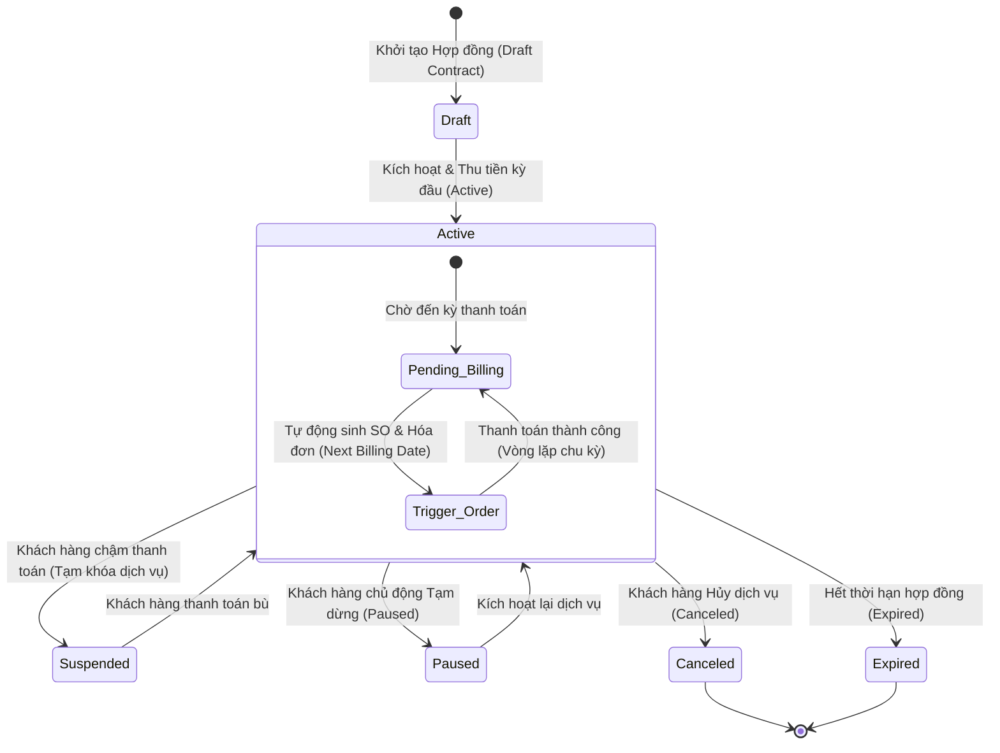

# 3060 Quản lý đơn hàng thuê bao và dịch vụ định kỳ (Subscription & Recurring)

Trong nền kinh tế hiện đại, mô hình kinh doanh dựa trên sự đăng ký định kỳ (Subscription Economy) đang phát triển mạnh mẽ. Doanh nghiệp không chỉ bán sản phẩm vật lý một lần, mà cung cấp các gói dịch vụ, sản phẩm tiêu dùng định kỳ (ví dụ: phần mềm SaaS, dịch vụ bảo trì thiết bị hàng tháng, hộp quà tặng giao định kỳ hàng tuần). Nghiệp vụ này đòi hỏi phân hệ Quản lý đơn hàng (OM) phải có khả năng quản lý các **Hợp đồng thuê bao (Subscription Contracts)** và tự động sinh **Đơn hàng lặp lại (Recurring Orders)** theo lịch trình đã cam kết mà không cần nhân viên kinh doanh phải nhập lại đơn hàng thủ công mỗi kỳ [3060].

---

## 1. Tình huống Nghiệp vụ & "Điểm đau" thực tế

Vận hành mô hình thuê bao và dịch vụ định kỳ bằng các công cụ thủ công thường dẫn đến các rủi ro hệ thống lớn:

*   **Bỏ sót kỳ thanh toán (Billing Leakage):** Đến kỳ thu tiền dịch vụ hàng tháng, nhân viên kinh doanh quên không tạo đơn hàng hoặc kế toán quên không phát hành hóa đơn cho khách hàng. Thất thoát doanh thu này rất khó phát hiện nếu doanh nghiệp quản lý hàng ngàn hợp đồng thuê bao bằng file Excel.
*   **Hạch toán doanh thu sai chuẩn mực (IFRS 15 / VAS):** Doanh nghiệp thu tiền trước 1 năm cho gói dịch vụ định kỳ (ví dụ: thu trước 12,000,000đ cho 12 tháng). Nếu kế toán lập tức ghi nhận toàn bộ 12,000,000đ vào doanh thu của tháng đầu tiên, báo cáo tài chính sẽ bị sai lệch nghiêm trọng. Theo chuẩn mực kế toán, khoản tiền này phải được ghi nhận vào tài khoản **Doanh thu chưa thực hiện (Deferred Revenue)** và được phân bổ dần vào doanh thu thực tế hàng tháng tương ứng với việc thực hiện dịch vụ bán hàng [1010].
*   **Hỗn loạn khi khách hàng tạm dừng hoặc thay đổi gói (Mid-cycle Changes):** Khách hàng yêu cầu tạm dừng dịch vụ 2 tuần để đi du lịch, hoặc yêu cầu nâng cấp gói dịch vụ (Upgrade/Downgrade) ngay giữa kỳ thanh toán. Việc tính toán thủ công số tiền cần hoàn lại (Pro-rated Refund) hoặc số tiền thu thêm cực kỳ phức tạp và dễ phát sinh sai sót.

---

## 2. Bản đồ Thiết kế & Ánh xạ Cơ sở dữ liệu

Dưới đây là bảng đối chiếu cấu trúc lưu trữ dữ liệu Hợp đồng thuê bao và Lịch trình thanh toán định kỳ trên các hệ thống ERP:

| Thực thể nghiệp vụ | Oracle EBS R12 (Tables) | Epicor ERP (Tables) | SAP S/4HANA (Tables) | Odoo (Tables) |
| :--- | :--- | :--- | :--- | :--- |
| **Hợp đồng thuê bao**<br/>*(Subscription Header)* | **`OKC_K_HEADERS_ALL_B`**<br/>**`OKS_K_HEADERS_B`** | **`Erp.FSHeader`**<br/>(Service Contract Header) | **`VBAK`**<br/>(Cột `VBTYP` = 'G' / BRIM) | **`sale.order`**<br/>(Cột `is_subscription` = True) |
| **Dòng dịch vụ định kỳ**<br/>*(Subscription Line)* | **`OKC_K_LINES_B`**<br/>**`OKS_K_LINES_B`** | **`Erp.FSDtl`**<br/>(Contract Lines) | **`VBAP`**<br/>(Contract Item Data) | **`sale_order_line`** |
| **Lịch trình thanh toán**<br/>*(Billing Schedule)* | **`OKS_LEVEL_ELEMENTS`**<br/>(Các đợt thanh toán chi tiết) | **`Erp.FSContract`** /<br/>Sched Billing Tables | **`FPLT`** / **`FPLA`**<br/>(Billing Plan Tables) | **`sale.subscription.stage`** /<br/>Schedule Rules |
| **Giao diện hóa đơn tự động**<br/>*(Auto-Billing Interface)* | **`RA_INTERFACE_LINES_ALL`**<br/>(Đích đến chính của mỗi kỳ billing) | **`Erp.ARInvHed`**<br/>(Hóa đơn sinh tự động qua Contract Billing) | **`VBRK`** / **`VBRP`**<br/>(Billing Document) | **`account.move`**<br/>(Hóa đơn định kỳ) |
| **Giao dịch Đơn hàng SO**<br/>*(Triggered Sales Order — chỉ áp dụng khi có giao hàng vật lý)* | **`OE_ORDER_HEADERS_ALL`**<br/>(Giao dịch SO sinh ra mỗi kỳ) | **`Erp.OrderHed`**<br/>(Đơn hàng SO liên kết) | **`VBAK`**<br/>(Đơn hàng SO liên kết) | **`sale_order`**<br/>(Đơn hàng SO con) |

---

## 3. Sơ đồ Vòng đời và Chuyển trạng thái của Đơn hàng thuê bao

Sơ đồ trạng thái dưới đây mô tả chu kỳ sống và luồng xử lý định kỳ tự động của một hợp đồng thuê bao trên hệ thống:



---

## 4. Quy trình cấu hình thực tế trên các ERP lớn

### A. Trên Oracle EBS R12 (Phân hệ Oracle Service Contracts - OKS)
Oracle EBS quản lý thuê bao chuyên sâu thông qua phân hệ **Service Contracts**:
1.  **Tạo mới Hợp đồng dịch vụ định kỳ:**
    *   *Đường dẫn:* `Service Contracts Developer > Launch Contracts`.
    *   *Nghiệp vụ:* Tạo mới hợp đồng (`OKC_K_HEADERS_ALL_B`), gán phân loại `Subcategory = SERVICE` hoặc `WARRANTY`. Nhập thời hạn hợp đồng (ví dụ: từ 01/01/2026 đến 31/12/2026).
2.  **Thiết lập Lịch trình phát hành hóa đơn (Billing Schedule):**
    *   *Nghiệp vụ:* Tại dòng hợp đồng, chọn tab `Pricing/Billing` $\rightarrow$ `Billing Schedule`.
    *   *Cấu hình:* Chọn tần suất hóa đơn (ví dụ: `Monthly` - Hàng tháng). Hệ thống sẽ tự động phân rã thành 12 đợt thanh toán chi tiết trên bảng `OKS_LEVEL_ELEMENTS`, chỉ rõ ngày hệ thống tự động đẩy dữ liệu sang phân hệ kế toán thu tiền (`Date to Interface`) [1010].
3.  **Đường đi của dữ liệu mỗi kỳ billing:**
    *   *Nghiệp vụ:* Đến `Date to Interface`, `OKS_LEVEL_ELEMENTS` đẩy thẳng dữ liệu vào bảng giao diện hóa đơn `RA_INTERFACE_LINES_ALL` để chương trình Auto Invoice của Oracle Receivables sinh hóa đơn — đây là đường đi chuẩn cho hợp đồng dịch vụ thuần túy (không kèm giao hàng vật lý). Chỉ khi hợp đồng thuê bao có kèm sản phẩm vật lý cần xuất kho định kỳ (ví dụ gói giao hàng hàng tháng), hệ thống mới cần tùy biến thêm để mỗi kỳ tự động sinh thêm một Sales Order chuẩn trong `OE_ORDER_HEADERS_ALL` phục vụ soạn hàng, song song với luồng billing.

### B. Trên Epicor ERP (Field Service Contract Maintenance)
Epicor quản lý dịch vụ định kỳ thông qua phân hệ **Service Contract**:
1.  **Tạo mới Hợp đồng dịch vụ (Service Contract Setup):**
    *   *Đường dẫn:* `Service Management > Service Contract Maintenance`.
    *   *Nghiệp vụ:* Nhập mã số hợp đồng mới (`ContractNum`), chọn đối tác khách hàng, thời gian hiệu lực và gán giá trị hợp đồng năm (`ContractVal`) [2000].
2.  **Cấu hình luồng hóa đơn định kỳ (Contract Billing Setup):**
    *   *Nghiệp vụ:* Tại tab `Billing`, thiết lập tần suất hóa đơn (ví dụ: `Quarterly` - Hàng quý). 
    *   *Vận hành:* Định kỳ, kế toán chạy chương trình **Contract Billing Generation** để hệ thống quét các hợp đồng đến kỳ, tự động tạo mới hóa đơn dịch vụ định kỳ mà không cần tạo đơn hàng SO thủ công nhiều lần [1010].

---

## 5. SQL Database Audit Queries (Truy vấn đối soát dữ liệu)

### A. Đối soát lịch trình hóa đơn của các Hợp đồng thuê bao trên Oracle EBS

Query dưới đây giúp bộ phận kiểm soát nội bộ và kế toán doanh thu tra cứu toàn bộ các đợt phát hành hóa đơn của hợp đồng thuê bao đang hoạt động, xác định chính xác ngày thu tiền tiếp theo (`Next Billing Date`) kèm loại hình gia hạn hợp đồng:

```sql
SELECT 
    och.contract_number           AS contract_number,
    och.scs_code                  AS contract_type, -- SERVICE, WARRANTY, SUBSCRIPTION
    -- Lấy chính xác trường renewal_type_code từ bảng core och
    och.renewal_type_code         AS renewal_type_code, 
    -- Giải mã sẵn các mã code gia hạn chuẩn của Oracle để dễ đọc báo cáo
    DECODE(och.renewal_type_code, 
           'MAN', 'Manual', 
           'EVN', 'Evergreen', 
           'DNR', 'Do Not Renew', 
           'NSR', 'Notify Salesrep', 
           och.renewal_type_code) AS renewal_type_desc,
    ocl.line_number               AS line_number,
    ocl.start_date                AS line_start_date, 
    ocl.end_date                  AS line_end_date,   
    ole.date_to_interface         AS next_billing_date,
    ole.amount                    AS recurring_amount,
    och.sts_code                  AS contract_status
FROM 
    okc_k_headers_all_b och
INNER JOIN 
    oks_k_headers_b oksh ON och.id = oksh.chr_id
INNER JOIN 
    okc_k_lines_b ocl ON och.id = ocl.dnz_chr_id
INNER JOIN 
    oks_k_lines_b okl ON ocl.id = okl.cle_id
INNER JOIN 
    oks_level_elements ole ON okl.id = ole.cle_id -- Kết nối dòng Billing Schedule chuẩn R12
WHERE 
    och.sts_code = 'ACTIVE' 
    AND ole.date_to_interface >= TRUNC(SYSDATE)
ORDER BY 
    och.contract_number, ocl.line_number, ole.date_to_interface;
```

### B. Tra cứu các Hợp đồng dịch vụ đang hoạt động trên Epicor ERP

Query dưới đây lọc ra toàn bộ các hợp đồng dịch vụ định kỳ đang có hiệu lực trên hệ thống Epicor để phục vụ đối soát sản lượng và doanh thu tích lũy:

```sql
SELECT 
    fsh.Company,
    fsh.ContractNum               AS Contract_Number,
    fsh.Description               AS Contract_Description,
    c.CustID                      AS Customer_ID,
    c.Name                        AS Customer_Name,
    fsh.StartDate                 AS Start_Date,
    fsh.EndDate                   AS End_Date,
    fsh.ContractVal               AS Annual_Contract_Value,
    fsh.ActiveContract            AS Is_Contract_Active
FROM 
    Erp.FSHeader fsh
INNER JOIN 
    Erp.Customer c ON fsh.Company = c.Company AND fsh.CustNum = c.CustNum
WHERE 
    fsh.Company = 'YOUR_COMPANY_CODE'
    AND fsh.ActiveContract = 1 -- Chỉ lấy hợp đồng đang hoạt động
    AND (fsh.EndDate IS NULL OR fsh.EndDate >= GETDATE())
ORDER BY 
    fsh.ContractNum;
```

---

## 6. Nguyên tắc Nghiệp vụ cốt lõi khi Tự xây dựng hoặc Tùy biến Hệ thống (OMS/ERP)

### Nguyên tắc 1: Động cơ tự động sinh đơn hàng định kỳ (Recurring Order Scheduler)
*   **Yêu cầu thiết kế logic:** Hệ thống tự xây dựng phải có một tiến trình chạy ngầm (Cron Job / Background Worker) hoạt động hàng ngày. Tiến trình này quét toàn bộ các hợp đồng thuê bao có trạng thái `ACTIVE` và so khớp ngày hiện tại với ngày thanh toán tiếp theo (`next_billing_date`). 
*   **Vận hành:** Ngay khi phát hiện khớp ngày, hệ thống phải tự động gọi API để nhân bản và tạo mới một Đơn bán hàng (Sales Order) hoặc Hóa đơn (Invoice) tương ứng cho kỳ đó, đồng thời tự động cập nhật ngày thanh toán tiếp theo của hợp đồng lên kỳ kế tiếp [3060].

### Nguyên tắc 2: Công thức tính toán điều chỉnh theo tỷ lệ thời gian (Prorated Adjustment Rules)
*   **Yêu cầu thiết kế logic:** Khi khách hàng yêu cầu thay đổi gói dịch vụ giữa kỳ (ví dụ: nâng cấp từ gói Basic lên Premium, hoặc hạ cấp/tạm dừng giữa kỳ), hệ thống phải tự động tính toán khoản chênh lệch theo tỷ lệ thời gian thực tế sử dụng (Prorated):
    $$
    \text{Chênh lệch điều chỉnh (Adjustment Amount)} = \left( \frac{\text{Đơn giá gói mới} - \text{Đơn giá gói cũ}}{\text{Tổng số ngày trong tháng}} \right) \times \text{Số ngày sử dụng còn lại}
    $$
    Kết quả dương thể hiện khoản phí thu thêm (nâng cấp gói), kết quả âm thể hiện khoản cần hoàn trả cho khách hàng (hạ cấp hoặc tạm dừng gói). Hệ thống tự động sinh một đơn hàng điều chỉnh công nợ (Adjustment Order) dựa trên công thức này để gửi cho khách hàng, tránh việc tính toán thủ công ngoài Excel dễ sai lệch.

---

## 7. Luồng luân chuyển dữ liệu liên phân hệ (Cross-Module Touchpoints)

*   **Tích hợp phân hệ Kế toán sổ cái (FIN-GL):** Đây là điểm chạm tích hợp sống còn của mô hình thuê bao. Hệ thống hạch toán doanh thu định kỳ bắt buộc phải tự động ghi nhận số tiền thu trước của khách hàng vào tài khoản **Doanh thu chưa thực hiện (Deferred Revenue)**, sau đó phân hệ Sổ cái tự động phân bổ dần vào tài khoản **Doanh thu thực tế (Recognized Revenue)** hàng tháng dựa trên trạng thái thực hiện dịch vụ của đơn hàng [1010].
*   **Tích hợp phân hệ Công nợ phải thu (AR/Dunning):** Trạng thái `Suspended` trên vòng đời hợp đồng (mục 3) được kích hoạt tự động dựa trên dữ liệu công nợ quá hạn từ phân hệ Phải thu. Khi hóa đơn định kỳ quá hạn thanh toán vượt số ngày cho phép (Dunning Threshold), phân hệ AR gửi tín hiệu ngược lại hợp đồng thuê bao để tự động chuyển trạng thái sang Suspended, tạm khóa dịch vụ cho đến khi khách hàng thanh toán bù.
*   **Tích hợp phân hệ Kho (WMS/INV):** Đối với các gói thuê bao sản phẩm vật lý định kỳ (ví dụ: gói giao cà phê hàng tháng), đơn hàng SO con được sinh ra tự động hàng kỳ sẽ đóng vai trò là yêu cầu xuất kho tiêu chuẩn, tự động gán vào luồng soạn hàng tại kho (Picking) để đảm bảo hàng hóa được giao đúng hẹn cho khách [1010].

---

<div align="center" style={{color: 'var(--ifm-color-primary)'}}>
  <strong>Chúc các bạn thành công và vui vẻ!</strong>
</div>