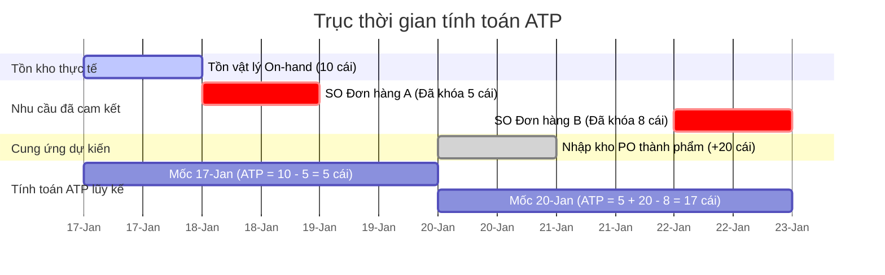

# 4000 Cơ chế kiểm tra khả năng cung ứng hàng hóa (ATP)

Trong quản lý đơn hàng bán hàng, việc cam kết chính xác ngày giao hàng cho khách hàng là yếu tố quyết định uy tín thương mại. Để làm được điều này, hệ thống ERP không chỉ nhìn vào lượng hàng vật lý đang có sẵn trong kho (On-hand Inventory) mà phải tính toán dựa trên **Khả năng cung ứng hàng hóa (Available to Promise - ATP)**. ATP là công thức động tính toán lượng tồn kho sẵn có cộng thêm lượng hàng dự kiến sẽ nhập về trong tương lai (từ các đơn mua hàng PO hoặc lệnh sản xuất WIP đang chạy) trừ đi các cam kết bán hàng đã xác nhận [4000].

---

## 1. Tình huống Nghiệp vụ & "Điểm đau" thực tế

Khi thiếu công cụ tính toán ATP tự động theo trục thời gian, doanh nghiệp thường gặp các sự cố vận hành lớn:

*   **Cam kết ngày giao hàng "ảo" (Over-promising):** Nhân viên bán hàng thấy hệ thống báo tồn kho bằng 0 nên từ chối nhận đơn của khách hàng, hoặc ngược lại, hứa bừa ngày giao hàng dựa trên cảm tính. Thực tế, doanh nghiệp có một lô hàng lớn mua từ nhà cung cấp (PO) dự kiến sẽ về kho vào ngày mai, hoặc một lệnh sản xuất (Work Order) sắp hoàn thành vào cuối tuần này đủ để đáp ứng đơn hàng [1000].
*   **Tranh chấp tài nguyên tồn kho giữa các kênh:** Khi hàng thực tế về kho, hệ thống không tự động phân phối cho đơn hàng của khách hàng đã cọc trước mà để nhân viên kinh doanh của kênh khác vào làm đơn bán hàng lẻ lấy mất, gây trễ hẹn nghiêm trọng cho đối tác chiến lược [3030].

---

## 2. Bản đồ Thiết kế & Ánh xạ Cơ sở dữ liệu

Dưới đây là bảng đối chiếu cấu trúc lưu trữ và thiết lập quy tắc kiểm tra ATP giữa các hệ thống ERP phổ biến:

| Thực thể nghiệp vụ | Oracle EBS R12 (Tables) | Epicor ERP (Tables) | SAP S/4HANA (Tables) | Odoo (Tables) |
| :--- | :--- | :--- | :--- | :--- |
| **Cờ kích hoạt ATP**<br/>*(ATP Flag on Item)* | **`MTL_SYSTEM_ITEMS_B`**<br/>(Cột `atp_flag` = 'Y'/'N') | **`Erp.Part`**<br/>(Cột `CheckATP` = True) | **`MARC`**<br/>(Cột `MTVFP` - Check Group) | Định nghĩa theo **Product Type** & Routes |
| **Quy tắc tính toán**<br/>*(ATP Rules)* | **`MSC_ATP_RULES`** /<br/>GOP Configuration | **`Erp.PartClass`** /<br/>Scheduling Rules | **`T399D`**<br/>(MRP Controllers) | Định nghĩa qua **Lead Times** & Lead Days |
| **Giao dịch Nhu cầu**<br/>*(Committed Demand)* | **`MTL_DEMAND`** /<br/>`OE_ORDER_LINES_ALL` | **`Erp.PartWhse`**<br/>(Cột `DemandQty`) [3030] | **`VBBE`**<br/>(Individual Requirements) | **`stock.move`**<br/>(Dòng dịch chuyển kho chờ) |
| **Ngày hứa hẹn giao**<br/>*(Scheduled Ship Date)* | **`OE_ORDER_LINES_ALL`**<br/>(Cột `SCHEDULE_SHIP_DATE`) | **`Erp.OrderRel`**<br/>(Cột `NeedByDate`) [3030] | **`VBEP`**<br/>(Cột `EDATU` - Delivery Date) | **`sale_order_line`**<br/>(Cột `commitment_date`) |

---

## 3. Sơ đồ Trục thời gian tính toán ATP (Available to Promise Timeline)

Sơ đồ dưới đây mô tả cách động cơ ATP tính toán lượng hàng sẵn có để cam kết với khách hàng tại các thời điểm khác nhau dọc theo trục thời gian tương lai:



---

## 4. Quy trình cấu hình thực tế trên các ERP lớn

### A. Trên Oracle EBS R12 (Order Scheduling & Global Order Promising - GOP)
1.  **Kích hoạt ATP trên danh mục sản phẩm (Item Master):**
    *   *Đường dẫn:* `Inventory > Items > Master Items > Order Management` [2000].
    *   *Nghiệp vụ:* Chọn thuộc tính `Check ATP = Check Material` (hoặc `Check Material and Resources` nếu muốn kiểm tra cả năng lực máy móc của nhà máy).
2.  **Cấu hình quy tắc ATP (ATP Rule):**
    *   *Đường dẫn:* `Inventory > Setup > Rules > ATP`.
    *   *Nghiệp vụ:* Tạo mới quy tắc tính toán. Tích chọn bao gồm cả đơn hàng dự kiến nhập từ nhà cung cấp (`Include Purchase Orders`) và lệnh sản xuất (`Include Work Orders`) làm nguồn cung tương lai [1000].
3.  **Vận hành trên Sales Order Entry:**
    *   *Nghiệp vụ:* Khi nhân viên lưu dòng đơn hàng, hệ thống tự động chạy tiến trình lập lịch (Scheduling). Công cụ GOP sẽ kiểm tra trục thời gian cung - cầu và tự động điền ngày giao hàng khả thi vào trường `Schedule Ship Date` [1010].

### B. Trên Epicor ERP (Part Maintenance & ATP Check)
Epicor tích hợp chặt chẽ ATP với phân hệ lập kế hoạch sản xuất (MRP):
1.  **Kích hoạt kiểm tra ATP trên Part Maintenance:**
    *   *Đường dẫn:* `Material Management > Inventory Management > Setup > Part` [1030].
    *   *Nghiệp vụ:* Tại tab `Part > Detail`, tích chọn ô `Check ATP` để bắt buộc hệ thống chạy kiểm tra khả năng đáp ứng khi tạo đơn hàng.
2.  **Sử dụng màn hình tra cứu trục thời gian (Time Phase Inquiry):**
    *   *Nghiệp vụ:* Khi nhân viên kinh doanh nhập đơn hàng trong `Order Entry`, họ có thể click chuột phải chọn `Time Phase Inquiry` [1030]. Màn hình này hiển thị chi tiết tất cả các nguồn cung (PO, Job/Work Order) và nhu cầu (SO) theo ngày để nhân viên giải thích rõ ràng lịch trình giao hàng cho đối tác.

---

## 5. SQL Database Audit Queries (Truy vấn đối soát dữ liệu)

### A. Đối soát ngày lập lịch giao hàng và trạng thái kiểm tra ATP trên Oracle EBS

Query dưới đây giúp bộ phận kiểm soát nội bộ rà soát các dòng đơn hàng đã hoàn tất lập lịch giao hàng, đối chiếu ngày giao hàng hứa hẹn với trạng thái kiểm tra ATP được cấu hình trên Item Master:

```sql
SELECT 
    oha.org_id                    AS operating_unit_id,
    oha.order_number              AS order_number,
    oel.line_number               AS line_number,
    msib.segment1                 AS item_code,
    msib.atp_flag                 AS is_atp_enabled, -- 'Y' thể hiện có kích hoạt kiểm tra
    oel.ordered_quantity          AS ordered_qty,
    oel.schedule_ship_date        AS scheduled_ship_date,
    oel.promise_date              AS customer_promised_date,
    oel.flow_status_code          AS line_status
FROM 
    oe_order_headers_all oha
INNER JOIN 
    oe_order_lines_all oel ON oha.header_id = oel.header_id
INNER JOIN 
    oe_system_parameters_all osp ON oha.org_id = osp.org_id
INNER JOIN 
    mtl_system_items_b msib ON oel.inventory_item_id = msib.inventory_item_id 
                            AND osp.master_organization_id = msib.organization_id
WHERE 
    oel.schedule_ship_date IS NOT NULL
    AND oha.ordered_date >= TO_DATE('2026-01-01', 'YYYY-MM-DD')
ORDER BY 
    oha.order_number, oel.line_number;
```

### B. Tra cứu cấu hình ATP và tình hình nhu cầu vật tư trên Epicor ERP

Query dưới đây lọc ra toàn bộ các sản phẩm có kích hoạt tính năng kiểm tra ATP trên Epicor, hiển thị kèm số lượng tồn kho thực tế, số lượng đã phân bổ và tổng nhu cầu hiện tại:

```sql
SELECT 
    p.Company,
    p.PartNum                     AS Part_Number,
    p.Description                 AS Part_Description,
    p.ClassID                     AS Part_Class_ID,
    p.CheckATP                    AS Is_ATP_Check_Enabled, -- Flag CheckATP trên Part Master
    pw.AllocQty                   AS Total_Allocated_Qty,
    pw.DemandQty                  AS Total_Demand_Qty,
    pw.OnHandQty                  AS Current_On_Hand_Qty
FROM 
    Erp.Part p
INNER JOIN 
    Erp.PartWhse pw ON p.Company = pw.Company AND p.PartNum = pw.PartNum
WHERE 
    p.Company = 'YOUR_COMPANY_CODE'
    AND p.InActive = 0
    AND p.CheckATP = 1 -- Chỉ lọc các sản phẩm có bật kiểm tra ATP
ORDER BY 
    p.PartNum;
```

---

## 6. Nguyên tắc Nghiệp vụ cốt lõi khi Tự xây dựng hoặc Tùy biến Hệ thống (OMS/ERP)

Để thiết kế một động cơ kiểm tra ATP chính xác và hiệu quả trên hệ thống tự xây dựng, đội ngũ phát triển cần tuân thủ hai quy tắc logic nghiệp vụ sau:

### Nguyên tắc 1: Công thức tính toán ATP lũy kế (Cumulative ATP Formula)
*   **Yêu cầu thiết kế logic:** Hệ thống tự xây không được tính ATP đơn giản bằng cách lấy lượng tồn kho hiện tại trừ đơn đặt hàng. Lượng ATP tại một thời điểm $t$ trong tương lai phải được tính toán động dựa trên công thức lũy kế (Cumulative ATP):

    $$ATP(t) = \text{Tồn kho vật lý thực tế} + \sum \text{Lượng hàng dự kiến nhập kho trước } t - \sum \text{Nhu cầu đã cam kết trước } t$$

    Trong đó, lượng hàng dự kiến nhập kho gồm các đơn mua hàng (PO) đã được nhà cung cấp xác nhận và lệnh sản xuất (Work Order) đã được duyệt chạy [1000].

### Nguyên tắc 2: Thuật toán lập lịch tiến và lùi (Backward-Forward Scheduling)
*   **Yêu cầu thiết kế logic:** Khi nhân viên nhập đơn hàng yêu cầu giao vào ngày $X$:
    *   **Lập lịch lùi (Backward Scheduling):** Hệ thống kiểm tra xem lượng ATP tại ngày $X$ có đủ đáp ứng hay không. Nếu có, xác nhận ngày giao hàng là $X$.
    *   **Lập lịch tiến (Forward Scheduling):** Nếu ngày $X$ không đủ hàng, hệ thống phải tự động quét dọc theo trục thời gian tương lai để tìm điểm cung ứng tiếp theo (ví dụ: ngày $Y$ có lô hàng PO nhập kho). Hệ thống cộng thêm thời gian vận chuyển (Transit Lead Time) và tự động gợi ý ngày giao hàng khả thi mới là $Y + \text{Lead Time}$ để nhân viên cam kết với khách hàng [4000].

---

## 7. Luồng luân chuyển dữ liệu liên phân hệ (Cross-Module Touchpoints)

*   **Tích hợp phân hệ Kho (WMS/INV):** Số lượng tồn kho vật lý thời gian thực (On-hand Stock) là điểm khởi đầu cho mọi phép toán ATP. Ngay khi kho hoàn tất giao dịch nhập kho hoặc xuất kho, số dư tồn kho phải được cập nhật ngay lập tức sang công cụ tính toán ATP [1000].
*   **Tích hợp phân hệ Mua hàng & Sản xuất (PO/MFG):** Ngày giao nhận hứa hẹn trên đơn mua hàng (PO Promised Date) [1000] và ngày dự kiến hoàn thành của lệnh sản xuất (Work Order Due Date) là hai nguồn dữ liệu cung ứng tương lai (Future Supplies) quyết định độ chính xác của thuật toán lập lịch tiến trong động cơ ATP [4000].

---

<div align="center" style={{color: 'var(--ifm-color-primary)'}}>
  <strong>Chúc các bạn thành công và vui vẻ!</strong>
</div>