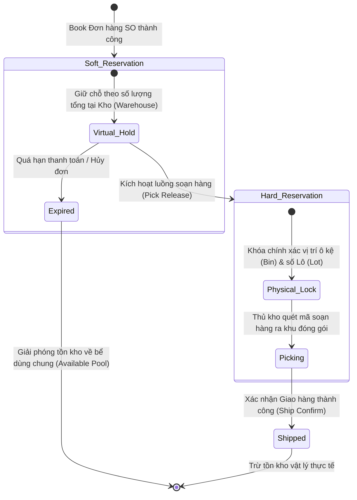

# 4010 Quy tắc giữ hàng và phân bổ tồn kho tối ưu

Khi đơn bán hàng (Sales Order) đã vượt qua các bộ lọc xác thực về điều kiện thương mại và công nợ, bước tiếp theo của hệ thống là thực hiện **Khóa giữ chỗ và Phân bổ tồn kho (Inventory Reservation & Allocation)**. Việc giữ hàng giúp khóa cứng một lượng sản phẩm cụ thể trong kho để dành riêng cho một đơn hàng xác định, ngăn chặn hoàn toàn tình trạng "giành giật" tồn kho giữa các nhân viên bán hàng và đảm bảo hàng hóa luôn sẵn sàng khi đến lịch giao cho khách.

---

## 1. Tình huống Nghiệp vụ & "Điểm đau" thực tế

Hoạt động phân bổ tồn kho thiếu quy tắc tự động thường gây ra các xung đột lớn trong vận hành doanh nghiệp:

*   **Tồn kho "ảo" do giữ hàng vô thời hạn:** Nhân viên kinh doanh tạo đơn hàng và thực hiện khóa giữ kho một lượng lớn sản phẩm để "chờ khách hàng suy nghĩ". Tuy nhiên, khách hàng sau đó không mua nhưng đơn hàng vẫn treo trên hệ thống. Việc giữ hàng ảo này làm cho hệ thống báo hết hàng, khiến doanh nghiệp mất cơ hội bán hàng cho các khách hàng thực tế khác có nhu cầu mua ngay — đây chính là hệ quả trực tiếp của việc thiếu cơ chế ưu tiên phân bổ đã trình bày tại **[OM 3030 - Quản lý đơn đặt hàng trước và đơn hàng chờ (Pre-order & Backorder Management)](./3030-quan-ly-don-dat-hang-truoc-va-don-hang-cho.md)**.
*   **Thất thoát hàng hóa do xuất lộn Lô/Hạn sử dụng:** Đối với các mặt hàng có hạn sử dụng (FMCG, Dược phẩm), nếu hệ thống chỉ giữ hàng theo số lượng chung chung mà không khóa chính xác số Lô (Lot Number) tại vị trí cụ thể (Bin Location), thủ kho khi đi soạn hàng có thể lấy nhầm các lô hàng mới nhập, để lại các lô hàng cũ trong kho dẫn đến việc hết hạn sử dụng và phải hủy bỏ hàng hóa.

---

## 2. Bản đồ Thiết kế & Ánh xạ Cơ sở dữ liệu

Dưới đây là bảng đối chiếu cấu trúc lưu trữ dữ liệu giữ hàng và phân bổ tồn kho bán hàng giữa các hệ thống ERP:

| Thực thể nghiệp vụ | Oracle EBS R12 (Tables) | Epicor ERP (Tables) | SAP S/4HANA (Tables) | Odoo (Tables) |
| :--- | :--- | :--- | :--- | :--- |
| **Bảng khóa giữ kho**<br/>*(Reservation Master)* | **`MTL_RESERVATIONS`**<br/>(Liên kết SO và Item) | **`Erp.OrderAlloc`**<br/>(Bảng phân bổ chi tiết) | **`MRES`**<br/>(Reservation Header)<br/>**`RESB`** (Items) | **`stock.move`**<br/>(Trạng thái 'assigned') |
| **Sản phẩm liên kết**<br/>*(Reserved Parts)* | **`MTL_SYSTEM_ITEMS_B`**<br/>(Thông tin sản phẩm) | **`Erp.PartAlloc`**<br/>(Phân bổ theo sản phẩm) | **`MARC`** / **`MARD`**<br/>(Tồn kho nhà máy/vị trí) | **`product.product`**<br/>(Biến thể sản phẩm) |
| **Tồn kho tổng hợp**<br/>*(Warehouse Summary)* | **`MTL_ONHAND_QUANTITIES`**<br/>(Số dư tồn thực tế) | **`Erp.PartWhse`**<br/>(Cột `AllocQty`, xem thêm **[OM 4000](./4000-co-che-kiem-tra-kha-nang-cung-ung-hang-hoa-atp.md)**) | **`MSKU`** / **`MARD`**<br/>(Tồn kho phân đoạn) | **`stock.quant`**<br/>(Cột `reserved_quantity`) |

---

## 3. Sơ đồ Luồng chuyển đổi Trạng thái giữ hàng (Soft to Hard Reservation)

Sơ đồ dưới đây mô tả sự chuyển dịch từ trạng thái "Giữ hàng mềm" (Soft Reservation) trên đơn hàng sang "Giữ hàng cứng" (Hard Reservation) tại vị trí vật lý trong kho:



---

## 4. Quy trình cấu hình thực tế trên các ERP lớn

### A. Trên Oracle EBS R12 (Inventory Reservations)
1.  **Thiết lập quy tắc giữ hàng tự động (Auto-Reservation Setup):**
    *   *Đường dẫn:* `Order Management > Setup > Rules > Scheduling` (tham khảo thêm **[OM 1010 - Thiết lập quy tắc lập lịch và giữ hàng đơn hàng (Order Scheduling & Reservation Setup)](./1010-thiet-lap-loai-chung-tu-don-hang.md)**).
    *   *Nghiệp vụ:* Kích hoạt thuộc tính `Auto-Reserve = Yes` cho loại đơn hàng tiêu chuẩn. Khi nhân viên lưu đơn hàng, hệ thống tự động kiểm tra tồn kho và sinh một bản ghi giữ chỗ trong bảng **`MTL_RESERVATIONS`** — bước này diễn ra ngay sau khi đơn hàng được chốt (Booked), quy trình chốt đơn tham khảo tại **[OM 3010 - Xác nhận và chốt đơn hàng bán (Sales Order Booking)](./3010-nhap-don-ban-hang-thu-cong-va-don-mau.md)**.
2.  **Khóa giữ chỗ theo Lô (Lot-level Reservation):**
    *   *Nghiệp vụ:* Khi thực hiện bước soạn hàng (`Pick Release`), nếu sản phẩm được quản lý theo Lô, hệ thống sẽ tự động đối chiếu các quy tắc chọn lô (ví dụ: FEFO - Cận hạn xuất trước) để tự động điền số Lô được khóa giữ chỗ vào dòng chi tiết của `MTL_RESERVATIONS`.

### B. Trên Epicor ERP (Fulfillment Queue & Allocation)
Epicor quản lý quy trình phân bổ cực kỳ chặt chẽ thông qua công cụ **Fulfillment Queue**:
1.  **Thiết lập Mẫu phân bổ tồn kho (Allocation Template):**
    *   *Đường dẫn:* `Sales Management > Order Management > Setup > Allocation Template` (tham khảo thêm **OM 1030 - Thiết lập nhập liệu đơn hàng cơ bản trên Epicor (Order Entry Setup)**).
    *   *Nghiệp vụ:* Khai báo các quy tắc ưu tiên phân bổ (ví dụ: ưu tiên đơn hàng của khách hàng hạng vàng — cấu hình phân hạng khách hàng xem **OM 2000 - Thiết lập phân hạng và ưu tiên khách hàng (Customer Tier & Priority Setup)**, hoặc ưu tiên đơn hàng có ngày cần hàng gần nhất, xem thêm logic ưu tiên FIFO tại **[OM 3030 Quản lý đơn đặt hàng trước và đơn hàng chờ (Pre-order & Backorder Management](./3030-quan-ly-don-dat-hang-truoc-va-don-hang-cho.md)**).
2.  **Thực hiện phân bổ cứng (Hard Allocation):**
    *   *Đường dẫn:* `Material Management > Inventory Management > General Operations > Fulfillment Queue` (tham khảo thêm **INV 1000 - Quản lý hàng đợi phân bổ tồn kho (Fulfillment Queue Management)**).
    *   *Nghiệp vụ:* Lọc danh sách đơn hàng cần phân bổ. Nhấn nút `Allocate` để hệ thống tự động khóa giữ chỗ chính xác số lượng hàng từ vị trí ô kệ (`BinNum`) cụ thể vào bảng `Erp.OrderAlloc`, chuyển đổi trạng thái của đợt giao hàng sang sẵn sàng soạn hàng (`Released for Picking`) theo đúng cơ chế Release đã trình bày tại **[OM 3030 Quản lý đơn đặt hàng trước và đơn hàng chờ (Pre-order & Backorder Management](./3030-quan-ly-don-dat-hang-truoc-va-don-hang-cho.md)**.

---

## 5. SQL Database Audit Queries (Truy vấn đối soát dữ liệu)

### A. Đối soát chi tiết các đơn hàng đang khóa giữ kho trên Oracle EBS

Query dưới đây giúp bộ phận kiểm soát nội bộ và quản lý kho kiểm tra toàn bộ các đơn hàng hiện đang có giao dịch giữ kho cứng hoạt động trong bảng `MTL_RESERVATIONS`, hiển thị chi tiết mã kho, ô kệ và số Lô bị khóa:

```sql
SELECT 
    mr.reservation_id             AS reservation_id,
    oha.order_number              AS order_number,
    oel.line_number               AS line_number,
    msib.segment1                 AS item_code,
    mr.primary_reservation_quantity AS reserved_qty,
    mr.subinventory_code          AS reserved_subinventory,
    mr.lot_number                 AS reserved_lot_number,
    mr.creation_date              AS reservation_date
FROM 
    mtl_reservations mr
INNER JOIN 
    oe_order_lines_all oel ON mr.demand_source_line_id = oel.line_id
INNER JOIN 
    oe_order_headers_all oha ON oel.header_id = oha.header_id
INNER JOIN 
    mtl_system_items_b msib ON mr.inventory_item_id = msib.inventory_item_id 
                            AND mr.organization_id = msib.organization_id
WHERE 
    mr.demand_source_type_id = 2 -- 2 đại diện cho nguồn nhu cầu từ Sales Order
ORDER BY 
    oha.order_number, oel.line_number;
```

### B. Tra cứu các đơn hàng đã được phân bổ tồn kho trên Epicor ERP

Query dưới đây lọc ra toàn bộ các bản ghi phân bổ tồn kho đang hoạt động trên Epicor, hiển thị chi tiết ô kệ (`BinNum`) và số lượng hàng đang bị khóa giữ chỗ để chuẩn bị xuất kho:

```sql
SELECT 
    oa.Company,
    oa.OrderNum                   AS Order_Number,
    oa.OrderLine                  AS Line_Number,
    oa.OrderRelNum                AS Release_Number,
    oa.PartNum                    AS Part_Number,
    oa.WarehouseCode              AS Reserved_Warehouse,
    oa.BinNum                     AS Reserved_Bin,
    oa.AllocatedQty               AS Allocated_Quantity,
    oa.AllocationType             AS Allocation_Type
FROM 
    Erp.OrderAlloc oa
WHERE 
    oa.Company = 'YOUR_COMPANY_CODE'
    AND oa.AllocatedQty > 0 -- Chỉ lấy các giao dịch có phân bổ thực tế
ORDER BY 
    oa.OrderNum, oa.OrderLine;
```

---

## 6. Nguyên tắc Nghiệp vụ cốt lõi khi Tự xây dựng hoặc Tùy biến Hệ thống (OMS/ERP)

### Nguyên tắc 1: Phân tách rõ ràng giữa Giữ hàng mềm và Giữ hàng cứng (Soft vs. Hard Reservation)
*   **Yêu cầu thiết kế logic:** Hệ thống tự xây dựng phải phân chia quy trình giữ kho thành hai giai đoạn rõ rệt:
    *   **Giữ hàng mềm (Soft Reservation):** Được kích hoạt ngay khi đơn hàng SO được xác nhận duyệt (Booked, xem **[OM 3010 - Xác nhận và chốt đơn hàng bán (Sales Order Booking)](./3010-nhap-don-ban-hang-thu-cong-va-don-mau.md)**). Hệ thống chỉ thực hiện trừ lùi ảo số lượng trên tổng lượng tồn kho sẵn có của Kho tổng (`Warehouse`). Lúc này chưa khóa vị trí ô kệ cụ thể.
    *   **Giữ hàng cứng (Hard Reservation):** Được kích hoạt khi đơn hàng đi vào bước soạn hàng (Pick Release). Hệ thống bắt buộc phải khóa chính xác vị trí ô kệ vật lý vật tư nằm (`Bin Location`) và số Lô (`Lot Number`) để thủ kho đi soạn hàng chính xác, ngăn không cho các đơn hàng khác lấy trùng Lô này.

### Nguyên tắc 2: Quy tắc tự động giải phóng tồn kho quá hạn (Auto-Release / Time-to-Live Logic)
*   **Yêu cầu thiết kế logic:** Để giải quyết triệt để điểm nghẽn "giữ hàng ảo vô thời hạn" gây nghẽn kho, hệ thống tự xây dựng phải thiết lập một tham số "Thời gian giữ kho tối đa" (Time-To-Live - TTL). 
*   **Vận hành:** Đối với các đơn hàng trực tuyến, nếu quá 30 phút khách hàng không hoàn tất thanh toán, hoặc đơn hàng sỉ quá 7 ngày không tiến hành xuất kho, tiến trình ngầm (Worker) của hệ thống phải tự động hủy bỏ giao dịch giữ kho (Cancel Reservation), trả lượng hàng này về bể tồn kho sẵn có dùng chung để nhường cơ hội bán hàng cho đơn hàng khác — đặc biệt quan trọng với các đơn hàng đổ về liên tục từ nhiều kênh như mô tả tại **[OM 3020 - Đồng bộ đơn hàng tự động đa kênh (Omnichannel Order Sync)](./3020-co-che-dong-bo-don-hang-tu-dong-da-kenh.md)**.

---

## 7. Luồng luân chuyển dữ liệu liên phân hệ (Cross-Module Touchpoints)

*   **Tích hợp phân hệ Kho (WMS/INV):** Giao dịch giữ hàng cứng chính là dữ liệu đầu vào trực tiếp để phân hệ Kho tự động sinh ra chỉ thị soạn hàng (Pick Ticket), chỉ rõ cho thủ kho lộ trình đi lấy hàng tối ưu nhất trong kho dựa trên các ô kệ đã bị khóa giữ chỗ — cơ chế lập lịch và giữ hàng nền tảng tham khảo tại **[OM 1010 - Thiết lập quy tắc lập lịch và giữ hàng đơn hàng (Order Scheduling & Reservation Setup)](./1010-thiet-lap-loai-chung-tu-don-hang.md)**.
*   **Tích hợp phân hệ Công nợ phải thu (AP/AR):** Khi một đơn hàng bị khóa tín dụng (Credit Hold) từ bộ phận công nợ — xem chi tiết cơ chế kiểm soát tại **AP/AR 2010 - Kiểm tra hạn mức tín dụng và khóa công nợ khách hàng (Customer Credit Hold)** — hệ thống OM phải tự động tạm dừng hoặc giải phóng (Release) các giao dịch giữ kho cứng tương ứng, nhường lượng tồn kho đó cho các đơn hàng của những khách hàng có sức khỏe tài chính tốt hơn.

---

## Xem thêm

- **[OM 3020 - Đồng bộ đơn hàng tự động đa kênh (Omnichannel Order Sync)](./3020-co-che-dong-bo-don-hang-tu-dong-da-kenh.md)**
- **[OM 3030 - Quản lý đơn đặt hàng trước và đơn hàng chờ (Pre-order & Backorder Management)](./3030-quan-ly-don-dat-hang-truoc-va-don-hang-cho.md)**
- **[OM 4000 - Cơ chế kiểm tra khả năng cung ứng hàng hóa (Available to Promise - ATP)](./4000-co-che-kiem-tra-kha-nang-cung-ung-hang-hoa-atp.md)**
- **OM 1010 - Thiết lập quy tắc lập lịch và giữ hàng đơn hàng (Order Scheduling & Reservation Setup)**
- **OM 1030 - Thiết lập nhập liệu đơn hàng cơ bản trên Epicor (Order Entry Setup)**
- **OM 2000 - Thiết lập phân hạng và ưu tiên khách hàng (Customer Tier & Priority Setup)**
- **OM 3010 - Xác nhận và chốt đơn hàng bán (Sales Order Booking)**
- **INV 1000 - Quản lý hàng đợi phân bổ tồn kho (Fulfillment Queue Management)**
- **AP/AR 2010 - Kiểm tra hạn mức tín dụng và khóa công nợ khách hàng (Customer Credit Hold)**

<div align="center" style={{color: 'var(--ifm-color-primary)'}}>
  <strong>Chúc các bạn thành công và vui vẻ!</strong>
</div>