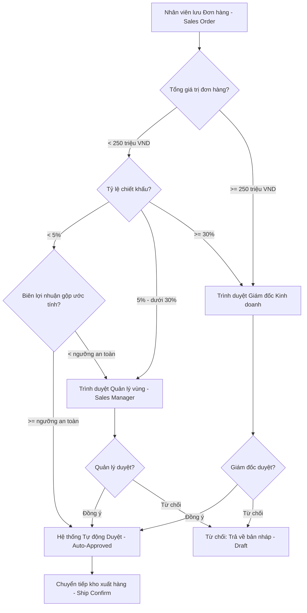

# 4020 Thiết lập luồng phê duyệt đơn hàng tự động

Trong hoạt động bán hàng, để tăng tính linh hoạt và trao quyền cho đội ngũ kinh doanh mà vẫn đảm bảo an toàn tài chính, doanh nghiệp cần thiết lập các quy tắc phê duyệt tự động. **Luồng phê duyệt đơn hàng (Sales Order Approval Workflow)** giúp phân loại đơn hàng dựa trên các tiêu chí rủi ro (tổng giá trị đơn hàng và tỷ lệ chiết khấu là hai tiêu chí phổ biến nhất; biên lợi nhuận sản phẩm có thể được bổ sung như một điều kiện nâng cao) để tự động hóa việc duyệt nhanh các đơn hàng an toàn, đồng thời định tuyến chính xác các đơn hàng vượt khung đến đúng cấp quản lý có thẩm quyền phê duyệt [4020].

---

## 1. Tình huống Nghiệp vụ & "Điểm đau" thực tế

Khi thiếu một công cụ định tuyến phê duyệt tự động trên hệ thống ERP, doanh nghiệp thường gặp các điểm nghẽn lớn:

*   **Trì trệ cơ hội bán hàng do phê duyệt thủ công (Approval Bottleneck):** Mọi đơn hàng dù lớn hay nhỏ đều phải chờ Giám đốc kinh doanh hoặc Kế toán trưởng ký duyệt bằng giấy hoặc duyệt thủ công qua email. Khi người quản lý đi công tác hoặc quá tải lịch làm việc, hàng trăm đơn hàng bị nghẽn lại trên hệ thống, làm chậm tiến độ giao hàng cho khách.
*   **Không kiểm soát được biên lợi nhuận ròng:** Nhân viên bán hàng áp dụng mức chiết khấu cao vượt khung cho phép hoặc bán dưới giá vốn (do áp dụng chồng chéo các chương trình khuyến mãi) mà không bị hệ thống chặn lại [2020, 2030]. Đơn hàng vẫn được xuất kho và giao đi, doanh nghiệp chỉ phát hiện ra sai sót sau khi kế toán chạy báo cáo giá thành cuối kỳ.
*   **Rủi ro "lọt lưới" với chiết khấu cao nhưng giá trị đơn hàng nhỏ:** Nếu hệ thống chỉ xét điều kiện theo tổng giá trị đơn hàng, một đơn hàng nhỏ nhưng chiết khấu gần như cho không (ví dụ 80-90%) vẫn có thể trôi qua như đơn hàng an toàn, trong khi bản chất đây là rủi ro tài chính đáng kể cần cấp quản lý cao hơn xem xét.

---

## 2. Bản đồ Thiết kế & Ánh xạ Cơ sở dữ liệu

Dưới đây là bảng đối chiếu cấu trúc lưu trữ và điều khiển luồng phê duyệt đơn hàng giữa các hệ thống ERP:

| Thực thể nghiệp vụ | Oracle EBS R12 (Tables) | Epicor ERP (Tables) | SAP S/4HANA (Tables) | Odoo (Tables) |
| :--- | :--- | :--- | :--- | :--- |
| **Trạng thái phê duyệt**<br/>*(Approval Status)* | **`OE_ORDER_HEADERS_ALL`**<br/>(Cột `FLOW_STATUS_CODE`, `BOOKED_FLAG`) | **`Erp.OrderHed`**<br/>(Cột `Approved` = 1/0) | **`VBUK`** / **`VBAK`**<br/>(Bảng trạng thái đối tượng) | **`sale_order`**<br/>(Cột `state` = 'sale') |
| **Bản ghi giữ/chặn đơn**<br/>*(Hold / Block Record)* | **`OE_HOLD_DEFINITIONS`**<br/>**`OE_ORDER_HOLDS_ALL`** | **`Erp.OrderHold`**<br/>(Bảng ghi vết khóa đơn) | **`JEST`**<br/>(Bảng trạng thái cá biệt) | **`approval.request`**<br/>(Bảng yêu cầu duyệt) |
| **Động cơ định tuyến**<br/>*(Workflow Engine)* | **`AME_RULES`** /<br/>Oracle Workflow Builder | **Method Directives**<br/>(BPM Rules Engine) | **Flexible Workflow** /<br/>Status Profiles | **`approval.rule`**<br/>(Automated Actions) |

> **Lưu ý:** Tên bảng vật lý ở trên là tên cấu trúc dữ liệu chuẩn của từng hệ thống. Trong triển khai thực tế, tên bảng/cột có thể khác đôi chút tùy phiên bản (ví dụ Epicor 10 vs Kinetic) hoặc tùy mức độ tùy biến (customization) của từng doanh nghiệp — nên đối chiếu lại với data dictionary của môi trường đang chạy trước khi viết SQL sản xuất.

---

## 3. Sơ đồ Định tuyến Phê duyệt đa tầng (Multi-tier Approval Routing)

Sơ đồ dưới đây mô tả cách hệ thống tự động đánh giá các điều kiện của đơn hàng để đưa ra quyết định duyệt thẳng hoặc định tuyến phê duyệt qua các cấp quản lý. Ngoài điều kiện theo giá trị đơn hàng, sơ đồ bổ sung một nhánh kiểm tra chiết khấu tuyệt đối để tránh bỏ lọt các đơn hàng nhỏ nhưng chiết khấu quá cao:



**Điểm khác biệt so với thiết kế đơn giản chỉ có 2 tiêu chí:**
*   Nhánh `>= 30%` chiết khấu luôn bị đẩy thẳng lên Giám đốc dù đơn hàng có giá trị tuyệt đối nhỏ, vì mức chiết khấu này thường đồng nghĩa với bán gần/dưới giá vốn.
*   Nhánh biên lợi nhuận gộp (Gross Margin) chỉ được kiểm tra khi đơn hàng đã "lọt" qua điều kiện giá trị và chiết khấu ở mức an toàn, đóng vai trò như một lớp kiểm tra thứ hai — khớp với mô tả tích hợp COST ở mục 7.

---

## 4. Quy trình cấu hình thực tế trên các ERP lớn

### A. Trên Oracle EBS R12 (Oracle Workflow, AME & Order Holds)
Oracle sử dụng sự kết hợp giữa **AME (Approvals Management Engine)** để xử lý quy tắc phê duyệt và cơ chế **Order Holds** để thực thi việc chặn đơn hàng trên phân hệ OM:
1.  **Thiết lập quy tắc phê duyệt trong AME:**
    *   *Đường dẫn:* `Approvals Management Business Analyst > Rules`.
    *   *Nghiệp vụ:* Khai báo thuộc tính dữ liệu (`Attributes`), ví dụ: `ORDER_AMOUNT`. Định nghĩa các điều kiện (`Conditions`), ví dụ: nếu `ORDER_AMOUNT > 250,000,000 VND`, gán nhóm người phê duyệt (`Approver Group`) là `Director_Group`.
2.  **Thực thi chặn đơn hàng chờ duyệt:**
    *   *Nghiệp vụ:* Khi nhân viên nhấn `Book Order`, workflow kích hoạt AME đánh giá điều kiện; nếu đơn hàng thuộc diện phải duyệt, hệ thống tự động áp một **Order Hold** (định nghĩa sẵn trong `OE_HOLD_DEFINITIONS`, ví dụ hold `APPROVAL_PENDING`) lên đơn hàng và ghi nhận bản ghi giữ đơn trong `OE_ORDER_HOLDS_ALL`. Đơn hàng vẫn ở trạng thái `BOOKED` nhưng bị khóa không cho tiến sang bước Pick Release cho đến khi hold được gỡ (release) bởi người có thẩm quyền [1010].

### B. Trên Epicor ERP (Business Process Management - BPM)
Epicor quản lý phê duyệt đơn hàng thông qua công cụ tùy biến quy trình **BPM (Method Directives)**:
1.  **Thiết lập Method Directive kiểm tra hạn mức chiết khấu:**
    *   *Đường dẫn:* `System Setup > Business Process Management > Method Directives`.
    *   *Nghiệp vụ:* Chọn phương thức `SalesOrder.Update`. Thiết lập điều kiện (Condition): nếu phát hiện đơn hàng có dòng sản phẩm có tỷ lệ chiết khấu vượt quá 10% [2020].
2.  **Tự động khóa đơn hàng (Order Hold):**
    *   *Nghiệp vụ:* Nếu điều kiện trên thỏa mãn, BPM sẽ thực hiện hành động (Action) tự động gán một mã khóa đơn (ví dụ: `DSC` - Discount Hold) vào bảng `Erp.OrderHold`, đồng thời set thuộc tính `Approved = False` trên bảng `Erp.OrderHed` để ngăn không cho kho tiến hành đóng gói hàng [3010, 4010]. Nên xác nhận lại tên cột `Approved` theo đúng phiên bản Epicor đang triển khai (10.x hay Kinetic) trước khi áp dụng vào môi trường sản xuất.

---

## 5. SQL Database Audit Queries (Truy vấn đối soát dữ liệu)

### A. Đối soát các Đơn hàng đang bị giữ (Hold) chờ phê duyệt trên Oracle EBS

Query dưới đây giúp bộ phận kiểm soát nội bộ tra cứu toàn bộ các đơn hàng hiện đang bị áp Order Hold chờ phê duyệt, hiển thị chi tiết thời gian bắt đầu giữ đơn và loại hold:
```sql
--✅ Query 1: Loại bỏ duplicate (1 dòng = 1 hold)
SELECT
    operating_unit_id,
    order_number,
    customer_number,
    customer_name,
    hold_name,       
    creation_date AS hold_applied_date
FROM
    (
        SELECT
            oha.org_id                    AS operating_unit_id,
            oha.order_number              AS order_number,
            oha.header_id,
            hca.account_number            AS customer_number,
            hp.party_name                 AS customer_name,
            ohd.name                      AS hold_name,
            ooh.creation_date             AS creation_date,
            ROW_NUMBER() OVER (PARTITION BY oha.header_id, ohd.hold_id 
                               ORDER BY ooh.creation_date DESC) AS rn
        FROM
            oe_order_headers_all oha
        INNER JOIN
            hz_cust_accounts hca ON oha.sold_to_org_id = hca.cust_account_id
        INNER JOIN
            hz_parties hp ON hca.party_id = hp.party_id
        INNER JOIN
            oe_order_holds_all ooh ON ooh.header_id = oha.header_id
        INNER JOIN
            oe_hold_sources_all ohs ON ooh.hold_source_id = ohs.hold_source_id
        INNER JOIN
            oe_hold_definitions ohd ON ohd.hold_id = ohs.hold_id
        WHERE
            ooh.released_flag = 'N'
    ) sub_query
WHERE
    rn = 1
ORDER BY
    hold_applied_date DESC;

--✅ Query 2: Gom nhóm (1 dòng = 1 đơn hàng + tất cả hold)

SELECT
    oha.org_id                    AS operating_unit_id,
    oha.order_number              AS order_number,
    hca.account_number            AS customer_number,
    hp.party_name                 AS customer_name,
    LISTAGG(ohd.name, ', ') WITHIN GROUP (ORDER BY ohd.name) AS all_holds,
    MIN(ooh.creation_date)        AS first_hold_date, 
    MAX(ooh.creation_date)        AS last_hold_date,
    COUNT(DISTINCT ohd.hold_id)   AS total_hold_types
FROM
    oe_order_headers_all oha
INNER JOIN
    hz_cust_accounts hca ON oha.sold_to_org_id = hca.cust_account_id
INNER JOIN
    hz_parties hp ON hca.party_id = hp.party_id
INNER JOIN
    oe_order_holds_all ooh ON ooh.header_id = oha.header_id
INNER JOIN
    oe_hold_sources_all ohs ON ooh.hold_source_id = ohs.hold_source_id
INNER JOIN
    oe_hold_definitions ohd ON ohd.hold_id = ohs.hold_id
WHERE
    ooh.released_flag = 'N'
GROUP BY
    oha.org_id, oha.header_id, oha.order_number, 
    hca.account_number, hp.party_name
ORDER BY
    MAX(ooh.creation_date) DESC;
```

### B. Tra cứu các Đơn hàng chưa được duyệt bán trên Epicor ERP

Query dưới đây lọc ra toàn bộ các đơn hàng đang hoạt động trên Epicor nhưng chưa được đánh dấu phê duyệt (`Approved = 0`), giúp quản trị viên rà soát các đơn hàng bị nghẽn chưa được giải phóng:

```sql
SELECT
    oh.Company,
    oh.OrderNum                   AS Order_Number,
    oh.OrderDate                  AS Order_Date,
    oh.Approved                   AS Is_Approved, -- Cột Approved thể hiện trạng thái duyệt
    oh.DocOrderAmt                AS Total_Order_Amount,
    c.CustID                      AS Customer_ID,
    c.Name                        AS Customer_Name,
    oh.CreatedBy                  AS Created_By_User
FROM
    Erp.OrderHed oh
INNER JOIN
    Erp.Customer c ON oh.Company = c.Company AND oh.CustNum = c.CustNum
WHERE
    oh.Company = 'YOUR_COMPANY_CODE'
    AND oh.Approved = 0 -- Chỉ lấy đơn hàng chưa được phê duyệt
    AND oh.VoidOrder = 0
ORDER BY
    oh.OrderDate DESC;
```

---

## 6. Nguyên tắc Nghiệp vụ cốt lõi khi Tự xây dựng hoặc Tùy biến Hệ thống (OMS/ERP)

### Nguyên tắc 1: Động cơ cấu hình quy tắc duyệt động (Dynamic Routing Rules Engine)
*   **Yêu cầu thiết kế logic:** Hệ thống tự xây dựng không được phép viết code cứng (Hardcode) luồng phê duyệt của từng phòng ban. Hãy thiết kế một bảng cấu hình luật duyệt động cho phép người dùng định nghĩa các điều kiện ghép nhóm (ví dụ: `Discount > 10%` AND `Margin < 15%`), bao gồm cả các ngưỡng "chặn tuyệt đối" (như mức chiết khấu >= 30% ở mục 3) độc lập với giá trị đơn hàng.
*   **Vận hành:** Khi người dùng nhấn nút duyệt, hệ thống tự động tra cứu bảng quy tắc này để sinh ra các bước phê duyệt tương ứng (Approval Steps) và gửi thông báo theo thời gian thực tới tài khoản của cấp quản lý [4020].

### Nguyên tắc 2: Khóa chỉnh sửa và Hoàn trả quy trình (Edit Lock & Flow Reset)
*   **Yêu cầu thiết kế logic:**
    *   **Khóa dữ liệu:** Khi đơn hàng đang ở trạng thái Chờ duyệt (`PENDING_APPROVAL`), hệ thống phải khóa cứng toàn bộ màn hình đơn hàng (Read-only), không cho phép nhân viên bán hàng thay đổi thông tin số lượng, đơn giá hay mức chiết khấu nhằm tránh gian lận sau khi đã trình duyệt.
    *   **Hoàn trả quy trình:** Nếu đơn hàng bị từ chối phê duyệt (Rejected), hệ thống mở khóa cho phép nhân viên chỉnh sửa lại. Tuy nhiên, ngay khi nhân viên lưu bất kỳ sự thay đổi nào, hệ thống bắt buộc phải đặt lại trạng thái duyệt về từ đầu (Reset Approval Flow) và yêu cầu trình ký duyệt lại từ bước đầu tiên để đảm bảo tính an toàn [4020].

---

## 7. Luồng luân chuyển dữ liệu liên phân hệ (Cross-Module Touchpoints)

*   **Tích hợp phân hệ Kế toán giá thành (FIN-COST):** Đơn hàng có áp dụng mức giá chiết khấu đặc biệt sẽ được hệ thống đối chiếu trực tiếp với dữ liệu giá thành sản phẩm từ phân hệ COST để tính toán biên lợi nhuận gộp ước tính (Gross Margin) thời gian thực — đây chính là nhánh kiểm tra thứ hai trong sơ đồ ở mục 3, và là tham số quyết định để kích hoạt luồng trình duyệt cấp cao nếu lợi nhuận gộp dưới ngưỡng an toàn của doanh nghiệp.
*   **Tích hợp phân hệ Kho (WMS/INV):** Phân hệ Kho chỉ tiếp nhận các yêu cầu soạn hàng xuất kho (Pick Release) từ những đơn hàng đã hoàn tất luồng phê duyệt — tức đã được gỡ Hold (Oracle EBS) hoặc đã có `Approved = True` (Epicor) trên hệ thống [1010].

---

<div align="center" style={{color: 'var(--ifm-color-primary)'}}>
  <strong>Chúc các bạn thành công và vui vẻ!</strong>
</div>