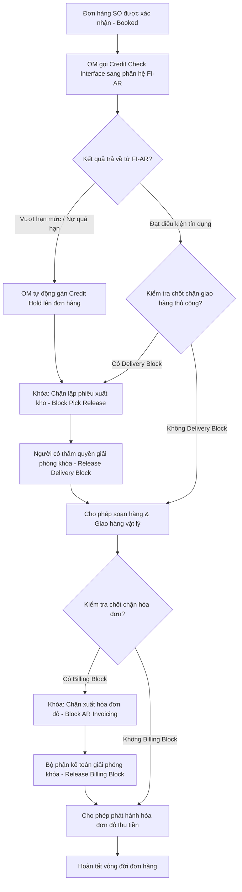

# 4030 Cơ chế kiểm tra tín dụng và chặn giao/xuất hóa đơn

Khi đơn hàng bán hàng (Sales Order) đã được khởi tạo thành công trên hệ thống, việc kiểm soát rủi ro tài chính và vận hành vẫn tiếp diễn dọc theo chu kỳ thực thi đơn hàng. Bài viết này tiếp cận vấn đề **từ góc độ phân hệ OM (Order Management/SD)**: OM không sở hữu và không tính toán hạn mức tín dụng hay công nợ khách hàng — đó là dữ liệu chủ của phân hệ **Tài chính công nợ (FI-AR)**. Vai trò của OM là **gọi kiểm tra tín dụng (Credit Check Interface)** tại các mốc thực thi quan trọng, tiếp nhận kết quả trả về, rồi tự thực thi hai chốt chặn thuộc quyền sở hữu của chính mình: **Chặn giao hàng (Delivery Block / Hold)** và **Chặn xuất hóa đơn (Billing Block / Hold)** [4030]. Việc phân tách rõ ràng hai cơ chế chặn này giúp bộ phận Tín dụng và bộ phận Kinh doanh kiểm soát chính xác từng điểm chạm thực thi của đơn hàng tùy theo trạng thái thanh toán và uy tín của khách hàng [2010, 4030].

---

## 1. Tình huống Nghiệp vụ & "Điểm đau" thực tế

Trong vận hành doanh nghiệp, việc gộp chung các cơ chế chặn giao dịch thành một trạng thái "Khóa đơn" duy nhất, hoặc để OM tự ý xử lý luôn nghiệp vụ tín dụng, thường gây ra các bất tiện lớn:

*   **Xuất nhầm hàng chưa được phê duyệt kỹ thuật:** Đơn hàng gặp lỗi cấu hình kỹ thuật hoặc chưa hoàn tất đàm phán hợp đồng thương mại [3040, 3050]. Tuy nhiên, do không có chốt chặn giao hàng chuyên biệt, thủ kho vẫn tiến hành soạn hàng và giao đi, dẫn đến việc khách hàng trả lại hàng lỗi, gây phát sinh chi phí logistics hai đầu [1010].
*   **Xuất hóa đơn sai đơn giá thực tế:** Đối với các mặt hàng có giá biến động theo chất lượng thực tế sau khi giao nhận (ví dụ: nông sản, thủy hải sản cần test độ ẩm hoặc tỷ lệ hao hụt), doanh nghiệp bắt buộc phải giao hàng đi trước, sau đó mới đối soát chất lượng để chốt giá bán cuối cùng. Nếu hệ thống tự động xuất hóa đơn đỏ (AR Invoice) ngay khi xuất kho mà không có chốt chặn hóa đơn, kế toán sẽ phải làm thủ tục hủy hóa đơn và phát hành lại rất phức tạp [1010].
*   **OM "tự quyết" thay vì tham chiếu FI-AR:** Nếu đội triển khai để logic tính công nợ/hạn mức nằm rải rác trong custom code của OM (thay vì gọi sang FI-AR), mọi thay đổi chính sách tín dụng (ân hạn, hạn mức theo nhóm khách hàng...) đều phải sửa code ở tầng OM, dữ liệu công nợ dễ bị lệch so với sổ cái kế toán vì không cùng một nguồn sự thật (single source of truth).

---

## 2. Bản đồ Thiết kế & Ánh xạ Cơ sở dữ liệu (trong phạm vi OM)

Dưới đây là bảng đối chiếu các bảng **do OM/SD sở hữu**, dùng để lưu trạng thái chặn giao dịch (Holds/Blocks) trên đơn hàng:

| Thực thể nghiệp vụ (OM sở hữu) | SAP S/4HANA (Tables) | Oracle EBS R12 (Tables) | Epicor ERP (Tables) | Odoo (Tables) |
| :--- | :--- | :--- | :--- | :--- |
| **Chặn giao hàng**<br/>*(Delivery Block)* | **`VBAK`** (Cột `LIFSK` - Header)<br/>**`VBAP`** (Cột `LIFSK` - Line) | **`OE_ORDER_HOLDS_ALL`**<br/>(Chặn Activity `PICK_RELEASE`) | **`Erp.OrderHed`** (Cột `OrderHeld`) / `Erp.OrderHold` | Field boolean tùy biến trên **`stock.picking`**<br/>(qua Automated Actions) |
| **Chặn xuất hóa đơn**<br/>*(Billing Block)* | **`VBAK`** (Cột `FAKSK` - Header)<br/>**`VBAP`** (Cột `FAKSK` - Line) | **`OE_ORDER_HOLDS_ALL`**<br/>(Chặn Activity `INVOICING`) | **`Erp.OrderHed`** (Cột `OrderHeld`) / `Erp.OrderHold` | Field boolean tùy biến trên **`sale.order`**<br/>(qua Automated Actions) |
| **Cờ kết quả kiểm tra tín dụng**<br/>*(Credit Hold Flag — OM chỉ lưu kết quả, không tính toán)* | **`VBAK`** (Cột `CMGST` - Status khối tín dụng) | **`OE_ORDER_HOLDS_ALL`**<br/>(Hold loại `CREDIT`, do Credit Check API set) | **`Erp.OrderHed`** (Cột `CreditHold`) | Field boolean tùy biến, set bởi Automated Action đọc dữ liệu công nợ |
| **Bảng danh mục Khóa**<br/>*(Hold/Block Master — OM sở hữu)* | **`TVLS`** (Delivery Block Reasons)<br/>**`TVFS`** (Billing Block Reasons) | **`OE_HOLD_DEFINITIONS`**<br/>(Định nghĩa luồng chặn) | **`Erp.HoldCd`**<br/>(Mã lý do khóa đơn) | Không có bảng chuẩn sẵn có; cần tự định nghĩa qua field lựa chọn (Selection) hoặc module tùy biến |

> **Ranh giới phạm vi:** Các bảng chứa **hạn mức tín dụng** và **công nợ hiện tại** của khách hàng (ví dụ `KNKK`, `S066` bên SAP; hồ sơ tín dụng khách hàng trong Receivables bên Oracle EBS; `Erp.Customer.CreditLimit` bên Epicor) **không thuộc phạm vi bài này** vì đó là dữ liệu chủ do phân hệ **FI-AR (Kế toán công nợ)** quản lý. OM chỉ đọc kết quả kiểm tra (pass/fail) trả về từ phân hệ đó để quyết định có gán `Credit Hold` lên đơn hàng của mình hay không.

---

## 3. Sơ đồ Hoạt động của Chốt chặn Giao hàng và Chốt chặn Hóa đơn

Sơ đồ dưới đây mô tả luồng xử lý đứng từ góc độ OM: bước đầu tiên là **gọi sang FI-AR** để lấy kết quả kiểm tra tín dụng (OM không tự tính), sau đó mới thực thi hai chốt chặn thuộc quyền sở hữu của OM:



**Lưu ý về ranh giới trong sơ đồ:** Nhánh `Call_Credit --> Result` là một **lời gọi liên phân hệ (cross-module call)** — logic bên trong hộp thoại "Kết quả trả về từ FI-AR" (so sánh hạn mức, tính công nợ, áp dụng ân hạn...) không thuộc phạm vi OM và không được trình bày chi tiết ở đây; xem thêm bài viết chuyên đề về Credit Management thuộc phân hệ FI-AR. OM chỉ có trách nhiệm nhận cờ kết quả và thực thi hành vi chặn.

---

## 4. Quy trình cấu hình thực tế trên các ERP lớn (giới hạn trong phạm vi OM/SD)

### A. Trên Oracle EBS R12 (Order Holds & Credit Check Interface)
Oracle sử dụng hệ thống **Holds** cực kỳ linh hoạt để chặn bất kỳ bước nào trong Workflow của đơn hàng. Phần cấu hình dưới đây thuộc quyền của OM; hồ sơ hạn mức tín dụng khách hàng (Customer Credit Profile) được cấu hình riêng trong phân hệ Receivables và không thuộc phạm vi bài này.

1.  **Định nghĩa mã Khóa chặn giao hàng (Delivery Hold):**
    *   *Đường dẫn:* `Order Management Super User > Setup > Orders > Holds`.
    *   *Nghiệp vụ:* Tạo mới một Hold định nghĩa (`OE_HOLD_DEFINITIONS`). Tại trường `Workflow Item Type` chọn `OM Order Line`, tại trường `Workflow Activity` chọn `Pick Release`. Khi đơn hàng bị gán mã này, thủ kho không thể tạo chỉ thị soạn hàng.
2.  **Định nghĩa mã Khóa chặn hóa đơn (Billing Hold):**
    *   *Nghiệp vụ:* Tạo mới một Hold định nghĩa, tại trường `Workflow Activity` chọn `Invoice Interface`. Khi đơn hàng bị gán mã này, hàng hóa vẫn được xuất kho bình thường nhưng hệ thống chặn không cho truyền dữ liệu sang phân hệ AR để kế toán lập hóa đơn thu tiền [1010].
3.  **Tiếp nhận kết quả Credit Check từ Receivables:**
    *   *Nghiệp vụ:* OM gọi Credit Check API tại bước `Book Order`/`Pick Release` (tùy cấu hình điểm kiểm tra). Nếu kết quả trả về là "Fail", OM tự động áp một Hold loại `CREDIT` (định nghĩa sẵn trong `OE_HOLD_DEFINITIONS`) lên đơn hàng, ghi nhận trong `OE_ORDER_HOLDS_ALL` — về bản chất đây vẫn là một bản ghi Hold như hai mục trên, chỉ khác nguồn kích hoạt là tự động từ FI-AR thay vì gán thủ công.

### B. Trên Epicor ERP (General Order Holds & Credit Hold)
Epicor quản lý chốt chặn thông qua trạng thái **Hold** kết hợp mã lý do **Hold Code**. Dữ liệu `CreditLimit` của khách hàng thuộc bảng `Erp.Customer` (dữ liệu chủ khách hàng/AR), OM chỉ đọc để so sánh với công nợ hiện tại rồi set cờ trên đơn hàng của chính mình.

1.  **Định nghĩa mã lý do khóa đơn (Hold Code):**
    *   *Đường dẫn:* `Sales Management > Order Management > Setup > Hold Code` [1030].
    *   *Nghiệp vụ:* Tạo mới mã lý do khóa đơn (ví dụ: `TCH` - Lỗi kỹ thuật sản xuất, `FIN` - Chờ kế toán đối soát đặt cọc). Cấu hình thuộc tính cho phép chặn bước xuất kho hoặc chặn bước thanh toán tương ứng.
2.  **Kích hoạt chặn thủ công trên đơn hàng:**
    *   *Nghiệp vụ:* Tại màn hình `Order Entry`, nhân viên chọn mã lý do khóa đơn. Hệ thống tự động thiết lập trạng thái `OrderHeld = 1` trên bảng `OrderHed` và khóa cứng các hoạt động xuất kho (`Shipment Entry`) của đơn hàng này cho đến khi thủ công nhấn nút `Release` [3010, 4010].
3.  **Cờ Credit Hold tự động:**
    *   *Nghiệp vụ:* BPM (Method Directive trên `SalesOrder.Update`) đọc giá trị `Customer.CreditLimit` và tổng công nợ hiện tại của khách hàng, nếu vượt ngưỡng thì tự động set `OrderHed.CreditHold = 1`. Việc tính toán "công nợ hiện tại" (Outstanding Balance) là dữ liệu tổng hợp từ AR, OM chỉ tiêu thụ kết quả này chứ không tự tính lại logic kế toán.

### C. Trên SAP S/4HANA — phần cấu hình thuộc SD (không đi vào Credit Management/FI-AR)
Trong SAP, việc kiểm tra tín dụng thuộc **Credit Management** (FSCM hoặc FI-AR classic), nhưng **điểm kích hoạt kiểm tra và cách áp block lại nằm trong cấu hình SD** — đây mới là phần thuộc phạm vi OM:

1.  **Gán loại kiểm tra tín dụng vào chứng từ bán hàng:**
    *   *Đường dẫn:* Cấu hình `Sales Document Type` (transaction `VOV8`), gán `Credit Limit Check` phù hợp (ví dụ: kiểm tra động - Dynamic Check) cho từng loại đơn hàng.
    *   *Nghiệp vụ:* Đây là bước OM quyết định *khi nào* cần gọi kiểm tra (ví dụ: lúc tạo Sales Order, lúc tạo Delivery, hoặc cả hai), không phải bước tính hạn mức.
2.  **Kết quả trả về set cột `CMGST` trên `VBAK`:**
    *   *Nghiệp vụ:* Nếu Credit Management trả kết quả "Blocked", SD tự động cập nhật cột `CMGST` (Credit status of document) trên `VBAK`, đồng thời hệ thống có thể tự set thêm `LIFSK`/`FAKSK` tùy cấu hình Credit Group, ngăn không cho tạo Delivery/Billing cho đến khi bộ phận tín dụng giải phóng (thường qua giao dịch `VKM3`/`VKM4` — các giao dịch này thuộc quy trình xử lý của người phụ trách tín dụng, không phải cấu hình OM).

---

## 5. SQL Database Audit Queries (Truy vấn đối soát dữ liệu, trong phạm vi bảng OM)

### A. Đối soát các Đơn hàng đang bị khóa chặn giao dịch trên Oracle EBS

Query dưới đây giúp bộ phận kiểm soát nội bộ và quản trị hệ thống rà soát toàn bộ các đơn hàng hiện đang bị khóa giao dịch trong phạm vi bảng OM, phân loại rõ hoạt động bị chặn (Shipping vs Invoicing vs Credit) kèm thông tin tài khoản người/nguồn áp dụng khóa:

```sql
-- Kiểm tra có dữ liệu hold nào không (bỏ qua điều kiện)
SELECT COUNT(*) AS total_holds_any_status
FROM oe_order_holds_all oh
WHERE oh.header_id IS NOT NULL;

-- Kiểm tra có hold nào đang active (released_flag = 'N') không
SELECT COUNT(*) AS active_holds
FROM oe_order_holds_all oh
WHERE oh.released_flag = 'N';
-- Xem hold từ năm nào
SELECT
    EXTRACT(YEAR FROM oha.creation_date) AS order_year,
    COUNT(*) AS hold_count
FROM
    oe_order_headers_all oha
INNER JOIN
    oe_order_holds_all oh ON oha.header_id = oh.header_id
WHERE
    oh.released_flag = 'N'
GROUP BY
    EXTRACT(YEAR FROM oha.creation_date)
ORDER BY
    order_year DESC;
--Xem toàn bộ hold đang active
SELECT
    oha.org_id                    AS operating_unit_id,
    oha.order_number              AS order_number,
    ohd.name                      AS hold_name,
    ohd.description               AS hold_description,
    ohd.activity_name             AS blocked_activity_type, -- PICK_RELEASE, INVOICING hoặc CREDIT
    oh.creation_date              AS hold_applied_date,
    fu.user_name                  AS applied_by_user
FROM
    oe_order_headers_all oha
INNER JOIN
    oe_order_holds_all oh ON oha.header_id = oh.header_id
INNER JOIN
    oe_hold_sources_all ohs ON oh.hold_source_id = ohs.hold_source_id
INNER JOIN
    oe_hold_definitions ohd ON ohs.hold_id = ohd.hold_id
INNER JOIN
    fnd_user fu ON oh.created_by = fu.user_id
WHERE
    oh.released_flag = 'N' -- Chỉ lấy các khóa đang có hiệu lực hoạt động
--    AND oha.ordered_date >= TO_DATE('2020-01-01', 'YYYY-MM-DD')
ORDER BY
    oh.creation_date DESC;
```

*Ghi chú:* Khi `activity_name = 'CREDIT'`, đây là hold do OM tự động gán dựa trên kết quả từ Receivables — nếu cần biết chi tiết vì sao khách hàng bị từ chối tín dụng (hạn mức bao nhiêu, công nợ hiện tại bao nhiêu), cần truy vấn tiếp sang các bảng của Receivables, nằm ngoài phạm vi bảng OM nêu trên.

### B. Tra cứu các đơn hàng bị khóa giao nhận / xuất hóa đơn trên Epicor ERP

Query dưới đây lọc ra toàn bộ đơn hàng Epicor đang bị gán trạng thái khóa tín dụng (`CreditHold`) hoặc khóa nghiệp vụ vận hành (`OrderHeld`) trên chính bảng đơn hàng của OM, hỗ trợ rà soát tắc nghẽn giao dịch bán hàng:

```sql
SELECT
    oh.Company,
    oh.OrderNum                   AS Order_Number,
    oh.OrderDate                  AS Order_Date,
    oh.CreditHold                 AS Is_Credit_Held, -- Cờ do OM set dựa trên kết quả đối chiếu AR
    oh.OrderHeld                  AS Is_General_Held, -- Khóa nghiệp vụ vận hành, gán thủ công
    c.CustID                      AS Customer_ID,
    c.Name                        AS Customer_Name,
    oh.DocOrderAmt                AS Order_Amount
FROM
    Erp.OrderHed oh
INNER JOIN
    Erp.Customer c ON oh.Company = c.Company AND oh.CustNum = c.CustNum
WHERE
    oh.Company = 'YOUR_COMPANY_CODE'
    AND (oh.CreditHold = 1 OR oh.OrderHeld = 1) -- Chỉ lấy đơn hàng đang bị khóa
    AND oh.VoidOrder = 0
ORDER BY
    oh.OrderDate DESC;
```

*Ghi chú:* Cột `c.CreditLimit` (nếu cần đối soát ngược hạn mức) thuộc bảng chủ khách hàng, có thể join thêm để tham khảo nhanh, nhưng việc tính "Outstanding Balance" chính xác cần lấy từ báo cáo công nợ AR, không nên tính lại trong truy vấn phạm vi OM này.

---

## 6. Nguyên tắc Nghiệp vụ cốt lõi khi Tự xây dựng hoặc Tùy biến Hệ thống (OMS/ERP)

### Nguyên tắc 1: Thiết kế hai chốt chặn trạng thái độc lập, thuộc sở hữu của OM (Independent Block Checkpoints)
*   **Yêu cầu thiết kế logic:** Hệ thống tự xây dựng không được gộp chung trạng thái khóa. Hãy thiết kế hai trường cờ (Flags) độc lập trên bảng đơn hàng — thuộc bảng do OM sở hữu: `delivery_blocked` và `billing_blocked`. Một cờ thứ ba `credit_blocked` cũng nên nằm trên bảng đơn hàng của OM, nhưng giá trị của nó **chỉ được set thông qua kết quả trả về từ service/API của FI-AR**, không tính toán trực tiếp trong OM.
*   **Vận hành:**
    *   Nếu `delivery_blocked = true`, API tạo phiếu xuất kho bắt buộc phải từ chối xử lý đơn hàng [1010].
    *   Nếu `billing_blocked = true` (bao gồm cả trường hợp do `credit_blocked` kích hoạt), phân hệ xuất kho vẫn thực hiện xuất kho bình thường (nếu không có delivery block), nhưng API phát hành hóa đơn tài chính phải bỏ qua đơn hàng này cho đến khi cờ được gỡ về `false` [1010].

### Nguyên tắc 2: Cơ chế thừa kế khóa từ Header xuống Line (Header-to-Line Inheritance)
*   **Yêu cầu thiết kế logic:** Khi một chốt chặn (Delivery, Billing hoặc Credit Block) được gán trên đầu đơn hàng (Header), hệ thống phải tự động áp dụng (Inherit) trạng thái khóa này xuống toàn bộ các dòng sản phẩm chi tiết (Lines) hiện có và các dòng được tạo mới sau đó.
*   **Thẩm quyền giải phóng:** Hệ thống cho phép người dùng có thẩm quyền giải phóng khóa đơn lẻ trên từng dòng sản phẩm (Line Release) để cho phép giao hàng trước một phần, trong khi các dòng còn lại vẫn giữ nguyên trạng thái khóa ban đầu để kiểm soát rủi ro. Riêng với `credit_blocked`, thẩm quyền giải phóng nên được giới hạn cho vai trò thuộc bộ phận Tín dụng/Kế toán công nợ, không giao cho nhân viên bán hàng hoặc thủ kho.

---

## 7. Luồng luân chuyển dữ liệu liên phân hệ (Cross-Module Touchpoints)

*   **Tham chiếu phân hệ Tài chính công nợ (FI-AR):** OM **không sở hữu và không tính toán** hạn mức tín dụng (Credit Limit) hay công nợ hiện tại (Outstanding AR Balance) của khách hàng — đây là dữ liệu chủ và nghiệp vụ thuộc phân hệ FI-AR. OM chỉ gọi Credit Check Interface tại các mốc thực thi (Book Order, Pick Release, Create Delivery...), tiếp nhận kết quả pass/fail, rồi tự thực thi việc gán `credit_blocked` trên chính bảng đơn hàng của mình. Chi tiết cách phân hệ FI-AR tính toán hạn mức và công nợ nằm ngoài phạm vi bài này.
*   **Tích hợp phân hệ Kho (WMS/INV):** Chốt chặn giao hàng (`Delivery Block`) là ranh giới kiểm soát an toàn của phân hệ bán hàng. Phân hệ Kho bắt buộc phải chặn việc chuẩn bị hàng (Picking/Packing) đối với bất kỳ đơn hàng nào có cờ chặn giao hàng đang hoạt động [1010].
*   **Tích hợp phân hệ Kế toán công nợ (FIN-AR) — chiều xuất hóa đơn:** Chốt chặn hóa đơn (`Billing Block`) ngăn không cho đơn hàng hoàn tất luồng hạch toán công nợ. Đây là điểm mấu chốt để kế toán quản lý rủi ro xuất hóa đơn sai khi chưa hoàn tất đối soát chất lượng hàng giao thực tế hoặc chưa nhận đủ tiền tạm ứng của khách [1010].

---

<div align="center" style={{color: 'var(--ifm-color-primary)'}}>
  <strong>Chúc các bạn thành công và vui vẻ!</strong>
</div>
