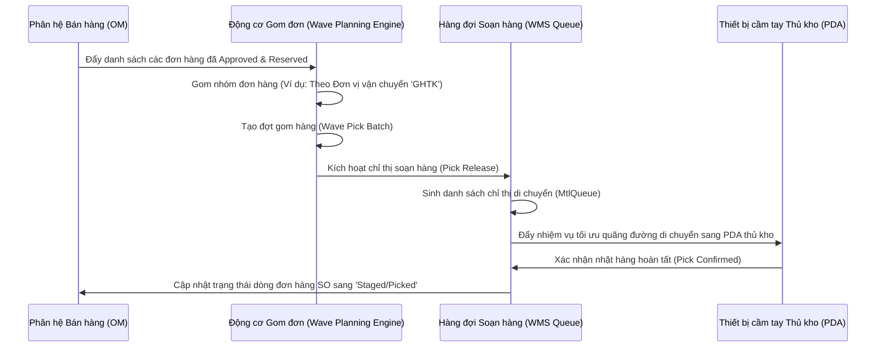

# 5000 Chỉ thị chuẩn bị hàng, gom đơn và phân vùng đóng gói

Khi đơn hàng bán hàng (Sales Order) hoàn tất các bước phê duyệt thương mại, kiểm tra tín dụng và phân bổ tồn kho [4010, 4020, 4030], quy trình bán hàng chuyển giao sang giai đoạn thực thi logistics. **Chỉ thị chuẩn bị hàng** (mỗi hệ thống gọi theo tên riêng: Oracle EBS gọi là *Pick Release*, Epicor gọi là *Release for Picking*, SAP tách thành *Delivery → Picking*, Odoo gọi là *Batch/Wave Transfer*) và **Lập kế hoạch gom đơn theo đợt (Wave/Batch Planning)** là điểm chạm tích hợp cốt lõi giữa phân hệ OM và phân hệ Quản lý kho (WMS). Đây là quy trình gom nhóm các đơn hàng một cách khoa học để tối ưu hóa quãng đường di chuyển của thủ kho, đẩy nhanh tốc độ đóng gói và chuẩn bị giao hàng cho khách [5000].

---

## 1. Tình huống Nghiệp vụ & "Điểm đau" thực tế

Nếu doanh nghiệp đẩy đơn hàng xuống kho một cách rời rạc và thiếu kế hoạch, bộ phận vận hành kho sẽ đối mặt với các tổn thất lớn về chi phí:

*   **Lãng phí quãng đường di chuyển trong kho (Sử dụng Pick đơn lẻ):** Một thủ kho cầm một phiếu xuất hàng đi nhặt 1 sản phẩm ở đầu kho, đóng gói rồi quay lại. 5 phút sau, họ lại cầm một phiếu xuất của đơn hàng khác đi lấy đúng sản phẩm đó ở vị trí cũ. Việc nhặt hàng đơn lẻ (Single-order Picking) này khiến thủ kho kiệt sức vì di chuyển liên tục nhưng năng suất xuất hàng cực kỳ thấp.
*   **Trì trệ khu vực đóng gói do nghẽn cổ chai:** Kho xuất hàng cho các đơn vị vận chuyển khác nhau (ví dụ: bưu tá Shopee Express, xe tải giao sỉ đại lý, bưu tá GHTK) vào cùng một thời điểm mà không phân loại. Hàng hóa chất đống tại khu vực đóng gói (Packing Zone), gây nhầm lẫn nhãn dán giao hàng (Shipping Label) và trễ giờ lấy hàng của các hãng vận chuyển.

---

## 2. Bản đồ Thiết kế & Ánh xạ Cơ sở dữ liệu

Dưới đây là bảng đối chiếu cấu trúc lưu trữ chỉ thị chuẩn bị hàng và đợt gom đơn (Pick Batches/Waves) giữa các hệ thống ERP:

| Thực thể nghiệp vụ | Oracle EBS R12 (Tables) | Epicor ERP (Tables) | SAP S/4HANA (Tables) | Odoo (Tables) |
| :--- | :--- | :--- | :--- | :--- |
| **Đợt gom đơn**<br/>*(Pick Wave / Batch)* | **`WSH_PICKING_BATCHES`**<br/>(Thông tin đợt Pick Release) | Sử dụng **Allocation Template** để gom lô | **`/SCWM/WAVE`**<br/>(Wave Header — chỉ có trong EWM; LE-WM cổ điển không có khái niệm Wave native) | **`stock.picking.batch`**<br/>(Batch / Wave Transfers) |
| **Dòng chỉ thị soạn hàng**<br/>*(Pick/Material Line)* | **`WSH_DELIVERY_DETAILS`**<br/>(Cột `RELEASED_STATUS` = 'S') | **`Erp.MtlQueue`**<br/>(Hàng đợi nhặt hàng) | **`LIPS`**<br/>(Delivery Item Data) | **`stock.move.line`**<br/>(Dòng dịch chuyển thực tế) |
| **Yêu cầu Giao hàng**<br/>*(Outbound Delivery)* | **`WSH_NEW_DELIVERIES`**<br/>(Chứng từ giao nhận gốc) | **`Erp.ShipHead`** / **`ShipDtl`**<br/>(Phiếu giao hàng đại diện) | **`LIKP`**<br/>(Delivery Header Data) | **`stock.picking`**<br/>(Phiếu xuất kho) |

> **Lưu ý về SAP:** Khái niệm "Wave" trong SAP chỉ tồn tại native ở **EWM** (Extended Warehouse Management, bảng `/SCWM/WAVE`, `/SCWM/WAVE_ITM`). Nếu doanh nghiệp dùng LE-WM (Warehouse Management cổ điển) hoặc chỉ dùng luồng Delivery/Picking đơn giản không qua WM, việc gom đợt thường được xử lý thủ công qua danh sách Outbound Delivery (`LIKP`/`LIPS`) được lọc theo route/shipping point, không có bảng Wave riêng. Nên xác định rõ doanh nghiệp đang dùng module WM nào trước khi tham chiếu bảng này.

---

## 3. Sơ đồ luồng Lập kế hoạch gom đơn và Thực thi kho (Wave Planning Workflow)

Sơ đồ dưới đây mô tả cách hệ thống OM phân nhóm (Gom đợt) các đơn hàng SO hợp lệ và chuyển tiếp chỉ thị soạn hàng sang phân hệ Kho (WMS):



---

## 4. Quy trình cấu hình thực tế trên các ERP lớn

*Phần dưới đây trình bày chi tiết cấu hình trên Oracle EBS và Epicor — hai hệ thống đã được triển khai đi sâu trong thực tế. SAP và Odoo đã có mặt ở bảng ánh xạ mục 2 để tham khảo cấu trúc dữ liệu, phần quy trình cấu hình chi tiết của hai hệ thống này sẽ được bổ sung ở các bài cập nhật sau.*

### A. Trên Oracle EBS R12 (Shipping Execution - Pick Release Batch)
Oracle quản lý luồng chuẩn bị hàng cực kỳ mạnh mẽ thông qua phân hệ **Shipping Execution**:
1.  **Thiết lập quy tắc gom đợt (Release Rules):**
    *   *Đường dẫn:* `Order Management > Shipping > Setup > Release Rules`.
    *   *Nghiệp vụ:* Tạo mới quy tắc. Định nghĩa các tiêu chí lọc tự động, ví dụ: Chỉ gom các đơn hàng có kho xuất là `M1` và có phương thức vận chuyển là `Shopee_Express` vào cùng một lô [1010].
2.  **Khởi chạy đợt chuẩn bị hàng (Pick Release Processing):**
    *   *Nghiệp vụ:* Chạy chương trình `Release Sales Orders`. Hệ thống sẽ dựa trên quy tắc đã chọn để tạo một đợt chuẩn bị hàng (`WSH_PICKING_BATCHES`). 
    *   *Xử lý:* Trạng thái dòng giao nhận chuyển từ `Ready to Release` ('R') sang `Released to Warehouse` ('S' - Đã đẩy xuống kho và in phiếu nhặt hàng) [1010].

### B. Trên Epicor ERP (Material Queue & Fulfillment Queue)
Epicor đẩy nhiệm vụ xuống kho thông qua hàng đợi di chuyển vật tư **Material Queue**:
1.  **Kích hoạt luồng chuẩn bị hàng từ Fulfillment Queue:**
    *   *Đường dẫn:* `Material Management > Inventory Management > General Operations > Fulfillment Queue` [1000].
    *   *Nghiệp vụ:* Bộ phận điều phối chọn các dòng đơn hàng cần xuất, chọn hành động `Release for Picking` [4010].
2.  **Đẩy nhiệm vụ xuống Material Queue:**
    *   *Cơ chế:* Hệ thống tự động chuyển đổi yêu cầu bán hàng thành các nhiệm vụ di chuyển vật tư trong bảng **`Erp.MtlQueue`** với loại giao dịch `TransactionType = 'STK-CUS'` (Xuất kho cho khách hàng) [3010]. Thủ kho cầm thiết bị quét mã vạch (PDA) truy cập vào Material Queue để nhận và thực hiện nhiệm vụ nhặt hàng trực quan.

---

## 5. SQL Database Audit Queries (Truy vấn đối soát dữ liệu)

### A. Đối soát các đợt chuẩn bị hàng đang hoạt động trên Oracle EBS

Query dưới đây giúp bộ phận vận hành logistics đối soát xem các đơn hàng thuộc đợt Pick Release nào đã được đẩy xuống kho thành công và đang ở trạng thái nào (`Released to Warehouse` hoặc `Staged/Picked`):

```sql
SELECT 
    wpb.batch_name                AS pick_release_batch,
    wnd.delivery_id               AS delivery_id,
    oha.order_number              AS order_number,
    oel.line_number               AS line_number,
    msib.segment1                 AS item_code,
    wdd.requested_quantity        AS requested_qty,
    wdd.released_status           AS delivery_line_status -- 'S' = Released to Warehouse, 'Y' = Staged/Picked
FROM 
    wsh_picking_batches wpb
INNER JOIN 
    wsh_delivery_details wdd ON wpb.batch_id = wdd.batch_id
INNER JOIN 
    oe_order_lines_all oel ON wdd.source_line_id = oel.line_id
INNER JOIN 
    oe_order_headers_all oha ON oel.header_id = oha.header_id
INNER JOIN 
    oe_system_parameters_all osp ON oha.org_id = osp.org_id
INNER JOIN 
    mtl_system_items_b msib ON wdd.inventory_item_id = msib.inventory_item_id 
                            AND osp.master_organization_id = msib.organization_id
LEFT JOIN 
    wsh_delivery_assignments wda ON wdd.delivery_detail_id = wda.delivery_detail_id
LEFT JOIN 
    wsh_new_deliveries wnd ON wda.delivery_id = wnd.delivery_id
WHERE 
    wdd.released_status IN ('S', 'Y') -- S: Đã đẩy xuống kho, Y: Đã nhặt hàng xong chờ đóng gói
    AND oha.ordered_date >= TO_DATE('2026-01-01', 'YYYY-MM-DD')
ORDER BY 
    wpb.batch_name, oha.order_number;
```

### B. Tra cứu hàng đợi soạn hàng xuất cho khách (Active Material Queue) trên Epicor ERP

Query dưới đây lọc ra toàn bộ các yêu cầu nhặt hàng xuất cho khách hàng đang nằm trong hàng đợi `MtlQueue` của Epicor, giúp thủ kho kiểm tra công việc chưa hoàn thành:

```sql
SELECT 
    mq.Company,
    mq.MtlQueueNum                AS Queue_Number,
    mq.OrderNum                   AS Sales_Order_Number,
    mq.OrderLine                  AS Line_Number,
    mq.PartNum                    AS Part_Number,
    mq.Quantity                   AS Requested_Quantity,
    mq.FromWarehouseCode          AS Source_Warehouse,
    mq.FromBinNum                 AS Source_Bin,
    mq.ToWarehouseCode            AS Destination_Stage_Warehouse,
    mq.ToBinNum                   AS Destination_Stage_Bin,
    mq.TransactionType            AS Pick_Transaction_Type -- 'STK-CUS' thể hiện xuất kho cho khách
FROM 
    Erp.MtlQueue mq
WHERE 
    mq.Company = 'YOUR_COMPANY_CODE'
    AND mq.TransactionType = 'STK-CUS' -- Chỉ lọc các giao dịch nhặt hàng xuất cho khách
ORDER BY 
    mq.MtlQueueNum;
```

---

## 6. Nguyên tắc Nghiệp vụ cốt lõi khi Tự xây dựng hoặc Tùy biến Hệ thống (OMS/ERP)

### Nguyên tắc 1: Bộ lọc Lập kế hoạch gom đơn theo đợt (Wave Planning Filters)
*   **Yêu cầu thiết kế logic:** Hệ thống tự xây dựng không được đẩy trực tiếp từng đơn hàng lẻ tẻ xuống thiết bị nhặt hàng của thủ kho. Hãy thiết kế một công cụ "Gom đợt" (Wave Generation Tool) cho phép bộ phận điều phối lọc đơn hàng theo các tiêu chí thông minh:
    $$\text{Tổ hợp lọc} = \text{Kho xuất hàng (Warehouse)} + \text{Đơn vị vận chuyển (Carrier)} + \text{Phân khu lưu trữ vật tư (Zone)}$$
    Hệ thống sẽ gom toàn bộ các đơn hàng thỏa mãn điều kiện này vào một mã đợt duy nhất (Wave ID) và sinh ra một **Phiếu nhặt hàng tổng (Group Picking List)** để thủ kho đi nhặt một lần cho nhiều đơn hàng, sau đó mới chia hàng tại khu vực đóng gói [5000].

### Nguyên tắc 2: Khóa biến động thông tin khi đã chạy Pick Release (Release State Lock)
*   **Yêu cầu thiết kế logic:** Ngay khi một dòng đơn hàng SO được kích hoạt chỉ thị soạn hàng (Pick Released), hệ thống tự xây dựng phải lập tức chuyển trạng thái dòng đó sang chế độ khóa cứng (Read-only). 
*   **Mục tiêu:** Tuyệt đối không cho phép nhân viên bán hàng thay đổi số lượng, hủy đơn hàng hoặc sửa đổi thông tin địa chỉ giao hàng khi thủ kho đang trực tiếp di chuyển lấy hàng hoặc đang dán nhãn đóng gói sản phẩm vật lý, tránh tình trạng sai lệch giữa hàng hóa thực tế giao đi và chứng từ trên hệ thống.

---

## 7. Luồng luân chuyển dữ liệu liên phân hệ (Cross-Module Touchpoints)

*   **Tích hợp phân hệ Kho (WMS/INV):** Chỉ thị chuẩn bị hàng đại diện cho sự bàn giao quyền kiểm soát tài sản từ phân hệ bán hàng sang phân hệ quản lý kho [1010]. Quy trình WMS sẽ tiếp nhận chỉ thị này để chạy các thuật toán tối ưu hóa quãng đường di chuyển (Routing Optimization) và phân bổ công việc cho nhân viên quét mã vạch bằng PDA trong kho.
*   **Tích hợp phân hệ Bán hàng (OM):** Kết quả của việc nhặt hàng thành công trong kho (Staged/Picked) là dữ liệu phản hồi thời gian thực để phân hệ OM tự động cập nhật trạng thái đơn hàng sang sẵn sàng đóng gói và bàn giao cho đơn vị vận chuyển [1010].

---

<div align="center" style={{color: 'var(--ifm-color-primary)'}}>
  <strong>Chúc các bạn thành công và vui vẻ!</strong>
</div>
