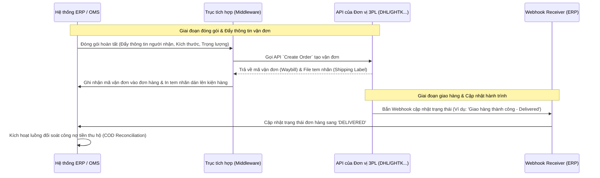

# 5010 Giải pháp kết nối đơn vị vận chuyển thứ ba và theo dõi hành trình

Trong kỷ nguyên thương mại điện tử và bán hàng đa kênh, phần lớn doanh nghiệp không tự vận hành toàn bộ đội xe giao hàng mà hợp tác với các đơn vị vận chuyển thứ ba (3PL - Third-Party Logistics) như DHL, FedEx, Viettel Post, Giao Hàng Tiết Kiệm (GHTK), Shopee Express [3020]. Việc xây dựng giải pháp kết nối tự động (API Integration) giữa phân hệ quản lý đơn hàng (OM) của ERP với hệ thống của đối tác 3PL giúp doanh nghiệp tự động hóa hoàn toàn quy trình đẩy thông tin giao hàng, lấy mã vận đơn (Waybill/Tracking Number) và theo dõi hành trình đơn hàng theo thời gian thực [5010].

---

## 1. Tình huống Nghiệp vụ & "Điểm đau" thực tế

Khi vận hành giao nhận thủ công hoặc hệ thống tích hợp thiếu ổn định, doanh nghiệp thường gặp các điểm nghẽn lớn:

*   **Nhập tay mã vận đơn (Waybill) thủ công:** Khi kho đóng gói xong, nhân viên logistics phải đăng nhập vào cổng thông tin của từng hãng 3PL để gõ tay thông tin người nhận, cân nặng, kích thước để tạo vận đơn. Sau đó, họ phải copy-paste ngược lại mã vận đơn từ website 3PL vào đơn hàng trên ERP để lưu vết. Quy trình thủ công này cực kỳ chậm chạp, dễ gõ sai địa chỉ và không thể đáp ứng được lượng đơn hàng lớn.
*   **Trễ thông tin đối soát COD và giao hàng hỏng:** Doanh nghiệp không biết đơn hàng đã được giao thành công (Delivered) hay bị hoàn trả (Returned) cho đến khi nhận được bảng kê đối soát Excel từ đối tác 3PL vào cuối tháng. Việc chậm trễ thông tin này gây khó khăn cho việc xử lý khiếu nại của khách hàng, làm chậm tiến độ ghi nhận doanh thu và kéo dài chu kỳ xoay vòng vốn (Cash-to-Cash cycle) [1010].

---

## 2. Bản đồ Thiết kế & Ánh xạ Cơ sở dữ liệu

Dưới đây là bảng đối chiếu cấu trúc lưu trữ thông tin giao vận và mã vận đơn 3PL trên các hệ thống ERP:

| Thực thể nghiệp vụ | Oracle EBS R12 (Tables) | Epicor ERP (Tables) | SAP S/4HANA (Tables) | Odoo (Tables) |
| :--- | :--- | :--- | :--- | :--- |
| **Chứng từ Giao hàng**<br/>*(Shipment / Delivery)* | **`WSH_NEW_DELIVERIES`**<br/>(Phiếu giao hàng vật lý) | **`Erp.ShipHead`**<br/>(Bảng đầu phiếu giao hàng) | **`VTTK`**<br/>(Shipment Header) | **`stock.picking`**<br/>(Phiếu xuất kho) |
| **Mã vận đơn 3PL**<br/>*(Waybill / Tracking No)* | **`WSH_NEW_DELIVERIES`**<br/>(Cột `WAYBILL` - Mã vận đơn) | **`Erp.ShipHead`**<br/>(Cột `TrackingNumber`) | **`VTTK`**<br/>(Cột `SIGN` / Custom Field) | **`stock.picking`**<br/>(Cột `carrier_tracking_ref`) |
| **Đơn vị vận chuyển**<br/>*(Carrier / Ship Via)* | **`WSH_CARRIERS`**<br/>(Danh mục đối tác vận chuyển) | **`Erp.ShipVia`**<br/>(Danh mục hãng vận chuyển) | **`TSPT`**<br/>(Shipping Types) | **`delivery.carrier`**<br/>(Danh mục hãng giao hàng) |
| **Dòng hàng giao chi tiết**<br/>*(Shipment Lines)* | **`WSH_DELIVERY_DETAILS`**<br/>(Chi tiết dòng hàng xuất) | **`Erp.ShipDtl`**<br/>(Chi tiết dòng hàng giao) | **`VTTP`**<br/>(Shipment Item) | **`stock.move.line`**<br/>(Chi tiết dòng xuất kho) |

---

## 3. Sơ đồ Kiến trúc tích hợp API và Đồng bộ Hành trình 3PL (API & Tracking Flow)

Sơ đồ trình tự dưới đây mô tả cách hệ thống ERP/OMS giao tiếp với API của đơn vị 3PL để tự động lấy mã vận đơn và cập nhật hành trình giao hàng:



---

## 4. Quy trình cấu hình thực tế trên các ERP lớn

### A. Trên Oracle EBS R12 (Shipping Execution - Carrier & Waybill)
Trong thực tế vận hành hiện tại, Oracle quản lý thông tin giao vận tích hợp trực tiếp trong phân hệ **Shipping Execution**:
1.  **Thiết lập danh mục Đơn vị vận chuyển (Carrier):**
    *   *Đường dẫn:* `Order Management > Shipping > Setup > Carriers`.
    *   *Nghiệp vụ:* Khai báo tên đối tác vận chuyển (ví dụ: `DHL`, `Viettel_Post`). Liên kết đối tác này với các mã phương thức vận chuyển (`Ship Method Codes`).
2.  **Đồng bộ mã vận đơn từ API trung gian:**
    *   *Cơ chế:* Hệ thống Middleware sau khi gọi API của hãng vận chuyển thành công sẽ gọi API chuẩn của Oracle để đẩy mã vận đơn ngược lại vào trường **`WAYBILL`** trên bảng `WSH_NEW_DELIVERIES` [1010]. Hệ thống tự động chuyển đổi trạng thái giao hàng sang `Ship Confirmed`.

### B. Trên Epicor ERP (kinh nghiệm triển khai kết nối hãng vận chuyển)
Theo kinh nghiệm triển khai Epicor trước đây, hệ thống hỗ trợ giải pháp kết nối hãng vận chuyển thông qua các màn hình quản lý xuất kho/giao hàng:
1.  **Cấu hình danh mục hãng vận chuyển (Ship Via):**
    *   *Đường dẫn:* `Material Management > Inventory Management > Setup > Ship Via`.
    *   *Nghiệp vụ:* Tạo mới mã hãng vận chuyển (`ShipViaCode`). Thiết lập các thông số kết nối API của hãng (URL, Token, Carrier Account) để phục vụ tích hợp lấy mã vận đơn tự động [2000].
2.  **Tự động cập nhật Tracking Number:**
    *   *Vận hành:* Khi thủ kho hoàn tất đóng gói và xác nhận cân hàng trên màn hình xuất kho, hệ thống gọi API của hãng vận chuyển để lấy mã vận đơn và ghi trực tiếp vào trường **`TrackingNumber`** trên bảng `Erp.ShipHead` [3010, 5010]. Đồng thời tự động kích hoạt trạng thái sẵn sàng xuất hóa đơn (`ReadyToInvoice = 1`).

---

## 5. SQL Database Audit Queries (Truy vấn đối soát dữ liệu)

### A. Tra cứu các phiếu xuất kho đã được gán mã vận đơn 3PL trên Oracle EBS

Query dưới đây hỗ trợ bộ phận Logistics đối soát các lô hàng đã giao cho đối tác vận chuyển, hiển thị chi tiết mã vận đơn (Waybill) và trọng lượng bưu kiện:

```sql
SELECT DISTINCT
    wdd.org_id                    AS operating_unit_id,
    wnd.delivery_id               AS delivery_id,
    wnd.name                      AS delivery_name,
    wnd.waybill                   AS tracking_number_waybill, -- Mã vận đơn 3PL
    wnd.ship_method_code          AS shipping_method,
    wnd.status_code               AS delivery_status, -- 'CO' = Confirmed
    wnd.confirm_date              AS ship_confirm_date,
    wnd.gross_weight              AS package_gross_weight,
    wnd.weight_uom_code           AS weight_uom
FROM 
    wsh_new_deliveries wnd
JOIN 
    wsh_delivery_assignments wda ON wnd.delivery_id = wda.delivery_id
JOIN 
    wsh_delivery_details wdd ON wda.delivery_detail_id = wdd.delivery_detail_id
WHERE 
    wnd.waybill IS NOT NULL  -- Chỉ lấy các phiếu đã được gán mã vận đơn thành công
    --AND wnd.creation_date >= TO_DATE('2026-01-01', 'YYYY-MM-DD')
ORDER BY 
    wnd.confirm_date DESC;
```

### B. Kiểm tra danh sách phiếu giao hàng đã gán mã Tracking trên Epicor ERP

Query dưới đây lọc ra toàn bộ các phiếu xuất kho đóng gói (`ShipHead`) trên Epicor đã được đồng bộ mã vận đơn từ hãng vận chuyển thông qua tích hợp API:

```sql
SELECT 
    sh.Company,
    sh.PackNum                    AS Shipment_Pack_Num,
    sh.ShipDate                   AS Ship_Date,
    sh.ShipViaCode                AS Ship_Via_Code,
    sv.Description                AS Carrier_Name,
    sh.TrackingNumber             AS Tracking_Waybill_Number, -- Mã vận đơn tracking
    sh.PkgWeight                  AS Package_Weight,
    sh.ShipToNum                  AS Ship_To_Number,
    sh.ReadyToInvoice             AS Ready_To_Invoice
FROM 
    Erp.ShipHead sh
INNER JOIN 
    Erp.ShipVia sv ON sh.Company = sv.Company AND sh.ShipViaCode = sv.ShipViaCode
WHERE 
    sh.Company = 'YOUR_COMPANY_CODE'
    AND sh.TrackingNumber <> '' -- Lọc các phiếu đã được gán mã vận đơn thành công
    AND sh.ShipDate >= '2026-01-01'
ORDER BY 
    sh.ShipDate DESC;
```

---

## 6. Nguyên tắc Nghiệp vụ cốt lõi khi Tự xây dựng hoặc Tùy biến Hệ thống (OMS/ERP)

### Nguyên tắc 1: Luồng gọi API tạo vận đơn bất đồng bộ (Asynchronous Waybill Ingestion)
*   **Yêu cầu thiết kế logic:** Do API của các đơn vị vận chuyển thứ ba (3PL) thường xuyên gặp tình trạng phản hồi chậm hoặc quá tải trong giờ cao điểm, hệ thống tự xây dựng tuyệt đối không được gọi API tạo vận đơn theo thời gian thực (Synchronous) ngay khi thủ kho bấm nút xác nhận đóng gói. 
*   **Vận hành:** Hệ thống phải đưa yêu cầu tạo vận đơn vào một hàng đợi xử lý lỗi (Integration Queue / Background Job). Nếu API của đối tác bị timeout, tiến trình phải tự động thử lại (Retry) với cơ chế giãn cách thời gian (Exponential Backoff) cho đến khi lấy được mã vận đơn thành công, ghi nhận vào trường `tracking_number_snapshot` và tiến hành in tem nhãn giao hàng [3020, 5010].

### Nguyên tắc 2: Động cơ xử lý trạng thái hành trình tự động (Webhook Listener Engine)
*   **Yêu cầu thiết kế logic:** Hệ thống tự xây dựng phải mở một API nhận dữ liệu tự động (Webhook Endpoint) để các hãng vận chuyển 3PL chủ động đẩy (Push) thông tin hành trình giao hàng về ERP. Mỗi khi nhận được webhook cập nhật trạng thái mới (ví dụ: đã lấy hàng, đang trung chuyển, giao thành công, khách từ chối nhận), hệ thống phải tự động cập nhật trạng thái đơn hàng tương ứng để bộ phận chăm sóc khách hàng và kế toán công nợ theo dõi mà không cần tra cứu thủ công [3020].

---

## 7. Luồng luân chuyển dữ liệu liên phân hệ (Cross-Module Touchpoints)

*   **Tích hợp phân hệ Kho (WMS/INV):** Sau khi lấy được mã vận đơn và file tem nhãn từ API của 3PL, thông tin này được đẩy trực tiếp xuống phân hệ Kho để tự động in và dán tem nhãn giao hàng (Shipping Label) lên bưu kiện tại khu vực đóng gói [1010].
*   **Tích hợp phân hệ Kế toán công nợ (FIN-AR):** Khi nhận được webhook xác nhận trạng thái "Giao hàng thành công và thu tiền hộ" (Delivered / COD Collected) từ 3PL, hệ thống OM sẽ tự động kích hoạt luồng giải phóng chốt chặn hóa đơn (Release Billing Block) [4030] để kế toán tiến hành đối soát dòng tiền COD thực tế thu được từ hãng vận chuyển, đảm bảo hạch toán doanh thu đúng kỳ [1010].

---

<div align="center" style={{color: 'var(--ifm-color-primary)'}}>
  <strong>Chúc các bạn thành công và vui vẻ!</strong>
</div>
