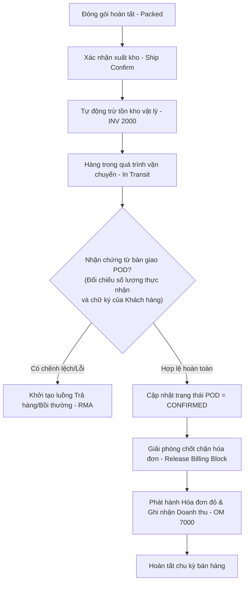

# 5020 Xác nhận giao hàng thành công và bàn giao trách nhiệm

Quy trình **Xác nhận giao hàng (Ship Confirmation)** và **Xác nhận bàn giao thành công (Proof of Delivery - POD)** là chặng cuối của luồng thực thi logistics trước khi chuyển giao dữ liệu sang phân hệ Tài chính để ghi nhận doanh thu và hạch toán công nợ [5020]. Đây là thời điểm phân hệ Quản lý Đơn hàng (OM) chính thức kích hoạt giao dịch trừ tồn kho vật lý tại phân hệ Tồn kho (INV) và thiết lập ranh giới chuyển giao quyền sở hữu tài sản cũng như rủi ro thương mại từ người bán sang người mua dựa trên các điều khoản thương mại quốc tế (Incoterms) [5020].

---

## 1. Tình huống Nghiệp vụ & "Điểm đau" thực tế

Hoạt động bàn giao và xác nhận giao hàng nếu thiếu đi cơ chế kiểm soát chặt chẽ trên ERP thường phát sinh các rủi ro vận hành sau:

*   **Hạch toán doanh thu non (Premature Revenue Recognition):** Doanh nghiệp ký hợp đồng giao hàng đến kho của khách hàng (Incoterms: DDP/DAP). Tuy nhiên, ngay khi hàng vừa bốc lên xe tải rời khỏi kho của mình, hệ thống ERP đã tự động chuyển trạng thái đơn hàng sang "Hoàn tất" và ghi nhận doanh thu [1010]. Nếu trên đường vận chuyển xảy ra tai nạn, mất mát hoặc khách hàng từ chối nhận hàng do hỏng hóc, doanh nghiệp sẽ phải thực hiện các thủ tục hoàn nhập doanh thu và hủy hóa đơn vô cùng phức tạp [5020].
*   **Tranh chấp số lượng giao nhận thực tế:** Lái xe giao hàng cho đại lý, đại lý ký nhận thiếu 5 sản phẩm trên biên bản bàn giao bằng giấy. Tuy nhiên, lái xe không báo về hoặc báo trễ, hệ thống vẫn xuất hóa đơn đỏ theo số lượng đặt hàng ban đầu. Khách hàng khiếu nại và từ chối thanh toán toàn bộ hóa đơn cho đến khi chênh lệch được giải quyết, làm phát sinh nợ quá hạn [4030].

---

## 2. Bản đồ Thiết kế & Ánh xạ Cơ sở dữ liệu

Dưới đây là bảng đối chiếu cấu trúc lưu trữ dữ liệu Xác nhận giao kho và Chứng từ bàn giao (POD) trên các hệ thống ERP:

| Thực thể nghiệp vụ | SAP S/4HANA (Tables) | Oracle EBS R12 (Tables) | Epicor ERP (Tables) | Odoo (Tables) |
| :--- | :--- | :--- | :--- | :--- |
| **Xác nhận xuất kho**<br/>*(Goods Issue / Ship Confirm)* | **Post Goods Issue (PGI)**<br/>(Giao dịch trừ tồn kho) | **`WSH_NEW_DELIVERIES`**<br/>(Trạng thái `STATUS_CODE` = 'CO') | **`Erp.ShipHead`**<br/>(Cột `ShipStatus` = 'SHIPPED') | **`stock.picking`**<br/>(Trạng thái 'done') |
| **Chứng từ bàn giao**<br/>*(Proof of Delivery - POD)* | **`LIKP`**<br/>(Cột `PDSTK` - Trạng thái POD) | **`WSH_NEW_DELIVERIES`**<br/>(Trường mở rộng `POD_STATUS`, `POD_DATE`) | **`Erp.ShipHead`**<br/>(Cột `ReadyToInvoice` = 1) | Ghi nhận qua chữ ký số /<br/>Attachment trên Picking |
| **Giao dịch Trừ tồn kho**<br/>*(Inventory Debit)* | **`MSEG`**<br/>(Document Segment) | **`MTL_MATERIAL_TRANSACTIONS`**<br/>(Transaction Type = 'Sales Order') | **`Erp.PartTran`**<br/>(Transaction Type = 'STK-CUS') | **`stock.valuation.layer`**<br/>(Bản ghi giá trị xuất kho) |

---

## 3. Sơ đồ Luồng chuyển giao Quyền sở hữu Tài sản (Ship Confirm to POD)

Sơ đồ dưới đây mô tả sự khác biệt giữa hai sự kiện: Hàng rời kho vật lý (Ship Confirm) và Khách hàng ký nhận thành công (POD) chi phối thời điểm phát hành hóa đơn tài chính:



---

## 4. Quy trình cấu hình thực tế trên các ERP lớn

### A. Trên Oracle EBS R12 (Shipping Execution - Ship Confirm & POD)
1.  **Thực hiện Xác nhận giao hàng (Ship Confirm):**
    *   *Đường dẫn:* `Order Management > Shipping > Transactions`.
    *   *Nghiệp vụ:* Tìm kiếm phiếu giao nhận (`Delivery`), chọn hành động `Ship Confirm`. Hệ thống sẽ kích hoạt tiến trình xử lý nền để cập nhật trạng thái dòng đơn hàng sang `SHIPPED`, đồng thời ghi nhận vào bảng **`WSH_NEW_DELIVERIES`** với trạng thái `STATUS_CODE = 'CO'` (Confirmed) [1010].
2.  **Cập nhật chứng từ bàn giao (POD Entry):**
    *   *Nghiệp vụ:* Khi nhận được biên bản giao hàng có chữ ký của khách hàng, nhân viên logistics truy cập màn hình `Delivery`, cập nhật các trường thông tin **`POD_STATUS = 'RECV'`**, ngày nhận hàng `POD_DATE` và đính kèm file quét biên bản [5020]. Hệ thống dựa trên sự kiện này để giải phóng trạng thái chờ hóa đơn.

### B. Trên Epicor ERP (kinh nghiệm triển khai Customer Shipment Entry)
Theo kinh nghiệm triển khai Epicor trước đây, hệ thống quản lý xác nhận giao hàng thông qua phiếu đóng gói giao hàng **Pack Slip**:
1.  **Xác nhận xuất kho (Confirm Shipment):**
    *   *Đường dẫn:* `Material Management > Shipping / Receiving > Customer Shipment Entry` [1010].
    *   *Nghiệp vụ:* Tạo phiếu giao hàng, chọn đơn hàng cần xuất. Khi hàng được bốc lên xe, thủ kho tích chọn ô **`Shipped`** và lưu lại.
    *   *Giao dịch hệ thống:* Epicor chuyển trạng thái `ShipStatus` thành `SHIPPED`, tự động sinh giao dịch trừ kho vật lý `STK-CUS` (Stock to Customer) trong bảng `PartTran`, và khóa cứng không cho phép sửa đổi số lượng xuất [3010, 5020].
2.  **Bàn giao quyền xuất hóa đơn (Ready to Invoice):**
    *   *Nghiệp vụ:* Sau khi nhận được xác nhận giao hàng thành công từ tài xế (POD), nhân viên logistics tích chọn ô **`Ready To Invoice = 1`** trên màn hình `ShipHead`. Đây là điều kiện bắt buộc để phân hệ Kế toán công nợ có thể nhìn thấy phiếu giao hàng này và phát hành hóa đơn tài chính [1010].

---

## 5. SQL Database Audit Queries (Truy vấn đối soát dữ liệu)

### A. Đối soát các phiếu giao hàng đã Ship Confirm và trạng thái POD trên Oracle EBS

Query dưới đây giúp bộ phận kiểm soát nội bộ tra cứu toàn bộ các phiếu giao hàng đã xác nhận xuất kho thành công, đối chiếu với trạng thái cập nhật chứng từ bàn giao POD thực tế trên hệ thống:

```sql
SELECT 
    wnd.org_id                    AS operating_unit_id,
    wnd.delivery_id               AS delivery_id,
    wnd.name                      AS delivery_name,
    wnd.status_code               AS delivery_status, -- 'CO' = Confirmed / Shipped
    wnd.confirm_date              AS ship_confirm_date,
    wnd.pod_status                AS pod_status,      -- Trạng thái chứng từ bàn giao
    wnd.pod_date                  AS pod_received_date,
    wnd.pod_by                    AS pod_confirmed_by
FROM 
    wsh_new_deliveries wnd
WHERE 
    wnd.status_code = 'CO' -- Chỉ lấy các phiếu đã được xác nhận xuất kho thành công
    AND wnd.creation_date >= TO_DATE('2026-01-01', 'YYYY-MM-DD')
ORDER BY 
    wnd.confirm_date DESC;
```

### B. Tra cứu các phiếu giao hàng đã xác nhận xuất kho (Shipped) trên Epicor ERP

Query dưới đây lọc ra toàn bộ các phiếu giao hàng đã thực xuất trên Epicor, hiển thị trạng thái sẵn sàng xuất hóa đơn (`ReadyToInvoice`) làm căn cứ kiểm tra đối soát công nợ:

```sql
SELECT 
    sh.Company,
    sh.PackNum                    AS Pack_Slip_Number,
    sh.ShipDate                   AS Ship_Date,
    sh.ShipStatus                 AS Ship_Status, -- 'SHIPPED' thể hiện đã xác nhận xuất kho
    sh.ReadyToInvoice             AS Ready_To_Invoice, -- 1 thể hiện đã có POD và sẵn sàng xuất hóa đơn
    sh.ShipToNum                  AS Ship_To_Number,
    sh.TrackingNumber             AS Tracking_Number,
    sh.ChangedBy                  AS Last_Updated_By
FROM 
    Erp.ShipHead sh
WHERE 
    sh.Company = 'YOUR_COMPANY_CODE'
    AND sh.ShipStatus = 'SHIPPED'
    AND sh.ShipDate >= '2026-01-01'
ORDER BY 
    sh.ShipDate DESC;
```

---

## 6. Nguyên tắc Nghiệp vụ cốt lõi khi Tự xây dựng hoặc Tùy biến Hệ thống (OMS/ERP)

### Nguyên tắc 1: Khóa biến động số liệu tuyệt đối sau khi Ship Confirm (Post-shipment Freeze)
*   **Yêu cầu thiết kế logic:** Ngay khi giao dịch Xác nhận xuất kho (Ship Confirm) được thực hiện thành công, hệ thống tự xây dựng bắt buộc phải kích hoạt API gọi sang phân hệ Tồn kho để trừ tồn kho vật lý thực tế, đồng thời chuyển toàn bộ trạng thái của dòng đơn hàng SO tương ứng sang chế độ khóa cứng vĩnh viễn (Frozen State).
*   **Mục tiêu:** Tuyệt đối không cho phép bất kỳ người dùng nào tự ý sửa đổi số lượng, đơn giá, mã hàng hay thông tin khách hàng trên các dòng đơn hàng đã xuất kho thực tế để đảm bảo tính toàn vẹn dữ liệu kế toán kho [5020].

### Nguyên tắc 2: Sự kiện kích hoạt doanh thu dựa trên ranh giới POD (POD Revenue Trigger)
*   **Yêu cầu thiết kế logic:** Đối với các đơn hàng có điều khoản giao hàng tại kho khách hàng, hệ thống tự xây dựng không được phép tự động phát hành hóa đơn tài chính ngay khi bấm nút xuất kho. Hệ thống phải gán mặc định một chốt chặn hóa đơn (`billing_blocked = true`) [4030]. Chỉ khi bộ phận logistics nhận được biên bản bàn giao thành công (POD) và cập nhật trạng thái POD sang `CONFIRMED` trên hệ thống, chốt chặn này mới được tự động gỡ bỏ để chuyển tiếp sang phân hệ hóa đơn [1010].

### Nguyên tắc 3: Xử lý bàn giao một phần (Partial POD Handling)
*   **Yêu cầu thiết kế logic:** Thực tế giao nhận không phải lúc nào cũng khớp tuyệt đối 100% hoặc chênh lệch hoàn toàn — trường hợp phổ biến là khách hàng chỉ ký nhận một phần số lượng trên biên bản bàn giao (ví dụ giao 100 nhưng chỉ ký nhận 95). Hệ thống tự xây dựng cần cho phép ghi nhận số lượng POD thực nhận tách biệt với số lượng đã xuất kho, tự động tách dòng hóa đơn theo đúng số lượng đã xác nhận và giữ phần chênh lệch còn lại ở trạng thái chờ xử lý (Pending Reconciliation) thay vì buộc toàn bộ chứng từ phải chờ giải quyết xong tranh chấp mới được xuất hóa đơn phần đã xác nhận đúng [5020].

---

## 7. Luồng luân chuyển dữ liệu liên phân hệ (Cross-Module Touchpoints)

*   **Tích hợp phân hệ Tồn kho (INV):** Sự kiện Xác nhận xuất kho (Ship Confirm) là lệnh kích hoạt duy nhất để phân hệ Tồn kho thực hiện ghi nhận giao dịch trừ kho vật lý bán hàng (`INV 2000`) và cập nhật giá trị vốn hàng bán (COGS) [1010, 5020].
*   **Tích hợp phân hệ Kế toán công nợ (FIN-AR):** Sự kiện xác nhận biên bản bàn giao thành công (POD Confirmation) là ranh giới pháp lý quyết định thời điểm chuyển giao rủi ro tài sản [5020]. Đây là căn cứ duy nhất để kế toán công nợ phát hành hóa đơn đỏ (VAT Invoice) và ghi nhận doanh thu bán hàng chính xác theo kỳ kế toán [1010].

---

<div align="center" style={{color: 'var(--ifm-color-primary)'}}>
  <strong>Chúc các bạn thành công và vui vẻ!</strong>
</div>
