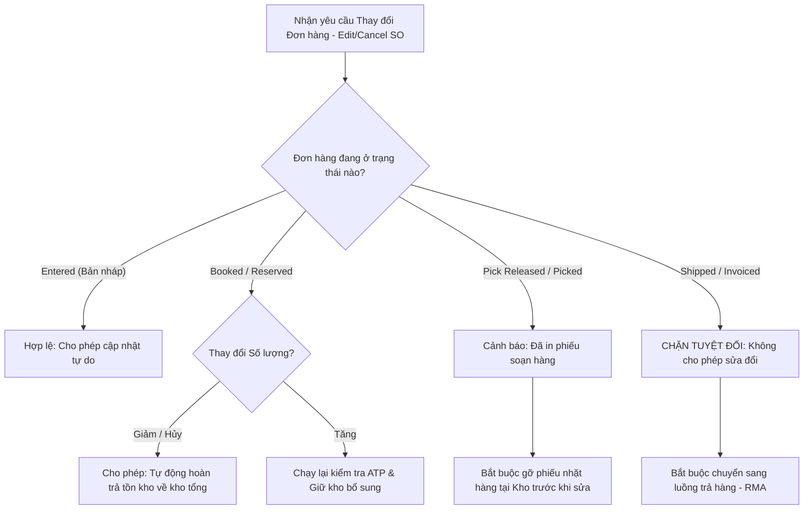

# 5030 Quản lý thay đổi đơn hàng sau khi đã xác nhận/phân bổ tồn kho

Trong chu kỳ bán hàng thực tế (Order-to-Cash), đơn hàng rất hiếm khi đi thẳng một mạch từ lúc khởi tạo đến lúc xuất kho mà không có sự thay đổi. Khách hàng có thể gọi điện yêu cầu đổi mã sản phẩm, giảm số lượng, thay đổi địa chỉ giao hàng hoặc thậm chí hủy đơn hàng đột ngột. Việc **Quản lý thay đổi đơn hàng (Order Change Management)** khi đơn hàng đã đi vào các bước thực thi (đã khóa nợ, giữ hàng hoặc đã in phiếu soạn hàng) đòi hỏi hệ thống ERP phải có các chốt chặn kiểm soát nghiêm ngặt nhằm tránh xung đột dữ liệu giữa phòng kinh doanh và thủ kho [5030].

---

## 1. Tình huống Nghiệp vụ & "Điểm đau" thực tế

Thiếu đi một ma trận kiểm soát thay đổi tự động giữa phân hệ OM và kho vận sẽ đẩy doanh nghiệp vào các tổn thất tài chính và lỗi hệ thống nghiêm trọng:

*   **Xung đột dữ liệu giữa Sales và Kho (Ghost Shipments):** Nhân viên kinh doanh đồng ý cho khách hàng hủy đơn hoặc giảm số lượng ngay trên giao diện nhập đơn hàng SO. Tuy nhiên, hệ thống kho lúc này đã in phiếu soạn hàng (Pick Ticket) và thủ kho đã bốc xếp hàng ra khu vực đóng gói [5000]. Kết quả là hàng hóa vật lý vẫn được giao đi mặc dù đơn hàng trên hệ thống đã bị hủy, dẫn đến thất thoát tài sản khó thu hồi.
*   **Nghẽn giữ kho ảo khi hủy đơn (Stock Leaks):** Khi đơn hàng bị hủy bỏ hoặc giảm số lượng, nếu hệ thống không tự động giải phóng lượng hàng đã giữ chỗ (Reservations), lượng tồn kho này sẽ bị khóa vĩnh viễn trên hệ thống [4010]. Hệ thống báo hết hàng khiến doanh nghiệp không thể bán cho khách hàng khác, trong khi hàng thực tế vẫn nằm im trong góc kho.

---

## 2. Bản đồ Thiết kế & Ánh xạ Cơ sở dữ liệu

Dưới đây là bảng đối chiếu cấu trúc lưu trữ dữ liệu và kiểm soát thay đổi đơn hàng giữa các hệ thống ERP:

| Thực thể nghiệp vụ | SAP S/4HANA (Tables) | Oracle EBS R12 (Tables) | Epicor ERP (Tables) | Odoo (Tables) |
| :--- | :--- | :--- | :--- | :--- |
| **Quy tắc chặn thay đổi**<br/>*(Processing Constraints)* | **Status Management**<br/>(Bảng trạng thái đối tượng) | **`OE_PC_CONSTRAINTS`**<br/>**`OE_PC_CONDITIONS`** | **BPM Object Rules**<br/>(Kiểm tra trạng thái) | Kiểm soát qua trạng thái dòng **`sale.order`** |
| **Ghi vết hủy dòng**<br/>*(Canceled Lines)* | **`VBAP`**<br/>(Cột `ABGRU` - Reason Code) | **`OE_ORDER_LINES_ALL`**<br/>(Cột `CANCELLED_QUANTITY`) | **`Erp.OrderDtl`**<br/>(Cột `VoidLine` = 1) | **`sale_order_line`**<br/>(Cột `state` = 'cancel') |
| **Bảng nhật ký thay đổi**<br/>*(Audit Trail Log)* | **`CDHDR`** (Header Changes)<br/>**`CDPOS`** (Line Changes) | Cơ chế **AuditTrail**<br/>(Bảng lịch sử tương ứng theo entity đã bật audit) | Cơ chế **Change Log**<br/>(theo cấu hình BPM/Ice) | **`mail.message`**<br/>(Vết hoạt động dòng đơn) |

---

## 3. Sơ đồ Cổng kiểm soát thay đổi đơn hàng (Order Change Validation Gate)

Sơ đồ dưới đây mô tả cách hệ thống tự động thẩm định và đưa ra quyết định cho phép, cảnh báo hoặc chặn đứng yêu cầu thay đổi đơn hàng tùy theo trạng thái thực tế của quy trình:



---

## 4. Quy trình cấu hình thực tế trên các ERP lớn

### A. Trên Oracle EBS R12 (Phân hệ Processing Constraints)
Oracle sử dụng công cụ mạnh mẽ **Processing Constraints** để khóa cứng hành vi của người dùng dựa trên trạng thái thực tế của đơn hàng:
1.  **Cấu hình quy tắc chặn thay đổi dòng đơn hàng (Constraint Rules):**
    *   *Đường dẫn:* `Order Management Super User > Setup > Rules > Security > Processing Constraints`.
    *   *Nghiệp vụ:* Tạo mới quy tắc kiểm soát cho thực thể `Order Line`.
    *   *Điều kiện áp dụng:* Chặn hành động `UPDATE` đối với cột `Ordered Quantity` khi trạng thái dòng giao hàng đạt điều kiện `Line is Pick Released` (Đã đẩy chỉ thị xuống kho) [5000]. Nếu người dùng cố tình sửa, hệ thống sẽ từ chối lưu giao dịch và báo lỗi ràng buộc tương ứng.

### B. Trên Epicor ERP (kinh nghiệm triển khai Business Process Management & Void Line)
Theo kinh nghiệm triển khai Epicor trước đây, hệ thống tự động khóa các thay đổi đơn hàng dựa trên liên kết trạng thái đợt giao hàng (`OrderRel`):
1.  **Chặn thay đổi tự động:**
    *   *Cơ chế:* Khi một dòng Release của đơn hàng đã được đưa vào phiếu đóng gói (`Customer Shipment Entry`) hoặc đã đánh dấu giao hàng (`Shipped`), Epicor tự động khóa cứng (Read-only) toàn bộ các trường số lượng (`OrderQty`), đơn giá, mã sản phẩm trên màn hình `Order Entry` [5020].
2.  **Hủy dòng đơn hàng bằng tính năng Void:**
    *   *Nghiệp vụ:* Nếu đơn hàng chưa xuất kho nhưng khách muốn hủy, nhân viên kinh doanh chọn hành động `Void Line`. Hệ thống gán giá trị **`VoidLine = 1`** trên bảng `OrderDtl`, tự động giải phóng lượng hàng đã phân bổ (`OrderAlloc`) và đóng dòng đơn hàng [4010].

---

## 5. SQL Database Audit Queries (Truy vấn đối soát dữ liệu)

### A. Đối soát các dòng đơn hàng đã bị hủy bỏ và lý do hủy trên Oracle EBS

Query dưới đây giúp bộ phận kiểm soát rà soát toàn bộ các dòng đơn hàng đã bị hủy bỏ một phần hoặc toàn bộ trên Oracle EBS, hiển thị chi tiết số lượng hủy, lý do hủy và tài khoản nhân viên thực hiện hủy đơn:

```sql
SELECT 
    oha.org_id                    AS operating_unit_id,
    oha.order_number              AS order_number,
    oel.line_number               AS line_number,
    msib.segment1                 AS item_code,
    oel.ordered_quantity          AS original_ordered_qty,
    oel.cancelled_quantity        AS cancelled_qty,
    orst.comments                 AS cancellation_comments,
    flv.meaning                   AS cancellation_reason,
    fu.user_name                  AS cancelled_by_user,
    olh.hist_creation_date        AS cancellation_date
FROM 
    oe_order_headers_all oha
INNER JOIN 
    oe_order_lines_all oel ON oha.header_id = oel.header_id
INNER JOIN 
    oe_system_parameters_all osp ON oha.org_id = osp.org_id
INNER JOIN 
    mtl_system_items_b msib ON oel.inventory_item_id = msib.inventory_item_id 
                            AND osp.master_organization_id = msib.organization_id
-- Join history to pinpoint standard cancellation action trails
INNER JOIN 
    oe_order_lines_history olh ON oel.line_id = olh.line_id 
                               AND olh.hist_type_code = 'CANCELLATION'
-- Join change reasons table using correct relational parameters
LEFT JOIN 
    oe_reasons orst ON olh.reason_id = orst.reason_id
-- Translate contextual cancellation codes to clear textual meanings
LEFT JOIN 
    fnd_lookup_values flv ON orst.reason_code = flv.lookup_code 
                          AND flv.lookup_type = 'CANCEL_CODE'
                          AND flv.language = USERENV('LANG')
-- Trace the exact user executing the historical change logic
INNER JOIN 
    fnd_user fu ON olh.hist_created_by = fu.user_id
WHERE 
    oel.cancelled_quantity > 0 
    --AND oha.ordered_date >= TO_DATE('2026-01-01', 'YYYY-MM-DD')
ORDER BY 
    olh.hist_creation_date DESC;
```

### B. Tra cứu các dòng đơn hàng bị hủy bỏ (Voided Lines) trên Epicor ERP

Query dưới đây lọc ra toàn bộ các dòng đơn hàng bị hủy bỏ (`VoidLine = 1`) trên hệ thống Epicor, phục vụ công tác đối soát doanh thu hụt và hành vi người dùng:

```sql
SELECT 
    od.Company,
    od.OrderNum                   AS Order_Number,
    od.OrderLine                  AS Line_Number,
    od.PartNum                    AS Part_Number,
    od.OrderQty                   AS Original_Ordered_Quantity,
    od.VoidLine                   AS Is_Voided_Canceled, -- 1 thể hiện đã bị hủy bỏ
    od.OpenLine                   AS Is_Line_Open, -- 0 thể hiện dòng đã đóng
    od.ChangedBy                  AS Updated_By_User,
    od.ChangeDate                 AS Update_Date
FROM 
    Erp.OrderDtl od
WHERE 
    od.Company = 'YOUR_COMPANY_CODE'
    AND od.VoidLine = 1
    AND od.ChangeDate >= '2026-01-01'
ORDER BY 
    od.ChangeDate DESC;
```

---

## 6. Nguyên tắc Nghiệp vụ cốt lõi khi Tự xây dựng hoặc Tùy biến Hệ thống (OMS/ERP)

### Nguyên tắc 1: Thiết kế Ma trận kiểm soát thay đổi dựa trên Trạng thái (State-based Change Matrix)
*   **Yêu cầu thiết kế logic:** Hệ thống tự xây dựng phải thiết lập một bộ quy tắc nghiêm ngặt để xác định hành vi sửa đổi đơn hàng tương ứng với từng cột mốc của chu kỳ bán hàng:
    *   **Trạng thái Entered (Nháp):** Cho phép sửa đổi tất cả các trường thông tin [3010].
    *   **Trạng thái Booked / Reserved:** Cho phép tăng/giảm số lượng. Nếu giảm số lượng, hệ thống phải tự động kích hoạt API trừ lùi lượng hàng đã giữ chỗ [4010]. Nếu tăng số lượng, hệ thống phải chạy lại kiểm tra ATP và giữ kho bổ sung [4000]. Riêng thay đổi địa chỉ giao hàng ở trạng thái này không ảnh hưởng đến tồn kho nên có thể cho phép cập nhật tự do, nhưng phải bắn lại thông tin địa chỉ mới xuống chứng từ vận chuyển nếu đã có phiếu giao hàng khởi tạo trước đó.
    *   **Trạng thái Picked / Staged (Đang soạn hàng):** Khóa cứng không cho phép sửa đổi. Nếu muốn sửa, bắt buộc nhân sự kho phải làm thủ tục gỡ phiếu nhặt hàng (De-allocate / Un-stage) tại phân hệ Kho trước, sau đó mới cho phép sửa trên giao diện OM [5000].
    *   **Trạng thái Shipped (Đã giao hàng):** Khóa cứng vĩnh viễn tuyệt đối. Riêng yêu cầu đổi địa chỉ giao hàng ở giai đoạn này không còn ý nghĩa trên chứng từ gốc mà phải xử lý như một yêu cầu vận chuyển lại (re-delivery) độc lập, không sửa ngược vào đơn hàng đã chốt [5020].

### Nguyên tắc 2: Tự động hoàn trả tồn kho vật lý (Automated Allocation Rollback)
*   **Yêu cầu thiết kế logic:** Khi một đơn hàng SO bị giảm số lượng hoặc hủy bỏ ở trạng thái đã giữ kho (`Booked/Reserved`), động cơ quản lý đơn hàng phải lập tức kích hoạt API gọi sang phân hệ Tồn kho để xóa hoặc giảm số lượng tương ứng trên bản ghi giữ chỗ tồn kho vật lý.
*   **Mục tiêu:** Tránh hoàn toàn lỗi rò rỉ tồn kho (Stock Leaks), đảm bảo lượng hàng giải phóng lập tức được đưa về bể tồn kho sẵn có dùng chung để các đơn hàng khác có thể tiếp cận [4010].

---

## 7. Luồng luân chuyển dữ liệu liên phân hệ (Cross-Module Touchpoints)

*   **Tích hợp phân hệ Tồn kho (INV):** Sự thay đổi về số lượng và trạng thái của đơn hàng là căn cứ duy nhất để phân hệ Tồn kho cập nhật chính xác số liệu giữ chỗ thực tế (`MTL_RESERVATIONS` hoặc `OrderAlloc`), đảm bảo tính toàn vẹn của số dư tồn kho khả dụng [1010, 4010].
*   **Tích hợp phân hệ Kho (WMS/INV):** Khi đơn hàng bị hủy bỏ ở trạng thái đã chuẩn bị hàng, hệ thống phải bắn chỉ thị hủy in phiếu soạn hàng (Cancel Picking Task) xuống thiết bị PDA của thủ kho, ngăn chặn kịp thời việc bốc xếp xuất nhầm hàng hóa vật lý rời khỏi kho [1010, 5000].

---

<div align="center" style={{color: 'var(--ifm-color-primary)'}}>
  <strong>Chúc các bạn thành công và vui vẻ!</strong>
</div>
