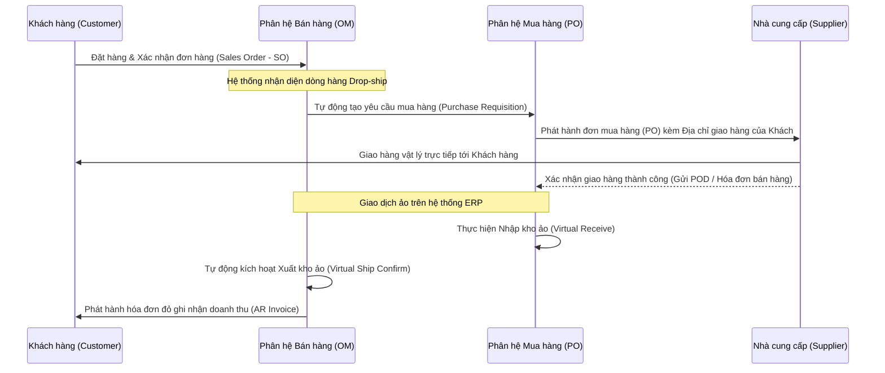

# 6000 Quy trình bán hàng Drop-shipment từ nhà cung cấp

Trong mô hình chuỗi cung ứng hiện đại, **Bán hàng giao thẳng (Drop-shipment)** là phương thức giúp doanh nghiệp tối ưu hóa chi phí lưu kho vận hành. Khi phát sinh đơn bán hàng (Sales Order - SO) từ khách hàng, doanh nghiệp không tiến hành xuất kho của mình mà chuyển trực tiếp yêu cầu sang cho Nhà cung cấp. Nhà cung cấp sẽ chịu trách nhiệm đóng gói và vận chuyển hàng hóa giao thẳng đến địa chỉ của khách hàng. Doanh nghiệp đóng vai trò thương mại, mua sỉ từ nhà cung cấp và bán lẻ cho khách hàng mà không cần trực tiếp chạm vào hàng hóa vật lý [6000].

---

## 1. Tình huống Nghiệp vụ & "Điểm đau" thực tế

Triển khai quy trình Drop-shipment thủ công hoặc thiết lập sai logic tích hợp trên hệ thống ERP thường dẫn đến các lỗi nghiêm trọng sau:

*   **Lệch lạc thông tin địa chỉ giao hàng:** Nhân viên mua hàng phải gõ tay lại địa chỉ giao hàng của khách hàng từ đơn bán hàng (SO) sang đơn mua hàng (PO) gửi cho nhà cung cấp. Việc nhập liệu thủ công này rất dễ dẫn đến sai sót địa chỉ, khiến nhà cung cấp giao sai địa điểm, làm phát sinh chi phí đền bù và hủy đơn [3010].
*   **Trì trệ luồng xuất hóa đơn do không đồng bộ dữ liệu giao nhận:** Vì hàng hóa không đi qua kho của doanh nghiệp nên thủ kho không biết khi nào nhà cung cấp đã giao hàng thành công để làm thủ tục xuất kho trên hệ thống. Nếu kế toán phải chờ đối soát hóa đơn giấy từ nhà cung cấp gửi về vào cuối tháng mới làm thủ tục xuất kho ảo trên ERP, doanh nghiệp sẽ bị trễ hạn phát hành hóa đơn thu tiền khách hàng hàng tuần/hàng tháng [1010, 5020].

---

## 2. Bản đồ Thiết kế & Ánh xạ Cơ sở dữ liệu giữa OM và PO

Drop-shipment là luồng nghiệp vụ tích hợp chặt chẽ 1:1 giữa phân hệ Bán hàng (OM) và phân hệ Mua hàng (PO). Dưới đây là bảng đối chiếu cấu trúc liên kết chứng từ giữa hai phân hệ trên các ERP lớn:

| Thực thể nghiệp vụ | Oracle EBS R12 (Tables) | Epicor ERP (Tables) | SAP S/4HANA (Tables) | Odoo (Tables) |
| :--- | :--- | :--- | :--- | :--- |
| **Đơn bán hàng SO**<br/>*(Sales Order)* | **`OE_ORDER_LINES_ALL`**<br/>(Cột `SOURCE_TYPE_CODE` = 'EXTERNAL') | **`Erp.OrderRel`**<br/>(Cột `DropShip` = 1) | **`VBAP`**<br/>(Item Category `TAS`, xác định từ Item Category Group `BANS` của vật tư) | **`sale.order`**<br/>(Route = Dropship) |
| **Hợp đồng liên kết**<br/>*(Junction / Link)* | **`OE_DROP_SHIP_SOURCES`**<br/>(Bảng liên kết SO Line và PO Line) | **`Erp.PORel`**<br/>(Lưu vết trực tiếp `OrderNum`, `OrderLine`) | **`VBFA`**<br/>(Document Flow Table) | **`procurement.group`**<br/>(Liên kết nhu cầu) |
| **Đơn mua hàng PO**<br/>*(Purchase Order)* | **`PO_HEADERS_ALL`**<br/>**`PO_LINES_ALL`** | **`Erp.POHeader`**<br/>**`Erp.PODetail`** | **`EKKO`** (Header)<br/>**`EKPO`** (Items) | **`purchase.order`**<br/>**`purchase.order.line`** |
| **Xác nhận giao nhận**<br/>*(Virtual Shipment)* | **`WSH_NEW_DELIVERIES`**<br/>(Xác nhận giao ảo tự động) | Xử lý qua nghiệp vụ nhận hàng PO liên kết (Receipt Entry gắn `PORel`) | **Post Goods Issue (PGI)**<br/>(Giao dịch xuất kho ảo) | **`stock.picking`**<br/>(Dropship transfer 'done') |

---

## 3. Sơ đồ chu kỳ vận hành bán hàng giao thẳng (Drop-shipment Order Cycle)

Sơ đồ trình tự dưới đây mô tả cách hai luồng chứng từ SO và PO phối hợp chặt chẽ để thực thi một giao dịch Drop-shipment khép kín:



---

## 4. Quy trình cấu hình thực tế trên các ERP lớn

### A. Trên Oracle EBS R12 (Drop Ship Order Flow)
1.  **Cấu hình dòng sản phẩm Drop Ship:**
    *   *Nghiệp vụ:* Khi nhân viên kinh doanh tạo dòng đơn hàng trên màn hình `Sales Orders`, tại tab `Shipping`, gán trường `Source Type = External` (`OE_ORDER_LINES_ALL.source_type_code`) [3010].
2.  **Khởi chạy luồng mua hàng liên kết:**
    *   *Nghiệp vụ:* Chạy chương trình **Requisition Import**. Hệ thống tự động quét các dòng đơn hàng SO có nguồn `External` để tự động tạo yêu cầu mua hàng (`Requisition`), kế thừa toàn bộ địa chỉ giao hàng của khách hàng từ SO.
    *   *Liên kết:* Khi Requisition được chuyển đổi thành PO, hệ thống tự động ghi nhận mối liên kết chặt chẽ vào bảng **`OE_DROP_SHIP_SOURCES`** [6000].

### B. Trên Epicor ERP (kinh nghiệm triển khai Drop Ship Release)
Theo kinh nghiệm triển khai Epicor trước đây:
1.  **Cấu hình đợt giao hàng dạng Drop Ship:**
    *   *Đường dẫn:* `Sales Management > Order Management > Sheets > Sales Order Entry` [1030].
    *   *Nghiệp vụ:* Tại màn hình `Releases`, tích chọn ô **`Drop Ship`** (`OrderRel.DropShip = 1`) cho đợt giao hàng [3030, 3040].
2.  **Tự động tạo PO mua hàng giao thẳng:**
    *   *Đường dẫn:* `Material Management > Purchase Management > General Operations > Suggestion`.
    *   *Nghiệp vụ:* Tiến trình tính toán nhu cầu mua hàng (`Generate PO Suggestions`) sẽ tự động quét các dòng Release SO gán cờ `Drop Ship` để tạo đề xuất mua hàng [1000]. Khi PO được tạo, Epicor gán chặt mã đơn hàng SO gốc vào dòng Release PO (`PORel.OrderNum` / `PORel.OrderLine`) [3040].

---

## 5. SQL Database Audit Queries (Truy vấn đối soát dữ liệu)

### A. Đối soát liên kết chứng từ SO - PO của luồng Drop-ship trên Oracle EBS

Query dưới đây hỗ trợ bộ phận kế toán và mua hàng đối soát chéo, kiểm tra xem các đơn bán hàng Drop-ship đã được sinh đơn mua hàng PO tương ứng hay chưa và trạng thái hiện tại của dòng đơn hàng:

```sql
SELECT 
    oha.org_id                    AS operating_unit_id,
    oha.order_number              AS sales_order_number,
    oel.line_number               AS so_line_number,
    msib.segment1                 AS item_code,
    oel.ordered_quantity          AS order_qty,
    pv.vendor_name                AS supplier_name,
    pha.segment1                  AS purchase_order_number,
    pla.line_num                  AS po_line_number,
    oel.flow_status_code          AS so_line_status
FROM 
    oe_order_headers_all oha
INNER JOIN 
    oe_order_lines_all oel ON oha.header_id = oel.header_id
INNER JOIN 
    oe_drop_ship_sources odss ON oel.line_id = odss.line_id
INNER JOIN 
    po_headers_all pha ON odss.po_header_id = pha.po_header_id
INNER JOIN 
    po_lines_all pla ON odss.po_line_id = pla.po_line_id
-- Corrected: Join ap_suppliers using the vendor_id from po_headers_all
INNER JOIN 
    ap_suppliers pv ON pha.vendor_id = pv.vendor_id
INNER JOIN 
    oe_system_parameters_all osp ON oha.org_id = osp.org_id
INNER JOIN 
    mtl_system_items_b msib ON oel.inventory_item_id = msib.inventory_item_id 
                            AND osp.master_organization_id = msib.organization_id
WHERE 
    oel.source_type_code = 'EXTERNAL'
    --AND oha.ordered_date >= TO_DATE('2026-01-01', 'YYYY-MM-DD')
ORDER BY 
    oha.order_number, oel.line_number;
```

### B. Tra cứu các đợt giao hàng Drop-ship liên kết trên Epicor ERP

Query dưới đây lọc ra toàn bộ các đợt giao hàng Drop-ship của đơn hàng bán trên Epicor đã được liên kết thành công với đợt giao hàng của đơn mua hàng PO:

```sql
SELECT 
    orl.Company,
    orl.OrderNum                   AS Sales_Order_Number,
    orl.OrderLine                  AS SO_Line_Number,
    orl.OrderRelNum                AS SO_Release_Number,
    od.PartNum                     AS Part_Number,
    orl.OurReqQty                  AS Requested_Quantity,
    orl.DropShip                   AS Is_Drop_Ship, -- Cột DropShip = 1
    pr.PONum                       AS Linked_PO_Number,
    pr.POLine                      AS Linked_PO_Line,
    pr.PORelNum                    AS Linked_PO_Release
FROM 
    Erp.OrderRel orl
INNER JOIN 
    Erp.OrderDtl od ON orl.Company = od.Company AND orl.OrderNum = od.OrderNum AND orl.OrderLine = od.OrderLine
INNER JOIN 
    Erp.PORel pr ON orl.Company = pr.Company 
                 AND orl.OrderNum = pr.OrderNum 
                 AND orl.OrderLine = pr.OrderLine 
                 AND orl.OrderRelNum = pr.OrderRelNum
WHERE 
    orl.Company = 'YOUR_COMPANY_CODE'
    AND orl.DropShip = 1 -- Chỉ lấy đợt giao hàng Drop-ship
    AND orl.OpenRelease = 1
ORDER BY 
    orl.OrderNum, orl.OrderLine;
```

---

## 6. Nguyên tắc Nghiệp vụ cốt lõi khi Tự xây dựng hoặc Tùy biến Hệ thống (OMS/ERP)

### Nguyên tắc 1: Bảo toàn liên kết chéo và Tự động hóa tạo yêu cầu (Auto-trigger Purchase Requests)
*   **Yêu cầu thiết kế logic:** Khi đơn hàng SO có gắn nhãn nguồn cung là `DROP_SHIP` được xác nhận duyệt (Booked), hệ thống tự xây dựng phải chặn hoàn toàn luồng in phiếu soạn hàng tại kho bán lẻ thông thường [5000]. Thay vào đó, hệ thống phải tự động ghi nhận thông tin yêu cầu mua sắm vào hàng đợi mua hàng, chuyển giao đầy đủ: Địa chỉ giao hàng của khách hàng (`Ship-to Address`), mã sản phẩm, số lượng yêu cầu [2000].
*   **Trường hợp đơn hàng hỗn hợp (Mixed Sourcing):** Với các đơn hàng SO có đồng thời dòng hàng lấy từ kho của doanh nghiệp và dòng hàng drop-ship từ nhà cung cấp, hệ thống phải xử lý độc lập luồng giao hàng và hóa đơn cho từng dòng theo đúng nguồn cung của nó, tránh gộp chung một chứng từ giao hàng hoặc một hóa đơn duy nhất cho cả hai nguồn khác nhau, vì thời điểm hàng thực tế đến tay khách hàng của mỗi nguồn là khác nhau.
*   **Mục tiêu:** Đảm bảo chứng từ mua hàng PO sinh ra liên kết trực tiếp 1:1 với dòng đơn bán SO để phục vụ đối soát tự động sau này.

### Nguyên tắc 2: Cơ chế Nhập kho và Xuất kho ảo đồng thời (Back-to-Back Virtual Transactions)
*   **Yêu cầu thiết kế logic:** Vì hàng hóa thực tế không đi qua kho vật lý của doanh nghiệp, hệ thống tự xây dựng phải thiết kế một cơ chế giao dịch ảo:
    *   Khi có xác nhận giao hàng thành công từ nhà cung cấp (hoặc khi nhận được hóa đơn mua hàng từ nhà cung cấp), hệ thống tự động chạy một luồng ngầm thực hiện đồng thời hai bút toán: **Nhập kho ảo (Virtual Receipt)** tại phân hệ PO và **Xác nhận xuất kho ảo (Virtual Ship Confirm)** tại phân hệ OM [5020].
    *   **Mục tiêu:** Giao dịch ảo này giúp trừ số dư tồn kho ảo trên hệ thống và lập tức giải phóng trạng thái dòng đơn hàng bán SO sang sẵn sàng xuất hóa đơn tài chính [1010, 4030] mà không gây nhầm lẫn hoặc ảnh hưởng đến các hoạt động bốc xếp thực tế của thủ kho bán lẻ.

---

## 7. Luồng luân chuyển dữ liệu liên phân hệ (Cross-Module Touchpoints)

*   **Tích hợp phân hệ Mua hàng (PO):** Đơn bán hàng Drop-shipment là nguồn sinh nhu cầu trực tiếp để phân hệ Mua hàng phát hành đơn mua hàng (PO) cho đối tác cung ứng [1000, 6000].
*   **Tích hợp phân hệ Tài chính (FIN-AP/AR):** Sự kiện xác nhận giao hàng ảo (Virtual Ship Confirm) kích hoạt luồng phát hành hóa đơn đỏ phải thu khách hàng (AR) [1010, 5020]. Đồng thời, sự kiện nhập kho ảo (Virtual Receipt) kích hoạt luồng ghi nhận công nợ phải trả nhà cung cấp (AP), làm căn cứ cho kế toán chạy quy trình đối soát 3 chiều (3-way match) [1000].

---

<div align="center" style={{color: 'var(--ifm-color-primary)'}}>
  <strong>Chúc các bạn thành công và vui vẻ!</strong>
</div>
