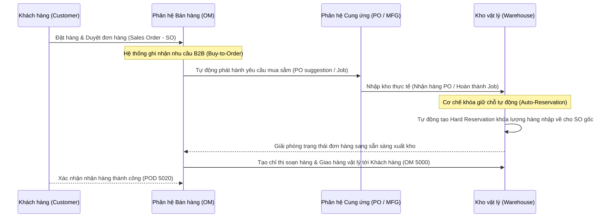

# 6010 Quy trình bán hàng liên kết mua hàng/sản xuất trực tiếp (Back-to-back)

Bên cạnh mô hình Drop-shipment (giao thẳng từ nhà cung cấp đến khách hàng) [6000], các doanh nghiệp thương mại và sản xuất còn áp dụng mô hình **Bán hàng liên kết mua hàng/sản xuất trực tiếp (Back-to-back - B2B)**. Điểm khác biệt cốt lõi là hàng hóa từ nhà cung cấp (hoặc từ phân xưởng sản xuất) bắt buộc phải được giao về kho vật lý của doanh nghiệp để thực hiện các thủ tục kiểm tra chất lượng (QC), dán nhãn hoặc đóng gói lại, sau đó doanh nghiệp mới làm thủ tục xuất kho giao cho khách hàng. Toàn bộ luồng cung ứng này được hệ thống ERP khóa giữ chỗ cứng (Pegging / Hard Reservation) 1:1 từ khâu mua/sản xuất đến khâu bán [6010].

---

## 1. Tình huống Nghiệp vụ & "Điểm đau" thực tế

Triển khai quy trình Back-to-back thủ công hoặc thiếu liên kết tự động trên ERP thường gây ra các xung đột vận hành lớn:

*   **Tranh chấp hàng hóa khi nhập kho:** Khi hàng từ Nhà cung cấp được nhập về kho (hoặc thành phẩm sản xuất xong được nhập kho từ phân xưởng), thủ kho không biết lô hàng này dành riêng cho ai. Hệ thống tự động đưa hàng vào bể tồn kho dùng chung (Available Pool), dẫn đến việc nhân viên kinh doanh khác nhanh tay làm đơn bán lẻ lấy mất, khiến khách hàng đặt trước bị trễ hẹn [3030, 4010].
*   **Hủy đơn hàng một đầu gây tồn kho chết:** Khách hàng yêu cầu hủy đơn bán hàng SO do thay đổi kế hoạch. Tuy nhiên, do thiếu liên kết chéo, đơn mua hàng PO tương ứng gửi cho nhà cung cấp vẫn tiếp tục được thực hiện và nhập về kho, hoặc lệnh sản xuất WIP vẫn tiếp tục chạy, khiến doanh nghiệp phải gánh chịu một lượng hàng tồn kho chết khó thanh lý [5030].

---

## 2. Bản đồ Thiết kế & Ánh xạ Cơ sở dữ liệu giữa OM - PO - MFG

Back-to-back là luồng nghiệp vụ liên kết ba phân hệ: Bán hàng (OM), Mua hàng (PO), và Sản xuất (MFG). Dưới đây là bảng đối chiếu cấu trúc liên kết chứng từ trên các ERP lớn:

| Thực thể nghiệp vụ | Oracle EBS R12 (Tables) | Epicor ERP (Tables) | SAP S/4HANA (Tables) | Odoo (Tables) |
| :--- | :--- | :--- | :--- | :--- |
| **Đơn bán hàng SO**<br/>*(Sales Order)* | **`OE_ORDER_LINES_ALL`**<br/>(Cột `SOURCE_TYPE_CODE` = 'INTERNAL') | **`Erp.OrderRel`**<br/>(Cột `BuyToOrder` = 1 hoặc `MakeToOrder` = 1) | **`VBAP`**<br/>(Nhánh mua theo đơn: Item Category `TAB`; nhánh sản xuất theo đơn điều khiển qua Strategy Group/Special Stock Indicator `E`, không nhất thiết đổi Item Category) | **`sale.order`**<br/>(Route = MTO + Buy/Manufacture) |
| **Hợp đồng liên kết**<br/>*(Junction / Pegging)* | **`MTL_RESERVATIONS`**<br/>(Liên kết SO Line với PO/WIP Source) | **`Erp.PORel`** *(Buy to Order)*<br/>**`Erp.JobProd`** *(Make to Order)* | **`EBAN`** (Requisition)<br/>**`PLAF`** (Planned Order)<br/>(Cột `KDAUF` = SO Num) | **`procurement.group`**<br/>(Liên kết nhu cầu) |
| **Đơn mua/Lệnh sản xuất**<br/>*(Supply Source)* | **`PO_HEADERS_ALL`** (PO)<br/>**`WIP_DISCRETE_JOBS`** (WO) | **`Erp.POHeader`** (PO)<br/>**`Erp.JobHead`** (WO) | **`EKKO`** (PO)<br/>**`AFKO`** (Work Order) | **`purchase.order`** (PO)<br/>**`mrp.production`** (WO) |
| **Nhận hàng về kho**<br/>*(Supply Receipt)* | **`RCV_TRANSACTIONS`** (PO)<br/>**`WIP_MOVE_TRANSACTIONS`** (WO) | **`Erp.RcvHead`** / `RcvDtl` (PO)<br/>**`Erp.PartTran`** (Transaction Type = 'WIP-STK') | **Goods Receipt (GR)**<br/>(Mã phong tỏa theo SO) | **`stock.picking`** (Receipt 'done') |

---

## 3. Sơ đồ luồng vận hành Bán hàng liên kết trực tiếp (Back-to-back Flow)

Sơ đồ trình tự dưới đây mô tả cách hệ thống tự động khóa giữ chỗ (Pegging) để bảo vệ lượng hàng nhập về cho đúng đơn hàng SO gốc:



---

## 4. Quy trình cấu hình thực tế trên các ERP lớn

### A. Trên Oracle EBS R12 (Back-to-back Buy/Assemble Flow)
1.  **Cấu hình thuộc tính sản phẩm trên Item Master:**
    *   *Nghiệp vụ:* Trong phân hệ quản lý danh mục (`Inventory`), định nghĩa mã sản phẩm với các thuộc tính: `Assemble to Order = Yes` (hoặc cấu hình luồng Buy-to-Order), và kích hoạt `Check ATP = Yes` [2000, 4000].
2.  **Khóa giữ chỗ tự động khi nhận hàng:**
    *   *Cơ chế:* Khi nhà cung cấp giao hàng về kho và thủ kho thực hiện giao dịch nhận hàng (`Receiving`), hệ thống Oracle sẽ không đưa hàng vào tồn khả dụng chung. Động cơ tự động gọi sang phân hệ Tồn kho để sinh một bản ghi giữ chỗ cứng trong bảng **`MTL_RESERVATIONS`**, chỉ định rõ nguồn cung từ phiếu nhận hàng vừa tạo để dành riêng cho dòng đơn bán hàng SO gốc [1010, 4010].

### B. Trên Epicor ERP (kinh nghiệm triển khai Buy-To-Order / Make-To-Order)
Theo kinh nghiệm triển khai Epicor trước đây, hệ thống quản lý luồng liên kết này chi tiết đến cấp độ **Release** và **Job**:
1.  **Cấu hình luồng Mua hàng giao kho (Buy-To-Order):**
    *   *Nghiệp vụ:* Tại màn hình nhập đơn hàng `Sales Order Entry`, tích chọn ô **`Buy To Order`** (`OrderRel.BuyToOrder = 1`) [3010]. Hệ thống tự động khóa không cho kho soạn hàng từ tồn kho sẵn có.
2.  **Cấu hình luồng Sản xuất theo đơn (Make-to-Order):**
    *   *Nghiệp vụ:* Tích chọn ô **`Make To Order`** (`OrderRel.MakeToOrder = 1`). Hệ thống tự động chuyển yêu cầu sang phân hệ sản xuất để lập lệnh sản xuất (`Job`). 
    *   *Khóa giữ chỗ:* Epicor lưu thông tin liên kết chặt chẽ vào bảng **`Erp.JobProd`**, đảm bảo khi lệnh sản xuất hoàn thành (`Job Closing`), hàng hóa tự động được khóa giữ chỗ cho đơn hàng SO gốc [3040].

---

## 5. SQL Database Audit Queries (Truy vấn đối soát dữ liệu)

### A. Đối soát liên kết giữ chỗ B2B giữa SO và PO trên Oracle EBS

Query dưới đây giúp bộ phận kiểm soát nội bộ và kế toán tra cứu các đơn hàng Back-to-back đã được gán giữ chỗ cứng với đơn mua hàng PO tương ứng trên hệ thống Oracle EBS:

```sql
SELECT 
    oha.org_id                    AS operating_unit_id,
    oha.order_number              AS sales_order_number,
    oel.line_number               AS so_line_number,
    msib.segment1                 AS item_code,
    oel.ordered_quantity          AS ordered_qty,
    pha.segment1                  AS linked_po_number,
    pla.line_num                  AS po_line_number,
    mr.primary_reservation_quantity AS reserved_qty,
    oel.flow_status_code          AS so_line_status
FROM 
    oe_order_headers_all oha
INNER JOIN 
    oe_order_lines_all oel ON oha.header_id = oel.header_id
INNER JOIN 
    mtl_reservations mr ON oel.line_id = mr.demand_source_line_id
-- Sửa đổi logic Join nguồn cung ứng PO từ bảng giữ chỗ
INNER JOIN 
    po_headers_all pha ON mr.supply_source_header_id = pha.po_header_id
INNER JOIN 
    po_line_locations_all plla ON mr.supply_source_line_id = plla.line_location_id
INNER JOIN 
    po_lines_all pla ON plla.po_line_id = pla.po_line_id
INNER JOIN 
    oe_system_parameters_all osp ON oha.org_id = osp.org_id
INNER JOIN 
    mtl_system_items_b msib ON oel.inventory_item_id = msib.inventory_item_id 
                            AND osp.master_organization_id = msib.organization_id
WHERE 
    mr.supply_source_type_id = 1 -- Nguồn cung ứng từ Purchase Order
    AND mr.demand_source_type_id = 2 -- Nguồn nhu cầu từ Sales Order
    -- AND oha.ordered_date >= TO_DATE('2026-01-01', 'YYYY-MM-DD') 
ORDER BY 
    oha.order_number, oel.line_number;
```

### B. Tra cứu đợt giao hàng Buy-To-Order liên kết trên Epicor ERP

Query dưới đây lọc ra toàn bộ các đợt giao hàng có cấu hình Buy-To-Order trên Epicor đã được liên kết thành công với đợt giao hàng của đơn mua hàng PO:

```sql
SELECT 
    orl.Company,
    orl.OrderNum                   AS Sales_Order_Number,
    orl.OrderLine                  AS SO_Line_Number,
    orl.OrderRelNum                AS SO_Release_Number,
    od.PartNum                     AS Part_Number,
    orl.OurReqQty                  AS Requested_Quantity,
    orl.BuyToOrder                 AS Is_Buy_To_Order, -- Cột BuyToOrder = 1
    pr.PONum                       AS Linked_PO_Number,
    pr.POLine                      AS Linked_PO_Line,
    pr.PORelNum                    AS Linked_PO_Release
FROM 
    Erp.OrderRel orl
INNER JOIN 
    Erp.OrderDtl od ON orl.Company = od.Company AND orl.OrderNum = od.OrderNum AND orl.OrderLine = od.OrderLine
INNER JOIN 
    Erp.PORel pr ON orl.Company = pr.Company 
                 AND orl.OrderNum = pr.OrderNum 
                 AND orl.OrderLine = pr.OrderLine 
                 AND orl.OrderRelNum = pr.OrderRelNum
WHERE 
    orl.Company = 'YOUR_COMPANY_CODE'
    AND orl.BuyToOrder = 1 -- Chỉ lấy đợt giao hàng Buy-To-Order
    AND orl.OpenRelease = 1
ORDER BY 
    orl.OrderNum, orl.OrderLine;
```

---

## 6. Nguyên tắc Nghiệp vụ cốt lõi khi Tự xây dựng hoặc Tùy biến Hệ thống (OMS/ERP)

### Nguyên tắc 1: Động cơ tự động khóa giữ chỗ chéo (Automated Cross-Reservation Engine)
*   **Yêu cầu thiết kế logic:** Khi hàng hóa từ đơn mua hàng PO được làm thủ tục nhập kho thực tế (hoặc thành phẩm được làm thủ tục hoàn thành nhập kho từ sản xuất), hệ thống tự xây dựng tuyệt đối không được đưa lượng hàng này vào bể tồn kho sẵn có dùng chung. 
*   **Vận hành:** Hệ thống phải kiểm tra thông tin liên kết nguồn (Pegging Link). Nếu phát hiện lô hàng nhập về thuộc một đơn bán hàng SO cụ thể, động cơ giữ chỗ phải tự động gọi API tạo một giao dịch **Khóa giữ kho cứng (Hard Reservation)** dành riêng cho đơn hàng SO đó [1010, 4010].

### Nguyên tắc 2: Đồng bộ hủy bỏ dây chuyền và Cảnh báo tháo gỡ (Cascade Cancellation & Change Lock)
*   **Yêu cầu thiết kế logic:** 
    *   **Hủy dây chuyền:** Nếu khách hàng yêu cầu hủy đơn bán hàng SO, hệ thống tự xây dựng phải tự động gửi thông báo hoặc kích hoạt yêu cầu hủy đơn mua hàng PO (hoặc lệnh sản xuất Job) tương ứng để tránh tồn kho chết [5030].
    *   **Khóa thay đổi:** Nếu đơn mua hàng PO tương ứng đã được nhà cung cấp giao đi (hoặc lệnh sản xuất đã chạy được hơn 50% tiến độ), hệ thống bắt buộc phải khóa không cho phép hủy đơn SO tự động, yêu cầu nhân viên phải trình duyệt qua luồng phê duyệt đặc biệt để xử lý thủ công [4020, 5030].

---

## 7. Luồng luân chuyển dữ liệu liên phân hệ (Cross-Module Touchpoints)

*   **Tích hợp phân hệ Mua hàng & Sản xuất (PO/MFG):** Đơn bán hàng Back-to-back là nguồn sinh nhu cầu trực tiếp để phân hệ Mua sắm phát hành đơn PO, hoặc phân hệ Sản xuất lập lệnh sản xuất (Work Order/Job) [1000].
*   **Tích hợp phân hệ Tồn kho (INV):** Giao dịch nhập kho thực tế từ nhà cung cấp (`INV 1000`) hoặc nhập kho thành phẩm từ sản xuất (`MFG 5020`) là sự kiện kích hoạt (Event Trigger) để hệ thống tự động tạo bản ghi giữ kho cứng (`Hard Reservation`), hoàn tất luồng cung ứng Back-to-back một cách trơn tru [1010, 4010].

---

<div align="center" style={{color: 'var(--ifm-color-primary)'}}>
  <strong>Chúc các bạn thành công và vui vẻ!</strong>
</div>
