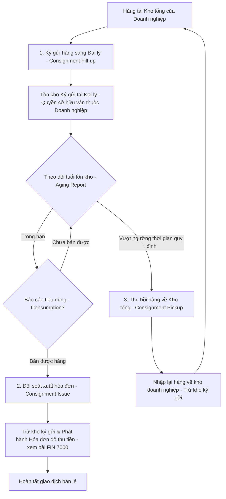

# 6020 Quản lý đơn hàng ký gửi đại lý và đối soát tiêu dùng

Trong ngành sản xuất, dược phẩm, thời trang, hoặc bán lẻ hàng tiêu dùng nhanh (FMCG), doanh nghiệp thường áp dụng mô hình **Bán hàng ký gửi đại lý (Consignment Sales)**. Doanh nghiệp sẽ vận chuyển hàng hóa ký gửi đến lưu kho tại cửa hàng hoặc kho của Đại lý (Customer Consignment Stock). Tuy nhiên, quyền sở hữu hàng hóa vẫn thuộc về doanh nghiệp và chưa phát sinh giao dịch mua bán [6020]. Định kỳ (hàng tuần hoặc hàng tháng), đại lý sẽ gửi báo cáo tiêu dùng/bán ra thực tế (Consumption Report), doanh nghiệp dựa vào đó để thực hiện đối soát, trừ lượng tồn kho ký gửi và xuất hóa đơn đỏ thu tiền.

> **Lưu ý phạm vi:** Bài này chỉ tập trung vào nghiệp vụ và cấu hình ở phân hệ Order Management/Sales (OM). Phần bút toán kế toán chi tiết (ghi nhận doanh thu, giá vốn, công nợ AR khi đối soát) được trình bày riêng ở bài phân hệ Tài chính (FIN) — xem tham chiếu ở mục 6.

---

## 1. Tình huống Nghiệp vụ & "Điểm đau" thực tế

Vận hành mô hình bán hàng ký gửi bằng các phương pháp thủ công hoặc thiết lập sai logic tồn kho thường gây ra các sai lệch nghiêm trọng:

*   **Nhầm lẫn tài sản sở hữu (Inventory Ownership):** Hàng hóa đã giao sang kho của Đại lý nhưng do hệ thống không phân loại rõ, kế toán kho vẫn tính gộp lượng hàng này vào tồn kho sẵn sàng bán của doanh nghiệp [1000]. Kết quả là hệ thống cho phép tạo đơn bán hàng cho các khách hàng khác lấy đúng lượng hàng này, gây ra tình trạng cháy hàng ảo trên hệ thống.
*   **Thất thoát số liệu đối soát tiêu dùng:** Đại lý báo cáo bán được 50 cái, nhưng do quá trình ghi nhận đối soát thủ công ngoài Excel bị lệch, doanh nghiệp chỉ xuất hóa đơn 40 cái. Sự lệch lạc lũy kế qua nhiều kỳ đối soát dẫn đến việc chênh lệch lớn giữa tồn kho thực tế tại đại lý và tồn kho theo dõi trên ERP khi tiến hành kiểm kê [1010].
*   **Hàng ký gửi tồn đọng quá lâu không bị phát hiện:** Nếu hệ thống không theo dõi tuổi hàng ký gửi (Consignment Aging), sản phẩm có thể nằm tại đại lý hàng tháng/hàng năm mà không bán được — dẫn đến rủi ro hết hạn sử dụng, lỗi mốt, hoặc thất thoát vốn lưu động mà doanh nghiệp không hề hay biết cho đến khi kiểm kê định kỳ.

---

## 2. Bản đồ Thiết kế & Ánh xạ Cơ sở dữ liệu

Dưới đây là bảng đối chiếu cấu trúc quản lý bán hàng ký gửi đại lý giữa các hệ thống ERP phổ biến:

| Thực thể nghiệp vụ | SAP S/4HANA (SD) | Oracle EBS R12 (Tables) | Epicor ERP (Tables) | Odoo (Tables) |
| :--- | :--- | :--- | :--- | :--- |
| **Gói hàng ký gửi**<br/>*(Consignment Fill-up - KB)* | **`VBAK`**<br/>(Order Type = 'KB') | **`OE_ORDER_HEADERS_ALL`**<br/>(Mã Transaction Type Fill-up) | **`Erp.Warehouse`**<br/>(Kho gán mã khách hàng `CustNum`) | **`stock.picking`**<br/>(Chuyển kho ký gửi đại lý) |
| **Hóa đơn tiêu dùng**<br/>*(Consignment Issue - KE)* | **`VBAK`**<br/>(Order Type = 'KE') | **`OE_ORDER_HEADERS_ALL`**<br/>(Mã Transaction Type Issue) | **`Erp.OrderHed`**<br/>(Đơn hàng xuất bán từ kho ký gửi) | **`sale.order`**<br/>(Xuất bán từ kho ký gửi) |
| **Thu hồi hàng ký gửi**<br/>*(Consignment Pickup - KA)* | **`VBAK`**<br/>(Order Type = 'KA') | **`OE_ORDER_HEADERS_ALL`**<br/>(Mã Transaction Type Pickup) | **Transfer Order**<br/>(Thu hồi hàng về kho tổng) | **`stock.picking`**<br/>(Nhận hàng ngược lại) |
| **Tồn kho tại Đại lý**<br/>*(Consignment Stock)* | **`MSKU`**<br/>(Special Stock Customer) | **`MTL_ONHAND_QUANTITIES`**<br/>(Lọc Subinventory ký gửi) | **`Erp.PartBin`**<br/>(Tồn kho tại kho ký gửi) | **`stock.quant`**<br/>(Lọc trường `owner_id`) |

> **Lưu ý riêng cho Odoo:** Khác với SAP/Oracle/Epicor — vốn tách hẳn một kho hoặc Subinventory riêng cho hàng ký gửi — Odoo mặc định dùng chung cấu trúc kho vật lý và phân biệt quyền sở hữu bằng trường `owner_id` trên bảng `stock.quant`. Khi hàng còn ở kho tổng nhưng đã "gán" cho đại lý, hoặc khi hàng đã chuyển sang kho đại lý nhưng vẫn thuộc sở hữu doanh nghiệp, hệ thống phân biệt hoàn toàn dựa vào giá trị `owner_id` này chứ không dựa vào vị trí kho vật lý. Đây là điểm dễ nhầm lẫn nhất khi đối chiếu logic giữa Odoo và các hệ thống còn lại.

---

## 3. Sơ đồ Chu kỳ Bán hàng Ký gửi Đại lý (Consignment Lifecycle)

Sơ đồ dưới đây mô tả các trạng thái cốt lõi của quy trình bán hàng ký gửi từ lúc chuyển hàng đi, theo dõi tuổi tồn kho, cho đến khi đối soát xuất hóa đơn hoặc thu hồi hàng thừa về:



---

## 4. Quy trình cấu hình thực tế trên các ERP lớn

### A. Trên Oracle EBS R12 (Consignment Inventory & Sales)
Oracle quản lý hàng ký gửi thông qua cơ chế phân tách Kho phụ (`Subinventory`):
1.  **Thiết lập Kho phụ ký gửi cho Đại lý:**
    *   *Nghiệp vụ:* Tạo một Subinventory chuyên biệt đại diện cho kho của đại lý (ví dụ: `CONS_KH01`).
2.  **Vận hành qua hai loại Transaction Type:**
    *   **Consignment Fill-up:** Nhân viên tạo Sales Order chuyên dụng để xuất hàng từ kho tổng sang kho ký gửi `CONS_KH01`. Hệ thống thực hiện dịch chuyển kho (Subinventory Transfer) [1010]. Giao dịch này thuần túy là dịch chuyển tồn kho nội bộ, không kích hoạt bất kỳ giao dịch công nợ AR nào ở bước này.
    *   **Consignment Issue:** Khi đại lý gửi báo cáo bán được hàng, nhân viên tạo đơn hàng SO gán mã giao dịch xuất hóa đơn ký gửi, hệ thống tự động trừ tồn kho tại `CONS_KH01` và kích hoạt luồng xuất hóa đơn đỏ tài chính [1010]. Chi tiết bút toán ghi nhận doanh thu/giá vốn tại bước này thuộc phạm vi bài phân hệ FIN (xem mục 6).

### B. Trên Epicor ERP (Customer Managed Inventory - CMI)
Epicor quản lý hàng ký gửi đại lý bằng cách liên kết trực tiếp **Warehouse** với mã khách hàng **Customer**:
1.  **Thiết lập Kho ký gửi đại lý:**
    *   *Đường dẫn:* `Material Management > Inventory Management > Setup > Warehouse` [1000].
    *   *Nghiệp vụ:* Tạo mới mã kho (ví dụ: `WH_CUST01`). Tại tab `Detail`, chọn mã đối tác khách hàng tại trường **`Customer (CustNum)`** để đánh dấu đây là kho ký gửi của khách [2000].
2.  **Đối soát xuất bán:**
    *   *Nghiệp vụ:* Khi đại lý báo tiêu dùng, nhân viên kinh doanh tạo đơn hàng `Sales Order Entry` [1030]. Tại tab `Releases`, chọn kho xuất hàng mặc định là kho ký gửi `WH_CUST01` [3030, 3040]. Khi xác nhận xuất kho (`Shipment Entry`), hệ thống sẽ trừ trực tiếp tồn kho tại kho ký gửi và chuyển sang trạng thái sẵn sàng xuất hóa đơn công nợ [1010, 5020].

---

## 5. SQL Database Audit Queries (Truy vấn đối soát dữ liệu)

### A. Đối soát số dư và giá trị tồn kho ký gửi của các Đại lý trên Oracle EBS

Query dưới đây giúp bộ phận kiểm soát nội bộ và kế toán kho tra cứu số dư **số lượng lẫn giá trị** tồn kho thực tế của các sản phẩm đang nằm tại các kho phụ ký gửi đại lý trên Oracle EBS — phần giá trị (`onhand_consignment_value`) cần thiết để kế toán biết quy mô tài sản đang "treo" ngoài đại lý, phục vụ đối soát tài chính chứ không chỉ đối soát số lượng:

```sql
SELECT
    moq.organization_id           AS organization_id,
    msib.segment1                 AS item_code,
    moq.subinventory_code         AS subinventory_code, -- Thường gán mã dạng 'CONS_xxx'
    moq.lot_number                AS lot_number,
    SUM(moq.transaction_quantity) AS onhand_consignment_qty,
    SUM(moq.transaction_quantity * NVL(cic.item_cost, 0))
                                   AS onhand_consignment_value
FROM
    mtl_onhand_quantities moq
INNER JOIN
    mtl_system_items_b msib ON moq.inventory_item_id = msib.inventory_item_id
                            AND moq.organization_id = msib.organization_id
LEFT JOIN
    cst_item_costs cic ON moq.inventory_item_id = cic.inventory_item_id
                       AND moq.organization_id = cic.organization_id
WHERE
    moq.subinventory_code LIKE '%CONS%' -- Lọc các Subinventory chuyên biệt cho ký gửi đại lý
GROUP BY
    moq.organization_id, msib.segment1, moq.subinventory_code, moq.lot_number
HAVING
    SUM(moq.transaction_quantity) > 0
ORDER BY
    msib.segment1;
```

### B. Tra cứu tồn kho ký gửi chi tiết theo Khách hàng trên Epicor ERP

Query dưới đây lọc ra toàn bộ số dư tồn kho của sản phẩm đang nằm tại các kho ký gửi đại lý trên Epicor, hiển thị chi tiết mã số và tên của khách hàng sở hữu kho:

```sql
SELECT
    w.Company,
    w.WarehouseCode               AS Consignment_Warehouse,
    w.Description                 AS Warehouse_Description,
    c.CustID                      AS Customer_Code,
    c.Name                        AS Customer_Name,
    pb.PartNum                    AS Part_Number,
    pb.LotNum                     AS Lot_Number,
    SUM(pb.OnhandQty)             AS On_Hand_Consignment_Qty
FROM
    Erp.Warehouse w
INNER JOIN
    Erp.Customer c ON w.Company = c.Company AND w.CustNum = c.CustNum -- Liên kết kho với khách hàng
INNER JOIN
    Erp.PartBin pb ON w.Company = pb.Company AND w.WarehouseCode = pb.WarehouseCode
WHERE
    w.Company = 'YOUR_COMPANY_CODE'
GROUP BY
    w.Company, w.WarehouseCode, w.Description, c.CustID, c.Name, pb.PartNum, pb.LotNum
HAVING
    SUM(pb.OnhandQty) > 0
ORDER BY
    c.CustID, pb.PartNum;
```

### C. Báo cáo tuổi tồn kho ký gửi (Consignment Aging) trên Oracle EBS

Query dưới đây tính số ngày kể từ giao dịch Fill-up gần nhất cho từng lô hàng ký gửi, phục vụ cảnh báo thu hồi khi hàng tồn đọng quá lâu tại đại lý:

```sql
SELECT
    moq.organization_id           AS organization_id,
    msib.segment1                 AS item_code,
    moq.subinventory_code         AS subinventory_code,
    moq.lot_number                AS lot_number,
    SUM(moq.transaction_quantity) AS onhand_consignment_qty,
    MAX(mmt.transaction_date)     AS last_fillup_date,
    ROUND(SYSDATE - MAX(mmt.transaction_date)) AS days_in_consignment
FROM
    mtl_onhand_quantities moq
INNER JOIN
    mtl_system_items_b msib ON moq.inventory_item_id = msib.inventory_item_id
                            AND moq.organization_id = msib.organization_id
LEFT JOIN
    mtl_material_transactions mmt ON moq.inventory_item_id = mmt.inventory_item_id
                                  AND moq.subinventory_code = mmt.subinventory_code
WHERE
    moq.subinventory_code LIKE '%CONS%'
GROUP BY
    moq.organization_id, msib.segment1, moq.subinventory_code, moq.lot_number
HAVING
    SUM(moq.transaction_quantity) > 0
ORDER BY
    days_in_consignment DESC;
```
> *Ngưỡng cảnh báo (ví dụ 90 ngày) nên được cấu hình linh động theo ngành hàng — hàng dược phẩm/thực phẩm cần ngưỡng ngắn hơn nhiều so với hàng thời trang hoặc thiết bị công nghiệp.*

---

## 6. Nguyên tắc Nghiệp vụ cốt lõi khi Tự xây dựng hoặc Tùy biến Hệ thống (OMS/ERP)

### Nguyên tắc 1: Tách biệt hai giai đoạn luân chuyển (Fill-up vs. Issue Separation)
*   **Yêu cầu thiết kế logic:** Hệ thống tự xây dựng bắt buộc phải chia quy trình ký gửi thành hai chứng từ độc lập:
    *   **Consignment Fill-up (Phiếu ký gửi hàng):** Chỉ thực hiện giao dịch chuyển kho (Subinventory/Warehouse Transfer) từ kho tổng sang kho đại lý. Trạng thái kế toán của lô hàng vẫn thuộc tài sản của doanh nghiệp (Inventory), tuyệt đối không sinh hóa đơn công nợ phải thu AR [1010].
    *   **Consignment Issue (Phiếu đối soát tiêu dùng):** Được tạo dựa trên báo cáo bán ra của đại lý. Chứng từ này sẽ trừ tồn kho tại kho đại lý, đồng thời chuyển quyền sở hữu tài sản sang cho đại lý và tự động kích hoạt luồng xuất hóa đơn đỏ thu tiền [1010]. **Chi tiết bút toán ghi nhận doanh thu, giá vốn và công nợ AR tại bước này được trình bày trong bài phân hệ Tài chính (FIN) — xem bài "Ghi nhận doanh thu và công nợ đối soát ký gửi" (OM 7000) trong cùng chuỗi tài liệu.**

### Nguyên tắc 2: Đối soát chênh lệch tự động (Consignment Reconciliation & Inventory Auditing)
*   **Yêu cầu thiết kế logic:** Hệ thống tự xây dựng cần có công cụ đối soát tự động. Khi tiến hành kiểm kê thực tế định kỳ tại kho của đại lý, hệ thống sẽ so khớp số dư kiểm kê thực tế với số dư lý thuyết trên hệ thống.
*   **Ngưỡng dung sai (Tolerance Threshold):** Nên cấu hình một ngưỡng chênh lệch cho phép (ví dụ ±2% số lượng hoặc giá trị). Nếu chênh lệch nằm trong ngưỡng, hệ thống có thể tự động sinh chứng từ `Consignment Issue` điều chỉnh cho phần thiếu hụt không rõ nguyên nhân. Nếu chênh lệch vượt ngưỡng, hệ thống bắt buộc đẩy sang luồng phê duyệt thủ công (kiểm toán nội bộ/quản lý kho xác nhận) trước khi ghi nhận điều chỉnh, nhằm tránh việc thất thoát hoặc gian lận bị "hợp thức hóa" qua cơ chế tự động.

### Nguyên tắc 3: Theo dõi tuổi tồn kho và ngưỡng thu hồi bắt buộc (Consignment Aging)
*   **Yêu cầu thiết kế logic:** Hệ thống cần tính và lưu trữ số ngày kể từ thời điểm Fill-up gần nhất cho từng lô/mã hàng tại từng đại lý. Khi tuổi tồn kho vượt ngưỡng quy định theo chính sách ngành hàng (ví dụ 90 ngày với hàng tiêu dùng nhanh, ngắn hơn với dược phẩm có hạn sử dụng), hệ thống nên tự động cảnh báo hoặc đề xuất tạo chứng từ `Consignment Pickup` để thu hồi hàng về kho tổng, tránh rủi ro hết hạn, lỗi mốt, hoặc tồn đọng vốn không kiểm soát.

---

## 7. Luồng luân chuyển dữ liệu liên phân hệ (Cross-Module Touchpoints)

*   **Tích hợp phân hệ Tồn kho (INV):** Luồng chuyển kho ký gửi (`Consignment Fill-up`) và thu hồi hàng ký gửi (`Consignment Pickup`) trực tiếp kích hoạt các giao dịch dịch chuyển kho tại phân hệ INV để đảm bảo theo dõi chính xác vị trí và giá trị của tài sản doanh nghiệp [1010].
*   **Tích hợp phân hệ Tài chính (FIN):** Khi thực hiện đối soát xuất bán (`Consignment Issue`), hệ thống OM đẩy dữ liệu sang phân hệ AR để ghi nhận doanh thu và hạch toán công nợ phải thu của đại lý, đồng thời kế toán kho tiến hành định khoản giảm trừ tài sản tồn kho ký gửi trên Sổ cái kế toán [1010, 6020]. Phần bút toán chi tiết không thuộc phạm vi bài OM này — tham chiếu bài chuyên biệt bên phân hệ FIN.

---

<div align="center" style={{color: 'var(--ifm-color-primary)'}}>
  <strong>Chúc các bạn thành công và vui vẻ!</strong>
</div>
