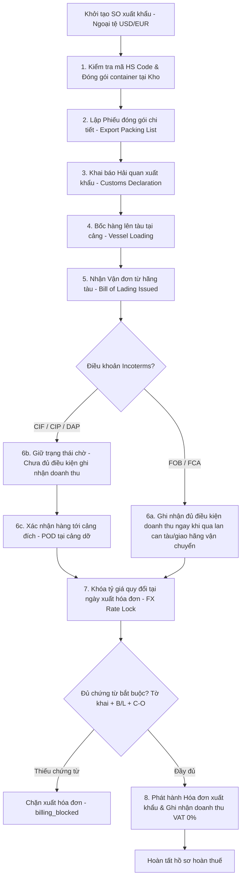

# 6030 Quy trình xử lý đơn hàng xuất khẩu và thủ tục liên quan

Trong bối cảnh toàn cầu hóa, hoạt động xuất khẩu là động cơ tăng trưởng của nhiều doanh nghiệp sản xuất và thương mại. Khác với đơn hàng nội địa, **Đơn hàng xuất khẩu (Export Sales Order)** có độ phức tạp rất cao về mặt thủ tục pháp lý. Quy trình xử lý đơn hàng xuất khẩu đòi hỏi hệ thống ERP phải kiểm soát đồng thời nhiều yếu tố đặc thù: quản lý đa tiền tệ (Multi-currency), kiểm soát điều khoản thương mại quốc tế (Incoterms), quản lý thông tin phương tiện vận chuyển (tàu biển, container), và đồng bộ hồ sơ hải quan để phục vụ hoàn thuế VAT [6030].

> **Lưu ý phạm vi:** Bài này chỉ tập trung vào nghiệp vụ và cấu hình ở phân hệ Order Management/Sales (OM). Phần bút toán chi tiết (đánh giá chênh lệch tỷ giá cuối kỳ, hạch toán doanh thu ngoại tệ) được trình bày riêng ở bài phân hệ Tài chính (FIN) — xem tham chiếu ở mục 6 và mục 7.

---

## 1. Tình huống Nghiệp vụ & "Điểm đau" thực tế

Triển khai đơn hàng xuất khẩu thủ công hoặc thiếu cấu hình đồng bộ trên ERP thường gây ra các tổn thất và sai lệch lớn cho doanh nghiệp:

*   **Rủi ro chênh lệch tỷ giá hối đoái (FX Exposure):** Đơn hàng xuất khẩu được báo giá bằng ngoại tệ (USD, EUR). Nếu hệ thống tính toán giá trị quy đổi VND dựa trên tỷ giá động thay đổi liên tục mà không có cơ chế khóa tỷ giá (Exchange Rate Lock) tại các cột mốc pháp lý, kế toán sẽ gặp khó khăn lớn khi đối chiếu hóa đơn và ghi nhận doanh thu tính thuế [1010, 6030].
*   **Hạch toán doanh thu sai thời điểm (Incoterms Violation):** Theo điều khoản FOB, quyền sở hữu và rủi ro hàng hóa chuyển giao cho khách hàng ngay khi hàng qua lan can tàu tại cảng bốc hàng. Nhưng đối với điều khoản CIF, doanh nghiệp phải chịu trách nhiệm cước biển và bảo hiểm cho đến khi hàng tới cảng dỡ. Nếu hệ thống tự động ghi nhận doanh thu và xuất hóa đơn ngay khi hàng xuất khỏi kho vật lý mà không đối chiếu điều khoản Incoterms, doanh nghiệp sẽ vi phạm nghiêm trọng chuẩn mực kế toán quốc tế (IFRS 15) [5020, 6030].
*   **Trễ hạn hoàn thuế do thất thoát hồ sơ hải quan:** Để được hưởng thuế suất VAT xuất khẩu 0% và làm thủ tục hoàn thuế, doanh nghiệp phải cung cấp đầy đủ: Tờ khai hải quan thông quan, Vận đơn đường biển (Bill of Lading - B/L), và chứng từ thanh toán qua ngân hàng. Việc lưu trữ hồ sơ giấy rời rạc ngoài hệ thống khiến kế toán mất nhiều thời gian tìm kiếm và đối soát khi thanh tra thuế vào kiểm tra.
*   **Sai/thiếu mã HS Code gây từ chối thông quan:** Nếu hệ thống không bắt buộc gán mã HS Code (Harmonized System) hợp lệ cho từng mặt hàng trước khi cho phép khai báo hải quan, tờ khai có thể bị hải quan từ chối hoặc áp sai mức thuế xuất khẩu, kéo dài thời gian thông quan và phát sinh chi phí lưu container tại cảng.

---

## 2. Bản đồ Thiết kế & Ánh xạ Cơ sở dữ liệu

Dưới đây là bảng đối chiếu cấu trúc quản lý các thông số đơn hàng xuất khẩu trên các hệ thống ERP:

| Thực thể nghiệp vụ | Oracle EBS R12 (Tables) | Epicor ERP (Tables) | SAP S/4HANA (Tables) | Odoo (Tables) |
| :--- | :--- | :--- | :--- | :--- |
| **Tiền tệ giao dịch**<br/>*(Currency & Rate)* | **`OE_ORDER_HEADERS_ALL`**<br/>(Cột `TRANSACTIONAL_CURR_CODE`, `CONVERSION_RATE`) | **`Erp.OrderHed`**<br/>(Cột `CurrencyCode`, `ExchangeRate`) | **`VBAK`**<br/>(Cột `WAERK` - SD Document Currency) | **`sale.order`**<br/>(Cột `currency_id`) |
| **Điều khoản giao hàng**<br/>*(Incoterms)* | **`OE_ORDER_HEADERS_ALL`**<br/>(Cột `FOB_POINT_CODE`) | **`Erp.Incoterms`**<br/>(Bảng danh mục Incoterms)<br/>**`Erp.OrderHed`** (Cột `IncotermsCode`) | **`VBAK`**<br/>(Cột `INCO1` - Incoterms Part 1) | **`sale.order`**<br/>(Cột `incoterm`) |
| **Vận đơn / Theo dõi**<br/>*(Bill of Lading - B/L)* | **`WSH_NEW_DELIVERIES`**<br/>(Cột `WAYBILL` - Mã B/L) [5010] | **`Erp.ShipHead`**<br/>(Cột `TrackingNumber` - Mã B/L) [5010] | **`VTTK`**<br/>(Cột `SIGN` - Bill of Lading No) [5010] | **`stock.picking`**<br/>(Cột `carrier_tracking_ref`) [5010] |
| **Hồ sơ hải quan**<br/>*(Customs Declaration)* | Custom Tables /<br/>Oracle Global Trade (GTM) | Custom Fields (`Character01`...) /<br/>Quick Ship | **`EIKP`** (Header Foreign Trade)<br/>**`EIPO`** (Item Foreign Trade) | Custom Models /<br/>Attachments |
| **Mã HS**<br/>*(Harmonized System Code)* | **`MTL_SYSTEM_ITEMS_B`**<br/>(Cột `CUSTOMS_CATEGORY`) | **`Erp.Part`**<br/>(Cột `CommodityCode`) | **`MARC`** / **`STXH`**<br/>(Cột `STAWN` - Commodity Code) | **`product.template`**<br/>(Cột `hs_code`) |
| **Chứng nhận xuất xứ**<br/>*(Certificate of Origin - C/O)* | Custom Fields trên<br/>`OE_ORDER_HEADERS_ALL` /<br/>Attachments | Custom Fields (`Character02`...) /<br/>Document Attachment | Custom field trên `VBAK`<br/>hoặc `EIKP` mở rộng | Custom Field /<br/>`ir.attachment` |

---

## 3. Sơ đồ Luồng đơn hàng Xuất khẩu tiêu chuẩn (Export Sales Order Lifecycle)

Sơ đồ dưới đây mô tả các bước thực thi từ khâu lên đơn hàng ngoại tệ, làm thủ tục hải quan, dán nhãn container, cho đến khi xác định đúng thời điểm ghi nhận doanh thu theo Incoterms và nhận vận đơn (B/L) để phát hành hóa đơn tài chính:



---

## 4. Quy trình cấu hình thực tế trên các ERP lớn

### A. Trên Oracle EBS R12 (Order Management - Export Attributes)
1.  **Thiết lập đa tiền tệ và tỷ giá trên đơn hàng:**
    *   *Nghiệp vụ:* Khi tạo Sales Order, tại màn hình Header, chọn mã ngoại tệ (`Currency = USD`).
    *   *Cấu hình tỷ giá:* Tại trường `Conversion Type`, chọn loại tỷ giá áp dụng (ví dụ: `Corporate` - tỷ giá công ty, hoặc `User` - tự nhập tỷ giá thỏa thuận trên hợp đồng). Hệ thống ghi nhận tỷ giá quy đổi vào trường `CONVERSION_RATE` [3010].
2.  **Khai báo điều khoản Incoterms:**
    *   *Nghiệp vụ:* Tại tab `Shipping`, gán mã điều khoản giao hàng tại trường `FOB` (ví dụ: `FOB` - Free on Board, `CIF` - Cost, Insurance, and Freight).
    *   *Theo dõi chứng từ:* Khi hãng tàu phát hành Bill of Lading, nhân viên nhập số B/L vào trường `Waybill` trên phiếu giao hàng `WSH_NEW_DELIVERIES` để làm căn cứ hạch toán [5010].
3.  **Khai báo mã HS Code:**
    *   *Nghiệp vụ:* Mã HS Code được gán tại cấp Item Master (`MTL_SYSTEM_ITEMS_B`, cột `CUSTOMS_CATEGORY`), không khai báo lại theo từng đơn hàng. Hệ thống nên có validation chặn không cho phép Release đơn hàng ra kho nếu Item chưa có mã HS Code hợp lệ.

### B. Trên Epicor ERP (Kinetic - International Trade Setup)
Epicor hỗ trợ quản lý thương mại quốc tế rất trực quan thông qua danh mục cấu hình riêng biệt:
1.  **Cấu hình danh mục Incoterms:**
    *   *Đường dẫn:* `Sales Management > Order Management > Setup > Incoterms`.
    *   *Nghiệp vụ:* Tạo mới các mã Incoterms chuẩn (`IncotermsCode`) kèm mô tả chi tiết quyền nghĩa vụ giao nhận.
2.  **Áp dụng trên Đơn hàng xuất khẩu:**
    *   *Đường dẫn:* `Sales Management > Order Management > Sheets > Sales Order Entry` [1030].
    *   *Nghiệp vụ:* Tại tab `Header > Detail`, chọn mã ngoại tệ (`CurrencyCode`), nhập tỷ giá quy đổi (`ExchangeRate`) và chọn mã điều khoản giao hàng (`IncotermsCode`). Khi in chứng từ xuất khẩu (Proforma Invoice / Commercial Invoice), hệ thống tự động kết xuất các điều khoản này lên mẫu in.
3.  **Khai báo mã HS Code (Commodity Code):**
    *   *Đường dẫn:* `Material Management > Inventory Management > Setup > Part`, trường `CommodityCode` tại tab `Detail`. Mã này được kế thừa tự động lên Export Packing List và hồ sơ khai báo hải quan khi in chứng từ.

---

## 5. SQL Database Audit Queries (Truy vấn đối soát dữ liệu)

### A. Đối soát đơn hàng xuất khẩu ngoại tệ và tỷ giá quy đổi trên Oracle EBS

Query dưới đây giúp bộ phận tài chính và kế toán rà soát toàn bộ các đơn hàng xuất khẩu đang hoạt động sử dụng ngoại tệ (khác đồng tiền hạch toán chính là VND), hiển thị chi tiết tỷ giá và điều khoản Incoterms gán trên đơn:

```sql
SELECT
    oha.org_id                    AS operating_unit_id,
    oha.order_number              AS export_order_number,
    hca.account_number            AS customer_number,
    hp.party_name                 AS customer_name,
    oha.transactional_curr_code   AS currency,
    oha.conversion_rate           AS exchange_rate,
    oha.fob_point_code            AS incoterm_fob,
    oha.payment_term_id           AS payment_term_id,
    oha.flow_status_code          AS order_status
FROM
    oe_order_headers_all oha
INNER JOIN
    hz_cust_accounts hca ON oha.sold_to_org_id = hca.cust_account_id
INNER JOIN
    hz_parties hp ON hca.party_id = hp.party_id
WHERE
    oha.transactional_curr_code <> 'VND' -- Lọc các đơn hàng ngoại tệ xuất khẩu
    AND oha.ordered_date >= TO_DATE('2026-01-01', 'YYYY-MM-DD')
ORDER BY
    oha.ordered_date DESC;
```

### B. Tra cứu đơn hàng xuất khẩu và mã điều khoản Incoterms trên Epicor ERP

Query dưới đây lọc ra toàn bộ các đơn hàng xuất khẩu trên Epicor sử dụng ngoại tệ, hiển thị chi tiết mã Incoterms và giá trị quy đổi ra đồng tiền hạch toán cơ sở (Base Currency) để phục vụ kiểm toán:

```sql
SELECT
    oh.Company,
    oh.OrderNum                   AS Order_Number,
    oh.OrderDate                  AS Order_Date,
    oh.CurrencyCode               AS Currency,
    oh.ExchangeRate               AS Exchange_Rate,
    oh.IncotermsCode              AS Incoterm_Code,
    i.Description                 AS Incoterm_Description,
    oh.DocOrderAmt                AS Total_Foreign_Amount,
    (oh.DocOrderAmt * oh.ExchangeRate) AS Total_Base_Amount
FROM
    Erp.OrderHed oh
LEFT JOIN
    Erp.Incoterms i ON oh.Company = i.Company AND oh.IncotermsCode = i.IncotermsCode
WHERE
    oh.Company = 'YOUR_COMPANY_CODE'
    AND oh.CurrencyCode <> 'VND' -- Lọc các đơn hàng ngoại tệ
    AND oh.VoidOrder = 0
ORDER BY
    oh.OrderDate DESC;
```

### C. Rà soát đơn hàng xuất khẩu đã bốc hàng nhưng còn bị chặn xuất hóa đơn (Billing Block Gate)

Query dưới đây phục vụ Nguyên tắc 2 (Chốt chặn chứng từ xuất khẩu bắt buộc) — giúp bộ phận logistics/kế toán theo dõi các đơn hàng đã hoàn tất bốc hàng nhưng vẫn còn bị khóa xuất hóa đơn do thiếu một trong ba loại chứng từ bắt buộc:

```sql
SELECT
    oha.order_number              AS export_order_number,
    oha.flow_status_code          AS order_status,
    oha.attribute10               AS customs_declaration_no,   -- Custom field lưu số tờ khai hải quan
    wnd.waybill                   AS bill_of_lading_no,
    oha.attribute11               AS certificate_of_origin_no, -- Custom field lưu số C/O
    oha.billing_blocked_flag      AS billing_blocked
FROM
    oe_order_headers_all oha
LEFT JOIN
    wsh_new_deliveries wnd ON oha.header_id = wnd.source_header_id
WHERE
    oha.flow_status_code = 'SHIPPED'
    AND oha.billing_blocked_flag = 'Y'
ORDER BY
    oha.order_number;
```
> *Tên các custom field (`attribute10`, `attribute11`, `billing_blocked_flag`) cần điều chỉnh theo cấu hình Descriptive Flexfield thực tế của từng doanh nghiệp.*

### D. Rà soát đơn hàng xuất khẩu thiếu mã HS Code trước khi khai hải quan

Query dưới đây giúp bộ phận xuất nhập khẩu phát hiện sớm các dòng hàng trên đơn xuất khẩu chưa được gán mã HS Code hợp lệ tại Item Master, tránh bị hải quan từ chối tờ khai:

```sql
SELECT
    oha.order_number              AS export_order_number,
    oli.line_number                AS order_line,
    msib.segment1                  AS item_code,
    msib.description               AS item_description,
    msib.customs_category          AS hs_code
FROM
    oe_order_lines_all oli
INNER JOIN
    oe_order_headers_all oha ON oli.header_id = oha.header_id
INNER JOIN
    mtl_system_items_b msib ON oli.inventory_item_id = msib.inventory_item_id
                             AND oli.ship_from_org_id = msib.organization_id
WHERE
    oha.transactional_curr_code <> 'VND'
    AND (msib.customs_category IS NULL OR TRIM(msib.customs_category) = '')
ORDER BY
    oha.order_number, oli.line_number;
```

---

## 6. Nguyên tắc Nghiệp vụ cốt lõi khi Tự xây dựng hoặc Tùy biến Hệ thống (OMS/ERP)

### Nguyên tắc 1: Khóa cứng tỷ giá quy đổi tại ngày xuất hóa đơn (Exchange Rate Lock Rule)
*   **Yêu cầu thiết kế logic:** Do tỷ giá ngoại tệ biến động liên tục hàng ngày, hệ thống tự xây dựng tuyệt đối không được tính toán giá trị quy đổi VND động trên báo cáo. Tại thời điểm phát hành hóa đơn xuất khẩu (`AR Commercial Invoice`) [1010], hệ thống bắt buộc phải **chụp lại (Snapshot) và khóa cứng** tỷ giá hối đoái chính thức (`exchange_rate_snapshot`) của ngày hôm đó (theo tỷ giá mua vào của ngân hàng thương mại được doanh nghiệp chỉ định).
*   **Mục tiêu:** Đảm bảo số liệu ghi nhận doanh thu khớp hoàn toàn với số liệu khai báo báo cáo thuế giá trị gia tăng gửi lên Cơ quan Thuế. Phần chênh lệch tỷ giá phát sinh sau đó (khi khách hàng thực trả tiền ở một tỷ giá khác) không xử lý ở OM — được đánh giá định kỳ tại phân hệ FIN thông qua nghiệp vụ FX Revaluation (xem mục 7).

### Nguyên tắc 2: Chốt chặn chứng từ xuất khẩu bắt buộc (Export Document Checklist Gate)
*   **Yêu cầu thiết kế logic:** Hệ thống tự xây dựng cần thiết lập một cổng kiểm soát chứng từ (Checklist Gate) gắn liền với đơn hàng xuất khẩu. Hệ thống phải kích hoạt chế độ chặn xuất hóa đơn tài chính (`billing_blocked = true`) [4030] và chỉ cho phép gỡ bỏ khi nhân viên logistics hoàn tất việc khai báo và đính kèm (Upload) các file quét chứng từ bắt buộc:
    1. Số tờ khai hải quan thông quan (Customs Declaration).
    2. Số vận đơn tàu biển/hàng không (Bill of Lading - B/L) [5010].
    3. Chứng nhận xuất xứ (Certificate of Origin - C/O) nếu có.
*   **Mục tiêu:** Chặn đứng hoàn toàn rủi ro thiếu sót hồ sơ hải quan, đảm bảo tính hợp lệ pháp lý cao nhất cho quy trình hoàn thuế VAT 0% của doanh nghiệp.

### Nguyên tắc 3: Xác định điểm kích hoạt ghi nhận doanh thu theo Incoterms (Revenue Recognition Trigger by Incoterms)
*   **Yêu cầu thiết kế logic:** Hệ thống tự xây dựng không được dùng một mốc thời gian duy nhất (ví dụ: ngày xuất kho vật lý) để xác định điều kiện ghi nhận doanh thu cho mọi đơn hàng xuất khẩu. Điểm kích hoạt phải được rẽ nhánh theo nhóm điều khoản Incoterms gán trên đơn hàng:
    *   **Nhóm FOB / FCA / EXW** (rủi ro chuyển giao sớm, tại cảng/địa điểm đi): hệ thống cho phép đơn hàng đủ điều kiện ghi nhận doanh thu ngay khi hàng qua lan can tàu hoặc giao cho đơn vị vận chuyển đầu tiên — thường lấy mốc ngày Bốc hàng lên tàu (`Vessel Loading Date`).
    *   **Nhóm CIF / CIP / DAP / DDP** (doanh nghiệp còn chịu trách nhiệm cước phí/rủi ro đến cảng đích): hệ thống phải giữ đơn hàng ở trạng thái "chưa đủ điều kiện ghi nhận doanh thu" cho đến khi có xác nhận giao hàng tại cảng dỡ (Proof of Delivery tại cảng đích), không được dùng POD tại cảng đi làm căn cứ.
*   **Mục tiêu:** Tránh vi phạm nguyên tắc ghi nhận doanh thu theo thời điểm chuyển giao quyền kiểm soát hàng hóa (IFRS 15). Bút toán ghi nhận doanh thu tương ứng với từng mốc này được trình bày chi tiết ở bài phân hệ FIN.

---

## 7. Luồng luân chuyển dữ liệu liên phân hệ (Cross-Module Touchpoints)

*   **Tích hợp phân hệ Kế toán sổ cái & Đa tiền tệ (FIN-GL):** Việc ghi nhận tỷ giá và doanh thu ngoại tệ trên đơn bán hàng là dữ liệu đầu vào trực tiếp để phân hệ GL thực hiện tiến trình đánh giá chênh lệch tỷ giá hối đoái định kỳ (FX Revaluation) cuối tháng đối với các hóa đơn xuất khẩu chưa thu được tiền. Chi tiết bút toán chênh lệch tỷ giá thực hiện/chưa thực hiện không thuộc phạm vi bài OM này — tham chiếu bài chuyên biệt bên phân hệ FIN.
*   **Tích hợp phân hệ Kho (WMS/INV):** Đơn hàng xuất khẩu đòi hỏi quy cách đóng gói đặc thù (nhập số container, dán nhãn pallet theo tiêu chuẩn quốc tế). Phân hệ Kho sẽ nhận diện đơn hàng xuất khẩu dựa trên cấu hình loại chứng từ [1010] để in phiếu hướng dẫn đóng gói (Export Packing List) chuẩn xác nhất.

---

<div align="center" style={{color: 'var(--ifm-color-primary)'}}>
  <strong>Chúc các bạn thành công và vui vẻ!</strong>
</div>
