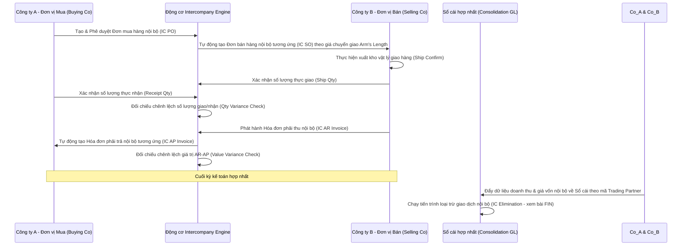

# 6040 Quản lý đơn hàng nội bộ giữa các công ty và chi nhánh (Intercompany)

Trong các tập đoàn đa công ty thành viên, hoạt động giao dịch nội bộ (Intercompany Transactions) diễn ra vô cùng thường xuyên. Ví dụ: Công ty A (chuyên phân phối) bán hàng cho khách hàng nhưng thực tế kho của Công ty B (chuyên sản xuất) lại giữ hàng và thực hiện xuất kho [1000]. Để hợp pháp hóa về mặt pháp lý và thuế, hệ thống ERP phải tự động sinh ra một cặp chứng từ mua bán song song: **Đơn mua hàng nội bộ (Intercompany PO)** tại Công ty A và **Đơn bán hàng nội bộ (Intercompany SO)** tại Công ty B, vận hành theo cơ chế **Giá chuyển giao nội bộ (Transfer Pricing)** [6040].

> **Lưu ý phạm vi:** Bài này chỉ tập trung vào nghiệp vụ và cấu hình ở phân hệ Order Management/Sales (OM) và điểm chạm với PO/GL. Phần bút toán loại trừ hợp nhất chi tiết (Intercompany Elimination Entries) và xử lý chênh lệch tỷ giá khi hai công ty dùng đồng tiền hạch toán khác nhau được trình bày riêng ở các bài phân hệ Tài chính (FIN) — xem tham chiếu ở mục 6 và mục 7.

---

## 1. Tình huống Nghiệp vụ & "Điểm đau" thực tế

Triển khai quy trình giao dịch liên công ty bằng phương pháp nhập liệu thủ công thường gây ra các sai lệch nghiêm trọng trên báo cáo tài chính hợp nhất:

*   **Chênh lệch số liệu công nợ nội bộ (Intercompany Mismatch):** Công ty A ghi nhận khoản phải trả nội bộ (AP) là 100,000,000đ, nhưng Công ty B do hạch toán trễ hoặc gõ sai đơn giá lại ghi nhận khoản phải thu nội bộ (AR) là 105,000,000đ. Khi đến kỳ hợp nhất báo cáo tài chính, kế toán tập đoàn phải mất nhiều tuần để tìm kiếm và đối chiếu thủ công chênh lệch này [1010].
*   **Thổi phồng doanh thu ảo của tập đoàn:** Nếu hệ thống ghi nhận doanh thu từ các giao dịch bán hàng nội bộ giống hệt như bán hàng cho khách hàng bên ngoài mà không có cơ chế gắn mã định danh giao dịch nội bộ để phân loại, báo cáo tài chính hợp nhất của tập đoàn sẽ bị thổi phồng doanh thu và giá vốn một cách ảo, vi phạm các chuẩn mực kế toán quốc tế.
*   **Rủi ro chuyển giá bị cơ quan thuế ấn định lại (Transfer Pricing Risk):** Nếu bảng giá chuyển giao nội bộ được thiết lập tùy ý, không dựa trên nguyên tắc giá thị trường độc lập (Arm's Length Principle), doanh nghiệp có thể bị cơ quan thuế nghi ngờ hành vi chuyển giá nhằm tối ưu thuế giữa các công ty thành viên, dẫn đến rủi ro bị ấn định lại giá và truy thu thuế.

---

## 2. Bản đồ Thiết kế & Ánh xạ Cơ sở dữ liệu giữa OM - PO - GL

Giao dịch Intercompany đòi hỏi sự đồng bộ dữ liệu thời gian thực giữa ba phân hệ chính: Bán hàng (OM), Mua hàng (PO), và Sổ cái tài chính (GL) để chuẩn bị cho bút toán loại trừ khi hợp nhất báo cáo.

| Thực thể nghiệp vụ | Oracle EBS R12 (Tables) | Epicor ERP (Tables) | SAP S/4HANA (Tables) | Odoo (Tables) |
| :--- | :--- | :--- | :--- | :--- |
| **Đơn mua nội bộ**<br/>*(Intercompany PO)* | **`PO_HEADERS_ALL`**<br/>**`PO_LINES_ALL`** | **`Erp.POHeader`**<br/>**`Erp.PODetail`** | **`EKKO`** (Header)<br/>**`EKPO`** (Items) | **`purchase.order`**<br/>(Is Intercompany) |
| **Đơn bán nội bộ**<br/>*(Intercompany SO)* | **`OE_ORDER_HEADERS_ALL`**<br/>**`OE_ORDER_LINES_ALL`** [1030] | **`Erp.OrderHed`** *(Cột `InterCompany` = 1)* [1030] | **`VBAK`** (Header)<br/>**`VBAP`** (Items) [1030] | **`sale.order`**<br/>(Cột `auto_purchase_order_id`) |
| **Hóa đơn bán nội bộ**<br/>*(Intercompany AR)* | **`RA_CUSTOMER_TRX_ALL`**<br/>(Hóa đơn phải thu nội bộ) | **`Erp.InvcHead`**<br/>(Hóa đơn phải thu nội bộ) | **`VBRK`** (Cột `FKART` = 'IV' - Intercompany) | **`account.move`**<br/>(Type = 'out_invoice') |
| **Hóa đơn mua nội bộ**<br/>*(Intercompany AP)* | **`AP_INVOICES_ALL`**<br/>(Hóa đơn phải trả nội bộ) | **`Erp.APInvHed`**<br/>(Hóa đơn phải trả nội bộ) | **`RBKP`**<br/>(Incoming Invoice Header) | **`account.move`**<br/>(Type = 'in_invoice') |
| **Mã đối tác nội bộ**<br/>*(Trading Partner / Elimination ID)* | Intercompany Segment trên COA<br/>(`GL_CODE_COMBINATIONS`) | Cột **`IcoCompany`**<br/>(dùng trực tiếp làm định danh đối tác) | Trường **`VBUND`**<br/>(Trading Partner trên `BSEG`/`BKPF`) | **`company_id`** liên kết chéo<br/>giữa 2 công ty giao dịch |

---

## 3. Sơ đồ chu kỳ vận hành Giao dịch nội bộ (Intercompany Flow)

Sơ đồ trình tự dưới đây mô tả cách hệ thống tự động sinh và đối chiếu cặp chứng từ mua bán nội bộ song song giữa hai công ty thành viên:



---

## 4. Quy trình cấu hình thực tế trên các ERP lớn

### A. Trên Oracle EBS R12 (Advanced Global Intercompany System - AGIS)
1.  **Thiết lập mối quan hệ liên kết công ty (Intercompany Relation):**
    *   *Đường dẫn:* `Intercompany Super User > Setup > Intercompany Relations`.
    *   *Nghiệp vụ:* Khai báo mối quan hệ mua bán giữa hai Operating Units (ví dụ: OU bán lẻ Miền Nam mua hàng của OU sản xuất Miền Bắc) [1000]. Chỉ định bảng giá chuyển giao nội bộ (`Transfer Pricing List`) áp dụng [2020] — bảng giá này cần được bộ phận kế toán thuế rà soát định kỳ để đảm bảo tuân thủ nguyên tắc giá thị trường độc lập.
2.  **Đồng bộ tự động chứng từ:**
    *   *Cơ chế:* Khi OU mua tạo và duyệt đơn `Internal Requisition`, hệ thống chạy tiến trình **Create Internal Sales Orders** để tự động tạo đơn bán hàng tương ứng trên bảng `OE_ORDER_HEADERS_ALL` của OU bán, kế thừa toàn bộ thông số số lượng và mã hàng [1010, 3010].

### B. Trên Epicor ERP (Multi-Company Direct)
Epicor sở hữu công cụ tích hợp liên công ty **Multi-Company Direct** hoạt động rất mạnh mẽ:
1.  **Kích hoạt luồng tích hợp liên công ty:**
    *   *Đường dẫn:* `System Setup > Multi-Company > Multi-Company Process Maintenance`.
    *   *Nghiệp vụ:* Cấu hình ánh xạ giữa Công ty mua và Công ty bán. Khai báo danh mục nhà cung cấp nội bộ (`Intercompany Vendor`) và khách hàng nội bộ (`Intercompany Customer`) đại diện chéo cho nhau [2000].
2.  **Tự động tạo đơn hàng SO nội bộ:**
    *   *Vận hành:* Ngay khi Công ty mua duyệt đơn mua hàng nội bộ (`PO Entry`), tiến trình chạy ngầm của Epicor sẽ đẩy dữ liệu qua bảng đệm và tự động tạo một đơn bán hàng tương ứng (`Order Entry`) bên Công ty bán, gán thuộc tính **`InterCompany = 1`** và lưu số PO gốc vào trường `IcoPONum` [3010, 3020].

---

## 5. SQL Database Audit Queries (Truy vấn đối soát dữ liệu)

### A. Đối soát các Đơn bán hàng nội bộ liên kết Đơn mua hàng trên Oracle EBS

Query dưới đây giúp bộ phận kế toán tập đoàn đối soát chéo danh sách các đơn bán hàng nội bộ (IC SO) đang hoạt động, hiển thị chi tiết đơn mua hàng nội bộ (IC PO) liên kết chéo giữa các Operating Units:

```sql
SELECT
    oha.org_id                    AS selling_operating_unit_id,
    oha.order_number              AS intercompany_so_number,
    pha.org_id                    AS buying_operating_unit_id,
    pha.segment1                  AS intercompany_po_number,
    msib.segment1                 AS item_code,
    oel.ordered_quantity          AS quantity,
    oel.unit_selling_price        AS transfer_price,
    oha.flow_status_code          AS so_status
FROM
    oe_order_headers_all oha
INNER JOIN
    oe_order_lines_all oel ON oha.header_id = oel.header_id
INNER JOIN
    po_headers_all pha ON oha.source_document_id = pha.po_header_id
INNER JOIN
    po_lines_all pla ON oel.source_document_line_id = pla.po_line_id
INNER JOIN
    oe_system_parameters_all osp ON oha.org_id = osp.org_id
INNER JOIN
    mtl_system_items_b msib ON oel.inventory_item_id = msib.inventory_item_id
                            AND osp.master_organization_id = msib.organization_id
WHERE
    oha.order_source_id = 10 -- 10 là mã nguồn mặc định cho Internal Requisition / Intercompany
    AND oha.ordered_date >= TO_DATE('2026-01-01', 'YYYY-MM-DD')
ORDER BY
    oha.order_number;
```

### B. Tra cứu các Đơn bán hàng liên công ty đang hoạt động trên Epicor ERP

Query dưới đây lọc ra toàn bộ các đơn bán hàng dạng Intercompany trên Epicor, hiển thị chi tiết thông tin công ty bán, công ty mua và mã đơn mua hàng nội bộ liên kết:

```sql
SELECT
    oh.Company                    AS Selling_Company,
    oh.OrderNum                   AS Intercompany_SO_Number,
    oh.IcoCompany                 AS Buying_Company,
    oh.IcoPONum                   AS Buying_PO_Number,
    od.OrderLine                  AS SO_Line,
    od.IcoPOLine                  AS Buying_PO_Line,
    od.PartNum                    AS Part_Number,
    od.OrderQty                   AS Quantity,
    od.UnitPrice                  AS Intercompany_Transfer_Price
FROM
    Erp.OrderHed oh
INNER JOIN
    Erp.OrderDtl od ON oh.Company = od.Company AND oh.OrderNum = od.OrderNum
WHERE
    oh.Company = 'YOUR_COMPANY_CODE'
    AND oh.InterCompany = 1 -- Chỉ lọc đơn hàng liên công ty
    AND oh.VoidOrder = 0
ORDER BY
    oh.OrderNum, od.OrderLine;
```

### C. Rà soát chênh lệch giá trị giữa Hóa đơn phải thu nội bộ (IC AR) và Hóa đơn phải trả nội bộ (IC AP) trên Oracle EBS

Query dưới đây phục vụ trực tiếp Nguyên tắc 2 (Đối chiếu công nợ và Chặn lệch giá trị) — phát hiện các cặp hóa đơn nội bộ có tổng giá trị AR và AP không khớp nhau, cần xử lý trước khi ghi sổ hợp nhất:

```sql
SELECT
    rct.customer_trx_id           AS ic_ar_invoice_id,
    rct.trx_number                AS ic_ar_invoice_number,
    rct.attribute1                AS linked_ic_document_ref, -- Lưu số IC PO/SO gốc để join chéo
    SUM(rctl.extended_amount)     AS ar_total_amount,
    api.invoice_id                AS ic_ap_invoice_id,
    api.invoice_num               AS ic_ap_invoice_number,
    api.invoice_amount            AS ap_total_amount,
    (SUM(rctl.extended_amount) - api.invoice_amount) AS ar_ap_variance
FROM
    ra_customer_trx_all rct
INNER JOIN
    ra_customer_trx_lines_all rctl ON rct.customer_trx_id = rctl.customer_trx_id
INNER JOIN
    ap_invoices_all api ON rct.attribute1 = api.attribute1 -- Join qua số chứng từ IC gốc
WHERE
    rct.attribute1 IS NOT NULL -- Chỉ lọc các hóa đơn có gắn mã định danh giao dịch nội bộ
GROUP BY
    rct.customer_trx_id, rct.trx_number, rct.attribute1,
    api.invoice_id, api.invoice_num, api.invoice_amount
HAVING
    SUM(rctl.extended_amount) <> api.invoice_amount
ORDER BY
    ar_ap_variance DESC;
```
> *Tên trường liên kết (`attribute1`) cần điều chỉnh theo cấu hình Descriptive Flexfield hoặc trường mã tham chiếu chứng từ nội bộ thực tế của từng doanh nghiệp.*

---

## 6. Nguyên tắc Nghiệp vụ cốt lõi khi Tự xây dựng hoặc Tùy biến Hệ thống (OMS/ERP)

### Nguyên tắc 1: Cơ chế tự động nhân bản chứng từ song song (Auto-Mirror Document Generation)
*   **Yêu cầu thiết kế logic:** Hệ thống tự xây dựng tuyệt đối không cho phép người dùng nhập tay độc lập đơn mua hàng nội bộ và đơn bán hàng nội bộ.
*   **Vận hành:** Ngay khi Đơn mua nội bộ (IC PO) được phê duyệt thành công tại Công ty mua, hệ thống phải tự động kích hoạt API để tạo lập một Đơn bán nội bộ tương ứng (IC SO) tại Công ty bán [3020]. Giá bán trên IC SO phải được tự động áp dụng dựa trên bảng **Giá chuyển giao nội bộ (Transfer Price)** được cấu hình trước [2020].
*   **Ràng buộc giá chuyển giao (Arm's Length Constraint):** Bảng giá chuyển giao nội bộ không được để người dùng tự do nhập giá tùy ý trên từng giao dịch. Giá phải được tham chiếu từ bảng giá chuẩn đã qua rà soát của bộ phận kế toán thuế, dựa trên nguyên tắc giá thị trường độc lập (Arm's Length Principle), nhằm giảm thiểu rủi ro bị cơ quan thuế nghi ngờ hành vi chuyển giá khi thanh tra.

### Nguyên tắc 2: Đối chiếu công nợ và Chặn lệch giá trị lẫn số lượng (AR-AP Mirror Validation)
*   **Yêu cầu thiết kế logic:** Khi Công ty bán thực hiện xuất hóa đơn phải thu nội bộ (IC AR Invoice) [1010], hệ thống tự xây dựng phải tự động sinh ra một Hóa đơn phải trả nội bộ tương ứng (IC AP Invoice) tại Công ty mua [1010].
*   **Chốt chặn lệch giá trị:** Hệ thống phải thiết lập quy tắc xác thực cứng. Nếu có bất kỳ sự thay đổi hoặc chênh lệch nào về tổng giá trị hóa đơn giữa đầu AR và đầu AP, hệ thống sẽ chặn không cho phép ghi sổ (Post) lên Sổ cái kế toán cho đến khi chênh lệch được giải quyết triệt để nhằm tránh lỗi lệch số liệu khi chạy báo cáo hợp nhất tập đoàn.
*   **Chốt chặn lệch số lượng:** Ngoài giá trị, hệ thống còn cần đối chiếu số lượng thực giao (`Ship Qty` tại Công ty bán) với số lượng thực nhận (`Receipt Qty` tại Công ty mua). Chênh lệch số lượng phát sinh do thất thoát, hư hỏng trong quá trình vận chuyển nội bộ giữa hai kho phải được ghi nhận thành một chứng từ điều chỉnh riêng (Internal Shrinkage/Variance), không được âm thầm gộp vào giá trị hóa đơn để "khớp" AR-AP cho bằng nhau.
*   **Lưu ý đa tiền tệ:** Nếu Công ty mua và Công ty bán sử dụng đồng tiền hạch toán khác nhau (ví dụ chi nhánh nước ngoài dùng USD, công ty mẹ dùng VND), giá chuyển giao nội bộ phải được quy đổi và khóa tỷ giá tại từng đầu chứng từ theo cùng cơ chế Exchange Rate Lock đã trình bày ở bài "Quy trình đơn hàng xuất khẩu" — tránh phát sinh chênh lệch AR-AP giả do làm tròn tỷ giá hai lần.

---

## 7. Luồng luân chuyển dữ liệu liên phân hệ (Cross-Module Touchpoints)

*   **Tích hợp phân hệ Mua hàng (PO):** Đơn mua hàng nội bộ (IC PO) là chứng từ gốc kích hoạt luồng tự động tạo đơn bán hàng nội bộ (IC SO) trên phân hệ OM [1000, 6040].
*   **Tích hợp phân hệ Kế toán Sổ cái hợp nhất (FIN-GL):** Đây là điểm chạm tích hợp quan trọng nhất của quy trình. Toàn bộ doanh thu bán hàng nội bộ (từ IC AR) và giá vốn nội bộ phát sinh từ giao dịch liên công ty sẽ được đẩy về Sổ cái, gắn kèm mã định danh đối tác nội bộ (Trading Partner/Elimination ID). Phân hệ GL sẽ dựa trên mã này để chạy tiến trình **Loại trừ giao dịch nội bộ (Intercompany Elimination)** khi lập báo cáo tài chính hợp nhất tập đoàn. Chi tiết bút toán loại trừ và xử lý chênh lệch tỷ giá nội bộ không thuộc phạm vi bài OM này — tham chiếu bài chuyên biệt bên phân hệ FIN.

---

<div align="center" style={{color: 'var(--ifm-color-primary)'}}>
  <strong>Chúc các bạn thành công và vui vẻ!</strong>
</div>
