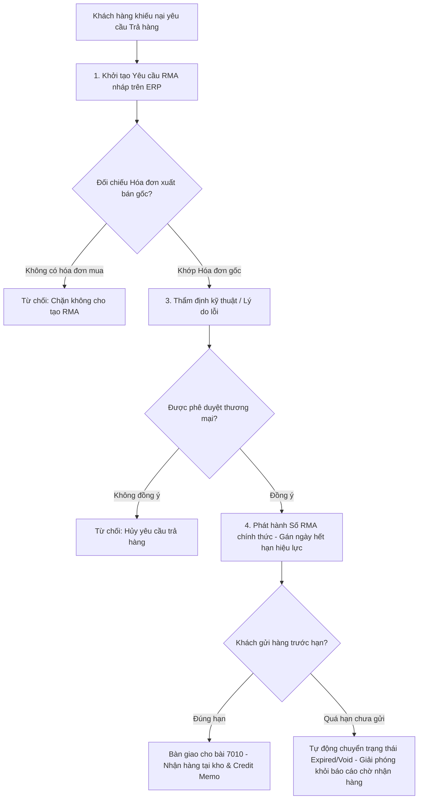

# 7000 Quy trình phê duyệt yêu cầu khách trả hàng (RMA)

Trong hoạt động phân phối và bán lẻ, đổi trả hàng là nghiệp vụ không thể tránh khỏi. Để quản lý luồng hàng trả lại từ khách hàng một cách có kiểm soát, hệ thống ERP sử dụng quy trình **Phê duyệt yêu cầu trả lại hàng (Return Material Authorization - RMA)**. RMA đóng vai trò là chứng từ thương mại chính thức xác nhận doanh nghiệp đồng ý cho phép khách hàng trả lại một lượng hàng hóa cụ thể do lỗi, hỏng, hoặc sai quy cách, đồng thời kích hoạt luồng logistics ngược (Reverse Logistics) [8000].

> **Lưu ý phạm vi:** Bài này chỉ tập trung vào luồng phê duyệt thương mại và phát hành số RMA chính thức thuộc phân hệ OM. Nghiệp vụ nhận hàng vật lý tại kho và kích hoạt Giấy giảm trừ công nợ được trình bày riêng ở bài "7010 Nhập kho hàng trả lại và kích hoạt yêu cầu Credit Memo". Trường hợp khách hàng chọn đổi hàng thay vì hoàn tiền được trình bày ở bài "7020 Xử lý đơn hàng đổi mới hoặc bồi thường hư hỏng". Bút toán giảm trừ công nợ chi tiết thuộc bài phân hệ Tài chính (FIN).

---

## 1. Tình huống Nghiệp vụ & "Điểm đau" thực tế

Thiếu đi một quy trình kiểm soát phê duyệt RMA chặt chẽ sẽ gây ra các rủi ro vận hành và tài chính lớn cho doanh nghiệp:

*   **Nhận hàng trả lại vô tội vạ tại kho:** Khách hàng tự ý gửi trả lại những mặt hàng không phải do doanh nghiệp bán ra, hoặc hàng đã hết hạn bảo hành, hàng bị hỏng do lỗi từ phía người sử dụng. Nếu thủ kho nhận hàng trả về mà không có chứng từ RMA đối chiếu trước, doanh nghiệp sẽ phải gánh chịu chi phí xử lý phế liệu và thất thoát tài sản lớn [1020].
*   **Tranh chấp giá trị giảm trừ công nợ (Credit Memo):** Nhân viên kinh doanh tự ý thỏa thuận nhận lại hàng lỗi và làm phiếu giảm trừ công nợ cho đại lý với giá trị cao hơn giá trị thực tế khách hàng mua ban đầu (do không đối chiếu được đơn giá của hóa đơn xuất bán gốc). Việc này làm sai lệch nghiêm trọng báo cáo tài chính và gây thất thoát dòng tiền [1010].
*   **Số RMA "treo" vô thời hạn do khách không gửi hàng trả lại:** Nếu hệ thống không gán thời hạn hiệu lực cho số RMA đã duyệt, khách hàng có thể xin duyệt trả hàng rồi không bao giờ gửi hàng về. Số RMA cứ tồn đọng mãi trên hệ thống ở trạng thái "đang chờ nhận hàng", làm sai lệch các báo cáo dự kiến tồn kho trả về và gây khó khăn cho việc đối soát định kỳ.

---

## 2. Bản đồ Thiết kế & Ánh xạ Cơ sở dữ liệu giữa OM và INV

Quy trình RMA phân định ranh giới rõ ràng: OM quản lý yêu cầu phê duyệt thương mại và phát hành số RMA chính thức, phân hệ Tồn kho (INV) quản lý thực tế nhận hàng vật lý tại kho dựa trên tham chiếu số RMA này [1020].

| Thực thể nghiệp vụ | SAP S/4HANA (SD) | Oracle EBS R12 (Tables) | Epicor ERP (Tables) | Odoo (Tables) |
| :--- | :--- | :--- | :--- | :--- |
| **Hợp đồng duyệt RMA**<br/>*(RMA Header)* | **`VBAK`**<br/>(Order Type = 'RE' - Returns) | **`OE_ORDER_HEADERS_ALL`**<br/>(Cột `ORDER_CATEGORY_CODE` = 'RETURN') | **`Erp.RMAHead`**<br/>(Bảng đầu phiếu RMA) | **`sale.order`**<br/>(Custom RMA Module) |
| **Dòng duyệt RMA**<br/>*(RMA Lines)* | **`VBAP`**<br/>(Returns Item Line Data) | **`OE_ORDER_LINES_ALL`**<br/>(Cột `LINE_CATEGORY_CODE` = 'RETURN') | **`Erp.RMADtl`**<br/>(Bảng dòng RMA chi tiết) | **`sale_order_line`**<br/>(Custom RMA Fields) |
| **Trạng thái vòng đời RMA**<br/>*(RMA Status)* | **`VBUK`**<br/>(Cột `GBSTK` - Overall Status) | **`OE_ORDER_HEADERS_ALL`**<br/>(Cột `FLOW_STATUS_CODE`) | **`Erp.RMAHead`**<br/>(Cột `RMAStatus`) | **`sale.order`**<br/>(Cột `state`) |
| **Nhập kho vật lý**<br/>*(RMA Receiving)* | **Goods Receipt (GR)**<br/>(Movement Type = 651 - Returns) | **`RCV_TRANSACTIONS`**<br/>(Transaction Type = 'RMA Receipt') [1020] | **`Erp.RMARct`**<br/>(Bảng nhận hàng RMA về kho) [1020] | **`stock.picking`**<br/>(Return picking 'done') [1020] |

---

## 3. Sơ đồ Luồng xử lý và Kiểm soát phê duyệt RMA (RMA Workflow)

Sơ đồ dưới đây mô tả quy trình kiểm soát từ khâu tiếp nhận khiếu nại, phê duyệt kỹ thuật cho đến khi cấp số RMA chính thức và theo dõi hiệu lực số RMA đó. Bước nhận hàng vật lý tại kho và phát hành Credit Memo được trình bày ở bài 7010:



---

## 4. Quy trình cấu hình thực tế trên các ERP lớn

### A. Trên Oracle EBS R12 (Order Management - Return Order)
Trong Oracle, đơn hàng trả lại thực chất là một loại đơn bán hàng đặc biệt được cấu hình luồng công việc đảo ngược:
1.  **Cấu hình loại đơn hàng RMA (Return Order Type):**
    *   *Đường dẫn:* `Order Management Super User > Setup > Transaction Types > Define` [1010].
    *   *Nghiệp vụ:* Tạo mới một Transaction Type, thiết lập trường `Order Category = Return`. Gán luồng công việc `Workflow` chuyên biệt cho RMA (ví dụ: `Order Flow - Return with Receipt and Credit`).
2.  **Khởi tạo RMA tham chiếu hóa đơn gốc (Reference Source):**
    *   *Nghiệp vụ:* Khi tạo dòng đơn hàng RMA (`OE_ORDER_LINES_ALL`), bắt buộc nhân viên phải nhập thông tin hóa đơn xuất bán gốc (`Reference Source = Invoice`). Hệ thống tự động sao chép chính xác đơn giá đã bán ban đầu và khóa cứng không cho phép sửa đổi vượt quá số lượng thực tế đã bán [2020].
3.  **Gán thời hạn hiệu lực số RMA:**
    *   *Nghiệp vụ:* Sau khi phê duyệt, hệ thống ghi nhận ngày hết hạn vào trường tùy biến (ví dụ `ATTRIBUTE5 = expiration_date`) trên `OE_ORDER_HEADERS_ALL`. Một Concurrent Program định kỳ quét các RMA quá hạn còn ở trạng thái `FLOW_STATUS_CODE = 'AWAITING_RECEIPT'` để tự động chuyển sang `CANCELLED`.

### B. Trên Epicor ERP (RMA Processing)
Epicor quản lý quy trình đổi trả hàng thông qua phân hệ chuyên dụng **RMA Processing**:
1.  **Thiết lập lý do trả hàng (RMA Reason Codes):**
    *   *Đường dẫn:* `Sales Management > Order Management > Setup > Reason Code` [1030].
    *   *Nghiệp vụ:* Khai báo các lý do khách trả hàng (ví dụ: `DEF` - Hàng lỗi do sản xuất, `WRG` - Giao sai quy cách).
2.  **Khởi tạo và Duyệt RMA (RMA Entry):**
    *   *Đường dẫn:* `Sales Management > Order Management > Sheets > RMA Entry`.
    *   *Nghiệp vụ:* Tạo mới phiếu RMA Header (`RMAHead`), chọn đối tác khách hàng [2000]. Tại tab `Line`, thêm dòng sản phẩm và gán liên kết bắt buộc với số hóa đơn bán gốc (`InvoiceNum`) hoặc số đơn hàng gốc (`OrderNum`). Cấp số RMA chính thức gửi cho khách hàng gửi kèm bưu kiện khi trả về.
3.  **Theo dõi hiệu lực RMA:**
    *   *Nghiệp vụ:* Trường `ExpirationDate` trên `Erp.RMAHead` được cấu hình mặc định theo chính sách trả hàng của doanh nghiệp (ví dụ 30 ngày kể từ ngày duyệt). BPM (Business Process Management) rule định kỳ kiểm tra và cập nhật `RMAStatus = 'Expired'` cho các phiếu quá hạn chưa có giao dịch tại `Erp.RMARct`.

---

## 5. SQL Database Audit Queries (Truy vấn đối soát dữ liệu)

### A. Tra cứu các yêu cầu duyệt RMA liên kết với Hóa đơn bán gốc trên Oracle EBS

Query dưới đây giúp bộ phận kiểm soát nội bộ rà soát các đơn hàng RMA đang hoạt động, đối chiếu chênh lệch giữa đơn giá trả lại và đơn giá thực tế đã bán trên hóa đơn gốc:

```sql
SELECT
    oha.org_id                    AS operating_unit_id,
    oha.order_number              AS rma_number,
    oel.line_number                AS rma_line_number,
    msib.segment1                  AS item_code,
    oel.ordered_quantity           AS return_qty,
    oel.unit_selling_price         AS return_unit_price,
    rct.trx_number                 AS original_invoice_number,
    rctl.unit_selling_price        AS original_selling_price,
    (oel.unit_selling_price - rctl.unit_selling_price) AS price_discrepancy -- Chênh lệch đơn giá
FROM
    oe_order_headers_all oha
INNER JOIN
    oe_order_lines_all oel ON oha.header_id = oel.header_id
INNER JOIN
    ra_customer_trx_lines_all rctl ON oel.reference_line_id = rctl.customer_trx_line_id -- Join đúng khóa dòng hóa đơn gốc
INNER JOIN
    ra_customer_trx_all rct ON rctl.customer_trx_id = rct.customer_trx_id
INNER JOIN
    oe_system_parameters_all osp ON oha.org_id = osp.org_id
INNER JOIN
    mtl_system_items_b msib ON oel.inventory_item_id = msib.inventory_item_id
                            AND osp.master_organization_id = msib.organization_id
WHERE
    oha.order_category_code = 'RETURN' -- Lọc chứng từ RMA
    AND oha.ordered_date >= TO_DATE('2026-01-01', 'YYYY-MM-DD')
ORDER BY
    oha.ordered_date DESC;
```
> *Lưu ý: join với `ra_customer_trx_lines_all` phải khớp theo khóa dòng `customer_trx_line_id` (không phải `customer_trx_id` là khóa của bảng header), sau đó mới join ngược lên `ra_customer_trx_all` để lấy số hóa đơn gốc — tránh nhân bản hoặc sai lệch dữ liệu đối chiếu đơn giá.*

### B. Đối soát các phiếu RMA đang chờ nhận hàng tại Kho trên Epicor ERP

Query dưới đây lọc ra toàn bộ các dòng yêu cầu trả hàng RMA đã được phê duyệt thương mại trên Epicor nhưng chưa được thực hiện giao dịch nhận hàng vật lý tại kho:

```sql
SELECT
    rh.Company,
    rh.RMANum                     AS RMA_Number,
    rd.RMALine                    AS RMA_Line,
    rh.RMADate                    AS RMA_Date,
    c.CustID                      AS Customer_Code,
    c.Name                        AS Customer_Name,
    rd.PartNum                    AS Part_Number,
    rd.ReturnQty                  AS Expected_Return_Qty,
    rd.InvoiceNum                 AS Original_Invoice_Number,
    -- Kiểm tra xem dòng đã được nhận hàng vật lý tại kho chưa
    (SELECT SUM(rc.ReceiptQty) FROM Erp.RMARct rc
     WHERE rc.Company = rd.Company AND rc.RMANum = rd.RMANum AND rc.RMALine = rd.RMALine) AS Actual_Received_Qty
FROM
    Erp.RMAHead rh
INNER JOIN
    Erp.RMADtl rd ON rh.Company = rd.Company AND rh.RMANum = rd.RMANum
INNER JOIN
    Erp.Customer c ON rh.Company = c.Company AND rh.CustNum = c.CustNum
WHERE
    rh.Company = 'YOUR_COMPANY_CODE'
    AND rh.VoidRMA = 0
ORDER BY
    rh.RMADate DESC;
```

### C. Rà soát các số RMA đã quá hạn hiệu lực nhưng chưa nhận hàng trên Oracle EBS

Query dưới đây phục vụ Nguyên tắc 3 (Kiểm soát thời hạn hiệu lực RMA) — giúp bộ phận CSKH và kho chủ động rà soát các RMA đã được duyệt, quá ngày hết hạn nhưng khách vẫn chưa gửi trả hàng, để xử lý hủy hoặc gia hạn:

```sql
SELECT
    oha.order_number              AS rma_number,
    oha.flow_status_code          AS rma_status,
    oha.attribute5                AS expiration_date, -- Custom field lưu ngày hết hạn RMA
    hp.party_name                  AS customer_name,
    ROUND(SYSDATE - TO_DATE(oha.attribute5, 'YYYY-MM-DD')) AS days_overdue
FROM
    oe_order_headers_all oha
INNER JOIN
    hz_cust_accounts hca ON oha.sold_to_org_id = hca.cust_account_id
INNER JOIN
    hz_parties hp ON hca.party_id = hp.party_id
WHERE
    oha.order_category_code = 'RETURN'
    AND oha.flow_status_code = 'AWAITING_RECEIPT'
    AND TO_DATE(oha.attribute5, 'YYYY-MM-DD') < SYSDATE
ORDER BY
    days_overdue DESC;
```
> *Tên trường lưu ngày hết hạn (`attribute5`) cần điều chỉnh theo cấu hình Descriptive Flexfield thực tế của từng doanh nghiệp.*

---

## 6. Nguyên tắc Nghiệp vụ cốt lõi khi Tự xây dựng hoặc Tùy biến Hệ thống (OMS/ERP)

### Nguyên tắc 1: Đối chiếu hóa đơn bán hàng gốc bắt buộc (Mandatory Reference Validation)
*   **Yêu cầu thiết kế logic:** Khi nhân viên kinh doanh khởi tạo đơn hàng RMA trên hệ thống tự xây dựng, động cơ kiểm tra (Validation Engine) bắt buộc người dùng phải chọn số hóa đơn bán hàng gốc (`original_invoice_id`) làm căn cứ tham chiếu.
*   **Ràng buộc số lượng:** Hệ thống phải tự động kiểm tra số lượng yêu cầu trả lại:
    $$\text{Số lượng trả lại mới} \le \text{Số lượng thực tế đã bán trên hóa đơn} - \text{Số lượng đã trả lại tích lũy trong quá khứ}$$
    Nếu vượt quá ngưỡng này, hệ thống phải chặn không cho phép lưu chứng từ RMA nhằm tránh gian lận số lượng hoàn trả [8000].

### Nguyên tắc 2: Tự động khóa đơn giá theo hóa đơn gốc (Unit Price Inheritance & Freeze)
*   **Yêu cầu thiết kế logic:** Đơn giá bán của các dòng sản phẩm trên chứng từ RMA bắt buộc phải kế thừa tự động (Inherit) 100% từ đơn giá thực tế đã bán trên hóa đơn gốc. Hệ thống phải khóa cứng (Read-only) trường đơn giá này trên giao diện RMA, tuyệt đối không cho phép nhân viên tự ý chỉnh sửa đơn giá trả lại để bảo vệ dòng tiền của doanh nghiệp [2020, 8000].

### Nguyên tắc 3: Kiểm soát thời hạn hiệu lực số RMA (RMA Validity & Auto-Expiration)
*   **Yêu cầu thiết kế logic:** Mỗi số RMA sau khi được phê duyệt thương mại phải được hệ thống tự động gán một ngày hết hạn hiệu lực (`expiration_date`), tính theo chính sách trả hàng của doanh nghiệp (ví dụ 15-30 ngày kể từ ngày duyệt). Hệ thống cần chạy tiến trình định kỳ (hàng ngày) quét các RMA đã quá hạn nhưng vẫn ở trạng thái "chờ nhận hàng" (`Awaiting Receipt`) và tự động chuyển sang trạng thái `Expired/Void`.
*   **Mục tiêu:** Giải phóng các số RMA "treo" ra khỏi báo cáo tồn kho dự kiến nhận về, giúp bộ phận kho và kế toán có bức tranh chính xác về khối lượng hàng trả lại thực sự đang chờ xử lý, đồng thời buộc khách hàng phải xin cấp lại số RMA mới nếu muốn tiếp tục trả hàng sau khi đã hết hạn.

---

## 7. Luồng luân chuyển dữ liệu liên phân hệ (Cross-Module Touchpoints)

*   **Tích hợp phân hệ Tồn kho (INV):** Chứng từ RMA sau khi được phê duyệt thành công và còn trong thời hạn hiệu lực sẽ được đẩy sang phân hệ Tồn kho làm căn cứ đối chiếu nhận hàng vật lý trả về. Chi tiết nghiệp vụ nhận hàng, quét mã vạch đối chiếu số lượng/mã hàng theo đúng phạm vi RMA được trình bày ở bài "7010 Nhập kho hàng trả lại và kích hoạt yêu cầu Credit Memo" [1020, 8000].
*   **Tích hợp phân hệ Kế toán công nợ (FIN-AR):** Sau khi hoàn tất nhận hàng tại kho, hệ thống kích hoạt luồng đẩy dữ liệu sang phân hệ AR để kế toán phát hành Giấy giảm trừ công nợ (Credit Memo). Chi tiết bút toán giảm trừ công nợ không thuộc phạm vi bài OM này — tham chiếu bài chuyên biệt bên phân hệ FIN [1010].
*   **Rẽ nhánh Đổi hàng (Exchange):** Trường hợp khách hàng lựa chọn đổi sản phẩm khác thay vì nhận hoàn tiền/giảm trừ công nợ, luồng xử lý sau phê duyệt RMA sẽ rẽ sang bài "7020 Xử lý đơn hàng đổi mới hoặc bồi thường hư hỏng" thay vì đi qua Credit Memo.

---

<div align="center" style={{color: 'var(--ifm-color-primary)'}}>
  <strong>Chúc các bạn thành công và vui vẻ!</strong>
</div>
