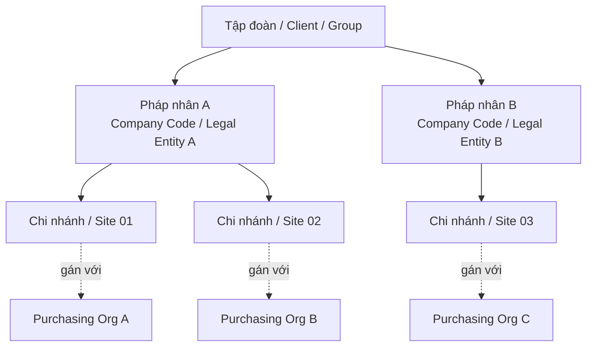

# 1000 Thiết lập cơ cấu tổ chức mua sắm (Purchasing Org Setup)

Trong một hệ thống ERP doanh nghiệp, việc thiết kế cơ cấu tổ chức mua sắm (Procurement Organization Structure) là bước đặt nền móng quyết định khả năng kiểm soát chi phí, phân quyền phê duyệt và quản lý luồng dữ liệu giao dịch. Bài viết này phân tích cách cấu trúc hệ thống mua sắm để đáp ứng mô hình đa pháp nhân (multi-company) và đa chi nhánh (multi-site), đi kèm hướng dẫn thực hành và câu lệnh SQL đối soát thực tế.

---

## 1. Khái niệm cốt lõi trong tổ chức mua sắm ERP

Trước khi cấu hình hệ thống, cần làm rõ hai khái niệm kỹ thuật thường bị nhầm lẫn trong các giải pháp ERP:

*   **Tổ chức mua hàng (Purchasing Organization):** 
    *   Là một thực thể pháp lý hoặc đơn vị vận hành chịu trách nhiệm đàm phán các điều khoản thương mại, giá cả, hợp đồng nguyên tắc (Blanket Agreement/Contract) với nhà cung cấp.
    *   Có thể đại diện cho toàn bộ tập đoàn, một công ty cụ thể, hoặc một nhà máy/chi nhánh cụ thể.
*   **Nhóm mua hàng (Purchasing Group / Buyer Group / Purchasing Agent):**
    *   Là đơn vị vận hành thực tế ở cấp độ tác nghiệp (ví dụ: nhóm mua nguyên liệu thô, nhóm mua bao bì, nhóm mua dịch vụ phi sản xuất).
    *   Chịu trách nhiệm trực tiếp đối với việc gửi đơn mua hàng (PO), đốc thúc tiến độ giao hàng (Expediting) và xử lý sự cố phát sinh.

---

## 2. Ba mô hình tổ chức mua sắm phổ biến

Tùy thuộc vào chiến lược quản trị của doanh nghiệp, hệ thống ERP sẽ được cấu hình theo một trong ba mô hình sau:

### Mô hình 1: Mua sắm tập trung (Centralized Procurement)
*   **Cấu trúc:** Một Tổ chức mua hàng duy nhất đại diện cho tất cả các công ty con và nhà máy trong tập đoàn để làm việc với nhà cung cấp.
*   **Ưu điểm:** Tối ưu hóa sức mạnh đàm phán nhờ gom tổng cầu lớn (Volume Leverage), chuẩn hóa danh mục nhà cung cấp.
*   **Hạn chế:** Phản ứng chậm trước các nhu cầu phát sinh mang tính khẩn cấp tại địa phương.

### Mô hình 2: Mua sắm phân tán (Decentralized / Plant-specific Procurement)
*   **Cấu trúc:** Mỗi công ty con hoặc mỗi nhà máy sở hữu một Tổ chức mua hàng riêng biệt.
*   **Ưu điểm:** Linh hoạt, đáp ứng nhanh nhu cầu đặc thù của từng địa bàn hoạt động.
*   **Hạn chế:** Phân tán dữ liệu nhà cung cấp, dễ xảy ra tình trạng mua cùng một mặt hàng từ cùng một đối tác nhưng với các mức giá và điều khoản khác nhau giữa các chi nhánh.

### Mô hình 3: Mô hình hỗn hợp (Hybrid / Matrix Procurement)
*   **Cấu trúc:** 
    *   Tổ chức mua hàng cấp tập đoàn (Corporate Purchasing Org) chịu trách nhiệm đàm phán và ký kết các hợp đồng khung (Framework/Blanket Contracts) đối với nguyên vật liệu cốt lõi.
    *   Tổ chức mua hàng cấp nhà máy (Local/Plant Purchasing Org) thực hiện lệnh rút hàng (Release Order) từ hợp đồng khung và tự mua sắm các loại vật tư tiêu hao (MRO/Indirect) tại chỗ.

---

## 3. Điểm giao thoa & Tham chiếu chéo (Cross-linking) sang các phân hệ khác

Cơ cấu tổ chức mua sắm không thể đứng độc lập mà là cầu nối trực tiếp giữa SCM và FIN. Khi thiết lập, hệ thống yêu cầu các liên kết bắt buộc sau:

### A. Liên kết với phân hệ Tồn kho (INV)
*   **Ranh giới kho của Tổ chức mua sắm (Inventory Org / Site Assignment):** 
    *   Mỗi Purchasing Org/Operating Unit/Site bắt buộc phải được gán quyền giao dịch với một hoặc nhiều chi nhánh/kho bãi cụ thể đã được định nghĩa tại **Quản lý nhiều kho, nhiều địa điểm** {/* TODO: link khi có bài inv-ton-kho */}. 
    *   Sự liên kết này đảm bảo khi tạo PO tại một OU/Site, hệ thống chỉ hiển thị và cho phép chọn các kho nhận hàng hợp lệ thuộc quyền quản lý của đơn vị đó, tránh việc nhập nhầm địa điểm giao nhận vật lý.

### B. Liên kết với phân hệ Tài chính kế toán (FIN)
*   **Sổ cái kế toán (Primary Ledger - GL):** 
    *   Bất kỳ Tổ chức mua sắm (Operating Unit / Company) nào khi khởi tạo đều phải khai báo liên kết với một Sổ cái cụ thể trong phân hệ **Sổ cái - GL** {/* TODO: link khi có bài fin-so-cai */} (đối với Oracle EBS là thông qua trường `Set of Books ID` / `Ledger ID`).
    *   Liên kết này quyết định loại tiền tệ hạch toán (Currency), niên độ kế toán (Calendar) và Hệ thống tài khoản kế toán (Chart of Accounts - COA) áp dụng cho mọi giao dịch mua sắm phát sinh.
*   **Phân vùng kế toán công nợ (AP Subledger Boundary):**
    *   Tổ chức mua sắm đóng vai trò là bộ lọc bảo mật và pháp lý cho phân hệ **Công nợ phải trả - AP** {/* TODO: link khi có bài fin-cong-no */}. Khi kế toán AP thực hiện đối soát hóa đơn tại bài **Ghi nhận hóa đơn nhà cung cấp** {/* TODO: link khi có bài fin-cong-no/3000 */}, hệ thống sẽ lọc hóa đơn và đơn mua hàng theo ranh giới Operating Unit đã định nghĩa.

---

## 4. Cách ánh xạ cấu trúc mua sắm vào sơ đồ tổ chức ERP

Để luồng nghiệp vụ chạy thông suốt từ Đơn mua hàng (PO) đến Nhập kho (GR) và Hóa đơn (IR), cấu trúc mua sắm phải được ánh xạ chính xác với sơ đồ tài chính:



### Các nguyên tắc gán liên kết hệ thống:
1.  **Gán Purchasing Org với Company Code:** Xác định đơn vị pháp lý nào sẽ chịu trách nhiệm thanh toán công nợ phát sinh từ các đơn mua hàng của Org đó.
2.  **Gán Purchasing Org với Plant/Warehouse:** Đảm bảo hệ thống xác định được địa điểm nhận hàng hợp lệ khi tạo Đơn mua hàng. Một Purchasing Org có thể gán cho nhiều Plant thuộc cùng một Company Code (hoặc khác Company Code trong mô hình mua sắm liên công ty - Intercompany).

---

## 5. Điểm đặc thù theo từng hệ thống ERP phổ biến

### SAP ERP
*   Mô hình tổ chức mua sắm trong SAP cực kỳ chặt chẽ. Bạn phải định nghĩa **Purchasing Organization** tại nhánh `Enterprise Structure` trong menu cấu hình IMG.
*   Có 3 cấp độ gán: *Cross-company code*, *Plant-specific*, và *Cross-plant*.
*   **Purchasing Group** trong SAP là một mã gồm 3 ký tự (alphanumeric) độc lập không cần gán trực tiếp vào cấu trúc doanh nghiệp mà được gán thẳng vào dữ liệu Master Data của Vật tư (Material Master - view Purchasing).

### Odoo
*   Odoo đơn giản hóa cấu trúc này bằng cách liên kết trực tiếp phân hệ Mua hàng (Purchase) với cấu trúc đa công ty (**Multi-Company**).
*   Quyền hạn mua sắm và phê duyệt được quản lý thông qua phân quyền tài khoản người dùng nhóm (User Groups) và bộ lọc bản ghi (Record Rules) theo công ty hiện tại của phiên làm việc.

### Oracle EBS & Epicor ERP
*   Hai hệ thống này có kiến trúc tổ chức mua sắm và luồng nhập liệu đặc thù riêng, chi tiết được trình bày ở phần hướng dẫn dưới đây.

---

## 6. Hướng dẫn luồng thiết lập (Setup Flow) chi tiết trên hệ thống

### A. Trên Oracle EBS R12.2.10 (Mô hình Multi-Org)
Trong Oracle EBS, phân hệ Oracle Purchasing vận hành chủ yếu ở cấp độ **Operating Unit (OU)**.

1.  **Định nghĩa Vị trí (Locations):**
    *   *Đường dẫn:* `HRMS > Work Structures > Location`
    *   *Nghiệp vụ:* Khai báo địa điểm nhận hàng (Ship-to) và địa điểm gửi hóa đơn (Bill-to). Các địa điểm này sau đó sẽ được liên kết trực tiếp vào Purchasing Options của OU.
2.  **Định nghĩa Đơn vị vận hành (Operating Unit - OU):**
    *   *Đường dẫn:* `HRMS > Work Structures > Organization > Define`
    *   *Nghiệp vụ:* Tạo tổ chức mới, gán phân loại (Classification) là `Operating Unit` và liên kết với Legal Entity (Pháp nhân) & Ledger (Sổ cái) tương ứng thông qua công cụ cấu hình Multi-Org.
3.  **Cấu hình Tùy chọn mua hàng (Purchasing Options):**
    *   *Đường dẫn:* `Purchasing Super User > Setup > Organizations > Purchasing Options`
    *   *Nghiệp vụ:* Chọn OU hiện tại, thiết lập tài khoản kiểm soát mặc định (Accrual Account, Charge Account), và cấu hình phương thức đánh số chứng từ (Document Numbering - Tự động hay Thủ công) cho PR, RFQ, PO.
4.  **Khai báo Người mua hàng (Define Buyers):**
    *   *Đường dẫn:* `Purchasing Super User > Setup > Personnel > Buyers`
    *   *Nghiệp vụ:* Liên kết nhân sự (Employee) từ danh mục HRMS vào danh sách Buyer hợp lệ. Chỉ những nhân sự được cấu hình ở đây mới có quyền tạo và thực hiện giao dịch trên phân hệ PO.

### B. Trên Epicor ERP (Mô hình Multi-Company / Multi-Site)
Epicor tổ chức mua sắm xoay quanh cấu trúc Công ty (Company) và Nhà máy/Chi nhánh (Site / Plant).

1.  **Cấu hình Site (Plant Maintenance):**
    *   *Đường dẫn:* `System Setup > Company/Site Maintenance > Site Maintenance`
    *   *Nghiệp vụ:* Định nghĩa các Site trực thuộc Company và thiết lập cấu hình kho nhận hàng mặc định cho từng Site.
2.  **Khai báo Người mua hàng (Buyer Setup):**
    *   *Đường dẫn:* `Material Management > Purchase Management > Setup > Buyer`
    *   *Nghiệp vụ:* Tạo mã Buyer (lưu trong bảng `PurAgent`). Thiết lập hạn mức phê duyệt PO trực tiếp cho từng Buyer (PO Limit) và gán quyền thay thế (Authorized Users) khi Buyer vắng mặt.
3.  **Gán Buyer mặc định cho nhóm vật tư:**
    *   *Đường dẫn:* `Material Management > Purchase Management > Setup > Part Class` (hoặc `Product Group`)
    *   *Nghiệp vụ:* Gán Buyer phụ trách cho từng nhóm vật tư để khi chạy MRP, hệ thống tự động sinh đề xuất mua hàng (PO Suggestions) gửi đích danh cho Buyer đó.

---

## 7. Truy vấn SQL đối soát cấu trúc tổ chức (SQL Database Audit Queries)

### A. Cho Oracle EBS R12.2.10

**Query 1:** Kiểm tra liên kết giữa Operating Unit (Purchasing Org), Legal Entity và Sổ cái kế toán:
```sql
SELECT 
    hou.organization_id         AS ou_org_id,
    hou.name                    AS operating_unit_name,
    xep.legal_entity_id         AS legal_entity_id,
    xep.name                    AS legal_entity_name,
    gl.ledger_id                AS ledger_id,
    gl.name                     AS ledger_name
FROM 
    hr_operating_units hou
INNER JOIN 
    gl_ledgers gl ON hou.set_of_books_id = gl.ledger_id
INNER JOIN 
    xle_entity_profiles xep ON hou.default_legal_context_id = xep.legal_entity_id
ORDER BY 
    hou.name;
```

**Query 2:** Kiểm tra thông số cơ bản của phân hệ Purchasing (PO Options) theo từng Operating Unit:
```sql
SELECT 
    hou.name                    AS operating_unit_name,
    sys.org_id                  AS org_id,
    sys.enforce_buyer_name_flag AS enforce_buyer_control,
    sys.min_release_amount      AS min_po_amount
FROM 
    po_system_parameters_all sys
INNER JOIN 
    hr_operating_units hou ON sys.org_id = hou.organization_id
ORDER BY 
    hou.name;
```

**Query 3:** Kiểm tra danh mục địa điểm (Location) được cấu hình làm điểm nhận hàng (Ship-to) hoặc gửi hóa đơn (Bill-to):
```sql
SELECT 
    hl.location_code,
    hl.description,
    hl.style,
    hl.address_line_1,
    hl.derived_locale,
    hl.ship_to_site_flag,
    hl.bill_to_site_flag,
    hl.receiving_site_flag,
    hl.in_organization_flag,
    hl.inventory_organization_id,
    hl.inactive_date
FROM 
    hr_locations_all hl
WHERE 
    hl.ship_to_site_flag = 'Y' 
    OR hl.bill_to_site_flag = 'Y'
ORDER BY 
    hl.location_code;
```

### B. Cho Epicor ERP (Truy vấn cơ sở dữ liệu SQL Server)

**Query 1:** Kiểm tra cấu trúc phân bổ Kho (Warehouse) theo từng Chi nhánh (Site/Plant) và Công ty:
```sql
SELECT 
    p.Company,
    c.Name                      AS CompanyName,
    p.Plant                     AS SiteID,
    p.Name                      AS SiteName,
    w.WarehouseCode             AS DefaultWarehouse,
    w.Description               AS WarehouseName
FROM 
    Erp.Plant p
INNER JOIN 
    Erp.Company c ON p.Company = c.Company
LEFT OUTER JOIN 
    Erp.Warehouse w ON p.Company = w.Company AND p.Plant = w.Plant
ORDER BY 
    p.Company, p.Plant;
```

**Query 2:** Kiểm tra danh mục Người mua hàng (Buyers / PurAgents) và hạn mức phê duyệt PO:
```sql
SELECT 
    pa.Company,
    pa.BuyerID,
    pa.Name                     AS BuyerName,
    pa.Active                   AS IsActive,
    pa.POAmtLimit               AS PO_Approval_Limit,
    pa.EMailAddress             AS Email
FROM 
    Erp.PurAgent pa
ORDER BY 
    pa.Company, pa.BuyerID;
```

---

## 8. Kinh nghiệm thực tế khi thiết lập (Best Practices & Pitfalls)

1.  **Không nên tạo quá nhiều Purchasing Org (hoặc Operating Unit):**
    *   Mỗi OU tăng thêm sẽ nhân bản khối lượng công việc thiết lập danh mục nhà cung cấp, cấu hình tài khoản, chính sách phê duyệt và báo cáo tài chính.
    *   *Lời khuyên:* Chỉ tạo OU mới khi có sự khác biệt bắt buộc về mặt pháp nhân thuế độc lập hoặc yêu cầu tách biệt tuyệt đối về mặt sổ sách kế toán. Nếu chỉ khác nhau về vị trí địa lý, hãy giải quyết ở cấp độ Inventory Organization.
2.  **Quản lý mã Buyer theo vai trò thay vì cá nhân (đối với Epicor):**
    *   Tránh tạo BuyerID theo tên cá nhân cụ thể như `NAMNV` hay `ANHLT`. Khi nhân viên nghỉ việc hoặc luân chuyển bộ phận, việc cập nhật lại BuyerID trên hàng ngàn Part Master hoặc Part Class rất phức tạp.
    *   *Lời khuyên:* Đặt mã Buyer theo nhóm hàng phụ trách (ví dụ: `BY_RAW` cho Buyer mua nguyên liệu, `BY_PKG` cho Buyer mua bao bì) rồi gán tài khoản của nhân viên cụ thể vào danh sách người dùng được ủy quyền (Authorized Users) của mã đó.
3.  **Chuẩn hóa mã nhóm mua hàng (Purchasing Group):**
    *   Tương tự như trên, việc phân chia nhóm mua hàng rõ ràng ngay từ khâu thiết lập ban đầu giúp tự động hóa tối đa luồng đề xuất mua sắm khi hệ thống chạy hoạch toán nhu cầu vật tư (MRP).

<p align="center" style={{color: 'var(--ifm-color-primary)'}}>
  <strong>Chúc các bạn thành công và vui vẻ!</strong>
</p>