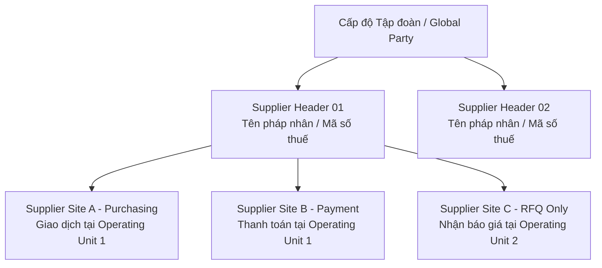

# 2000 Quản lý hồ sơ nhà cung cấp (Supplier Master)

Hồ sơ nhà cung cấp (Supplier/Vendor Master Data) là một trong những thực thể dữ liệu gốc quan trọng nhất của doanh nghiệp. Việc thiết kế cấu trúc dữ liệu nhà cung cấp chính xác không chỉ giúp chuẩn hóa quy trình mua sắm từ khâu đề xuất (RFQ/PO) mà còn chi phối trực tiếp đến việc hạch toán công nợ, đối chiếu hóa đơn và kê khai thuế đầu vào.

---

## 1. Khái niệm cốt lõi về Supplier Master & SLM

*   **Supplier Master (Hồ sơ gốc NCC):** Lưu trữ toàn bộ thông tin định danh, thông tin pháp lý, mã số thuế, địa chỉ giao dịch và tài khoản ngân hàng của đối tác.
*   **Supplier Lifecycle Management - SLM (Vòng đời đối tác):** Quy trình quản lý đối tác từ khâu đề xuất duyệt mới (Onboarding) -> Đánh giá năng lực định kỳ (Evaluation) -> Phân loại ưu tiên (Segmentation) -> Ngừng hợp tác (Phase-out).

---

## 2. Kiến trúc dữ liệu nhà cung cấp đa tầng trong ERP

Trong các hệ thống ERP phân khúc Tier-1 và Tier-2, dữ liệu nhà cung cấp luôn được tổ chức theo kiến trúc đa tầng (Multi-tier) để đảm bảo tính dùng chung của dữ liệu gốc nhưng vẫn đáp ứng được các chính sách thương mại và hạch toán riêng biệt tại từng chi nhánh/nhà máy.



### Các tầng dữ liệu chính:
1.  **Tầng Header (Global Level):** Chứa các thông tin bất biến như Tên pháp lý chính thức, Mã số thuế toàn cầu, Loại hình doanh nghiệp. Thông tin này được dùng chung trên toàn tập đoàn.
2.  **Tầng Site / Address (Operating Unit / Plant Level):** Định nghĩa địa chỉ giao dịch thực tế của nhà cung cấp. Mỗi Site sẽ được gán các vai trò cụ thể:
    *   *Purchasing Site:* Địa chỉ gửi đơn đặt hàng PO.
    *   *Pay Site:* Địa chỉ đối chiếu và thanh toán hóa đơn công nợ AP.
    *   *RFQ Site:* Địa chỉ nhận yêu cầu báo giá.

---

## 3. Điểm giao thoa & Tham chiếu chéo (Cross-linking) sang các phân hệ khác

Hồ sơ nhà cung cấp liên kết trực tiếp tới các phân hệ thuộc luồng Logistics và Tài chính:

### A. Liên kết với phân hệ Tồn kho (INV)
*   **Mã hóa nhà cung cấp trên danh mục hàng hóa:** Các thông số liên quan đến thời gian mua hàng (Lead Time), dung sai giao hàng nhận dạng tại [7000 Item Master (thiết lập mã hàng hoá, đơn vị tính)]() sẽ tham chiếu trực tiếp đến mã NCC tại đây.
*   **Danh mục nhà cung cấp được phê duyệt (ASL/Source List):** Liên kết giữa mã hàng hóa tại [7020 Nhóm hàng hoá / danh mục vật tư (Item Category)]() với các nhà cung cấp được chỉ định để chạy MRP tự động.

### B. Liên kết với phân hệ Tài chính kế toán (FIN)
*   **Hạch toán công nợ (AP Posting Group):** Mỗi nhà cung cấp/Supplier Site bắt buộc phải gán với một nhóm định khoản công nợ mặc định tại [1010 Thiết lập nhóm hạch toán công nợ và tự động hóa định khoản Sổ cái (Posting Groups & GL Accounts Mapping)](). Khi hạch toán hóa đơn tại AP, hệ thống sẽ tự động ghi nhận Tài khoản phải trả (Liability Account) tương ứng.
*   **Điều khoản thanh toán & Thuế:** Khai báo điều khoản thanh toán mặc định tại [1000 Cấu hình điều khoản thanh toán (Payment Terms)]() và chính sách thuế khấu trừ tại nguồn (Withholding Tax) khi chi tiền.

---

## 4. Điểm đặc thù theo từng hệ thống ERP phổ biến

### SAP S/4HANA
*   Sử dụng mô hình **Business Partner (BP)**. Nhà cung cấp được định nghĩa là một thực thể BP với vai trò (Role) `FLVN00` (dành cho kế toán mua hàng cấp Company Code) và `FLVN01` (dành cho Purchasing Org).
*   Kiểm soát chặt chẽ mã số thuế thông qua trường Tax Number (`STCD1` hoặc `STCD5` đối với Việt Nam) để chặn trùng lặp tuyệt đối.

### Odoo
*   Odoo quản lý nhà cung cấp thông qua model `res.partner`.
*   Một Partner có thể vừa đóng vai trò Khách hàng (Customer) vừa là Nhà cung cấp (Vendor). Odoo quản lý đa địa chỉ bằng các bản ghi con trực thuộc Partner gốc và gán nhãn loại địa chỉ (`Delivery`, `Invoice`, `Contact`).

---

## 5. Hướng dẫn luồng thiết lập (Setup Flow) chi tiết trên hệ thống

### A. Trên Oracle EBS R12.2.10 (Kiến trúc TCA)
Oracle EBS quản lý hồ sơ đối tác qua kiến trúc **TCA (Trading Community Architecture)**, tách biệt giữa thực thể pháp nhân tự nhiên (Party) và vai trò giao dịch (Supplier).

1.  **Khởi tạo Supplier Header:**
    *   *Đường dẫn:* `Purchasing Super User > Supply Base > Suppliers`
    *   *Nghiệp vụ:* Tạo mới nhà cung cấp, nhập tên pháp lý chính thức và mã số thuế (Tax Registration Number) tại màn hình Organization. Hệ thống sẽ tự tạo một `Party` trong cấu trúc TCA.
2.  **Thiết lập Supplier Sites:**
    *   *Nghiệp vụ:* Chuyển sang phần `Address Book`, khai báo các địa chỉ giao dịch. Gán địa chỉ đó cho Operating Unit (OU) cụ thể để tạo thành `Supplier Site`.
3.  **Cấu hình Vai trò của Site (Site Uses):**
    *   *Nghiệp vụ:* Tích chọn các flag `Purchasing` (để cho phép tạo PO về Site này) và `Pay` (để cho phép kế toán AP tạo hóa đơn thanh toán).
4.  **Khai báo tài khoản ngân hàng (Bank Accounts):**
    *   *Nghiệp vụ:* Tại phần `Banking Details`, gán tài khoản ngân hàng của nhà cung cấp ở cấp độ Header hoặc cấp độ Site cụ thể để phục vụ việc chạy thanh toán tự động (Electronic Funds Transfer - EFT).

### B. Trên Epicor ERP
Epicor quản lý hồ sơ nhà cung cấp thông qua màn hình Vendor Maintenance tập trung.

1.  **Tạo mới Vendor:**
    *   *Đường dẫn:* `Material Management > Purchase Management > Setup > Vendor`
    *   *Nghiệp vụ:* Nhập mã nhà cung cấp (Vendor ID) và Tên (Name). 
2.  **Thiết lập thông tin tài chính mặc định:**
    *   *Nghiệp vụ:* Tại tab `Detail`, gán điều khoản thanh toán mặc định (`Terms Code`), loại tiền tệ giao dịch (`Currency`) và mã số thuế (`Tax ID`).
3.  **Thiết lập địa chỉ giao dịch (Purchase Point):**
    *   *Nghiệp vụ:* Nếu nhà cung cấp có nhiều văn phòng/nhà máy giao hàng khác nhau, thiết lập các `Purchase Point` trực thuộc Vendor đó để hệ thống ghi nhận đúng địa chỉ gửi PO.
4.  **Cấu hình Phê duyệt (Vendor Approval):**
    *   *Nghiệp vụ:* Tích chọn thuộc tính `Approved` để cho phép tạo PO. Nếu nhà cung cấp bị đưa vào danh sách đen hoặc đang thẩm định lại, bỏ tích chọn hoặc đổi trạng thái để khóa hoạt động mua sắm tức thì.

---

## 6. Truy vấn SQL đối soát cấu trúc tổ chức (SQL Database Audit Queries)

> **Lưu ý:** các query trong Oracle EBS bên dưới, đặc biệt Query 2, join qua nhiều bảng phức tạp (`iby_external_payees_all`, `iby_pmt_instr_uses_all`, `iby_ext_bank_accounts`, `hz_relationships`, `hz_org_contacts`) — chưa được xác nhận chạy thực tế. Bạn nên test trong SQL Developer trước khi publish, tương tự cách đã kiểm tra ở bài 1000.

### A. Cho Oracle EBS R12.2.10

**Query 1:** Truy vấn danh sách nhà cung cấp, thông tin mã số thuế và các Site đang được gán quyền mua hàng (Purchasing) hoặc thanh toán (Pay) theo từng Operating Unit (OU):
```sql
SELECT 
    aps.segment1                  AS supplier_number,
    hp.party_name                 AS supplier_name,
    hp.jgzz_fiscal_code           AS tax_id, -- Mã số thuế
    assa.vendor_site_code         AS site_code,
    hou.name                      AS operating_unit,
    assa.purchasing_site_flag     AS purchasing_enabled,
    assa.pay_site_flag            AS payment_enabled,
    assa.inactive_date            AS site_inactive_date
FROM 
    ap_suppliers aps
INNER JOIN 
    hz_parties hp ON aps.party_id = hp.party_id
INNER JOIN 
    ap_supplier_sites_all assa ON aps.vendor_id = assa.vendor_id
INNER JOIN 
    hr_operating_units hou ON assa.org_id = hou.organization_id
ORDER BY 
    aps.segment1, assa.vendor_site_code;
```

**Query 2:** Đối soát thông tin tài khoản ngân hàng được gán cho từng nhà cung cấp phục vụ thanh toán tự động:
```sql
SELECT 
    aps.segment1                  AS supplier_number,
    hp.party_name                 AS supplier_name,
    ieba.bank_account_num         AS bank_account_number,
    ieba.bank_account_name        AS bank_account_name,
    ieba.iban                     AS iban_code,
    bp.party_name                 AS bank_name,
    bbr.office_code               AS branch_code
FROM 
    ap_suppliers aps
INNER JOIN 
    hz_parties hp ON aps.party_id = hp.party_id
INNER JOIN 
    iby_external_payees_all iepa ON iepa.payee_party_id = hp.party_id 
                                AND iepa.payment_function = 'PAYABLES_DISB'
INNER JOIN 
    iby_pmt_instr_uses_all ipiua ON ipiua.ext_pmt_party_id = iepa.ext_pmt_party_id
INNER JOIN 
    iby_ext_bank_accounts ieba ON ipiua.instrument_id = ieba.bank_account_id
INNER JOIN 
    hz_parties bp ON ieba.bank_id = bp.party_id
INNER JOIN 
    hz_relationships br ON ieba.branch_id = br.party_id
INNER JOIN 
    hz_org_contacts bbr ON br.relationship_id = bbr.party_relationship_id
ORDER BY 
    aps.segment1;
```

### B. Cho Epicor ERP (Truy vấn cơ sở dữ liệu SQL Server)

**Query 1:** Kiểm tra toàn bộ danh mục nhà cung cấp kèm trạng thái phê duyệt (Approved/Active) và thông tin điều khoản thanh toán:
```sql
SELECT 
    v.Company,
    v.VendorID,
    v.Name                        AS VendorName,
    v.TaxRegNum                   AS Tax_ID,
    v.TermsCode                   AS Payment_Terms,
    v.Approved                    AS Is_Approved,
    v.Active                      AS Is_Active,
    v.Address1,
    v.City,
    v.Country
FROM 
    Erp.Vendor v
WHERE 
    v.Company = 'YOUR_COMPANY_CODE'
ORDER BY 
    v.VendorID;
```

---

## 7. Kinh nghiệm thực tế khi thiết lập (Best Practices & Pitfalls)

1.  **Chặn trùng lặp nhà cung cấp bằng Mã số thuế (Tax ID / VAT Number):**
    *   *Sự cố:* Nhân viên mua sắm thường vô tình tạo trùng một nhà cung cấp nhiều lần dưới các tên viết tắt khác nhau (ví dụ: `Công ty A`, `Cty A`, `Công ty TNHH A`). Điều này làm sai lệch nghiêm trọng báo cáo công nợ tổng hợp của đối tác.
    *   *Giải pháp:* Cấu hình bắt buộc nhập trường Mã số thuế và đặt thuộc tính kiểm soát duy nhất (Unique Constraint) cho trường dữ liệu này trên ERP. Khi tạo mới, hệ thống phải tự động quét kiểm tra trùng Tax ID trước khi cho lưu.
2.  **Tách biệt rõ ràng vai trò của Supplier Site:**
    *   Không nên gán chung mọi địa chỉ của nhà cung cấp đều có quyền nhận PO và thanh toán. Văn phòng đại diện của đối tác có thể là nơi nhận PO, nhưng tiền thanh toán bắt buộc phải chuyển về tài khoản của trụ sở chính. 
    *   *Giải pháp:* Thiết lập rõ địa chỉ nào là `Purchasing Site`, địa chỉ nào là `Pay Site` để hệ thống tự động điều hướng chứng từ chính xác.
3.  **Thẩm định nhà cung cấp thông qua trạng thái phê duyệt (Approved Vendor List - AVL):**
    *   Kiểm soát chặt chẽ quy trình chuyển đổi trạng thái nhà cung cấp từ nháp (Draft/Onboarding) sang chính thức hoạt động (Approved/Active). Chỉ những bộ phận có thẩm quyền (như Ban kiểm soát chất lượng hoặc Giám đốc mua hàng) mới được cấp quyền phê duyệt kích hoạt hồ sơ nhà cung cấp để sử dụng trên PO.