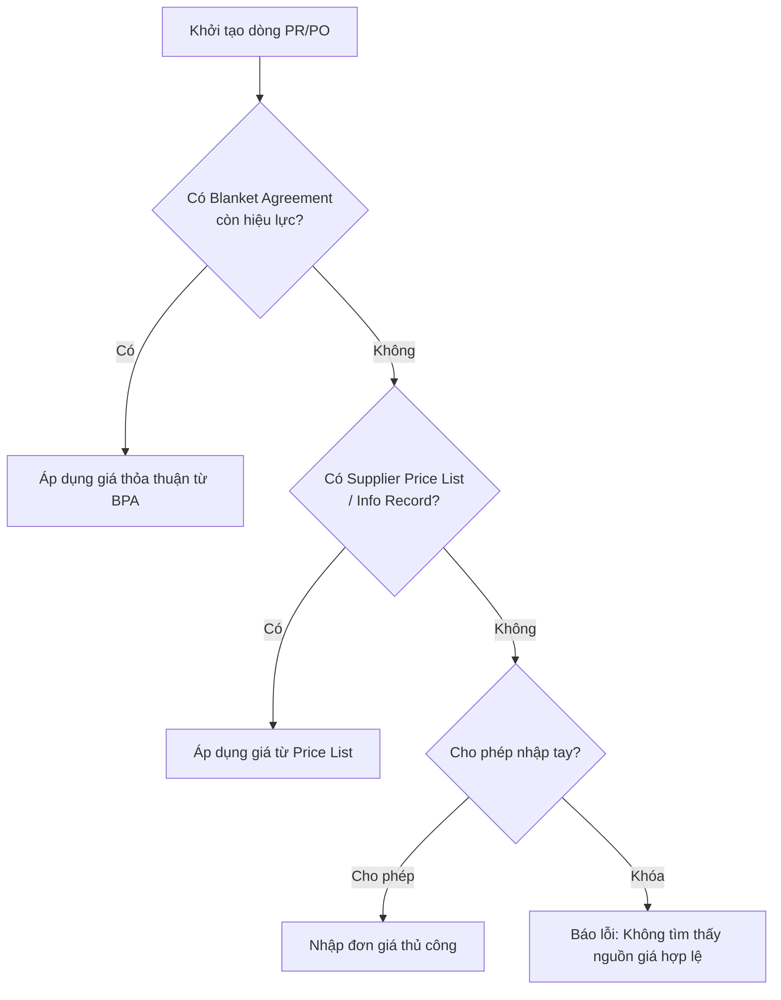

# 2010 Bảng giá & Thỏa thuận dài hạn (Blanket PO & Contract)

Việc quản lý đơn giá mua hàng thủ công trên từng đơn mua hàng (PO) nhỏ lẻ dễ dẫn đến sai lệch đơn giá thỏa thuận, mất nhiều thời gian kiểm soát và tăng rủi ro gian lận. Hệ thống ERP cung cấp các công cụ cấu hình bảng giá mua hàng tự động và các loại hợp đồng mua sắm dài hạn để chốt đơn giá, tối ưu hóa quy trình rút hàng và đối soát tài chính tự động.

---

## 1. Khái niệm cốt lõi về Bảng giá & Thỏa thuận dài hạn

Trong quy trình mua sắm, ERP phân biệt rõ 3 công cụ quản lý giá sau:

*   **Bảng giá nhà cung cấp (Supplier Price List / Info Record):** Đơn giá cố định của một mặt hàng gán cho một nhà cung cấp cụ thể, áp dụng trong một khoảng thời gian hiệu lực nhất định.
*   **Thỏa thuận mua hàng khung (Blanket Purchase Agreement - BPA / Blanket PO):** Hợp đồng nguyên tắc dài hạn cam kết mua một danh mục mặt hàng cụ thể với đơn giá thỏa thuận ưu đãi. Khi phát sinh nhu cầu thực tế, người mua tạo đơn rút hàng (Blanket Release / Release Order) kế thừa đơn giá và điều khoản từ BPA gốc.
*   **Hợp đồng nguyên tắc giá trị (Contract Purchase Agreement - CPA):** Thỏa thuận chỉ cam kết về tổng giá trị mua sắm (ví dụ: mua tối thiểu 10 tỷ VND trong năm 2026) và các điều khoản thương mại chung, không chi tiết hóa danh mục mặt hàng cụ thể. Khi phát sinh nhu cầu, Standard PO sẽ được tạo tham chiếu đến mã CPA để hệ thống tự động trừ dần vào giá trị cam kết.

---

## 2. Cơ chế tìm kiếm đơn giá mua hàng tự động (Pricing Determination Hierarchy)

Khi người dùng khởi tạo một yêu cầu PR hoặc đơn PO, ERP sẽ tự động quét qua các nguồn dữ liệu giá đã cấu hình để gán đơn giá tự động theo sơ đồ phân cấp dưới đây:



---

## 3. Điểm giao thoa & Tham chiếu chéo (Cross-linking) sang các phân hệ khác

Cấu hình đơn giá mua hàng chi phối trực tiếp đến nghiệp vụ quản lý vật tư và kế toán chi phí:

### A. Liên kết với phân hệ Tồn kho (INV)
*   **Mã hàng hóa:** Việc thiết lập bảng giá hoặc Blanket PO bắt buộc phải tham chiếu trực tiếp đến danh mục hàng hóa tại [7000 Item Master (thiết lập mã hàng hoá, đơn vị tính)](../inv-ton-kho/7000-thiet-lap-danh-muc-item-master.md).
*   **Phân bậc giá theo kho nhận (Price Breaks by Location):** Đơn giá mua sắm của một mặt hàng có thể thay đổi tùy thuộc vào vị trí nhà máy nhận hàng được cấu hình tại [3020 Quản lý nhiều kho, nhiều địa điểm (Multi-warehouse)](../inv-ton-kho/3020-quan-ly-nhieu-kho-nhieu-dia-diem-multi-warehouse.md) do chi phí vận chuyển hoặc chính sách thuế khác nhau.

### B. Liên kết với phân hệ Tài chính kế toán (FIN)
*   **Hạch toán chênh lệch giá mua (Purchase Price Variance - PPV):** Khi đơn giá trên hóa đơn nhà cung cấp nhập tại phân hệ [Công nợ phải trả - AP]() lệch so với đơn giá thỏa thuận trên PO, tài khoản hạch toán PPV mặc định được thiết lập tại [1010 Thiết lập nhóm hạch toán công nợ và tự động hóa định khoản Sổ cái (Posting Groups & GL Accounts Mapping)]() sẽ ghi nhận phần chênh lệch này để đẩy vào Sổ cái.
*   **Phân bổ chi phí vận chuyển phụ trội:** Các chi phí phụ ngoài giá gốc thỏa thuận (Landed Cost) được hạch toán và phân bổ theo hướng dẫn tại phân hệ [Kế toán Giá thành - COST]().

---

## 4. Hướng dẫn luồng thiết lập (Setup Flow) chi tiết trên hệ thống

### A. Trên Oracle EBS R12.2.10 (BPA & CPA Setup)

1.  **Thiết lập Blanket Purchase Agreement (BPA):**
    *   *Đường dẫn:* `Purchasing Super User > Purchase Orders > Purchase Orders`
    *   *Nghiệp vụ:* Chọn loại chứng từ (`Type`) là `Blanket Purchase Agreement`. Khai báo nhà cung cấp và thời gian hiệu lực (Effective Dates).
2.  **Khai báo danh mục mặt hàng và đơn giá thỏa thuận:**
    *   *Nghiệp vụ:* Tại tab `Lines`, nhập mã mặt hàng (Item), đơn vị tính và đơn giá thỏa thuận gốc.
3.  **Cấu hình Phân bậc đơn giá theo số lượng (Price Breaks):**
    *   *Nghiệp vụ:* Chọn dòng hàng hóa, click nút `Price Breaks`. Nhập số lượng mua tối thiểu (`Minimum Quantity`) và địa điểm kho nhận (`Ship-To`) tương ứng với mức giá chiết khấu. Ví dụ: mua dưới 1000 cái giá 10$, mua trên 1000 cái giá 9$.
4.  **Phê duyệt và Kích hoạt trạng thái hoạt động:**
    *   *Nghiệp vụ:* Thực hiện phê duyệt thông qua nút `Approve`. Khi chứng từ ở trạng thái `Approved` và `Active`, hệ thống mới cho phép tham chiếu khi tạo PR/PO.

### B. Trên Epicor ERP (Supplier Price List & Blanket PO)

1.  **Thiết lập Bảng giá nhà cung cấp (Supplier Price List):**
    *   *Đường dẫn:* `Material Management > Purchase Management > Setup > Supplier Price List`
    *   *Nghiệp vụ:* Chọn Supplier cần thiết lập giá. Tại tab `Parts`, chọn mã vật tư (`Part Num`) cần khai báo giá mua.
2.  **Cấu hình bậc giá theo số lượng (Quantity Breaks):**
    *   *Nghiệp vụ:* Tại tab `Price Breaks`, thiết lập đơn giá giảm dần tương ứng với các khoảng số lượng mua khác nhau (`Break Quantity`). Khai báo rõ ngày bắt đầu (`Effective Date`) và ngày kết thúc (`Expiration Date`) của bảng giá.
3.  **Khởi tạo Blanket Purchase Order:**
    *   *Đường dẫn:* `Material Management > Purchase Management > General Operations > Purchase Order Entry`
    *   *Nghiệp vụ:* Tạo PO mới, chọn loại chứng từ (`Type`) là `Blanket`. Hệ thống sẽ kích hoạt trường `Total Approved Qty` hoặc `Total Approved Amount` trên PO Line để cam kết tổng số lượng/giá trị đặt mua. 

---

## 5. Truy vấn SQL đối soát cấu trúc tổ chức (SQL Database Audit Queries)

> **Lưu ý:** query bên dưới (Oracle EBS) join qua nhiều bảng phức tạp, đặc biệt subquery `financial_system_params_all` — chưa được xác nhận chạy thực tế, nên test trước khi publish.

### A. Cho Oracle EBS R12.2.10

Query dưới đây truy vấn danh sách các Thỏa thuận mua hàng khung (BPA) đang có hiệu lực, kèm đơn giá thỏa thuận của từng mặt hàng và khoảng thời gian áp dụng:

```sql
SELECT 
    hou.name                      AS operating_unit,
    pha.segment1                  AS agreement_number,
    pha.sub_document_type_code    AS doc_subtype, -- 'BLANKET' hoặc 'CONTRACT'
    aps.segment1                  AS vendor_number,
    hp.party_name                 AS vendor_name,
    msib.segment1                 AS item_code,
    pla.line_num                  AS line_num,
    pla.unit_price                AS agreed_unit_price,
    pha.start_date                AS effective_start,
    pha.end_date                  AS effective_end,
    pha.approved_date             AS approved_date
FROM 
    po_headers_all pha
INNER JOIN 
    po_lines_all pla ON pha.po_header_id = pla.po_header_id
INNER JOIN 
    ap_suppliers aps ON pha.vendor_id = aps.vendor_id
INNER JOIN 
    hz_parties hp ON aps.party_id = hp.party_id
INNER JOIN 
    hr_operating_units hou ON pha.org_id = hou.organization_id
LEFT JOIN 
    mtl_system_items_b msib ON pla.item_id = msib.inventory_item_id 
                            AND msib.organization_id = (
                                SELECT inventory_organization_id 
                                FROM financial_system_params_all fsp 
                                WHERE fsp.org_id = pha.org_id
                            )
WHERE 
    pha.document_type_code = 'PA' -- Purchasing Agreement
    AND pha.approved_flag = 'Y' -- Đã được phê duyệt
    AND TRUNC(SYSDATE) BETWEEN NVL(pha.start_date, TRUNC(SYSDATE)) AND NVL(pha.end_date, TRUNC(SYSDATE))
ORDER BY 
    pha.segment1, pla.line_num;
```

### B. Cho Epicor ERP (Truy vấn cơ sở dữ liệu SQL Server)

Query dưới đây kiểm kê danh mục bảng giá nhà cung cấp đang hoạt động trên hệ thống, lọc theo ngày hiệu lực hiện tại để phục vụ công tác đối soát giá:

```sql
SELECT 
    vp.Company,
    vp.VendorID,
    v.Name                        AS VendorName,
    vp.PartNum                    AS Part_Number,
    vp.BaseUnitPrice              AS Standard_Price,
    vp.EffectiveDate              AS Start_Date,
    vp.ExpirationDate             AS End_Date
FROM 
    Erp.VendPart vp
INNER JOIN 
    Erp.Vendor v ON vp.Company = v.Company AND vp.VendorID = v.VendorID
WHERE 
    vp.Company = 'YOUR_COMPANY_CODE'
    AND GETDATE() BETWEEN vp.EffectiveDate AND ISNULL(vp.ExpirationDate, '2099-12-31')
ORDER BY 
    vp.PartNum, vp.VendorID;
```

---

## 6. Kinh nghiệm thực tế khi thiết lập (Best Practices & Pitfalls)

1.  **Lỗi trùng lặp khoảng thời gian hiệu lực (Overlapping Dates):**
    *   *Sự cố:* Khi cập nhật bảng giá mới cho nhà cung cấp, người dùng thường quên không cập nhật ngày hết hạn của bảng giá cũ. Điều này khiến một mặt hàng tồn tại song song hai đơn giá mua trong cùng một thời điểm, hệ thống ERP sẽ tự động lấy đơn giá thấp hơn hoặc gây lỗi tính toán khi chạy MRP.
    *   *Giải pháp:* Luôn xây dựng kịch bản kiểm tra logic (Validation) trước khi phê duyệt: Ngày bắt đầu (`Effective Date`) của bảng giá mới phải lớn hơn ít nhất 1 ngày so với ngày kết thúc (`Expiration Date`) của bảng giá cũ.
2.  **Khóa tính năng sửa giá mua thủ công trên Standard PO:**
    *   *Khuyến nghị:* Đối với các nguyên vật liệu chính, doanh nghiệp nên cấu hình chặn việc thay đổi đơn giá thủ công của người mua hàng trên màn hình PO Entry. Đơn giá bắt buộc phải được lấy tự động từ Blanket PO hoặc Price List đã được Ban giám đốc phê duyệt trước đó nhằm ngăn ngừa rủi ro gian lận giá mua sắm.
3.  **Tận dụng BPA để tự động hóa luồng phê duyệt Standard PO:**
    *   Khi Standard PO được tạo tham chiếu đến một BPA đã được phê duyệt trước đó, hệ thống có thể cấu hình bỏ qua bước phê duyệt PO thông thường (Auto-Approve / Pre-Approved Release) vì đơn giá và điều khoản thương mại đã được phê duyệt ở cấp độ hợp đồng khung BPA gốc, giúp rút ngắn tối đa thời gian xử lý đơn hàng.