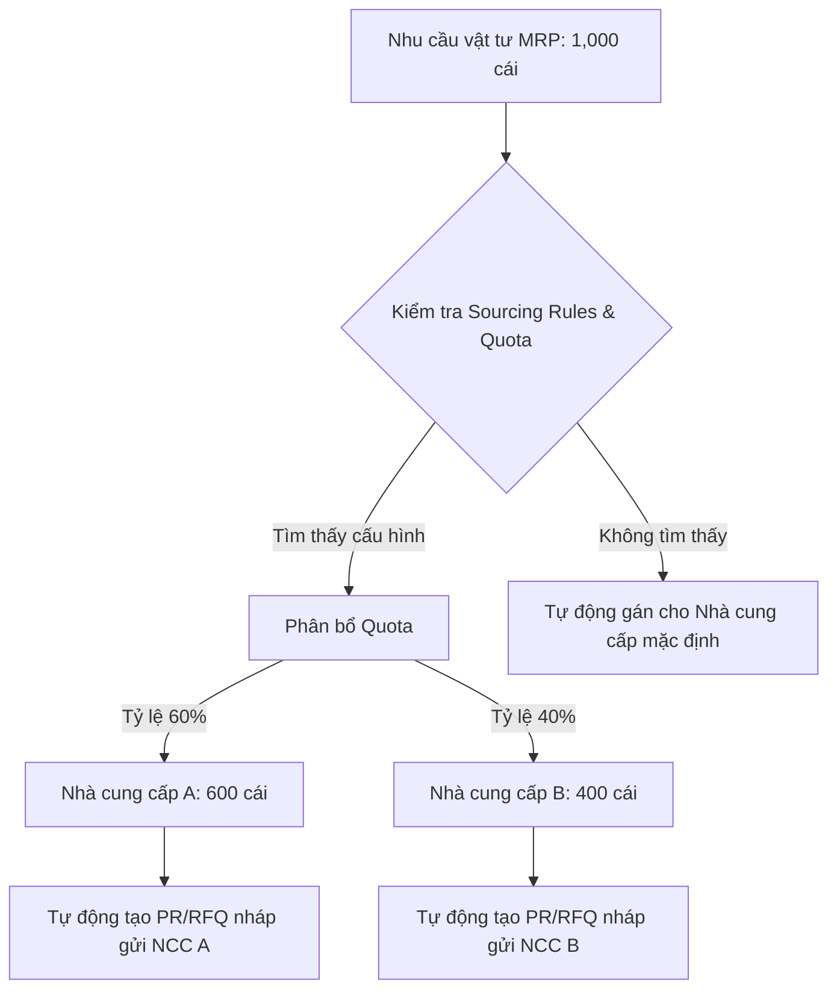

# 2020 Quy tắc xác định nguồn cung và phân bổ tỷ lệ

Trong một doanh nghiệp sản xuất quy mô lớn, việc phụ thuộc vào một nhà cung cấp duy nhất cho các nguyên vật liệu cốt lõi tiềm ẩn rủi ro đứt gãy chuỗi cung ứng rất lớn. Quy tắc xác định nguồn cung (Sourcing Rules) và phân bổ tỷ lệ mua sắm (Quota Arrangement / Allocation) giúp tự động hóa khâu phân bổ nhu cầu, cân bằng năng lực cung ứng của các đối tác khi chạy tính toán nhu cầu vật tư tự động (MRP).

---

## 1. Khái niệm cốt lõi về Sourcing Rules & Quota Arrangement

*   **Quy tắc xác định nguồn cung (Sourcing Rules):** Định nghĩa cách thức hệ thống lấy hàng hóa cho một nhà máy/kho cụ thể. Các phương thức bao gồm:
    *   *Buy From (Mua từ):* Mua từ một hoặc nhiều nhà cung cấp bên ngoài.
    *   *Transfer From (Điều chuyển từ):* Chuyển từ một nhà máy/kho nội bộ khác sang.
    *   *Make At (Sản xuất tại):* Tự sản xuất tại nhà máy hiện tại.
*   **Phân bổ tỷ lệ mua sắm (Quota Arrangement / Allocation):** Khi một mặt hàng có nhiều nhà cung cấp hợp lệ, quy tắc này xác định tỷ lệ phần trăm phân bổ số lượng đặt hàng cho từng bên (ví dụ: Nhà cung cấp A chiếm 60% tổng lượng nhu cầu, Nhà cung cấp B chiếm 40%).

---

## 2. Luồng vận hành chia tỷ lệ nhu cầu mua hàng tự động

Khi hệ thống chạy tính toán nhu cầu vật tư tự động (MRP) dựa trên kế hoạch sản xuất, ERP sẽ quét qua các quy tắc nguồn cung đã cấu hình để tự động tách một nhu cầu lớn thành nhiều đề xuất mua hàng (Purchase Suggestions / Planned Orders) tương ứng với tỷ lệ phân bổ của từng nhà cung cấp:



---

## 3. Điểm giao thoa & Tham chiếu chéo (Cross-linking) sang các phân hệ khác

Quy tắc nguồn cung là chốt chặn kết nối chặt chẽ giữa chuỗi cung ứng mua hàng và kế hoạch sản xuất:

### A. Liên kết với phân hệ Tồn kho (INV) và Sản xuất (MFG)
*   **Danh mục vật tư:** Các quy tắc nguồn cung luôn gắn chặt với mã vật tư tại [7000 Item Master (thiết lập mã hàng hoá, đơn vị tính)](../../1-kho/2000-item-master-va-thuoc-tinh-kho.md).
*   **Điểm đặt hàng lại (Reorder Point):** Khi lượng tồn kho khả dụng giảm xuống dưới mức tối thiểu được cấu hình tại [7030 Thiết lập điểm đặt hàng lại (Reorder Point / Min-Max)](../../1-kho/2000-item-master-va-thuoc-tinh-kho.md), hệ thống sẽ kích hoạt công cụ đề xuất mua hàng dựa trên Sourcing Rules để bổ sung kho tự động.
*   **Quy trình Điều chuyển nội bộ (Transfer From):** Khi cấu hình nguồn cung dạng `Transfer From`, hệ thống sẽ tự động tạo yêu cầu chuyển kho tại bài [3000 Chuyển kho nội bộ (Inter-warehouse Transfer)](../../1-kho/3000-giao-dich-nhap-xuat-chuyen.md) thay vì tạo đơn mua hàng ngoài.

### B. Liên kết với phân hệ Mua hàng (PO) và Tài chính (FIN)
*   **Xác định đơn giá thỏa thuận:** Nguồn cung sau khi được hệ thống tự động gán sẽ thừa hưởng đơn giá tương ứng từ bài [2010 Bảng giá & Thỏa thuận dài hạn (Blanket PO & Contract)]() [1].

---

## 4. Hướng dẫn luồng thiết lập (Setup Flow) chi tiết trên hệ thống

### A. Trên Oracle EBS R12.2.10

Oracle EBS sử dụng cặp công cụ **Sourcing Rules** và **Assignment Sets** để điều khiển luồng xác định nguồn cung.

1.  **Thiết lập Quy tắc nguồn cung (Sourcing Rules):**
    *   *Đường dẫn:* `Purchasing Super User > Supply Base > Sourcing Rules`
    *   *Nghiệp vụ:* Tạo mới quy tắc, nhập tên quy tắc và xác định phạm vi áp dụng (Global hoặc Local).
2.  **Cấu hình phân bổ và gán Tỷ lệ (Quota Allocation):**
    *   *Nghiệp vụ:* Tại tab `Receiving Org`, chọn nhà máy/kho nhận hàng. Tại phần `Source`, chọn phương thức `Buy From` và gán mã nhà cung cấp, thiết lập giá trị ưu tiên (`Rank`) và tỷ lệ phần trăm phân bổ (`% Allocation`).
3.  **Áp dụng quy tắc vào Assignment Set:**
    *   *Đường dẫn:* `Purchasing Super User > Supply Base > Assign Sourcing Rules`
    *   *Nghiệp vụ:* Chọn Assignment Set đang hoạt động của hệ thống. Khai báo mức độ gán (ví dụ: gán cho cụ thể 1 `Item` hoặc gán theo `Item Category`), chọn mã vật tư và liên kết với Sourcing Rule vừa tạo ở Bước 1.

### B. Trên Epicor ERP

Epicor quản lý nguồn cung thông qua tính năng **Approved Supplier List (ASL)** kết hợp với logic ưu tiên của động cơ chạy nhu cầu MRP.

1.  **Thiết lập nhà cung cấp được phê duyệt (Approved Supplier List):**
    *   *Đường dẫn:* `Material Management > Purchase Management > Setup > Approved Supplier List`
    *   *Nghiệp vụ:* Khai báo danh mục các nhà cung cấp được phép cung ứng đối với từng mã vật tư (`Part Num`). Gán mức độ ưu tiên và thời gian hiệu lực cho từng nhà cung cấp.
2.  **Cấu hình thời gian mua hàng và giá mặc định:**
    *   *Đường dẫn:* `Material Management > Purchase Management > Setup > Supplier Price List`
    *   *Nghiệp vụ:* Khai báo thời gian sản xuất và giao hàng của nhà cung cấp (`Lead Time`). Công cụ chạy nhu cầu MRP của Epicor sẽ ưu tiên chọn nhà cung cấp có Lead Time ngắn nhất hoặc đơn giá thấp nhất trong danh sách ASL khi tự động tạo đề xuất mua hàng (`PO Suggestions`).

---

## 5. Truy vấn SQL đối soát cấu trúc tổ chức (SQL Database Audit Queries)

### A. Cho Oracle EBS R12.2.10

Query dưới đây truy vấn chi tiết các quy tắc nguồn cung (Sourcing Rules) đang được gán cho từng vật tư trong hệ thống, bao gồm tỷ lệ phần trăm phân bổ và thứ tự ưu tiên (Rank):

```sql
SELECT 
    mas.assignment_set_name      AS assignment_set,
    msr.sourcing_rule_name       AS sourcing_rule_name,
    msia.assignment_type_name    AS assignment_level,
    msib.segment1                AS item_code,
    aps.segment1                 AS vendor_number,
    hp.party_name                AS vendor_name,
    msso.allocation_percent      AS allocation_percentage,
    msso.rank                    AS sourcing_rank
FROM 
    mrp_sourcing_rules msr
INNER JOIN 
    mrp_sr_receipt_org msro ON msr.sourcing_rule_id = msro.sourcing_rule_id
INNER JOIN 
    mrp_sr_source_org msso ON msro.sr_receipt_id = msso.sr_receipt_id
INNER JOIN 
    mrp_sr_assignments msa ON msr.sourcing_rule_id = msa.sourcing_rule_id
INNER JOIN 
    mrp_assignment_sets mas ON msa.assignment_set_id = mas.assignment_set_id
INNER JOIN 
    mrp_sr_assignment_v msia ON msa.assignment_id = msia.assignment_id
LEFT JOIN 
    ap_suppliers aps ON msso.vendor_id = aps.vendor_id
LEFT JOIN 
    hz_parties hp ON aps.party_id = hp.party_id
LEFT JOIN 
    mtl_system_items_b msib ON msa.inventory_item_id = msib.inventory_item_id 
                            AND msib.organization_id = msa.organization_id
ORDER BY 
    mas.assignment_set_name, msr.sourcing_rule_name, msso.rank;
```

### B. Cho Epicor ERP (Truy vấn cơ sở dữ liệu SQL Server)

Query dưới đây kiểm kê danh sách nhà cung cấp được duyệt (ASL) đối với từng mặt hàng để đối soát thông tin Lead Time và phân cấp ưu tiên mua sắm:

```sql
SELECT 
    vp.Company,
    vp.PartNum                    AS Part_Number,
    v.VendorID                    AS Vendor_ID,
    v.Name                        AS Vendor_Name,
    vp.LeadTime                   AS Lead_Time_Days,
    vp.BaseUnitPrice              AS Current_Unit_Price,
    vp.PurchasePoint              AS Purchase_Point
FROM 
    Erp.VendPart vp
INNER JOIN 
    Erp.Vendor v ON vp.Company = v.Company AND vp.VendorID = v.VendorID
WHERE 
    vp.Company = 'YOUR_COMPANY_CODE'
ORDER BY 
    vp.PartNum, vp.LeadTime;
```

---

## 6. Kinh nghiệm thực tế khi thiết lập (Best Practices & Pitfalls)

1.  **Lỗi không gán Sourcing Rule vào Assignment Set:**
    *   *Sự cố:* Người dùng tạo mới Sourcing Rule chi tiết và phân bổ tỷ lệ phần trăm chính xác, nhưng khi chạy MRP, hệ thống hoàn toàn bỏ qua cấu hình này và báo lỗi không tìm thấy nguồn cung.
    *   *Nguyên nhân:* Sourcing Rule mới tạo chưa được gán vào `Assignment Set` đang hoạt động (Active Assignment Set) trong phần thiết lập tham số hệ thống (System Profile Option `MRP: Default Sourcing Assignment Set`).
    *   *Giải pháp:* Luôn kiểm tra lại bước gán (Assignment) cuối cùng sau khi tạo mới bất kỳ quy tắc nguồn cung nào.
2.  **Xử lý sai lệch số lượng do chia tỷ lệ lẻ:**
    *   *Khuyến nghị:* Khi chia tỷ lệ nhu cầu mua hàng (ví dụ: chia 60% cho NCC A và 40% cho NCC B), nếu số lượng nhu cầu phát sinh từ MRP quá nhỏ hoặc là số lẻ (ví dụ: cần mua 1 cái), hệ thống sẽ gán toàn bộ số lượng này cho nhà cung cấp có mức ưu tiên cao hơn (Rank 1) để tránh việc tạo ra các đơn hàng lẻ không đáp ứng được số lượng đặt hàng tối thiểu (MOQ) của nhà cung cấp.
3.  **Tận dụng Sourcing Rules để kiểm soát chuỗi cung ứng đa nhà máy:**
    *   Đối với mô hình tập đoàn đa nhà máy, sử dụng linh hoạt quy tắc `Transfer From` để ưu tiên tiêu thụ lượng tồn kho dư thừa tại các nhà máy vệ tinh trước khi kích hoạt lệnh `Buy From` để mua mới từ nhà cung cấp ngoài, giúp giảm thiểu đáng kể chi phí tồn kho toàn hệ thống.