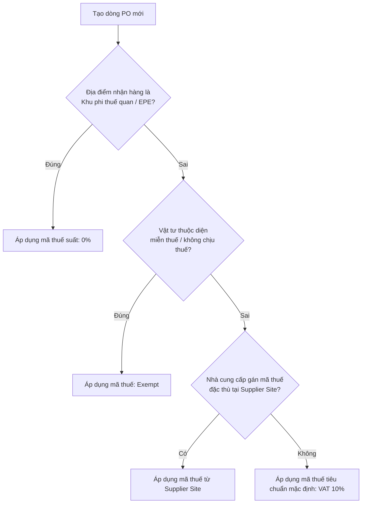

# 2030 Quy tắc thuế đầu vào theo nhà cung cấp và vật tư

Việc xác định thuế suất thuế giá trị gia tăng (GTGT/VAT) đầu vào chính xác trên Đơn mua hàng (PO) đóng vai trò quyết định để hạch toán đúng nguyên giá tài sản, chi phí sản xuất và công nợ phải trả nhà cung cấp. Cơ chế thiết lập quy tắc tính thuế tự động (Tax Determination Rules) giúp giảm thiểu sai sót thủ công của nhân viên mua hàng và đồng bộ dữ liệu chuẩn xác sang kế toán thuế.

> **Lưu ý ranh giới nghiệp vụ:** Hai phân hệ quản lý hai khía cạnh hoàn toàn khác nhau của cùng một sắc thuế đầu vào. Bài viết này **chỉ** trình bày góc nhìn tác nghiệp giao dịch (PO tự động gán mã thuế nào), **không** đi sâu hạch toán/kê khai — phần đó thuộc phân hệ **Thuế - TAX** bên nhánh Tài chính kế toán (FIN).

### Phân biệt ranh giới SCM-PO và FIN-TAX

| Tiêu chí | Phân hệ Mua hàng (PO/SCM) — Bài viết `2030` này | Phân hệ Thuế (FIN-TAX) — Bài viết bên phân hệ FIN |
|---|---|---|
| **Góc nhìn** | Tác nghiệp giao dịch (Transactional) | Hạch toán & Tuân thủ (Accounting & Compliance) |
| **Câu hỏi cần trả lời** | Làm thế nào để dòng PO tự động gán đúng mã thuế suất 10%, 5% hay 0% dựa trên việc mua cái gì, từ ai và giao ở đâu? | Mã thuế suất này hạch toán vào tài khoản Sổ cái (GL) nào? Luân chuyển dòng tiền thuế ra sao? Khai báo tờ khai thuế (VAT Return) gửi cơ quan thuế như thế nào? |
| **Đối tượng sử dụng** | Nhân viên mua hàng (Buyer), Thủ kho, Trưởng phòng mua sắm | Kế toán thuế, Kế toán trưởng, Giám đốc tài chính |
| **Nội dung cấu hình** | Gán mã phân loại thuế cho Vật tư (Item Tax Category), gán Nghĩa vụ thuế cho Nhà cung cấp (Tax Liability), và địa bàn tính thuế (Tax Jurisdiction) | Cấu hình Sơ đồ thuế (Tax Regimes), Thuế suất (Tax Rates), Tài khoản định khoản thuế Sổ cái (GL Tax Accounts), và thiết lập báo cáo/tờ khai thuế định kỳ |

---

## 1. Khái niệm cốt lõi về Quy tắc xác định Thuế đầu vào

* **Mã thuế đầu vào (Input Tax Code / Rate):** Định nghĩa phần trăm thuế suất áp dụng khi mua hàng hóa/dịch vụ (ví dụ: VAT 10%, VAT 5%, VAT 0%, Không chịu thuế).
* **Quy tắc xác định thuế (Tax Determination Rules):** Công cụ logic của ERP tự động quét qua các thuộc tính của giao dịch mua sắm để đưa ra mã thuế phù hợp. Ba yếu tố chi phối chính bao gồm:
  * *Địa điểm nhận hàng (Ship-to Location / Delivery Place):* Chi phối chính sách thuế vùng miền hoặc xuất nhập khẩu.
  * *Phân loại vật tư (Product Fiscal Classification):* Xác định mặt hàng đó có thuộc diện ưu đãi thuế hay chịu thuế suất đặc biệt không.
  * *Địa điểm/Thông tin nhà cung cấp (Ship-from / Supplier Tax Profile):* Xác định nhà cung cấp thuộc đối tượng chịu thuế nào (ví dụ: Doanh nghiệp chế xuất EPE, Nhà cung cấp nước ngoài).

---

## 2. Công cụ logic xác định mã thuế đầu vào trên PO (Tax Hierarchy)

Khi nhân viên mua hàng khởi tạo một dòng trên đơn PO, hệ thống sẽ thực thi logic kiểm tra tự động theo thứ tự phân cấp dưới đây để gán mã thuế GTGT đầu vào:



---

## 3. Điểm giao thoa & Tham chiếu chéo (Cross-linking) sang các phân hệ khác

Cấu hình thuế đầu vào là cầu nối trực tiếp giữa phân hệ mua hàng và phân hệ hạch toán tài chính:

### A. Liên kết với phân hệ Tồn kho (INV)

* **Phân loại thuế của vật tư:** Mã vật tư được cấu hình nhóm phân loại thuế tại [7000 Item Master (thiết lập mã hàng hoá, đơn vị tính)](../inv-ton-kho/7000-thiet-lap-danh-muc-item-master.md) hoặc gán nhóm thuế tại [7020 Nhóm hàng hoá / danh mục vật tư (Item Category)](../inv-ton-kho/7020-nhom-hang-hoa-danh-muc-vat-tu-item-category.md) để làm căn cứ xác định thuế suất tự động .
* **Kho bãi nhận hàng:** Vị trí nhận hàng thực tế tại [3020 Quản lý nhiều kho, nhiều địa điểm (Multi-warehouse)](../inv-ton-kho/3020-quan-ly-nhieu-kho-nhieu-dia-diem-multi-warehouse.md) quyết định địa bàn/vùng tính thuế (Tax Jurisdiction) .

### B. Liên kết với phân hệ Tài chính kế toán (FIN)

* **Hạch toán thuế Sổ cái:** Mã thuế đầu vào được liên kết trực tiếp với tài khoản khấu trừ thuế mặc định (Tài khoản 133 tại Việt Nam) được định nghĩa tại phân hệ **Thuế - TAX** {/* TODO: link khi có bài fin-thue */}. Khi ghi nhận hóa đơn tại bài [3000 Ghi nhận hóa đơn nhà cung cấp từ đơn mua hàng (AP Invoice Match)](), hệ thống sẽ tự động tách phần tiền thuế hạch toán vào tài khoản này [1].

---

## 4. Hướng dẫn luồng thiết lập (Setup Flow) chi tiết trên hệ thống

### A. Trên Oracle EBS R12.2.10 (e-Business Tax)

Oracle EBS sử dụng phân hệ tập trung **e-Business Tax (EB-Tax)** để quản lý toàn bộ logic tính thuế của tập đoàn.

1. **Thiết lập Tax Regime & Tax:**
   * *Đường dẫn:* `Tax Manager > Setup > Regimes` và `Taxes`
   * *Nghiệp vụ:* Tạo mới Tax Regime đại diện cho luật thuế quốc gia (ví dụ: `VN_VAT`). Định nghĩa loại thuế (`VN_VAT_IN`).
2. **Thiết lập trạng thái thuế (Tax Status) và thuế suất (Tax Rates):**
   * *Đường dẫn:* `Tax Manager > Setup > Tax Statuses` và `Tax Rates`
   * *Nghiệp vụ:* Tạo trạng thái thuế (ví dụ: `STANDARD_IN`). Tạo mã thuế suất cụ thể (ví dụ: `VAT_10%_IN` với tỷ lệ `10%`, liên kết với tài khoản khấu trừ thuế GTGT đầu vào).
3. **Cấu hình quy tắc gán thuế tự động (Tax Rules):**
   * *Đường dẫn:* `Tax Manager > Setup > Tax Rules`
   * *Nghiệp vụ:* Cấu hình quy tắc mặc định (Default Tax Rules). Nếu nhà cung cấp có thuộc tính là `EPE` (Doanh nghiệp chế xuất) và vị trí nhận hàng là nhà máy của EPE, hệ thống tự động gán mã thuế suất `VAT_0%_IN`.

### B. Trên Epicor ERP

Epicor quản lý thuế thông qua mã thuế (`Tax Code`) và nhóm phân loại thuế của vật tư (`Tax Category`).

1. **Thiết lập Mã thuế đầu vào (Tax Code Setup):**
   * *Đường dẫn:* `Financial Management > Tax Liability > Setup > Tax Code`
   * *Nghiệp vụ:* Tạo mã thuế mới (ví dụ: `VAT10`). Nhập tỷ lệ thuế suất (`10%`), chọn loại thuế là thuế đầu vào (Purchasing Tax) và gán tài khoản sổ cái hạch toán thuế (`Asset Account`).
2. **Thiết lập nhóm thuế cho vật tư (Tax Category):**
   * *Đường dẫn:* `Material Management > Purchase Management > Setup > Tax Category`
   * *Nghiệp vụ:* Định nghĩa các nhóm thuế vật tư (ví dụ: `TAXABLE` - chịu thuế tiêu chuẩn, `EXEMPT` - miễn thuế). Gán nhóm này vào trường Tax Category trong Part Maintenance.
3. **Gán nghĩa vụ thuế cho nhà cung cấp (Tax Liability):**
   * *Đường dẫn:* `Financial Management > Tax Liability > Setup > Tax Liability`
   * *Nghiệp vụ:* Gán mã nghĩa vụ thuế mặc định cho từng Supplier (ví dụ: `VN_DOMESTIC` chịu VAT thông thường, `IMPORT` chịu thuế nhập khẩu và VAT hàng nhập khẩu).

---

## 5. Truy vấn SQL đối soát cấu trúc tổ chức (SQL Database Audit Queries)

### A. Cho Oracle EBS R12.2.10

Query dưới đây truy vấn danh sách toàn bộ các mã thuế suất đầu vào đang hoạt động trên hệ thống, kèm trạng thái thuế và tài khoản kế toán khấu trừ thuế liên kết:

```sql
SELECT 
    ztb.tax_regime_code           AS tax_regime,
    ztb.tax                       AS tax_code,
    zsb.tax_status_code           AS tax_status,
    zrb.tax_rate_code             AS tax_rate_code,
    zrb.percentage_rate           AS tax_percentage,
    zrb.effective_from            AS effective_start,
    zrb.effective_to              AS effective_end,
    zrb.active_flag               AS is_active
FROM 
    zx_rates_b zrb
INNER JOIN 
    zx_taxes_b ztb ON zrb.tax_id = ztb.tax_id
INNER JOIN 
    zx_status_b zsb ON zrb.tax_status_id = zsb.tax_status_id
WHERE 
    zrb.active_flag = 'Y'
    AND TRUNC(SYSDATE) BETWEEN NVL(zrb.effective_from, TRUNC(SYSDATE)) AND NVL(zrb.effective_to, TRUNC(SYSDATE))
ORDER BY 
    ztb.tax_regime_code, ztb.tax, zrb.tax_rate_code;
```

### B. Cho Epicor ERP (Truy vấn cơ sở dữ liệu SQL Server)

Query dưới đây kết xuất danh mục mã thuế và tài khoản hạch toán khấu trừ thuế đầu vào đang hoạt động trong Epicor:

```sql
SELECT 
    tc.Company,
    tc.TaxCode                    AS Tax_Code,
    tc.Description                AS Tax_Description,
    tc.TaxRate                    AS Tax_Rate_Percentage,
    tc.AssetAcct                  AS Input_Tax_GL_Account,
    tc.LiabilityAcct              AS Output_Tax_GL_Account
FROM 
    Erp.TaxCode tc
WHERE 
    tc.Company = 'YOUR_COMPANY_CODE'
ORDER BY 
    tc.TaxCode;
```

---

## 6. Kinh nghiệm thực tế khi thiết lập (Best Practices & Pitfalls)

1. **Lỗi không gán tài khoản thuế mặc định cho mã thuế mới:**
   * *Sự cố:* Người dùng tạo mới mã thuế suất trên hệ thống và sử dụng thành công trên màn hình nhập PO. Tuy nhiên, khi sang phân hệ AP để chạy luồng đối soát hóa đơn [3000 Ghi nhận hóa đơn nhà cung cấp từ đơn mua hàng (AP Invoice Match)](), hệ thống báo lỗi nghiêm trọng không thể định khoản (Posting Error) do không tìm thấy tài khoản hạch toán thuế đầu vào.
   * *Giải pháp:* Quy trình cấu hình mã thuế mới luôn yêu cầu bộ phận kế toán thuế kiểm tra và gán đúng tài khoản định khoản (Tài khoản 133) tương ứng với từng mã thuế suất trước khi kích hoạt.
2. **Quản lý thay đổi thuế suất đột xuất (như chính sách giảm thuế VAT từ 10% xuống 8%):**
   * *Khuyến nghị:* Tuyệt đối không sửa trực tiếp tỷ lệ thuế suất từ `10%` thành `8%` trên mã thuế cũ. Việc này sẽ làm sai lệch dữ liệu lịch sử của tất cả các PO đã hoàn thành trước đó.
   * *Giải pháp:* Tạo một mã thuế suất mới hoàn toàn (ví dụ: `VAT_8%_IN`), khai báo ngày hiệu lực bắt đầu và đồng thời cập nhật ngày hết hạn hiệu lực của mã thuế suất cũ (`VAT_10%_IN`).
3. **Tách biệt Thuế GTGT thông thường và Thuế nhà thầu (Withholding Tax):**
   * Cần phân biệt rõ Thuế GTGT đầu vào thông thường (do người mua trả cho nhà cung cấp để họ nộp hộ) và Thuế nhà thầu khấu trừ tại nguồn (Withholding Tax - doanh nghiệp giữ lại một phần tiền thanh toán của nhà cung cấp nước ngoài để tự đi nộp cho cơ quan thuế). Hai loại thuế này có cơ chế hạch toán và luồng giao dịch hoàn toàn khác nhau.