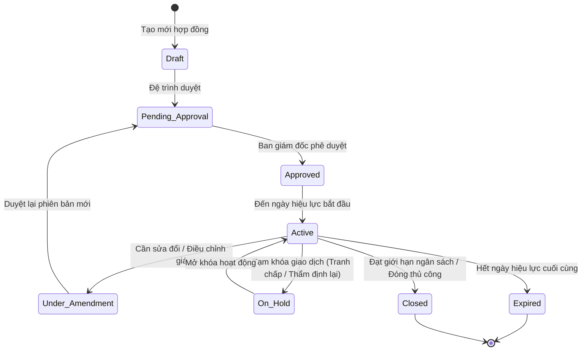

# 2040 Quản lý hợp đồng và thỏa thuận khung (Contract Lifecycle)

Hợp đồng thương mại và Thỏa thuận mua hàng khung (BPA/CPA) là cơ sở pháp lý để kiểm soát đơn giá, số lượng và tổng ngân sách mua sắm hàng năm. Việc quản lý vòng đời hợp đồng (Contract Lifecycle Management - CLM) trên hệ thống ERP giúp doanh nghiệp kiểm soát chặt chẽ quá trình sửa đổi điều khoản đơn giá (Amendment), gia hạn thời gian hiệu lực (Renewal) và tự động chặn các đơn mua hàng vượt quá ngân sách cam kết.

---

## 1. Khái niệm cốt lõi trong Quản lý Vòng đời Hợp đồng (CLM)

Một thỏa thuận mua hàng dài hạn khi vận hành trên hệ thống ERP sẽ đi qua các trạng thái và quy trình kiểm soát sau:

* **Sửa đổi hợp đồng (Contract Amendment / Revision):** Quá trình thay đổi các điều khoản cốt lõi của hợp đồng đang hoạt động (ví dụ: tăng/giảm đơn giá của mặt hàng, bổ sung thêm mã vật tư mới vào danh mục hợp đồng). Quá trình này bắt buộc phải sinh ra một số phiên bản mới (`Revision Number`) và chạy lại luồng phê duyệt từ đầu.
* **Gia hạn hợp đồng (Contract Renewal):** Kéo dài thời gian hiệu lực của hợp đồng (start/end date) khi hợp đồng cũ sắp hết hạn, thường đi kèm với việc cập nhật lại hạn mức ngân sách mới cho kỳ tiếp theo.
* **Kiểm soát ngân sách tiêu dùng (Contract Consumption Tracking):** Hệ thống tự động tích lũy số lượng và giá trị của các đơn mua hàng Standard PO con đã rút ra từ hợp đồng khung để đối chiếu và cảnh báo hoặc chặn giao dịch khi vượt quá hạn mức cam kết tối đa của hợp đồng mẹ.

---

## 2. Sơ đồ trạng thái vòng đời của thỏa thuận mua sắm khung

Một chứng từ hợp đồng mua sắm (BPA/CPA) được quản lý chặt chẽ theo các bước chuyển đổi trạng thái (State Machine) dưới đây:



---

## 3. Điểm giao thoa & Tham chiếu chéo (Cross-linking) sang các phân hệ khác

Hợp đồng mua sắm dài hạn chi phối trực tiếp đến các giao dịch mua sắm tác nghiệp và tài chính phát sinh:

### A. Liên kết với phân hệ Mua hàng (PO) và Tồn kho (INV)

* **Tham chiếu đơn giá tự động:** Các đơn mua hàng con Standard PO khi khởi tạo sẽ đối chiếu trực tiếp thời gian hiệu lực của hợp đồng tại bài [2010 Bảng giá & Thỏa thuận dài hạn (Blanket PO & Contract)](./2010-thiet-lap-bang-gia-nha-cung-cap-va-thoa-thuan-mua-hang.md) để tự động gán đơn giá thỏa thuận.
* **Quản lý danh mục vật tư:** Các mặt hàng ký kết trong hợp đồng khung phải được quản lý tập trung tại [7000 Item Master (thiết lập mã hàng hoá, đơn vị tính)](../inv-ton-kho/7000-thiet-lap-danh-muc-item-master.md).

### B. Liên kết với phân hệ Tài chính kế toán (FIN)

* **Quản lý tạm ứng hợp đồng (Down Payment):** Các khoản tiền đặt cọc hoặc tạm ứng theo điều khoản hợp đồng được theo dõi và hạch toán tại phân hệ [Công nợ phải trả - AP]() thông qua bài viết [3040 Tất toán khoản tạm ứng nhà cung cấp (AP Down Payment Clearing)]().
* **Áp dụng đơn giá hồi tố (Retroactive Pricing):** Khi có sự điều chỉnh giá hợp đồng (Amendment), hệ thống hỗ trợ quét lại các Standard PO hoặc phiếu nhận kho chưa hóa đơn tại phân hệ [Tồn kho (INV)]() để điều chỉnh lại giá trị tài sản trước khi kế toán AP thực hiện đối soát hóa đơn.

---

## 4. Hướng dẫn luồng thiết lập (Setup Flow) chi tiết trên hệ thống

### A. Trên Oracle EBS R12.2.10 (BPA/CPA Revision & Change History)

1. **Thực hiện Sửa đổi hợp đồng (BPA Amendment):**
   * *Đường dẫn:* `Purchasing Super User > Purchase Orders > Purchase Orders`
   * *Nghiệp vụ:* Mở Blanket Purchase Agreement (BPA) đang ở trạng thái `Approved`. Thực hiện thay đổi thông tin (ví dụ: tăng đơn giá dòng hoặc kéo dài ngày hết hạn `End Date`).
2. **Kiểm soát số phiên bản (Revision Number):**
   * *Nghiệp vụ:* Ngay khi người dùng thực hiện thay đổi và lưu lại, hệ thống tự động nâng số phiên bản (`Revision Number` từ `0` lên `1`). Trạng thái chứng từ chuyển từ `Approved` về `Requires Reapproval`.
3. **Cấu hình cập nhật giá hồi tố (Retroactive Pricing):**
   * *Đường dẫn:* Tại màn hình header của BPA, chọn nút `Terms` → Thiết lập thuộc tính `Allow Retroactive Pricing` là `Y`.
   * *Nghiệp vụ:* Khi giá BPA mới được duyệt, hệ thống sẽ tự động chạy chương trình `Retroactive Price Update` để cập nhật lại giá cho các đơn PO con đang mở chưa xuất hóa đơn.

### B. Trên Epicor ERP (Contract Renewal & Consumption Control)

1. **Gia hạn hiệu lực hợp đồng (Blanket PO Renewal):**
   * *Đường dẫn:* `Material Management > Purchase Management > General Operations > Purchase Order Entry`
   * *Nghiệp vụ:* Tìm kiếm Blanket PO cần gia hạn. Tại tab `Header`, cập nhật lại ngày hết hạn mới (`Expiration Date`).
2. **Thiết lập cảnh báo vượt hạn mức (Amount Control):**
   * *Nghiệp vụ:* Tại tab `PODetail`, thiết lập giá trị tổng cam kết phê duyệt tối đa (`Total Approved Amount`). Tích chọn thuộc tính `Lock Price` và `Restrict To Contract` để hệ thống tự động ngăn chặn việc tạo thêm các dòng PO Release con vượt quá giá trị hợp đồng mẹ.

---

## 5. Truy vấn SQL đối soát cấu trúc tổ chức (SQL Database Audit Queries)

### A. Cho Oracle EBS R12.2.10

Query dưới đây truy vấn toàn bộ các Thỏa thuận mua sắm khung (BPA/CPA), hiển thị số phiên bản sửa đổi hiện tại (`revision_num`), tổng ngân sách cam kết, và tổng số tiền đã tiêu dùng thực tế (được rút ra bởi các PO con):

```sql
SELECT 
    hou.name                      AS operating_unit,
    pha.segment1                  AS agreement_number,
    pha.type_lookup_code          AS agreement_type,    -- Thêm loại thỏa thuận để phân biệt Blanket/Contract
    pha.revision_num              AS current_revision,
    pha.start_date                AS start_date,
    pha.end_date                  AS end_date,
    aps.segment1                  AS vendor_number,
    hp.party_name                 AS vendor_name,
    pha.blanket_total_amount      AS total_agreed_amount,
    -- Tính tổng số tiền đã tiêu dùng thực tế từ các Standard PO con liên kết
    (
        SELECT SUM(plla.quantity * plla.price_override) 
        FROM po_line_locations_all plla 
        WHERE plla.from_header_id = pha.po_header_id
    )                             AS consumed_amount,
    pha.approved_flag             AS is_approved,
    pha.closed_code               AS status
FROM 
    po_headers_all pha
INNER JOIN 
    ap_suppliers aps ON pha.vendor_id = aps.vendor_id
INNER JOIN 
    hz_parties hp ON aps.party_id = hp.party_id
INNER JOIN 
    hr_operating_units hou ON pha.org_id = hou.organization_id
WHERE 
    pha.type_lookup_code IN ('BLANKET', 'CONTRACT') -- Thay đổi cấu trúc điều kiện lỗi tại đây
ORDER BY 
    pha.segment1;
```

### B. Cho Epicor ERP (Truy vấn cơ sở dữ liệu SQL Server)

Query dưới đây kiểm kê danh sách các Blanket PO trong Epicor, so sánh giữa số lượng cam kết tối đa trên dòng hợp đồng (`Approved_Qty`) với tổng số lượng thực tế đã được Buyer tạo đơn giải phóng nhận hàng (`Consumed_Qty`):

```sql
SELECT 
    pd.Company,
    pd.PONum                      AS Blanket_PO_Num,
    pd.POLine                     AS Line_Num,
    pd.PartNum                    AS Part_Number,
    pd.LineDesc                   AS Description,
    pd.DocUnitCost                AS Unit_Cost,
    pd.BaseQty                    AS Approved_Qty, -- Tổng số lượng cam kết trên hợp đồng mẹ
    -- Tính tổng số lượng đã giải phóng (rút hàng) từ bảng PORel
    (
        SELECT SUM(pr.RelQty) 
        FROM Erp.PORel pr 
        WHERE pr.Company = pd.Company 
          AND pr.PONum = pd.PONum 
          AND pr.POLine = pd.POLine
    )                             AS Consumed_Qty,
    ph.Approve                    AS Is_Approved,
    ph.ApprovalStatus             AS Approval_Status
FROM 
    Erp.PODetail pd
INNER JOIN 
    Erp.POHeader ph ON pd.Company = ph.Company AND pd.PONum = ph.PONum
WHERE 
    ph.POType = 'B' -- Blanket PO
    AND ph.Company = 'YOUR_COMPANY_CODE'
ORDER BY 
    pd.PONum, pd.POLine;
```

---

## 6. Kinh nghiệm thực tế khi thiết lập (Best Practices & Pitfalls)

1. **Chặn rò rỉ ngân sách do thiếu kiểm soát Over-Shipment:**
   * *Sự cố:* Hợp đồng khung cam kết mua tối đa 10,000 cái. Buyer tạo các đơn PO con vừa khít 10,000 cái. Tuy nhiên, thủ kho khi nhận hàng tại phân hệ INV lại cho phép nhận dư vượt định mức (Over-shipment tolerance) lên đến 10% (nhập kho 11,000 cái). Điều này khiến tổng giá trị thực nhận vượt quá ngân sách hợp đồng đã duyệt.
   * *Giải pháp:* Luôn cấu hình thuộc tính kiểm soát dung sai nhận hàng dư (Receiving Tolerance) đồng bộ với hạn mức tối đa của hợp đồng khung.
2. **Quy trình quản lý phê duyệt lại khi Amendment:**
   * *Khuyến nghị:* Để tránh việc làm gián đoạn chuỗi cung ứng, cấu hình hệ thống phân loại mức độ thay đổi khi Amendment:
     * *Sửa đổi nhỏ (Minor Change - ví dụ: sửa ngày giao hàng, sửa ghi chú):* Tự động phê duyệt lại (Auto-Approve).
     * *Sửa đổi lớn (Major Change - ví dụ: thay đổi đơn giá tăng, tăng giá trị hợp đồng):* Bắt buộc phải chuyển tiếp chạy lại luồng phê duyệt duyệt ký từ đầu.
3. **Cảnh báo thời gian hết hạn hợp đồng trước 30-60 ngày:**
   * *Khuyến nghị:* Cấu hình công cụ gửi email tự động (Alert/Notification) nhắc nhở Buyer phụ trách trước khi hợp đồng hết hạn hiệu lực (`End Date` / `Expiration Date`) từ 30 đến 60 ngày để họ chủ động thực hiện quy trình đàm phán lại đơn giá và làm thủ tục gia hạn (Renewal) trên hệ thống, tránh việc gián đoạn tạo đơn mua hàng tác nghiệp.