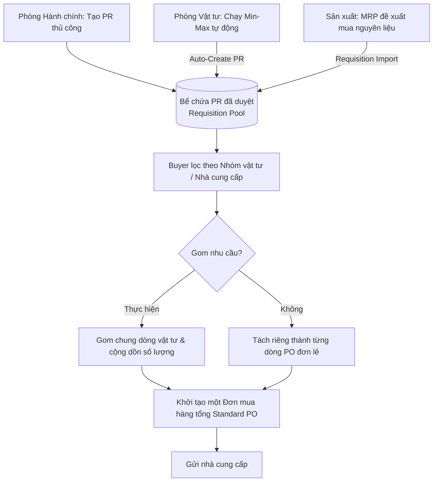

# 3000 Yêu cầu mua sắm và quy trình gom nhu cầu (PR & Consolidation)

Quy trình mua sắm trong doanh nghiệp luôn bắt đầu bằng việc phát sinh nhu cầu. Yêu cầu mua hàng (Purchase Requisition - PR) là chứng từ nội bộ đóng vai trò thu thập, kiểm soát ngân sách ban đầu của nhu cầu đó. Nghiệp vụ gom nhu cầu mua sắm (PR Consolidation) cho phép bộ phận mua sắm tập hợp các yêu cầu lẻ tẻ từ nhiều phòng ban/nhà máy để tiến hành đàm phán số lượng lớn với nhà cung cấp, giúp tối ưu hóa chi phí mua hàng và giảm thiểu số lượng đơn hàng PO nhỏ lẻ.

---

## 1. Khái niệm cốt lõi trong Nghiệp vụ PR & Gom nhu cầu

*   **Yêu cầu mua hàng (Purchase Requisition - PR):** Chứng từ nội bộ phi tài chính (không phát sinh bút toán Nợ/Có sổ cái) thể hiện nhu cầu sử dụng vật tư/dịch vụ của một nhân viên, phòng ban hoặc nhà máy. PR bao gồm:
    *   *PR thủ công (Manual PR):* Do người dùng chủ động tạo ra khi phát sinh nhu cầu đột xuất hoặc mua sắm hành chính (MRO/Indirect).
    *   *PR tự động (Automatic PR / Requisition Import):* Do hệ thống tự động sinh ra khi chạy kế hoạch nhu cầu vật tư (MRP) hoặc điểm đặt hàng lại kho (Min-Max) [1].
*   **Gom nhu cầu mua sắm (PR Consolidation / Demand Aggregation):** Quy trình gom các dòng yêu cầu (PR Lines) đã phê duyệt của cùng một mặt hàng (hoặc cùng nhóm mặt hàng) từ nhiều phòng ban khác nhau để tạo thành một Đơn mua hàng (Standard PO) duy nhất gửi cho nhà cung cấp [1].

---

## 2. Quy trình gom nhu cầu PR từ nhiều nguồn thành một Đơn mua hàng tổng

Dưới đây là sơ đồ luồng dữ liệu biểu diễn cách hệ thống thu thập nhu cầu tự động từ các phân hệ và quy trình gom nhu cầu của nhân viên mua hàng:



---

## 3. Điểm giao thoa & Tham chiếu chéo (Cross-linking) sang các phân hệ khác

Yêu cầu mua sắm PR là điểm tiếp nhận và xử lý chéo nhu cầu từ khắp các phân hệ trong doanh nghiệp:

### A. Tiếp nhận nhu cầu từ phân hệ Tồn kho (INV) và Sản xuất (MFG)
*   **Điểm bổ sung kho tự động:** Khi tồn kho xuống dưới mức an toàn, hệ thống tự động khởi tạo PR dựa trên cấu hình tại [7030 Thiết lập điểm đặt hàng lại (Reorder Point / Min-Max)](../inv-ton-kho/7030-thiet-lap-diem-dat-hang-lai-reorder-point-min-max.md).
*   **Mua hàng phục vụ lệnh sản xuất:** Khi lệnh sản xuất dở dang phát sinh nhu cầu mua nguyên vật liệu thầu phụ, hệ thống tự động đẩy yêu cầu mua hàng sang phân hệ PO thông qua luồng [2010 Xuất kho cho sản xuất (Issue for Work Order/BOM)](../inv-ton-kho/2010-xuat-kho-cho-san-xuat-bom.md).

### B. Kiểm soát ban đầu với phân hệ Tài chính (FIN)
*   **Kiểm soát ngân sách bộ phận (Budget Check / Cost Center):** Mỗi PR khi tạo bắt buộc phải gán với một Trung tâm chi phí (Cost Center) hoặc Mã dự án (Project Code) đã định nghĩa tại phân hệ [Sổ cái - GL](). Hệ thống sẽ kiểm tra số dư ngân sách còn lại của phòng ban trước khi cho phép đệ trình phê duyệt [1].

---

## 4. Hướng dẫn luồng thiết lập (Setup Flow) chi tiết trên hệ thống

### A. Trên Oracle EBS R12.2.10 (Autocreate Documents)

Oracle EBS cung cấp công cụ cực kỳ mạnh mẽ mang tên **Autocreate** để giúp Buyer quét và gom các dòng PR thành PO một cách nhanh chóng.

1.  **Nhập PR tự động từ các phân hệ khác (Requisition Import):**
    *   *Đường dẫn:* `Purchasing Super User > Reports > Run`
    *   *Nghiệp vụ:* Chạy chương trình concurrent `Requisition Import` để đồng bộ toàn bộ nhu cầu mua sắm tự động từ phân hệ Inventory (Min-Max) và phân hệ Work in Process (WIP) sang phân hệ PO.
2.  **Sử dụng công cụ Gom nhu cầu Autocreate:**
    *   *Đường dẫn:* `Purchasing Super User > Autocreate`
    *   *Nghiệp vụ:* Mở màn hình Autocreate. Sử dụng bộ lọc tìm kiếm các dòng PR đã phê duyệt theo mã mặt hàng (`Item`), Nhóm mua hàng (`Purchasing Group`) hoặc nhà cung cấp gợi ý (`Suggested Vendor`).
3.  **Tập hợp và Tạo PO tổng:**
    *   *Nghiệp vụ:* Chọn các dòng PR có cùng mã mặt hàng và cùng nhà cung cấp. 
    *   *Tùy chọn gom dòng:* Chọn hành động `Create` với kiểu tài liệu `Standard PO`. Nếu muốn cộng dồn số lượng của cùng một mặt hàng từ nhiều PR khác nhau thành một dòng PO duy nhất, chọn cấu hình `Add To` hoặc gộp dòng (`Consolidate Lines`).

### B. Trên Epicor ERP (PO Suggestions / Requisition Entry)

Epicor tách biệt rõ ràng giữa luồng PR mua sắm hành chính (qua Requisition Entry) và luồng mua sắm phục vụ sản xuất (qua PO Suggestions).

1.  **Sử dụng Requisition Entry (Cho nhu cầu MRO/Indirect):**
    *   *Đường dẫn:* `Material Management > Purchase Management > General Operations > Requisition Entry`
    *   *Nghiệp vụ:* Các phòng ban tự tạo yêu cầu mua sắm. Sau khi PR được duyệt thông qua phân quyền duyệt, PR sẽ tự động đổ về màn hình `PO Entry` hoặc `PO Suggestions` để Buyer xử lý.
2.  **Sử dụng PO Suggestions (Gom nhu cầu tự động của MRP):**
    *   *Đường dẫn:* `Material Management > Purchase Management > General Operations > New PO Suggestions`
    *   *Nghiệp vụ:* Toàn bộ nhu cầu mua sắm từ kế hoạch MRP hoặc Min-Max sẽ hiển thị tại đây dưới dạng các đề xuất mua hàng (`PO Suggestions`). 
    *   *Gom đơn:* Buyer tích chọn các đề xuất của cùng một nhà cung cấp, sử dụng tính năng `Generate PO` để gom tất cả các đề xuất lẻ tẻ thành một đơn Standard PO tổng duy nhất.

---

## 5. Truy vấn SQL đối soát cấu trúc tổ chức (SQL Database Audit Queries)

### A. Cho Oracle EBS R12.2.10

Query dưới đây truy vấn toàn bộ các dòng yêu cầu mua sắm (PR Lines) đã được duyệt nhưng **chưa được chuyển đổi sang PO**, nhóm theo nhà cung cấp gợi ý để phục vụ Buyer thực hiện gom đơn hàng:

```sql
SELECT 
    hou.name                      AS operating_unit,
    prha.segment1                 AS requisition_number,
    prla.line_num                 AS requisition_line,
    msib.segment1                 AS item_code,
    prla.item_description         AS description,
    prla.quantity                 AS request_qty,
    prla.unit_meas_lookup_code    AS uom_name,       -- Tên UOM đầy đủ từ Requisition Line
    muom.uom_code                 AS uom_code,       -- Mã UOM ngắn (Ví dụ: EA, KG, BOX) từ danh mục gốc
    muom.UOM_CLASS                AS uom_class,      -- Nhóm đơn vị tính (Ví dụ: Quantity, Weight, Length)
    muom.UNIT_OF_MEASURE          AS uom_full_name,  -- Tên đầy đủ gốc của đơn vị tính
    muom.UNIT_OF_MEASURE_TL       AS uom_full_name_translated, -- Tên đầy đủ đã dịch theo ngôn ngữ đăng nhập
    prla.unit_price               AS unit_price,
    (prla.quantity * prla.unit_price) AS line_amount,
    prha.creation_date            AS request_date,
    prla.suggested_vendor_name    AS suggested_vendor
FROM 
    po_requisition_headers_all prha
INNER JOIN 
    po_requisition_lines_all prla 
        ON prha.requisition_header_id = prla.requisition_header_id
INNER JOIN 
    hr_operating_units hou 
        ON prha.org_id = hou.organization_id
LEFT JOIN 
    mtl_system_items_b msib 
        ON prla.item_id = msib.inventory_item_id 
       AND msib.organization_id = prla.destination_organization_id
LEFT JOIN 
    mtl_units_of_measure_tl muom                        -- ← Tích hợp bảng danh mục UOM ở đây
        ON prla.unit_meas_lookup_code = muom.unit_of_measure
       AND muom.language = USERENV('LANG')
WHERE 
    prha.authorization_status = 'APPROVED' -- Chỉ quét các PR đã phê duyệt
    AND prla.line_location_id IS NULL -- Điều kiện: Chưa được tạo/gán vào PO
    AND NVL(prla.cancel_flag, 'N') = 'N'
    AND NVL(prla.closed_code, 'OPEN') = 'OPEN'
ORDER BY 
    prla.suggested_vendor_name, prha.creation_date;
```

### B. Cho Epicor ERP (Truy vấn cơ sở dữ liệu SQL Server)

Query dưới đây kiểm kê danh sách các yêu cầu mua sắm (Requisitions) trong Epicor đã được duyệt nhưng chưa gán mã đơn mua hàng (`PONum = 0`):

```sql
SELECT 
    rd.Company,
    rd.ReqNum                     AS Requisition_Num,
    rd.ReqLine                    AS Line_Num,
    rh.Requestor                  AS Requestor_User,
    rd.PartNum                    AS Part_Number,
    rd.LineDesc                   AS Description,
    rd.XOrderQty                  AS Request_Qty,
    rd.VendorNum                  AS Vendor_Number,
    v.Name                        AS Suggested_Vendor,
    rh.CurrentStatus              AS Req_Status
FROM 
    Erp.ReqDetail rd
INNER JOIN 
    Erp.ReqHead rh ON rd.Company = rh.Company AND rd.ReqNum = rh.ReqNum
LEFT OUTER JOIN 
    Erp.Vendor v ON rd.Company = v.Company AND rd.VendorNum = v.VendorNum
WHERE 
    rd.Company = 'YOUR_COMPANY_CODE'
    AND rh.CurrentStatus = 'Approved' -- Đã được phê duyệt
    AND rd.PONum = 0 -- Chưa được gán vào PO con nào
ORDER BY 
    rd.ReqNum, rd.ReqLine;
```

---

## 6. Kinh nghiệm thực tế khi thiết lập (Best Practices & Pitfalls)

1.  **Kiểm soát rủi ro mất dấu vết nguồn gốc PR (Loss of Traceability):**
    *   *Sự cố:* Khi Buyer thực hiện gom nhiều PR dòng lẻ từ các phòng ban khác nhau thành một dòng Standard PO tổng để lấy giá sỉ, hệ thống thường làm mất liên kết tham chiếu ngược. Khi hàng về kho, thủ kho không biết số hàng này thuộc về phòng ban nào để bàn giao.
    *   *Giải pháp:* Luôn bật cấu hình giữ nguyên liên kết tham chiếu chéo (Back-to-back linkage / Requisition Association). Trên đơn PO, tại mỗi dòng phân bổ nhận hàng (`PO Shipment` hoặc `PO Distribution`), bắt buộc phải ghi nhận rõ số PR gốc (`Requisition Number` và `Line Number`) tương ứng.
2.  **Đặt quy tắc làm tròn số lượng khi gom đơn mua sắm:**
    *   *Khuyến nghị:* Khi gom nhu cầu từ nhiều PR khác nhau dẫn đến tổng số lượng lẻ (ví dụ: tổng nhu cầu của 5 phòng ban là 42 cái), hệ thống nên tự động gợi ý làm tròn lên theo quy cách đóng gói tối thiểu (MOQ) của nhà cung cấp từ bài [2010 Bảng giá & Thỏa thuận dài hạn (Blanket PO & Contract)]() (ví dụ: làm tròn lên 50 cái nếu nhà cung cấp đóng thùng 10 cái/thùng). Phần dư thừa (8 cái) sẽ được hạch toán chuyển vào lưu trữ tồn kho an toàn của kho tổng.
3.  **Hạn chế can thiệp thủ công vào luồng PR tự động của MRP:**
    *   Đối với các nguyên vật liệu sản xuất trực tiếp, tuyệt đối tránh việc Buyer tự ý sửa đổi số lượng hoặc xóa bỏ các dòng PR tự động do hệ thống MRP sinh ra. Việc can thiệp thủ công thiếu căn cứ này sẽ gây lệch pha trực tiếp với kế hoạch sản xuất, dẫn đến việc thiếu hụt nguyên vật liệu trên chuyền hoặc gây tồn kho ảo ngoài tầm kiểm soát.